# MealRelay

A full-stack, real-time food delivery and order orchestration platform.

<p>


</p>

<p>


</p>

## Technology Stack and Features

-   ⚡ [**NestJS**](https://nestjs.com/) for the Node.js based backend system.

    -   🔍 [Apollo Server](https://www.apollographql.com/) for the NestJS backend **GraphQL** API provider.
    -   💾 [PostgreSQL](https://www.postgresql.org/) as the SQL database.
    -   🧰 [TypeORM](https://typeorm.io) for a type-supported secure database interactions and model mapping (ORM).
    -   ✨ [TypeScript](https://www.typescriptlang.org/) supporting for high robustness.
    -   🃏 [Jest](https://jestjs.io/) for both unit testing and E2E (End-to-End) testing.

-   🚀 [**React**](https://react.dev/) for the frontend system.

    -   🤖 [Vite](https://vite.dev/) for fast frontend stack building.
    -   ✨ [TypeScript](https://www.typescriptlang.org/) supporting for morden coding.
    -   🎨 [Tailwind CSS](https://tailwindcss.com/) for the modern UI design.
    -   💃 [React Router](https://reactrouter.com/) and [React Hook Form](https://react-hook-form.com/) for react-based eco-system constructing.
    -   🧪 [Vitest](https://vitest.dev/) for unit testing and [Cypress](https://www.cypress.io/) for E2E testing.

-   📞 GraphQL based Web Socket real-time subscription.
-   💶 Payment module supporting (by Paddle).
-   ✉️ Email supporting (by Mailgun).
-   🔒 Secure password hashing by default.
-   🔑 JWT (JSON Web Token) authentication.

### System Workflows

> User Role:
>
> -   Client (main user role)
> -   Restaurant Owner
> -   Delivery Driver

#### Client Role

> -   Login/Register auth.
> -   Edit user profile.
> -   Access all restaurants / restaurant categories / restaurant searching.
> -   Access dishes provided in a restaurant.
> -   Create orders based on the provided dish as well as its options.
> -   Check the order status.

#### Restaurant Owner Role

> -   Login/Register auth.
> -   Edit user profile.
> -   Check all owned restaurants.
> -   Create a new restaurant.
> -   Add a dish (with options) to an owned restaurant.
> -   Receive and confirm orders from the client in real-time.
> -   Change the _order_ status to `Cooking` and `Cooked`
> -   Check the sales with statictical graph.
> -   Purchase a 7 day promotion for an owned restaurant. (Restaurant searching result will show in a higher priority.)

#### Delivery Driver Role

> -   Login/Register auth.
> -   Edit user profile.
> -   Access _Google Maps_.
> -   Receive and confirm `Cooked` orders from restarautns.
> -   Change the _order_ status to `Delivering` and `Delivered`

## Backend

The backend is built based on `NestJS`. Please make sure the `Node.js` environment is installed and the Node Version `> 18.0`.

Following the `NestJS` system concept, this project creates mainly the following injectable modules:

-   Auth Module
-   **User Module**
-   **Restaurant Module**
-   **Order Module**
-   Mail Module
-   Payments Module
-   Upload Module

The backend utilizes the GraphQL instead traditional API for a more simple but efficient data communication. The `Schema` is automatically generated with `Apollo Server` Tools.

### How to use

Before executing the MealRelay backend system, you should create a `.env` configuration file in the root directory of backend as `./backend/.env`;

You can update and customize your configurations, but before deploying, make sure you included these key and values:

```
DB_HOST=your postgre database host
DB_PORT=your postgre database port
DB_USERNAME=your postgre database username
DB_PASSWORD=your postgre database password
DB_NAME=your postgre database name
PRIVATE_KEY=your private key for jwt sign
MAILGUN_API_KEY=your mailgun api key
MAILGUN_DOMAIN_NAME=your mailgun domain name
SUPABASE_KEY=your supabase key
SUPABSE_URL=your supabase url
```

For running backend server on your local machine, please run the following commands:

```sh
cd ./backend
pnpm install
pnpm run start
```

By default, your backend server will start at `http://localhost:3000`.

This project also opens the GraphQL playground by default, you can visit the url `http://localhost:3000/graphql` for a preview graphql endpoints as well as the document.

If you need to compile into a production mode, please run:

```sh
pnpm run build
```

The output will be saved in `./backend/dist/` directory.

### Testing

This project is tested with `Jest` library. To run the test process, please stay in the root directory of backend, and run the following commands:

-   Unit Test:

```sh
pnpm run test
```

-   E2E Test:

```sh
pnpm run test:e2e
```

-   Test Coverage:

```sh
pnpm run test:cov
```

## Frontend

For a modern React-based web system construction, we initialize this project with `Vite`. Please make sure the `Node` version meets the minium requirement.

The frontend is built with `React` framework, and the form and router are handled with `React-Hook-Form` and `React-Router`.

The UI interface is designed with `Tailwind CSS` and this project does not include other UI components.

The data fetch with the backend is implemented with `GraphQL` rules, and the types are generated with `Apollo Codegen` automatically.

### How to use

Also, before executing the MealRelay frontend system, you should create a `.env` configuration file in the root directory of frontend as `./frontend/.env`;

You can update and customize your configurations, but before deploying, make sure you included these key and values:

```
VITE_GOOGLE_MAPS=your google maps api key
```

> Don't forget to add the `VITE_` prefix to enable environment variables can be fetched by `Vite`

For running forntend server on your local machine, please run the following commands:

```sh
cd ./frontend
pnpm install
pnpm run dev
```

By default, your backend server will start at `http://localhost:5173`.

Similarly, if you need to compile into a production mode, please run:

```sh
pnpm run build
```

The output will be saved in `./frontend/dist/` directory.

### Testing

Since the `Jest` testing framework does not support `Vite` based project, currently. This project is tested with `Vitest` library for **Unit Test**, which has a similar test interface with Jest.

For an End-to-End test on a React based web system, this project uses `Cypress` for the E2E testing.

To enbale e2e testing, you should first enable the `post-build` feature for pnpm, and then when you finish installing dependencies, an executable `Cypress` application would be installed to you local system.

To run the test process, please change the current path to frontend root directory, and run the following commands:

-   Unit Test:

```sh
pnpm run test
```

-   E2E Test:

```sh
pnpm run cy:open
```

After this, the `Cypress` will open, and the following testing process should continue on a browser GUI interface.

-   Test Coverage:

```sh
pnpm run coverage
```

## User Interface Screenshots

### Auth (User Login / Signup)

<p>
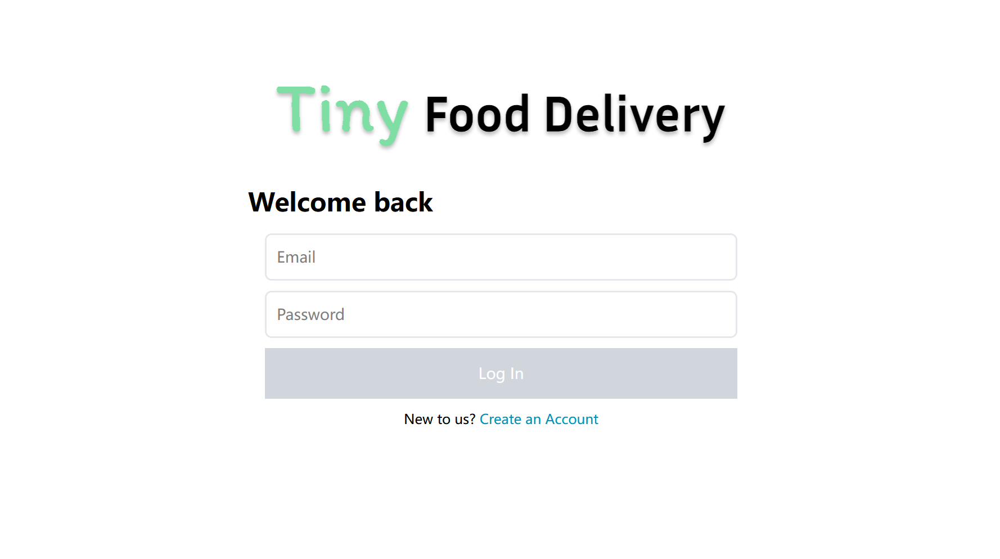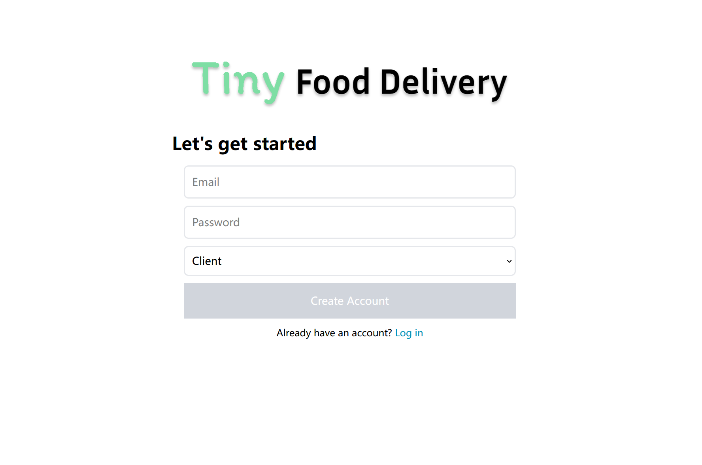
</p>

### Client User

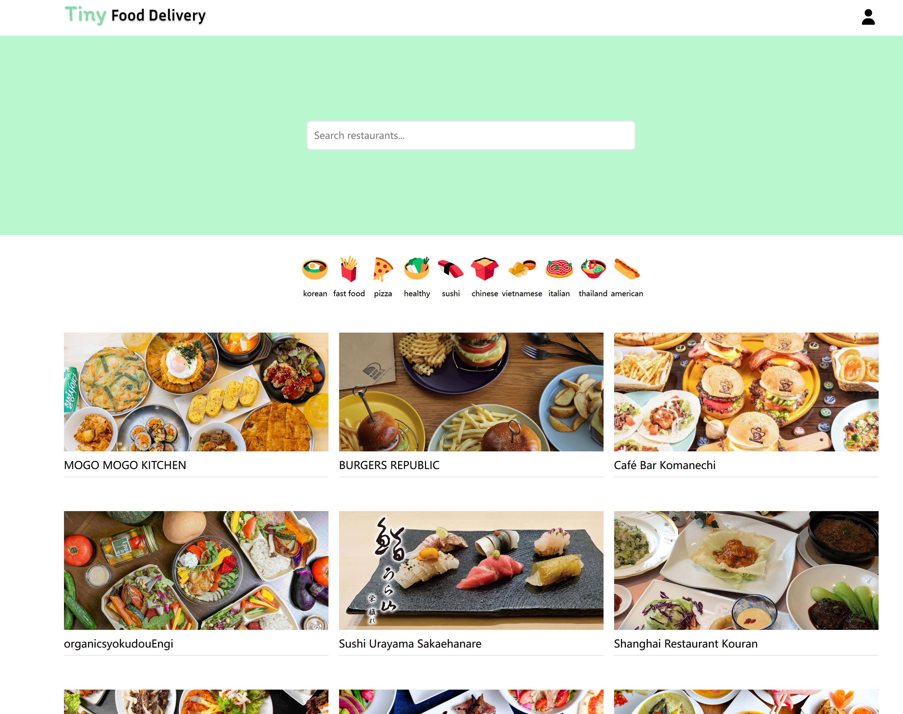

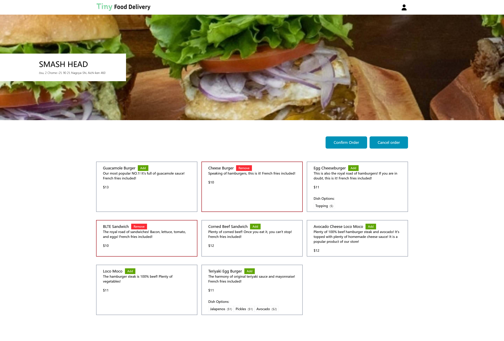

<p>
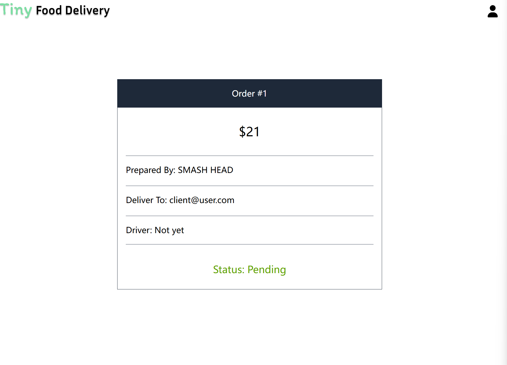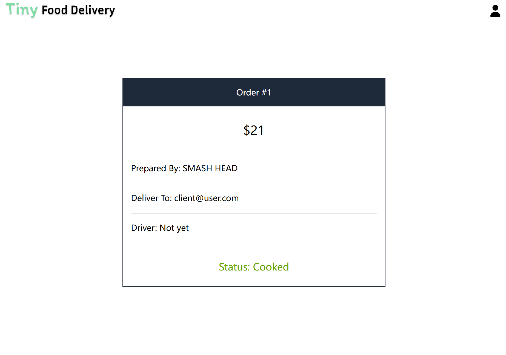
</p>

### Restaurant Owner

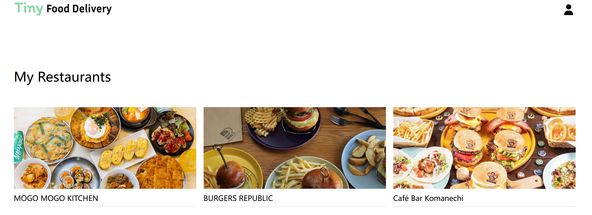

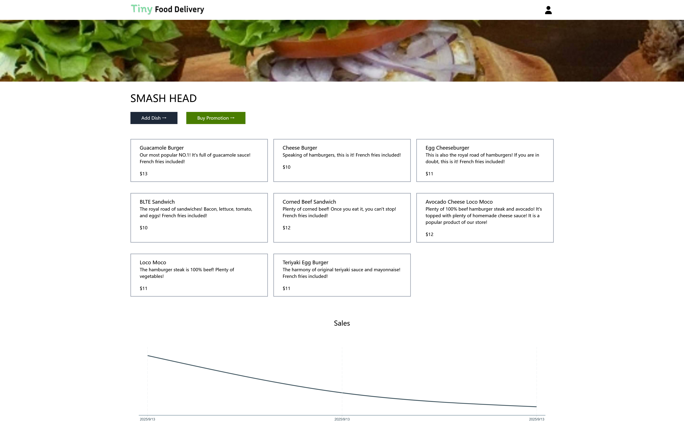

<p>
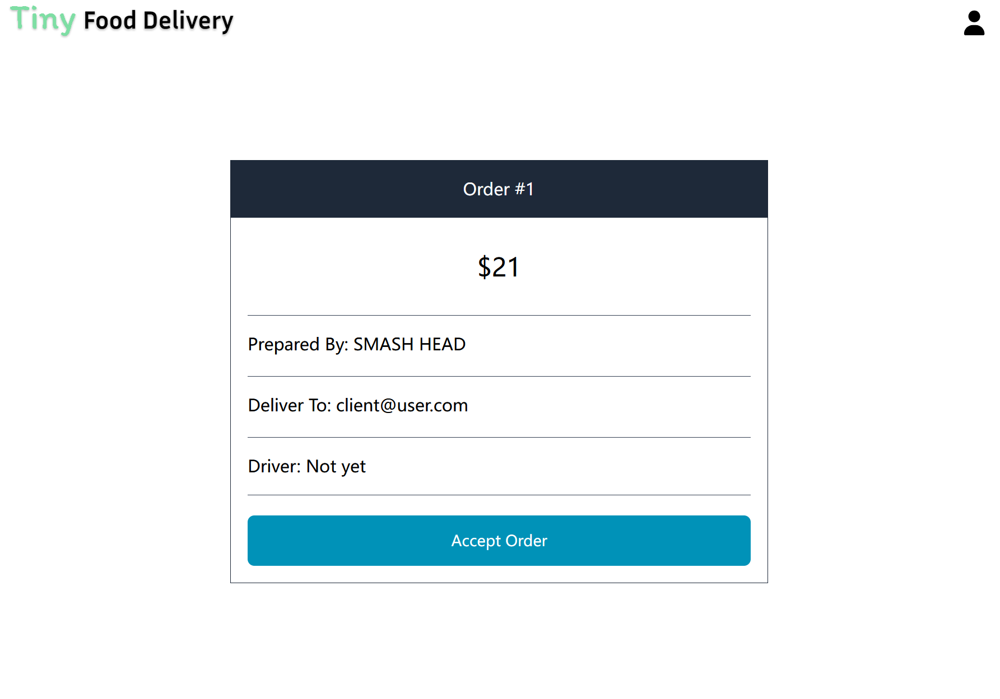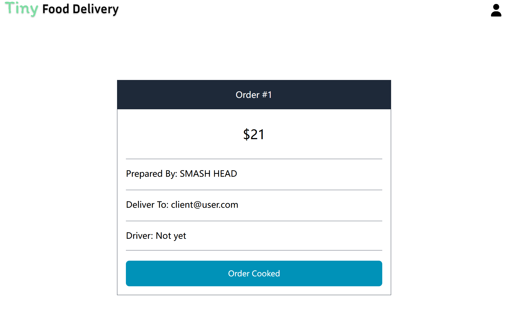
</p>

### Delivery Driver

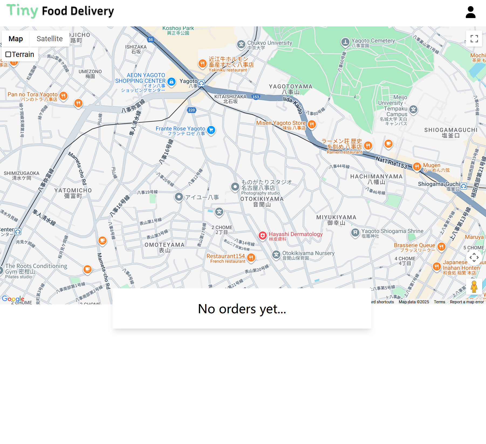

## TODO

-   Fix subscription bug.
-   Cover more files in **test**.
-   Beautify frontend interface. (including dark mode support).
-   CI (Continuous Integration) and CD (Continuous Deployment) based on GitHub Actions.

## Acknowledgement

> -   Nicolas

## License

MealRelay is available under the MIT License. Please refer to LICENSE for more details.
