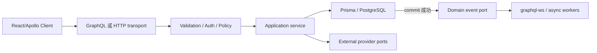

# MealRelay 后端重构总体计划

## 1. 背景与目标

仓库中存在两套后端：

- `backend/` 是可供取证的旧 NestJS/TypeORM 实现，包含完整业务模块，也包含已知安全、事务和实时通信问题。
- `api/` 是目标 NestJS 11 应用，目前只有基础骨架、初步 GraphQL 配置和未闭环的 Prisma 代码。

本计划的目标是先把业务逐个迁移到 `api/`，形成由 NestJS、Apollo code-first GraphQL、Prisma 和 PostgreSQL 组成、可测试且能够用于面试深入讲解的模块化单体。目标 API 应依据领域不变量、当前标准、安全要求和明确的工程取舍设计，不为维持旧前端临时可运行而保留不合理契约或兼容 shim。

### 当前执行顺序（2026-08-06 确认）

1. 先完成阶段 0–8 的后端重构、自动化测试、学习记录和后端生产就绪工作。
2. 后端阶段中，`frontend/` 保持只读，只用于理解历史产品行为；不修改前端源码、不运行 codegen，也不把旧前端兼容性作为 API 切片验收门槛。
3. 每个有意的 GraphQL/HTTP/认证契约变化，都要通过生成 schema、后端契约测试、learning note/ADR 和延后适配清单记录，不能静默变化。
4. API 核心领域和契约稳定后，再进入阶段 9，集中重构前端并完成 codegen、认证传输、Apollo cache、组件测试和关键 E2E 对接。

## 2. 成功标准

重构完成不是“目录看起来更整洁”，而是同时满足：

1. 目标 API 的关键业务流程可通过后端 GraphQL/HTTP/WS e2e 完成，契约变化均经过明确评审和记录。
2. 密码、密钥和供应商内部数据不会通过 API 暴露。
3. 多写操作具有事务边界；订单抢单、支付和状态变化具有并发/幂等保证。
4. GraphQL HTTP、`graphql-ws`、上传、Webhook 和健康检查均有对应边界测试。
5. Prisma migration 是数据库结构的唯一演进方式，不依赖运行时同步或共享库重置。
6. 自动质量门禁覆盖类型检查、非修复 lint、单元测试、集成/e2e 和构建。
7. 每个重大切片能够解释设计、失败模式、安全措施、测试证据和取舍。

上述条件定义后端阶段完成；完整产品交付还需要阶段 9 验证前端关键流程与稳定 API 的集成。

## 3. 权威来源

当来源冲突时，按以下顺序判断：

1. `api/` 中已经落地且通过评审的目标行为与测试。
2. 本计划记录的领域不变量、已批准的目标契约/ADR 与当前官方标准。
3. `backend/src/schema.gql`、Resolver、Service、Entity 和测试。
4. `frontend/src/` 中实际执行的 GraphQL/HTTP 操作；它们是历史产品证据，不是当前兼容要求。
5. 根 README 等说明文字。

安全修复可以有意打破错误的历史暴露。例如旧 schema 中的 `User.password` 不属于需要兼容的契约。

### 标准优先边界

HTTP、认证 header、CORS、cookie/cache、media type、multipart、GraphQL/WebSocket 传输、TLS/代理和 Webhook 等 Web 平台能力，以当前官方标准或仍在维护的协议作为目标。旧自定义约定和已废弃协议只用于理解迁移来源，不为其增加 fallback、双传输或兼容 shim。后端阶段在同一切片完成 API、供应商 adapter、后端测试、生成产物和文档；受影响的客户端变更进入阶段 9。业务不变量和有意设计的 schema 契约仍需单独评审。

## 4. 目标结构

```text
api/src/
├── app.module.ts
├── main.ts
├── config/                 # 配置 schema 与类型化访问
├── common/                 # 日志、错误、请求上下文、分页等跨领域能力
├── prisma/                 # 唯一 Prisma Client、生命周期和数据库边界
├── health/                 # liveness/readiness HTTP 端点
├── auth/                   # JWT、principal、guards、policies
├── users/                  # 用户与邮箱验证
├── catalog/                # 分类、餐厅、菜品和查询
├── orders/                 # 订单、计价、状态机和抢单
├── events/                 # 领域事件端口与订阅适配
├── payments/               # 支付事件和推广激活
├── uploads/                # 上传 HTTP 边界与存储端口
└── scheduling/             # 可测试、可多实例运行的定时任务
```

领域内部采用“薄 Resolver/Controller → 应用服务 → 仓储/供应商端口”的方向。Prisma 类型不直接成为包含内部字段的 GraphQL 输出类型。

## 5. 请求与事件路径



外部网络调用不放入数据库事务；需要反映已提交状态的事件只能在事务成功后发布。

## 6. 阶段与依赖

| 阶段 | 依赖 | 核心交付物 | 主要风险 |
| --- | --- | --- | --- |
| 契约基线 | 无 | 目标操作清单、旧行为矩阵、契约测试与延后适配策略 | 误把旧 schema 或前端偶然行为当目标要求 |
| Foundation | 契约基线 | 配置、GraphQL、Prisma、测试 DB、健康检查 | Prisma/TS 模块格式与包版本不兼容 |
| Identity | Foundation | 用户、JWT、验证、RBAC | 账户枚举、token 泄露、标准 bearer transport 迁移 |
| Catalog | Identity | 餐厅/菜品 CRUD、搜索、分页 | 越权、SQL 注入、N+1、缓存陈旧 |
| Orders | Catalog | 计价、事务、状态机、抢单 | 竞态、历史价格变化、非法状态跳转 |
| Realtime | Orders | 订阅、事件、异步邮件 | 提交前发布、断线泄露、多实例不一致 |
| Providers | Identity/Catalog/Events | 支付、推广、上传、调度 | 伪造 Webhook、重复处理、恶意文件 |
| Production | 所有核心阶段 | 可观测性、CI/CD、安全与恢复 | 无法定位故障、迁移不可回退、资源耗尽 |
| Frontend integration | 稳定的 Production API | 前端重构、类型生成、认证/订阅对接和关键流程 E2E | 前端假设与目标 schema 漂移、缓存错误、浏览器安全边界遗漏 |

## 7. 每个切片的实施循环

1. 盘点目标业务行为、旧输入输出、角色、关系、副作用和失败路径；前端操作仅作为历史证据。
2. 写契约测试或最小失败测试，固定预期行为。
3. 设计 Prisma 模型、约束、索引和 migration；明确事务与并发策略。
4. 先实现纯领域/应用逻辑，再接 Resolver、Controller 和适配器。
5. 覆盖成功、验证失败、未认证、错误角色、错误所有者、未找到和供应商失败。
6. 执行窄测试，再执行阶段质量门禁。
7. 更新阶段文档；实质性里程碑完成后添加 learning note，长期决策添加 ADR。

## 8. PR 拆分原则

- 单个 PR 只交付一个可描述的行为或基础能力。
- schema/migration、应用代码、相应测试应放在同一 PR 中。
- 不在功能 PR 中顺便升级无关依赖或格式化旧目录。
- 外部契约有意变化时，同一 PR 更新生成的 API schema、后端契约测试和延后前端适配记录；阶段 9 再更新前端操作和生成类型。
- 旧 `backend/` 默认只读；需要兼容 fixture 时才修改。

## 9. 全局完成定义

每个阶段至少执行：

```powershell
cd api
pnpm exec tsc --noEmit
pnpm exec eslint "src/**/*.ts" "test/**/*.ts"
pnpm exec jest --runInBand
pnpm exec jest --config ./test/jest-e2e.json --runInBand
pnpm run build
```

涉及 Prisma 时还应执行 `prisma format`、`prisma validate`、`prisma generate`，并在明确的 disposable PostgreSQL 上验证 migration。阶段 0–8 不要求执行前端 Vitest、build 或 codegen；这些门禁在阶段 9 基于稳定 API 启用。不能执行的后端检查必须在 PR 和 learning note 中写明原因。

## 10. 回退与切换策略

- 以纵向切片切换，不进行一次性“大爆炸”替换。
- 数据库 migration 优先采用向前兼容的 expand/contract 方式；部署前准备 forward-fix。
- 在新旧 API 并行验证阶段，避免双写真实外部服务；邮件、存储和支付使用明确的测试适配器。
- 后端切片退出旧职责前使用目标 API e2e 和 schema diff 确认行为；最终产品切换在阶段 9 使用前端关键操作再次验证。
- 旧后端只在新切片满足验收门槛后退出对应职责。

## 11. 当前状态

| 阶段 | 状态 | 备注 |
| --- | --- | --- |
| 契约基线 | 进行中 | 历史操作和主要目标修正已进入实施文档；自动契约门禁延后到稳定 SDL/Jest 阶段 |
| Foundation + Identity | 主要功能已编码，门槛待复核 | 全仓库格式门禁仍失败；现有环境校验 Jest fixture 已落后于必填配置 |
| Catalog | 主路径与 SDL 已编码，证据待收口 | 查询/runtime 证据与 learning 03 尚未闭环 |
| Orders | 主路径已编码，证据待收口 | 真实并发/runtime 证据与 learning 04 缺失 |
| Realtime/Async | 进程内主路径已编码，证据待收口 | `graphql-ws` runtime/生命周期证据与 learning 05 缺失；多实例共享事件总线仍是后续选择 |
| 阶段 7A 支付/推广/调度 | 主路径已编码但不可构建 | 缺少已引用的 Paddle SDK；typecheck/build 失败；sandbox/runtime 与 learning 06 尚未闭环 |
| 阶段 7B 安全上传 | 下一业务切片 | 先完成 7A 构建/格式收口，再按 `07-secure-upload-implementation.md` 实施 |
| 阶段 8 后端生产就绪 | 未开始 | 依赖功能重构完成和统一收口审计 |
| 前端重构与集成 | 延后 | 等阶段 0–8 完成且 API 契约稳定后启动 |
