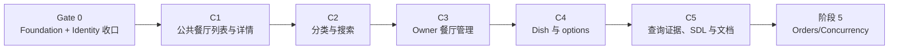
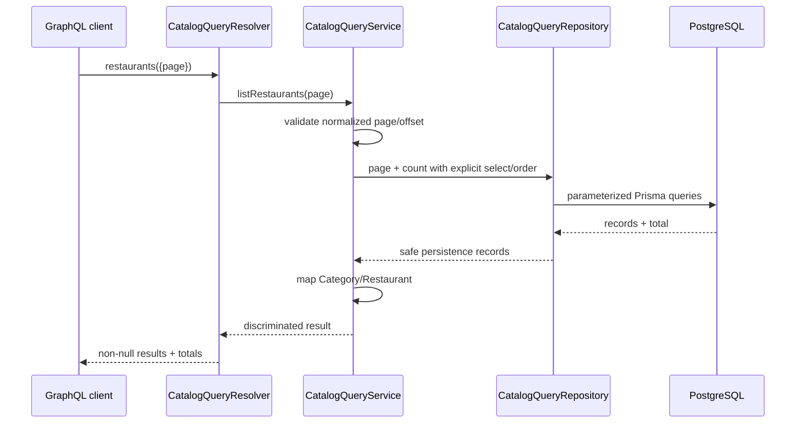

# 下一步重构实施蓝图：Foundation/Identity 收口与 Catalog/Query

> 状态更新（2026-08-09）：C1–C4 的主要代码已随 `65ae73b` 落地，但 C5 尚未完成：Catalog migration 未应用且缺两个 CHECK，generated SDL 仍无 Catalog，non-fixing lint 有 679 个格式错误，query/learning 证据未形成。先按 [05-orders-concurrency-implementation.md](./05-orders-concurrency-implementation.md) 的 Gate C5 收口，再进入 Orders。
>
> 基线日期：2026-08-07。
>
> 目标版本以 `api/package.json` 为准：NestJS 11、`@nestjs/graphql` 13.4、Apollo Server 5、Prisma 7.9、PostgreSQL、TypeScript 5.7。
>
> 本文只规划后续实施。本次文档工作不得修改 `api/`、`backend/` 或 `frontend/` 代码，也不得改写现有 migration。

## 1. 执行结论

当前不能直接开始 Catalog 代码。仓库已经出现 Foundation、Prisma、Auth 和 Users 的主要文件，但上一阶段尚未形成可启动、可生成完整 SDL、可通过静态质量门禁的纵向切片。下一步应按以下顺序执行：

1. **先做 Gate 0：收口 Foundation + Identity**，只修复现有实现的编译、依赖注入、启动装配、Bearer 边界、配置和 generated SDL；不在这一步扩展 Catalog。
2. **再做阶段 4：Catalog/Query**，按“公共餐厅查询 → 分类与搜索 → Owner 餐厅管理 → Dish/options → 查询证据与文档”五个可运行切片推进。
3. **Jest 继续延后**。当前仍处于 functional-refactor 阶段，不新增或扩写 `*.spec.ts`、Jest e2e、测试数据库或 coverage；只维护明确的延后测试 backlog，并执行 typecheck、非修复 lint、build、Prisma 校验和人工/runtime 验证。
4. `backend/` 与 `frontend/` 保持只读。目标 API 不提供旧 role、数字 ID、`x-jwt`、浮点计价或 raw SQL 搜索的兼容路径。
5. 初版 Catalog 不引入 Redis、缓存、第三方 DataLoader、`pg_trgm` 或全文搜索。只有实测基线证明需要时，才在独立切片中引入。



## 2. 当前项目状态审计

### 2.1 已存在的基础

| 范围 | 当前证据 | 判断 |
| --- | --- | --- |
| 依赖 | NestJS 11、GraphQL 13.4、Apollo 5、Prisma 7.9、PostgreSQL adapter、JWT、Argon2、Throttler、Zod 已安装并锁定 | 不需要为 Catalog 先升级依赖 |
| Prisma | `api/prisma/schema.prisma` 已有 `User`、`EmailVerification`、`UserRole`；Client 输出到 `src/generated/prisma`，`moduleFormat = "cjs"` | Identity 数据模型已有基础 |
| migration | `api/prisma/migrations/20260807100622_init/migration.sql` 已存在且当前工作区 clean | 必须保护并先确认应用状态，不能静默删除、重建或并入 Catalog migration |
| GraphQL | `GraphQLModule`、code-first、稳定排序和 `src/schema.gql` 路径已配置 | 配置存在，但业务 schema 尚未成功生成 |
| Validation | 全局 `ValidationPipe` 已设置 transform、whitelist、forbid unknown/extra fields | 可复用于 Catalog DTO |
| Prisma 生命周期 | `PrismaService` 使用一个 Prisma Client 和 `PrismaPg`，实现 init/destroy hooks | 方向正确，仍需在 bootstrap 中完成 shutdown 与已验证配置装配 |
| Foundation | health controller/resolver、liveness/readiness 和环境 Zod schema 已存在 | 部分完成，不等于阶段门禁已通过 |
| Identity | Auth、Users、JWT、Bearer parser、role guard、password hash、verification token、mailer port、repository/service/resolver 已存在 | 主体代码已写入，但尚未闭环 |
| Catalog | `api/src/catalog/` 不存在；Prisma 没有 Category/Restaurant/Dish | 尚未开始 |

### 2.2 2026-08-07 当前阻塞项

本轮纯文档工作只做了源码和工作区只读核对，没有执行会生成或改写文件的 Prisma、build 或 lint 命令。当前证据如下：

- `api/src/auth/auth.service.ts` 已经定义并导出 `LoginCommand`、`LoginResult`，也已导入 `normalizeEmail`；原先的未解析登录类型阻塞已经消失，不应重复修改。
- `api/src/generated/prisma/` 当前不存在且被 `.gitignore` 排除。因为现有源码从该目录导入 Client 和 enum，Gate 0 必须先执行 `pnpm exec prisma validate` 与 `pnpm exec prisma generate`，再判断真实 typecheck 结果。
- 当前若干源文件仍使用双引号，与 `.prettierrc` 的单引号约定不一致；Gate 0 应在明确 review 格式化改动后收口，再运行非修复 ESLint 验证。
- `api/src/schema.gql` 目前只有 `apiStatus`，没有 Auth/Users operation。这说明“文件存在”尚未转化为可审查的外部契约。
- `ConfigModule.forRoot()` 中 `validateEnvironment` 仍被注释；当前扩展后的 JWT、邮件配置没有启动时 fail-fast 保证。
- GraphQL context factory 仍被注释；`GqlAuthGuard` 读取的 `context.request`/`principal` 尚未由根模块可靠提供。
- CORS、typed port、production GraphiQL 策略和 shutdown hooks 仍被注释或未装配。
- `AccessTokenService` 与 `ResendVerficationMailer` 缺少明确的 `@Injectable()` 元数据；构造器依赖注入必须在 runtime smoke 中验证。
- `AuthModule` 重复注册 `PasswordHasherService`，Throttler 名称包含 `dentity`/`identity` 不一致风险。
- Bearer parser 对 `x-jwt` 的显式拒绝代码仍被注释；带有合法 Authorization 和额外 `x-jwt` 的请求当前可能未按仓库规则拒绝。
- Identity 的 service/resolver 测试仍是 Nest 脚手架式 “should be defined”，且没有提供所需依赖；配置测试也尚未同步新增的必填环境变量。根据当前仓库策略，这些行为测试不在本阶段补齐，只登记到 Jest backlog。
- `docs/refactor/03-identity-access-implementation.md` 中仍出现旧 `Client/Owner/Delivery` 枚举预期，与当前权威值 `CUSTOMER/OWNER/COURIER` 冲突；后续实施以 `AGENTS.md`、当前 Prisma/schema 类型和本文为准。

### 2.3 工作区保护

本轮只读核对时，根仓库 `git status --porcelain=v1` 与 `git -C api status --porcelain=v1` 都没有输出，即两个 Git 视角当前均为 clean。该状态只代表核对时刻；后续实现者仍必须：

- 每个切片开始和结束都分别检查根仓库与 `api/` Git 状态。
- 不覆盖实施开始前出现的任何用户改动，尤其是 `AGENTS.md`、`AGENTS.zh-CN.md`。
- 不删除、重命名、重新生成或折叠现有 init migration；若要改写已存在 migration，必须先确认它从未应用到任何需要保留的数据库，并得到明确授权。
- Catalog 必须使用独立、按时间排序的新 migration；不要把 Catalog DDL 追加进 `20260807100622_init`。

## 3. 范围与非目标

### 3.1 本计划包含

- 收口当前 Foundation/Identity 的编译、DI、启动与 schema generation 门禁。
- Category、Restaurant、Dish 和菜单 option definition 的 Prisma 模型与 reviewable migration。
- 公共浏览：分类、餐厅列表、餐厅详情、分类分页和搜索。
- Owner：自己的餐厅列表/详情，以及餐厅、Dish 的创建、编辑和删除。
- 固定 15 条 offset pagination、稳定排序、参数化大小写不敏感搜索。
- UUID GraphQL `ID`、整数最小货币单位、严格 JSON option parser、安全 mapper/select。
- N+1、查询索引和缓存的测量门槛。
- generated SDL review、前端延后适配清单、Jest 延后 backlog 和 learning note 计划。

### 3.2 本计划不包含

- 不修改 `frontend/`、不运行 frontend codegen、Vitest、Cypress 或 frontend build。
- 不修改 `backend/`；它只提供行为和缺陷证据。
- 不实现 Orders、order history、server-side total 或 price snapshot；这些属于阶段 5。
- 不实现 promotion、payment、`isPromoted` 或 `promotedUntil`；这些属于阶段 7。
- 不实现 uploads；Catalog 只接收已经存在的 HTTP(S) URL 字符串，实际安全上传在阶段 7 完成。
- 不实现 Redis/BullMQ、共享缓存、全文检索或多实例失效。
- 不实现新的 Jest unit/integration/e2e/concurrency tests；本阶段只保持代码可测试并记录场景。
- 不新增通用 CRUD repository、CQRS、event sourcing 或微服务边界。

## 4. Gate 0：Foundation + Identity 收口

Catalog 开始前必须先完成下面门禁。Gate 0 只让已经存在的行为成为一个可启动切片，不增加新业务范围。

### 4.1 文件级收口清单

| 文件/范围 | 必须完成的动作 | 出口证据 |
| --- | --- | --- |
| `auth/auth.service.ts` | 定义并导入明确的 login command/result discriminated union；导入 `normalizeEmail` | typecheck 不再出现未解析类型 |
| `auth/access-token.service.ts` | 补齐 Nest provider 元数据；保持 issuer、audience、algorithm、expiry、UUID 和 role 校验 | Nest 能构造 provider，登录能签发 token |
| `users/resend-verification-mailer.service.ts` | 补齐 provider 元数据；保持 timeout、Bearer provider auth、幂等键和安全日志 | Nest 能构造 mailer；启动不访问网络 |
| `auth/auth.module.ts` | 删除重复 provider；统一 `identity` throttler 名称；只导出真实跨模块需要的 provider | DI graph 无重复/拼写分叉 |
| `app.module.ts` | 启用 `validateEnvironment`；改为 typed `forRootAsync` GraphQL 配置；创建 `{ request, response, principal? }` context；生产关闭 GraphiQL | 配置错误启动即失败，Auth guard 能读 request |
| `main.ts` | 从 typed ConfigService 读取 port/CORS；启用 shutdown hooks；只允许 `Authorization`/`Content-Type` 等明确 headers | 无散落 `process.env`，CORS/关闭路径可解释 |
| `auth/bearer-token.ts` | 任何 `x-jwt` 都显式拒绝；只接受恰好一个格式正确的 Authorization bearer credential | 无 compatibility bridge |
| Prisma/migration | 审查当前 init migration、确认应用状态、校验 generated client 与 NodeNext/CJS 组合 | `prisma validate/generate` 成功，不执行 reset |
| generated SDL | 启动应用重新生成，审查 Identity operations、role enum 和 password 排除 | `schema.gql` 不再只有 `apiStatus` |
| 全部现有 TS 文件 | 按 `.prettierrc` 收口单引号/尾逗号；不运行会自动改写的 `pnpm lint` 作为诊断命令 | 非修复 ESLint 通过 |

### 4.2 Gate 0 外部契约最小要求

- SDL 至少包含 `register`、`login`、`me`、`changeEmail`、`changePassword`、`verifyEmail`、`resendVerificationEmail`。
- `UserRole` 只包含 `CUSTOMER`、`OWNER`、`COURIER`。
- SDL 不包含 `password`、`passwordHash`、`x-jwt`。
- 缺失、格式错误、重复 Authorization 以及任何 `x-jwt` 都被拒绝。
- HTTP context 使用 request header；不要提前解析 WS connection params，WS auth 留到阶段 6。
- 邮件发送仍在事务提交之后；应用启动和普通 health/catalog read 不触发真实邮件网络请求。

### 4.3 Gate 0 验证门槛

进入 C1 前必须同时满足：

- [ ] `pnpm exec tsc --noEmit --incremental false` 通过。
- [ ] `pnpm exec eslint "src/**/*.ts" "test/**/*.ts"` 通过，命令不带 `--fix`。
- [ ] `pnpm exec prisma validate` 和 `pnpm exec prisma generate` 通过。
- [ ] `pnpm run build` 通过。
- [ ] 使用明确的本地/一次性 PostgreSQL 启动应用，`/health/live`、`/health/ready`、`apiStatus` 可用。
- [ ] `schema.gql` 可确定性生成并包含完整 Identity 契约。
- [ ] 人工验证一个合法 Bearer 请求和缺失/`x-jwt` 拒绝路径。
- [ ] 没有执行 Jest、没有新增测试数据库、没有访问真实邮件供应商。

如果 Gate 0 未通过，不创建 `catalog/` 目录，也不创建 Catalog migration。这样可以避免把当前启动问题与新领域问题混在同一批改动中。

## 5. Legacy 行为与目标决策

### 5.1 产品使用证据

| Legacy operation | 主要消费者 | 目标决定 | 有意变化 |
| --- | --- | --- | --- |
| `allCategories` | 客户首页 | 保留名称 | 输出使用安全 Category model；空列表非 null |
| `restaurants(input)` | 客户首页 | 保留名称 | page 固定 15；UUID ID；稳定排序 |
| `restaurant(input)` | 餐厅详情/下单入口 | 保留名称 | ID 由 Int 改为 GraphQL `ID` 字符串；菜单价格改为 minor unit |
| `category(input)` | 分类页面 | 保留名称 | slug 规范化；固定 15 条；稳定排序 |
| `searchRestaurant(input)` | 搜索页面 | 暂保留名称，避免无价值 rename | Prisma 参数化过滤；trim、长度、通配符语义受控 |
| `myRestaurants` | Owner 首页 | 保留名称 | 增加可选/默认 page input，避免无界列表；只来自 principal |
| `myRestaurant(input)` | Owner 详情 | 保留名称 | 不提前返回 orders；Owner scope 内找不到与越权统一为 resource unavailable |
| `createRestaurant` | Owner 创建 | 保留名称 | ownerId 不在 input；Category 原子 get-or-create；返回 UUID |
| `editRestaurant` | 旧 schema，当前 UI 未稳定使用 | 第二批实现 | scoped update；不区分不存在与他人资源 |
| `deleteRestaurant` | 旧 schema | 第二批实现 | 当前阶段 hard delete，Dish cascade；Orders 接入后改为受约束删除策略 |
| `createDish` | Owner 菜单 | 保留名称 | 返回 dishId；price/extra 使用 minor unit；严格 option parser |
| `editDish` / `deleteDish` | 旧 schema | 第二批实现 | 通过 restaurant.ownerId scope，禁止只依赖 role guard |

### 5.2 明确不复制的 legacy 行为

- 不复制 `Raw((name) => `${name} ILIKE '%${query}%'`)` 字符串插值。
- 不把 TypeORM entity 同时当作 input、persistence 和 GraphQL output。
- 不使用 `Float`/JavaScript 浮点存储或累加价格。
- 不把 `owner`、`orders`、`password` 等 persistence 关系自动暴露到公共 Restaurant graph。
- 不使用 `console.log` 输出 Category、异常或用户输入。
- 不使用“先查询是否存在，再假设不会发生并发”的 Category 创建方式。
- 不使用 category delete cascade 删除全部 restaurants；Category FK 使用 restrict。
- 不接受 input 中的 `ownerId`、`userId`、`isPromoted`、`promotedUntil`。
- 不把错误的 Owner 与资源不存在暴露为可枚举的两种信息。

## 6. 目标 GraphQL 契约

### 6.1 全局约定

- 所有数据库 UUID 对外使用 GraphQL `ID!`，TypeScript 类型为 `string`。
- 继续使用 `{ ok, error, ... }` 处理预期业务失败；validation、unauthenticated、wrong role 和未知内部错误使用 GraphQL errors。
- 列表字段成功或为空时始终返回非 null 数组，不使用 `null` 表示空集合。
- 业务 not-found payload 中数据字段可为 null。
- `page` 默认 1，最小 1，最大 10,000；客户端不能传 page size，服务端固定 15。
- `totalPages = Math.ceil(totalResults / 15)`；零结果时 `totalPages = 0`，越界页返回空数组和真实 totals。
- 公共查询允许未登录用户、CUSTOMER、OWNER、COURIER 使用；Owner 查询/写操作要求 Bearer + `OWNER`。
- Mutation 的 actor 始终来自 `AuthenticatedPrincipal`，不从 input 接收。

### 6.2 目标 operation 集合

```graphql
type Query {
  allCategories: AllCategoriesPayload!
  restaurants(input: RestaurantsInput!): RestaurantsPayload!
  restaurant(input: RestaurantInput!): RestaurantPayload!
  category(input: CategoryInput!): CategoryPayload!
  searchRestaurant(input: SearchRestaurantInput!): SearchRestaurantPayload!
  myRestaurants(input: RestaurantsInput = { page: 1 }): RestaurantsPayload!
  myRestaurant(input: RestaurantInput!): RestaurantPayload!
}

type Mutation {
  createRestaurant(input: CreateRestaurantInput!): CreateRestaurantPayload!
  editRestaurant(input: EditRestaurantInput!): OperationPayload!
  deleteRestaurant(input: DeleteRestaurantInput!): OperationPayload!
  createDish(input: CreateDishInput!): CreateDishPayload!
  editDish(input: EditDishInput!): OperationPayload!
  deleteDish(input: DeleteDishInput!): OperationPayload!
}
```

上面 SDL 是契约意图，不是要手工写入 `schema.gql`。最终 SDL 只能由 code-first classes 生成并 review。Nest code-first 中所有数组、number、ID、nullability 都应显式写 `@Field()` 类型函数，GraphQL mapped types 必须从 `@nestjs/graphql` 导入。

### 6.3 目标输出模型

| 类型 | 字段 | 不公开的内容 |
| --- | --- | --- |
| `Category` | `id`, `name`, `slug`, nullable `coverImageUrl`, `restaurantCount`, timestamps | 不公开 raw normalized key；不直接公开 `restaurants` 循环关系 |
| `Restaurant` | `id`, `name`, `address`, `coverImageUrl`, `category`, `menu`, timestamps | 不公开 `ownerId`、`owner`、payments、orders、内部 promotion 字段 |
| `Dish` | `id`, `name`, `description`, `priceMinor`, nullable `photoUrl`, `options`, timestamps | 不公开 `restaurantId` persistence 字段 |
| `DishOption` | `name`, nullable `extraMinor`, nullable `choices` | 不公开 raw JSON 或未知键 |
| `DishChoice` | `name`, `extraMinor` | 不公开 raw JSON |

`Restaurant.menu` 在列表查询中只有客户端明确选择时才解析。首版先通过 repository relation query 和 Prisma 7 的 batching/query evidence 验证查询数；不要把整个 menu 无条件 include 到每个 15 条列表中。

### 6.4 错误语义

| 情况 | 外部表示 | 原因 |
| --- | --- | --- |
| DTO 非法、page/UUID/URL/options 不合法 | GraphQL validation error | 请求根本没有形成合法 command |
| 缺失/非法 Bearer | `UNAUTHENTICATED` | 认证边界 |
| 非 OWNER 调用管理 operation | `FORBIDDEN` | role policy |
| Owner 查询/修改他人资源或不存在资源 | `{ ok: false, error: "Resource is unavailable." }` | 防止资源枚举 |
| category slug 不存在 | `{ ok: false, error: "Category is unavailable.", ...emptyPage }` | 预期 query miss |
| category/slug 唯一冲突 | 稳定业务 error；服务端日志记录 request ID 和 Prisma code | 不泄漏 DB constraint 名称 |
| 未知 Prisma/程序错误 | sanitized GraphQL internal error | 不把内部 cause 伪装成业务 not-found |

## 7. 数据模型与不变量

### 7.1 Category

字段建议：

- `id`: UUID v7。
- `name`: trim、Unicode NFKC、连续空白折叠后的展示名，1–80 字符。
- `normalizedName`: 对规范化展示名做稳定 lowercase 后的内部唯一键，不进入 GraphQL。
- `slug`: 由规范化名称确定性生成，1–100 字符，唯一。
- `coverImageUrl`: nullable HTTP(S) URL；当前 createRestaurant 不负责分类图片管理。
- timestamps。

不变量：

- 相同 `normalizedName` 只能产生一个 Category；并发正确性来自 unique constraint + atomic upsert，而不是 check-then-create。
- slug 使用 Unicode 字母/数字和 `-`，连续分隔符合并，首尾不保留 `-`。若规范化后无法生成 slug，输入失败。
- 不提供 deleteCategory；切换 Restaurant 分类后不自动删除孤立 Category。
- Category 删除策略为 `Restrict`，绝不能级联删除餐厅。

### 7.2 Restaurant

字段建议：

- `id`: UUID v7。
- `ownerId`: FK → User，必填。
- `categoryId`: FK → Category，必填。
- `name`: 1–120 字符。
- `address`: 3–255 字符。
- `coverImageUrl`: 1–2048 字符，必须是 HTTP(S) URL。
- timestamps。

不变量与取舍：

- 同一 Owner 可以有同名餐厅；当前产品没有禁止同名的明确不变量，因此不增加组合 unique。
- Owner 不能通过 input 改 owner。
- 当前不加入 promotion 字段。阶段 7 加入 promotion 后，同一变更更新排序、索引、缓存失效计划和 SDL。
- Catalog 阶段 physical delete Restaurant，并 cascade 删除 Dish。阶段 5 加入 Orders FK 时，必须重新评审删除策略，禁止历史订单被 cascade 删除。
- 当前 catalog metadata 采用 last-write-wins；不提前加入 version/optimistic locking。Orders 的状态并发不使用这一取舍。

### 7.3 Dish 与价格

字段建议：

- `id`: UUID v7。
- `restaurantId`: FK → Restaurant，Restaurant 删除时 cascade。
- `name`: 1–120 字符。
- `description`: 5–500 字符。
- `priceMinor`: 非负整数，表示部署所选货币的最小单位。
- `photoUrl`: nullable HTTP(S) URL，最长 2048。
- `options`: PostgreSQL `jsonb`，默认 `[]`。
- timestamps。

价格决策：

- GraphQL 使用 `Int` 字段 `priceMinor`/`extraMinor`，不继续使用含义不清的 `Float price`。
- 单项价格/extra 范围 `0..100_000_000`，低于 GraphQL Int 上限。
- Catalog 只存定义；阶段 5 必须从数据库重新加载 Dish/options，验证用户选择并写不可变价格快照，不能信任客户端金额。
- 在阶段 9 前端集成前必须确认展示货币与格式化规则；API 不通过浮点或猜测 currency 来掩盖这个产品决策。

### 7.4 菜单 option definition

首版选择 **经过严格 parser 的 JSON aggregate**，不创建 `DishOption`/`DishChoice` 表，理由是：

- option 总是随 Dish 整体创建、读取和替换，没有独立查询或生命周期。
- 当前产品按名称提交选项，阶段 5 会保存订单快照，不需要订单长期 FK 到可变 option definition。
- JSON 减少当前切片的表和 join；代价是数据库不能表达全部结构约束，因此应用读写边界必须双向 parse。

Canonical union：

```ts
type MenuOptionDefinition =
  | { name: string; extraMinor: number; choices?: never }
  | {
      name: string;
      extraMinor?: never;
      choices: Array<{ name: string; extraMinor: number }>;
    };
```

Parser 规则：

- 每个 Dish 最多 20 个 options。
- 每个 option 最多 20 个 choices，全部 options 合计最多 100 个 choices。
- option/choice name trim、折叠空白，长度 1–60。
- option name 在 Dish 内大小写不敏感唯一；choice name 在所属 option 内大小写不敏感唯一。
- 一个 option 必须且只能有 `extraMinor` 或非空 `choices`；不能两者同时存在，也不能两者都不存在。
- `extraMinor` 为整数，范围 `0..100_000_000`。
- 拒绝未知键、非数组顶层、过深嵌套和序列化后超过 16 KiB 的定义。
- 写入前 parse + canonicalize；从 DB 读取后再次 parse。若 DB 中出现非法 JSON，不向 GraphQL 透传，记录不含完整 payload 的内部错误和 Dish ID。

Prisma 的 `Json` 字段是未类型化边界；不要用类型断言把 `Prisma.JsonValue` 直接伪装成 domain type，也不为这一小型结构额外引入 JSON type generator。

## 8. Prisma schema 与 migration 蓝图

以下是目标结构的 review 蓝图，不是可直接复制后跳过 migration review 的最终代码：

```prisma
model User {
  // existing fields
  restaurants Restaurant[]
}

model Category {
  id             String       @id @default(uuid(7)) @db.Uuid
  name           String       @db.VarChar(80)
  normalizedName String       @unique(map: "categories_normalized_name_key") @map("normalized_name") @db.VarChar(80)
  slug           String       @unique(map: "categories_slug_key") @db.VarChar(100)
  coverImageUrl  String?      @map("cover_image_url") @db.VarChar(2048)
  createdAt      DateTime     @default(now()) @map("created_at") @db.Timestamptz(3)
  updatedAt      DateTime     @updatedAt @map("updated_at") @db.Timestamptz(3)
  restaurants    Restaurant[]

  @@map("categories")
}

model Restaurant {
  id            String   @id @default(uuid(7)) @db.Uuid
  ownerId       String   @map("owner_id") @db.Uuid
  categoryId    String   @map("category_id") @db.Uuid
  name          String   @db.VarChar(120)
  address       String   @db.VarChar(255)
  coverImageUrl String   @map("cover_image_url") @db.VarChar(2048)
  createdAt     DateTime @default(now()) @map("created_at") @db.Timestamptz(3)
  updatedAt     DateTime @updatedAt @map("updated_at") @db.Timestamptz(3)
  owner         User     @relation(fields: [ownerId], references: [id], onDelete: Restrict)
  category      Category @relation(fields: [categoryId], references: [id], onDelete: Restrict)
  dishes        Dish[]

  @@index([createdAt(sort: Desc), id(sort: Desc)], map: "restaurants_created_at_id_idx")
  @@index([ownerId, createdAt(sort: Desc), id(sort: Desc)], map: "restaurants_owner_page_idx")
  @@index([categoryId, createdAt(sort: Desc), id(sort: Desc)], map: "restaurants_category_page_idx")
  @@map("restaurants")
}

model Dish {
  id           String     @id @default(uuid(7)) @db.Uuid
  restaurantId String     @map("restaurant_id") @db.Uuid
  name         String     @db.VarChar(120)
  description  String     @db.VarChar(500)
  priceMinor   Int        @map("price_minor")
  photoUrl     String?    @map("photo_url") @db.VarChar(2048)
  options      Json       @default("[]") @db.JsonB
  createdAt    DateTime   @default(now()) @map("created_at") @db.Timestamptz(3)
  updatedAt    DateTime   @updatedAt @map("updated_at") @db.Timestamptz(3)
  restaurant   Restaurant @relation(fields: [restaurantId], references: [id], onDelete: Cascade)

  @@index([restaurantId, createdAt, id], map: "dishes_restaurant_menu_idx")
  @@map("dishes")
}
```

### 8.1 migration 必须人工审查的 SQL

- 三张表、全部 FK、unique 和索引名称是否与 Prisma schema 一致。
- `price_minor >= 0` check constraint。
- `jsonb_typeof(options) = 'array'` check constraint。
- name/address/description 的非空白约束只在数据库能够稳定表达时添加；Unicode/空白 canonicalization 仍以应用边界为主。
- FK delete policy：User/Category → Restaurant 是 restrict；Restaurant → Dish 是 cascade。
- 不创建 `pg_trgm` extension 或 trigram index。
- 不包含 drop/recreate User、EmailVerification 或 UserRole。
- migration 可在明确的一次性/本地 development PostgreSQL 上从 init migration 顺序应用。

### 8.2 migration 操作规则

1. 先确认当前 `20260807100622_init` 是否已应用到任何需要保留的数据库。
2. 在 `api/` 执行 `prisma format`、`prisma validate`、`prisma generate`。
3. 用 `prisma migrate dev --create-only --name catalog_foundation` 生成独立 migration。
4. 人工 review SQL 后才允许 apply。
5. 不对未知、共享或非一次性数据库执行 `migrate reset`。
6. CI/生产未来只使用 review 后的 `prisma migrate deploy`。

## 9. 目标模块和文件结构

```text
api/src/
├── common/
│   └── pagination/
│       ├── page.constants.ts
│       ├── page.input.ts
│       └── page.types.ts
└── catalog/
    ├── application/
    │   ├── assert-owner.ts
    │   ├── catalog-query.service.ts
    │   ├── dish-management.service.ts
    │   ├── parse-catalog-input.ts
    │   └── restaurant-management.service.ts
    ├── domain/
    │   ├── catalog-input.error.ts
    │   ├── catalog-result.ts
    │   ├── catalog-text.ts
    │   ├── category-name.ts
    │   ├── menu-option-definition.ts
    │   └── money.ts
    ├── persistence/
    │   ├── catalog-query.repository.ts
    │   ├── catalog.mapper.ts
    │   ├── catalog.selects.ts
    │   ├── dish.repository.ts
    │   ├── menu-options-json.ts
    │   ├── prisma-error.ts
    │   └── restaurant.repository.ts
    ├── dto/
    │   ├── category-query.dto.ts
    │   ├── dish-management.dto.ts
    │   ├── restaurant-management.dto.ts
    │   └── restaurant-query.dto.ts
    ├── models/
    │   ├── category.model.ts
    │   ├── dish-option.model.ts
    │   ├── dish.model.ts
    │   └── restaurant.model.ts
    ├── catalog-query.resolver.ts
    ├── catalog.module.ts
    ├── dish-management.resolver.ts
    └── restaurant-management.resolver.ts
```

边界规则：

- Resolver 只负责 decorators、input/principal 转换和 payload 映射。
- Application service 负责用例、role 之外的 ownership、事务选择和业务错误。
- Repository 负责 Prisma select/where/transaction 实现，不创建无职责的通用 base repository。
- Mapper 从明确的 persistence record 转为 GraphQL-safe model；Prisma record 不直接从 resolver 返回。
- `domain/` 中的规范化、money 和 option parser 是无 Nest/Prisma 依赖的纯逻辑，方便 Jest 阶段补单元覆盖。
- Catalog 内使用相对 import；跨 domain 使用 `@/auth`、`@/users`、`@/prisma`。

## 10. 请求和数据流

### 10.1 公共分页查询



公共查询的 repository select 只读取 GraphQL 需要的字段和 category 摘要，不读取 owner、password、orders、payments 或全部 menu。

### 10.2 createRestaurant

1. `GqlAuthGuard` 验证一个标准 Bearer token并写入 principal。
2. `RolesGuard` 要求 `OWNER`。
3. DTO 验证 string/URL/长度；service 再执行 category canonicalization。
4. 在一个短 Prisma transaction 中：
   - 以 `normalizedName` atomic upsert Category；
   - 使用 principal.userId 创建 Restaurant；
   - 返回最小 public select。
5. 捕获明确的 Prisma unique/FK code 并映射为稳定业务结果；其他错误继续抛出。
6. 不进行上传、邮件、缓存或其他网络 I/O。

### 10.3 editRestaurant

- input 只有 `restaurantId` 和可编辑字段，没有 owner/promotion 字段。
- 至少一个字段必须出现；categoryName 若出现，先 canonicalize。
- 不涉及 category 时使用包含 `id + ownerId` 的 scoped update。
- 涉及 category 时在短事务中 upsert Category，再做 scoped update。
- 0 个匹配行统一返回 resource unavailable。
- 不自动删除旧的孤立 Category。

### 10.4 Dish 写路径

- create 先在 repository 中用 `restaurant.id + ownerId` 验证目标 Restaurant scope，再创建 Dish。
- edit/delete 的 where 必须同时包含 Dish ID 和 `restaurant.ownerId` relation scope，或者使用 `updateMany/deleteMany` 的行数结果；不能先只查 Dish ID 后依赖 resolver role。
- options 在进入 repository 前完成严格 parse/canonicalize。
- mapper 在返回 GraphQL 前再次 parse DB JSON。
- create 成功返回 `dishId`，便于未来前端 cache 使用；当前不修改前端。

## 11. 输入规范化与边界

| 输入 | 规则 | 备注 |
| --- | --- | --- |
| UUID ID | GraphQL `ID` + `@IsUUID()` | 不再 `Number(params.id)` |
| page | Int，default 1，min 1，max 10,000 | page size 固定 15 |
| restaurant name | NFKC、trim、折叠空白，1–120 | 保留展示大小写 |
| category name | NFKC、trim、折叠空白，1–80 | 另生成 normalizedName/slug |
| category slug query | trim、lowercase、1–100、只接受 canonical pattern | 不做 raw path 拼接 |
| address | trim、折叠空白，3–255 | 当前不做地理编码 |
| URL | HTTP(S)、显式 protocol、无 embedded credentials、max 2048 | API 不主动 fetch，避免引入 SSRF 面 |
| description | trim，5–500 | legacy 140 上限可扩展，不影响安全 |
| price/extra | integer，0..100,000,000 | minor units，不接收 Float |
| search query | NFKC、trim、折叠空白，2–80 | `%`、`_`、反斜杠按 literal 语义转义 |
| options | strict JSON-shaped GraphQL input | 限制数量、深度、大小和未知字段 |

DTO transform 只做无争议的 trim/类型转换；会影响唯一性、slug、价格或 option 语义的规则放在 domain function 中，避免 decorator 与 service 漂移。

## 12. 查询、排序与索引策略

### 12.1 Pagination

- 初版保留 offset pagination，因为旧产品按页导航且每页固定 15。
- offset 为 `(page - 1) * 15`，在经过上限校验后计算。
- 排序固定为 `createdAt DESC, id DESC`，第二排序键避免相同 timestamp 时结果不稳定。
- category/owner page 使用与 where 前缀一致的组合索引。
- 并发插入时 offset page 仍可能出现跨页重复/遗漏；这属于已接受限制，不用事务假装完全解决。
- 当数据量、深翻页 latency 或 feed 一致性成为实测问题时，再以 ADR 迁移 cursor pagination。

### 12.2 Search

首版使用 Prisma：

- `where.name.contains = escapedQuery`。
- PostgreSQL 字符串 filter 使用 `mode: 'insensitive'`。
- 参数化 Prisma query，不使用 `$queryRawUnsafe` 或手工 SQL 插值。
- 对 `%`、`_`、`\` 进行 literal pattern escaping，明确这些字符不是用户控制的 wildcard。
- 使用与普通列表相同的稳定排序和分页 totals。

前导 `%term%` 通常不能利用普通 B-tree。初版接受这一点，并在 C5 使用代表性数据记录 `EXPLAIN (ANALYZE, BUFFERS)`。只有满足以下条件之一才创建后续性能切片：

- p95 搜索延迟超过团队设定阈值；
- query plan 在目标规模稳定为高成本 sequential scan；
- 需要 typo/similarity，而不仅是 substring。

届时再评审 `pg_trgm` + GIN/GiST。PostgreSQL 官方说明 trigram index 可支持 `LIKE`/`ILIKE` 和 similarity，但 equality 可能不如 B-tree，因此不能无基线替换普通索引。

### 12.3 N+1

首版策略：

1. Category 列表通过 `_count` 同时返回 `restaurantCount`。
2. Restaurant list 明确 select category 摘要，不对每条 Restaurant 单独查 Category。
3. Restaurant detail 明确读取 menu；普通列表不无条件 include menu。
4. 若客户端在列表中显式选择 `menu`，通过 relation service/repository 使用 Prisma 7 可 batching 的 `findUnique(...).dishes()` 形状，并记录实际 query count。
5. 只有 query log 证明 batching 不成立或出现其他关系 N+1，才加入 request-scoped DataLoader；loader 不能是 singleton，key 必须携带授权语义。

### 12.4 Query complexity 与循环 graph

- Category 不暴露反向 `restaurants` 字段；Restaurant 不暴露 owner/orders/payments，先从 schema 结构上限制循环和过度抓取。
- page size 服务端固定，options 大小在写入边界受限。
- C5 用代表性深度/宽度 query 验证风险。
- 若结构限制仍不足，再按 Nest 官方 complexity plugin 方案引入 `graphql-query-complexity`，作为独立依赖变更，不与 CRUD 混在一起。

### 12.5 Cache

Catalog 首版不实现缓存。先记录：

| 候选 key | 可能失效来源 |
| --- | --- |
| category list | Category 创建/图片更新、Restaurant 分类改变 |
| restaurant page | Restaurant create/edit/delete、阶段 7 promotion |
| restaurant detail | Restaurant edit、Dish create/edit/delete |
| category page | Restaurant create/edit category/delete、promotion |

只有读热点和数据库 latency 有实测证据后才引入 cache-aside。多实例前不把进程内 cache 描述成生产一致性方案；阶段 7 promotion 必须进入失效矩阵。

## 13. 授权策略

| 用例 | Transport guard | Role guard | Application/repository scope |
| --- | --- | --- | --- |
| allCategories/restaurants/restaurant/category/search | 无 | 无 | 只读安全 select |
| myRestaurants/myRestaurant | GqlAuthGuard | OWNER | `ownerId = principal.userId` |
| createRestaurant | GqlAuthGuard | OWNER | 写入 ownerId 只能来自 principal |
| edit/delete Restaurant | GqlAuthGuard | OWNER | `id + ownerId` scoped write |
| create Dish | GqlAuthGuard | OWNER | Restaurant `id + ownerId` |
| edit/delete Dish | GqlAuthGuard | OWNER | Dish ID + Restaurant owner relation |

Guard 只回答“是否认证/角色是否允许进入”。即使 resolver 已有 `@Roles(OWNER)`，service/repository 也必须限制 owner scope；这是防止 IDOR 的核心边界。

## 14. 实施切片

### Gate 0 PR：Foundation/Identity 可运行收口

范围：只处理第 4 节列出的现有阻塞。

交付：

- typecheck、non-fixing lint、build 通过。
- Prisma validate/generate 通过。
- 完整 Identity SDL 生成。
- health、apiStatus、Bearer 正/反路径人工 smoke。
- 不修改 Prisma Catalog schema，不创建 catalog 文件。

退出条件：第 4.3 节全部满足。

### C1 PR：Restaurant 公共列表与详情

范围：

- 添加 Category/Restaurant/Dish persistence model 和 `catalog_foundation` migration；Dish 先只为 relation 结构准备，不在此 PR 暴露写 operation。
- 新建 CatalogModule、公共 models/pagination、safe selects/mappers。
- 实现 `restaurants`、`restaurant`。
- 固定 15 条、稳定排序和 UUID ID。

人工验证：

- 空库返回 `results: []`, `totalResults: 0`, `totalPages: 0`。
- 16 条 fixture/人工数据产生 2 页，边界页稳定。
- 餐厅不存在返回稳定 payload。
- SDL 不出现 ownerId、owner、orders 或 promotion 字段。

退出条件：C1 运行后仍能完成 Identity/health smoke，不能为了 Catalog 破坏前序 schema。

### C2 PR：Category 与搜索

范围：

- 实现 category name normalization/slug。
- 实现 `allCategories`、`category`、`searchRestaurant`。
- 使用 `_count`、parameterized `contains`、insensitive mode 和 literal wildcard escaping。
- 不引入 `pg_trgm`。

人工验证：

- 分类空列表、正常 slug、不存在 slug、分类第二页。
- 搜索大小写、前后空白、单引号、`%`、`_`、反斜杠、SQL 片段均只作为数据。
- 固定 fixture 下记录 query 数，不出现 category count N+1。

### C3 PR：Owner Restaurant 管理

范围：

- `myRestaurants`、`myRestaurant`。
- `createRestaurant`、`editRestaurant`、`deleteRestaurant`。
- Auth + role guard + application owner scope。
- Category atomic upsert + Restaurant create/update transaction。

人工验证：

- CUSTOMER/COURIER 被 role guard 拒绝。
- Owner A 不能读/改/删 Owner B 的资源，返回与随机 UUID 相同的外部语义。
- 相同 category 名称的连续/并发人工请求最终只有一个 Category；完整并发自动证明留到 Jest 阶段。
- create/edit 不接受 ownerId、isPromoted 或未知字段。

### C4 PR：Dish 与 options

范围：

- Dish GraphQL model、DTO、strict option parser、mapper/repository/service/resolver。
- `createDish`、`editDish`、`deleteDish`。
- `restaurant.menu`。
- `priceMinor`/`extraMinor` 全链路整数。

人工验证：

- 空 menu 返回 `[]`。
- direct extra 与 choices 两种合法 option 均 canonicalize。
- 同名、负数、Float、未知字段、过大/过深 options 被拒绝。
- Owner A 不能在 Owner B 的 Restaurant 中创建或修改 Dish。
- 从 DB 读取的 options 必须经过 parser，不能直接 cast。

### C5 PR：查询证据、契约与学习文档

范围：

- 使用代表性数据记录 pagination/search/detail 的 SQL/query count 和 query plan。
- 决定是否需要额外普通 B-tree；没有证据时不添加 trigram/cache/DataLoader。
- review generated `api/src/schema.gql` diff。
- 将 Catalog intentional changes 记录到阶段 9 输入清单。
- Catalog 功能实际完成后新增 `docs/learning/03-catalog-query.md`，不提前创建空 note。
- 确认 deferred Jest backlog 完整，准备进入 Orders 阶段。

退出条件：第 18 节完成定义满足，且 functional-refactor 总范围尚未完成时仍不启动 Jest phase。

## 15. 验证策略（当前 functional-refactor 阶段）

### 15.1 每个切片必须执行

在 `api/`：

```powershell
pnpm exec prisma format
pnpm exec prisma validate
pnpm exec prisma generate
pnpm exec tsc --noEmit --incremental false
pnpm exec eslint "src/**/*.ts" "test/**/*.ts"
pnpm run build
```

注意：

- `pnpm lint` 当前脚本带 `--fix`，不能作为只读诊断命令；实施者明确准备接受格式化改动时才运行。
- `prisma format`、`prisma generate` 和 build 会产生预期生成文件，实施 PR 中必须 review；本次纯文档工作不执行它们。
- migration 相关切片额外执行 `migrate dev --create-only`、人工 review、再在明确数据库 apply。
- 不执行 `prisma migrate reset`。

### 15.2 人工/runtime smoke 矩阵

| 类别 | 最小 smoke |
| --- | --- |
| 启动 | 合法 env 可启动；缺失关键 env fail-fast；production 不启用 GraphiQL |
| Health | live 不依赖 DB；ready 反映 DB 状态 |
| Identity 回归 | register/login/me SDL 仍存在；Bearer 正常；`x-jwt` 拒绝 |
| Public Catalog | 空列表、第一页、第二页、不存在 ID/slug、search 特殊字符 |
| Owner scope | 正常 owner、错误 role、另一 owner、随机 UUID |
| Dish options | 两种合法 union、重复名称、负/浮点 extra、未知键、过大 payload |
| Schema | UUID 是 `ID`；金额是 `Int` minor unit；无 ownerId/orders/password/promotion 泄漏 |
| Database | migration 从 init 顺序应用；FK/unique/check/index 与 review 一致 |

所有人工验证记录 request、结果摘要和环境，不记录 JWT、密码、verification token、数据库 URL 或邮件 API key。

## 16. 延后 Jest 覆盖 backlog

这些场景必须保留到 functional-refactor 完成后的 Jest 阶段；当前不创建占位 spec：

| 层级 | 延后场景 |
| --- | --- |
| Pure unit | category normalization/slug、LIKE literal escaping、page offset、money bounds、option union/canonicalization/size limits |
| Service unit | error mapping、Owner scope result、Category/Dish command 组合、unexpected error 不被吞掉 |
| Prisma/PostgreSQL integration | Category 并发 upsert、FK delete policy、check constraints、scoped update/delete、分页顺序、JSON round-trip |
| GraphQL e2e | 所有 public/owner operations、DTO unknown field、UUID、nullability、role/ownership denial、schema contract |
| Security | 搜索特殊字符/注入输入、IDOR、hidden owner/internal fields、oversized options |
| Performance contract | 固定 fixture 下 query 数上界、列表 menu 选择、category `_count`、search plan baseline |
| Concurrency | 两个请求创建同一 Category；Owner 并发 edit 的 last-write-wins 证据；delete 与 Dish create 竞争 |
| Regression | Identity Bearer/role/schema 和 health 在 CatalogModule 引入后继续工作 |

在开始 Jest 阶段前，必须先确认阶段 0–8 的 functional refactor 已完成；Catalog 单独完成不构成提前启动 Jest 的理由。

## 17. 延后前端适配清单

本阶段不修改下列文件，但阶段 9 必须处理：

| 当前前端假设 | 目标变化 |
| --- | --- |
| `Number(params.id)`、GraphQL Int/Float IDs | UUID GraphQL `ID`，路由和 variables 保持 string |
| `coverImg` | `coverImageUrl` |
| `photo` | `photoUrl` |
| `price`/`extra` Float | `priceMinor`/`extraMinor` Int，并按确定货币格式化 |
| `isPromoted` 始终存在 | Catalog 阶段不暴露；阶段 7 稳定 promotion 契约后再接入 |
| `myRestaurant.orders` | Orders 阶段前不暴露；阶段 5/6 再接入查询与订阅 |
| `myRestaurants` 无分页 input | 目标使用固定 15 条 page input/default |
| 手工 Apollo `writeQuery` 拼装 legacy Restaurant | 基于稳定 target schema 和 mutation payload 重新设计 cache update |
| Category `coverImg` 被假设存在 | target `coverImageUrl` nullable，UI 需要 placeholder |
| add-dish 只产生 direct `extra` | 迁移为 minor units，并支持 target strict option union |
| category/search 页面 state 变化但 variables 固定 page 1 | 阶段 9 修复为 page state 驱动 variables |

同时保留现有 Bearer/role 迁移清单：前端旧 `x-jwt` 和 `Client/Owner/Delivery` 必须迁移，不要求 API 加 alias。

## 18. 完成定义

只有全部满足，下一步 Catalog/Query 才算功能完成：

- [ ] Gate 0 已通过；Foundation/Identity 可编译、可启动、可生成完整 SDL。
- [ ] Catalog 使用独立 migration，未改写或删除现有 init migration。
- [ ] Category/Restaurant/Dish 的 FK、unique、check、index 和 delete policy 已人工 review。
- [ ] 公共 `allCategories/restaurants/restaurant/category/searchRestaurant` 可 runtime 验证。
- [ ] Owner `myRestaurants/myRestaurant` 和 Restaurant/Dish 管理可 runtime 验证。
- [ ] GraphQL ID 为 UUID string，前端兼容 shim 不存在。
- [ ] 所有价格和 extra 使用整数 minor units，未使用 JS Float 计价。
- [ ] option definition 写入和读取都通过 strict parser。
- [ ] 每个 Owner 写操作同时具有 role guard 与 owner-scoped service/repository 条件。
- [ ] 搜索使用 Prisma 参数化 filter，特殊字符语义明确，没有 raw string interpolation。
- [ ] page 固定 15，page bounds 和 `createdAt + id` 稳定排序明确。
- [ ] Category count、Restaurant category 和 menu 查询有 query-count 证据；无证据时未引入 DataLoader。
- [ ] search query plan 有基线；无证据时未引入 `pg_trgm`。
- [ ] 未引入 cache；候选 key 与失效矩阵已记录。
- [ ] generated SDL 已 review，未暴露 ownerId、orders、password 或内部 JSON。
- [ ] typecheck、non-fixing lint、Prisma validate/generate 和 build 通过。
- [ ] 没有新增/扩写 Jest、测试数据库或 frontend 集成工作；延后 backlog 完整。
- [ ] `backend/`、`frontend/` 和前端 generated types 未被修改。
- [ ] 实际完成后新增 Catalog learning note，包含真实命令、query plan、安全和面试证据。

## 19. 主要风险与缓解

| 风险 | 缓解 |
| --- | --- |
| 在未收口 Identity 时同时加入 Catalog，错误互相干扰 | Gate 0 独立 PR，Catalog 文件和 migration 后置 |
| 改写用户未跟踪 migration | 双 Git status；确认应用状态；Catalog 使用新 migration |
| Category 并发重复 | normalizedName unique + atomic upsert + 明确 Prisma code 处理 |
| UUID 改动破坏旧前端 | 后端不加数字 alias；记录阶段 9 string route/variable 迁移 |
| JSON options 逃逸类型系统 | strict parser 写前/读后双向执行；DB check 顶层 array |
| owner IDOR | principal 来源固定；每个 write 使用 owner-scoped where |
| `%term%` 搜索慢 | 先测 query plan；达到阈值后独立评审 pg_trgm |
| N+1 | explicit select/include、Prisma batching 证据；必要时 request-scoped loader |
| offset 并发翻页重复 | 稳定 tie-breaker + 记录限制；真实需求后 ADR 迁 cursor |
| hard delete 与未来订单历史冲突 | 阶段 5 加 Orders FK 前重新评审并限制 Restaurant 删除 |
| 价格单位未在 UI 确认 | API 内部先统一 minor units；阶段 9 前明确 currency/formatting |
| 业务异常被 broad catch 吞掉 | 只映射明确 Prisma code；unexpected error 进入 sanitized GraphQL error/log |

## 20. Learning note 预期内容

`docs/learning/03-catalog-query.md` 只能在 C1–C5 实际完成后创建，至少记录：

1. 目标 operations、UUID/price/options intentional changes。
2. 一条 public query 和一条 Owner mutation 的 Nest request flow。
3. Category upsert、FK/delete policy、JSON parser 和 transaction 边界。
4. offset vs cursor、JSON vs normalized option tables、Prisma batching vs DataLoader 的取舍。
5. 搜索注入、IDOR、over-fetching、oversized JSON 和错误清洗。
6. 当前手工/runtime 证据和延后 Jest matrix。
7. 实际 query count、`EXPLAIN (ANALYZE, BUFFERS)` 结果和未解决瓶颈。
8. 至少 5 个面试问题及基于本代码的简答。

建议面试问题：

- 为什么 role guard 不能阻止 Owner 修改别人的 Dish？
- unique constraint + upsert 如何比 check-then-insert 更抗并发？
- 为什么本项目首版为 option 选择 JSON，而价格快照仍必须进入订单表？
- offset pagination 在并发插入下有什么一致性问题，何时值得改 cursor？
- Prisma 参数化 `contains` 解决了 SQL injection，为什么仍要处理 `%`/`_` 语义？
- 什么时候 Prisma relation batching 足够，什么时候需要 request-scoped DataLoader？
- 为什么没有基线就添加 cache 或 trigram index 反而会增加系统风险？

## 21. 官方依据

- [NestJS GraphQL quick start](https://docs.nestjs.com/graphql/quick-start)：NestJS 11 + Express 5 的 Apollo package 组合，以及 code-first `autoSchemaFile` 装配。
- [NestJS GraphQL resolvers](https://docs.nestjs.com/graphql/resolvers)：code-first types、resolver/field resolver、显式数组/number/nullability 和模块组织。
- [NestJS GraphQL mapped types](https://docs.nestjs.com/graphql/mapped-types)：GraphQL DTO 的 `PartialType`/`PickType` 必须使用 `@nestjs/graphql` 版本。
- [NestJS GraphQL query complexity](https://docs.nestjs.com/graphql/complexity)：只有 schema 结构限制不足时，再引入 complexity plugin。
- [Prisma relation queries](https://www.prisma.io/docs/orm/prisma-client/queries/relation-queries)：relation select/include、relation count、nested write 和 load strategy。
- [Prisma generators](https://www.prisma.io/docs/orm/prisma-schema/overview/generators)：Prisma 7 `prisma-client` generator 的显式 output、CJS/ESM `moduleFormat` 与生成文件导入方式。
- [Prisma filtering and sorting](https://www.prisma.io/docs/orm/prisma-client/queries/filtering-and-sorting)：PostgreSQL case-insensitive filter、排序和 pattern 字符语义。
- [Prisma query optimization](https://www.prisma.io/docs/orm/prisma-client/queries/advanced/query-optimization-performance)：识别 N+1、`findUnique` batching、join 和 `in` 策略。
- [Prisma transactions](https://www.prisma.io/docs/orm/prisma-client/queries/transactions)：dependent write、batch transaction 和短 interactive transaction。
- [Prisma JSON fields](https://www.prisma.io/docs/orm/prisma-client/special-fields-and-types/working-with-json-fields)：`Json` 是未类型化 persistence 边界，读取后仍需类型验证。
- [Prisma indexes](https://www.prisma.io/docs/orm/prisma-schema/data-model/indexes)：PostgreSQL B-tree/GIN/GiST、组合索引和 operator class 支持。
- [PostgreSQL indexes](https://www.postgresql.org/docs/current/indexes.html)：索引加速读取也增加全局写入/存储开销，应基于用途添加。
- [PostgreSQL pg_trgm](https://www.postgresql.org/docs/current/pgtrgm.html)：trigram GiST/GIN 可支持 similarity、LIKE/ILIKE，但不是无条件替代 B-tree。

## 22. 实施启动检查表

开始 Gate 0 前：

- [ ] 阅读本文件和 `04-catalog-query.md`。
- [ ] 再次核对 `api/package.json`、lockfile 和官方文档版本。
- [ ] 记录根仓库与 `api/` Git 状态。
- [ ] 确认当前 init migration 的应用状态和目标数据库名称。
- [ ] 确认本次只做 Gate 0，不夹带 Catalog。

开始 C1 前：

- [ ] Gate 0 完成定义全部满足。
- [ ] generated Identity SDL 已 review。
- [ ] Catalog target SDL、UUID、minor units、JSON options 和 delete policy 已接受。
- [ ] 创建独立 Catalog migration，不改 init migration。
- [ ] 明确本阶段不写 Jest、不改 frontend/backend。

进入阶段 5 前：

- [ ] C1–C5 全部完成。
- [ ] Catalog learning note 已写入实际证据。
- [ ] deferred Jest 与 frontend backlog 已更新。
- [ ] Restaurant delete 与未来 order history 的关系已列为 Orders schema 设计输入。
- [ ] functional-refactor 仍未完成时，不提前启动 Jest phase。

## 23. 可执行实现手册：使用规则

本节开始给出逐文件实现。代码以当前仓库的 NestJS 11、`@nestjs/graphql` 13.4、Apollo Server 5、Prisma 7.9 和 TypeScript `nodenext` 配置为准。实施者必须按 Gate 0、C1、C2、C3、C4、C5 的顺序提交；后面的代码块描述目标文件的**完整内容**，标为 diff 的代码块除外。

每个切片统一执行以下准备动作：

~~~powershell
Set-Location C:\Users\yze\gomi\tiny-food-delivery
git status --short
git -C api status --short
~~~

如果状态不是 clean，先区分已有用户改动与本切片改动。本文没有授权覆盖已有改动，也没有授权 reset 数据库或 Git 历史。

代码落地规则：

1. 新文件必须位于 `api/`；`backend/` 和 `frontend/` 继续只读。
2. 先复制一个切片的代码，再执行该切片验证；不要一次性粘贴 C1–C4 后才找错误。
3. `schema.gql` 和 `src/generated/prisma/` 都由工具生成，不手写。
4. migration 先 `--create-only`、人工 review，再对明确的本地数据库 apply。
5. 本文出现的业务错误字符串是外部契约的一部分；不要把 Prisma code、constraint 名或异常 stack 返回给客户端。
6. 本阶段不新增 `*.spec.ts`。本文第 16 节继续作为延后 Jest backlog。

## 24. Gate 0：逐文件收口代码

### 24.1 先生成当前 Identity Prisma Client

在修改 Catalog schema 前，先验证现有 schema 并生成与当前 Identity 模型一致的 Client：

~~~powershell
Set-Location C:\Users\yze\gomi\tiny-food-delivery\api
pnpm exec prisma validate
pnpm exec prisma generate
~~~

预期出现 `api/src/generated/prisma/client.ts`、`enums.ts` 等生成文件。该目录被 ignore 是有意行为，不要强制加入 Git；部署/CI 后续必须在 build 前执行 generate。

### 24.2 修复 AccessToken provider 元数据

将 `api/src/auth/access-token.service.ts` 完整替换为：

~~~ts
import type { AuthenticatedPrincipal } from '@/auth/auth-principal';
import { EnvironmentVariables } from '@/config/environment.variables';
import { UserRole } from '@/users/user-role.enum';
import { Injectable, UnauthorizedException } from '@nestjs/common';
import { ConfigService } from '@nestjs/config';
import { JwtService } from '@nestjs/jwt';
import { isUUID } from 'class-validator';

interface AccessTokenPayload extends Record<string, unknown> {
  sub: string;
  role: UserRole;
  exp: number;
  iat: number;
}

export interface IssuedAccessToken {
  accessToken: string;
  expiresIn: number;
}

@Injectable()
export class AccessTokenService {
  constructor(
    private readonly jwt: JwtService,
    private readonly config: ConfigService<EnvironmentVariables, true>,
  ) {}

  async issue(principal: AuthenticatedPrincipal): Promise<IssuedAccessToken> {
    const expiresIn = this.config.get('JWT_ACCESS_TTL_SECONDS', {
      infer: true,
    });
    const accessToken = await this.jwt.signAsync(
      { role: principal.role },
      {
        algorithm: 'HS256',
        subject: principal.userId,
        expiresIn,
        issuer: this.config.get('JWT_ISSUER', { infer: true }),
        audience: this.config.get('JWT_AUDIENCE', { infer: true }),
      },
    );

    return { accessToken, expiresIn };
  }

  async verify(accessToken: string): Promise<AuthenticatedPrincipal> {
    try {
      const payload = await this.jwt.verifyAsync<AccessTokenPayload>(
        accessToken,
        {
          algorithms: ['HS256'],
          issuer: this.config.get('JWT_ISSUER', { infer: true }),
          audience: this.config.get('JWT_AUDIENCE', { infer: true }),
        },
      );

      if (!isUUID(payload.sub, '7') || !isUserRole(payload.role)) {
        throw new UnauthorizedException(
          'Invalid or expired access token.',
        );
      }

      return {
        userId: payload.sub,
        role: payload.role,
      };
    } catch {
      throw new UnauthorizedException('Invalid or expired access token.');
    }
  }
}

function isUserRole(value: unknown): value is UserRole {
  return Object.values(UserRole).some((role) => role === value);
}
~~~

### 24.3 收口 AuthModule

将 `api/src/auth/auth.module.ts` 完整替换为：

~~~ts
import { AccessTokenService } from '@/auth/access-token.service';
import { AuthResolver } from '@/auth/auth.resolver';
import { AuthService } from '@/auth/auth.service';
import { CredentialsRepository } from '@/auth/credentials.repository';
import { GqlAuthGuard } from '@/auth/gql-auth.guard';
import { GqlThrottlerGuard } from '@/auth/gql-throttler.guard';
import { PasswordHasherService } from '@/auth/password-hasher.service';
import { RolesGuard } from '@/auth/roles.guard';
import { EnvironmentVariables } from '@/config/environment.variables';
import { PrismaModule } from '@/prisma/prisma.module';
import { Module } from '@nestjs/common';
import { ConfigModule, ConfigService } from '@nestjs/config';
import { JwtModule } from '@nestjs/jwt';
import { ThrottlerModule } from '@nestjs/throttler';

@Module({
  imports: [
    ConfigModule,
    PrismaModule,
    ThrottlerModule.forRoot([
      {
        name: 'identity',
        ttl: 60_000,
        limit: 10,
      },
    ]),
    JwtModule.registerAsync({
      imports: [ConfigModule],
      inject: [ConfigService],
      useFactory: (
        config: ConfigService<EnvironmentVariables, true>,
      ) => ({
        secret: config.get('JWT_SECRET', { infer: true }),
      }),
    }),
  ],
  providers: [
    AuthService,
    AuthResolver,
    CredentialsRepository,
    PasswordHasherService,
    AccessTokenService,
    GqlAuthGuard,
    GqlThrottlerGuard,
    RolesGuard,
  ],
  exports: [
    PasswordHasherService,
    AccessTokenService,
    GqlAuthGuard,
    GqlThrottlerGuard,
    RolesGuard,
  ],
})
export class AuthModule {}
~~~

这里同时删除重复的 `PasswordHasherService`，并把 `dentity` 统一为 resolver 已使用的 `identity`。`GqlThrottlerGuard` 必须导出，因为 `UsersResolver` 位于 `UsersModule`，它通过导入 `AuthModule` 使用该 guard。

### 24.4 显式拒绝 legacy x-jwt 与重复 Authorization

将 `api/src/auth/bearer-token.ts` 完整替换为：

~~~ts
import { UnauthorizedException } from '@nestjs/common';
import { Request } from 'express';

const JWT_PATTERN =
  /^Bearer ([A-Za-z0-9_-]+\.[A-Za-z0-9_-]+\.[A-Za-z0-9_-]+)$/i;
const MAX_AUTHORIZATION_LENGTH = 8_192;

type RawHeaderRequest = Pick<Request, 'rawHeaders'>;

export function extractBearerToken(request: RawHeaderRequest): string {
  if (collectRawHeaders(request, 'x-jwt').length > 0) {
    throw new UnauthorizedException(
      'Unsupported authentication header.',
    );
  }

  const authorizationValues = collectRawHeaders(
    request,
    'authorization',
  );
  if (authorizationValues.length !== 1) {
    throw new UnauthorizedException(
      'A single Authorization header is required.',
    );
  }

  const authorization = authorizationValues[0];
  if (authorization.length > MAX_AUTHORIZATION_LENGTH) {
    throw new UnauthorizedException('Invalid Authorization header.');
  }

  const match = JWT_PATTERN.exec(authorization);
  if (!match) {
    throw new UnauthorizedException(
      'Expected Authorization: Bearer <JWT>.',
    );
  }

  return match[1];
}

function collectRawHeaders(
  request: RawHeaderRequest,
  headerName: string,
): string[] {
  const values: string[] = [];
  const target = headerName.toLowerCase();

  for (
    let index = 0;
    index < request.rawHeaders.length;
    index += 2
  ) {
    if (request.rawHeaders[index]?.toLowerCase() === target) {
      values.push(request.rawHeaders[index + 1] ?? '');
    }
  }

  return values;
}
~~~

必须读取 `rawHeaders`，因为 Node 可能合并普通 headers view；这里需要区分“恰好一个 Authorization”与重复凭据。

### 24.5 修复邮件 adapter 的 provider 元数据和拼写

将 `api/src/users/resend-verification-mailer.service.ts` 完整替换为：

~~~ts
import { EnvironmentVariables } from '@/config/environment.variables';
import {
  SendVerificationEmailCommand,
  VerificationMailer,
} from '@/users/verification-mailer.port';
import { Injectable } from '@nestjs/common';
import { ConfigService } from '@nestjs/config';

const RESEND_EMAILS_ENDPOINT = 'https://api.resend.com/emails';

@Injectable()
export class ResendVerificationMailer implements VerificationMailer {
  constructor(
    private readonly config: ConfigService<EnvironmentVariables, true>,
  ) {}

  async send(command: SendVerificationEmailCommand): Promise<void> {
    const verificationUrl = new URL(
      this.config.get('FRONTEND_VERIFY_EMAIL_URL', { infer: true }),
    );
    verificationUrl.searchParams.set('token', command.rawToken);

    const response = await fetch(RESEND_EMAILS_ENDPOINT, {
      method: 'POST',
      headers: {
        Authorization: `Bearer ${this.config.get('RESEND_API_KEY', {
          infer: true,
        })}`,
        'Content-Type': 'application/json',
        'Idempotency-Key': command.deliveryKey,
      },
      body: JSON.stringify({
        from: this.config.get('RESEND_FROM', { infer: true }),
        to: [command.recipientEmail],
        subject: 'Verify your MealRelay email',
        text:
          'Verify your MealRelay email by opening this link: ' +
          verificationUrl.toString(),
      }),
      signal: AbortSignal.timeout(
        this.config.get('RESEND_TIMEOUT_MS', { infer: true }),
      ),
    }).catch((error: unknown) => {
      if (
        error instanceof Error &&
        (error.name === 'TimeoutError' || error.name === 'AbortError')
      ) {
        throw new Error('Resend request timed out.');
      }
      throw error;
    });

    if (!response.ok) {
      throw new Error(`Resend returned status ${response.status}.`);
    }
  }
}
~~~

同步将 `api/src/users/users.module.ts` 完整替换为：

~~~ts
import { AuthModule } from '@/auth/auth.module';
import { PrismaModule } from '@/prisma/prisma.module';
import { ResendVerificationMailer } from '@/users/resend-verification-mailer.service';
import { UsersRepository } from '@/users/users.repository';
import { UsersResolver } from '@/users/users.resolver';
import { UsersService } from '@/users/users.service';
import { VERIFICATION_MAILER } from '@/users/verification-mailer.port';
import { VerificationTokenService } from '@/users/verification-token.service';
import { Module } from '@nestjs/common';

@Module({
  imports: [PrismaModule, AuthModule],
  providers: [
    UsersResolver,
    UsersService,
    UsersRepository,
    VerificationTokenService,
    ResendVerificationMailer,
    {
      provide: VERIFICATION_MAILER,
      useExisting: ResendVerificationMailer,
    },
  ],
})
export class UsersModule {}
~~~

### 24.6 启用 fail-fast 配置和 typed GraphQL context

将 `api/src/config/validate-environment.ts` 完整替换为：

~~~ts
import {
  EnvironmentVariables,
  environmentVariablesSchema,
} from '@/config/environment.variables';
import type { ZodError } from 'zod';

function formatEnvironmentErrors(error: ZodError): string {
  const issues = error.issues.map((issue) => {
    const path = issue.path.join('.') || 'environment';
    return `${path}: ${issue.message}`;
  });

  return `Environment validation failed: ${issues.join('; ')}`;
}

export function validateEnvironment(
  config: Record<string, unknown>,
): EnvironmentVariables {
  const result = environmentVariablesSchema.safeParse(config);
  if (!result.success) {
    throw new Error(formatEnvironmentErrors(result.error));
  }

  return result.data;
}
~~~

将 `api/src/app.module.ts` 完整替换为：

~~~ts
import { AuthModule } from '@/auth/auth.module';
import { GraphqlContext } from '@/auth/graphql-context';
import { EnvironmentVariables } from '@/config/environment.variables';
import { validateEnvironment } from '@/config/validate-environment';
import { HealthModule } from '@/health/health.module';
import { UsersModule } from '@/users/users.module';
import { ApolloDriver, ApolloDriverConfig } from '@nestjs/apollo';
import { Module } from '@nestjs/common';
import { ConfigModule, ConfigService } from '@nestjs/config';
import { GraphQLModule } from '@nestjs/graphql';
import { Request, Response } from 'express';
import { join } from 'node:path';
import { AppController } from './app.controller';
import { AppService } from './app.service';

@Module({
  imports: [
    ConfigModule.forRoot({
      isGlobal: true,
      cache: true,
      validate: validateEnvironment,
      ignoreEnvFile: process.env.NODE_ENV === 'production',
    }),
    GraphQLModule.forRootAsync<ApolloDriverConfig>({
      driver: ApolloDriver,
      imports: [ConfigModule],
      inject: [ConfigService],
      useFactory: (
        config: ConfigService<EnvironmentVariables, true>,
      ): ApolloDriverConfig => ({
        driver: ApolloDriver,
        graphiql:
          config.get('NODE_ENV', { infer: true }) !== 'production',
        autoSchemaFile: join(process.cwd(), 'src/schema.gql'),
        sortSchema: true,
        context: ({
          req,
          res,
        }: {
          req: Request;
          res: Response;
        }): GraphqlContext => ({
          request: req,
          response: res,
        }),
      }),
    }),
    HealthModule,
    AuthModule,
    UsersModule,
  ],
  controllers: [AppController],
  providers: [AppService],
})
export class AppModule {}
~~~

`GraphqlContext.principal` 仍由 `GqlAuthGuard` 在请求内写入；context factory 不验证 token，也不处理 WebSocket connection params。

### 24.7 启用明确 CORS、global validation 和 shutdown hooks

将 `api/src/main.ts` 完整替换为：

~~~ts
import { EnvironmentVariables } from '@/config/environment.variables';
import { ValidationPipe } from '@nestjs/common';
import { ConfigService } from '@nestjs/config';
import { NestFactory } from '@nestjs/core';
import { AppModule } from './app.module';

async function bootstrap(): Promise<void> {
  const app = await NestFactory.create(AppModule);
  const config = app.get(
    ConfigService<EnvironmentVariables, true>,
  );

  app.useGlobalPipes(
    new ValidationPipe({
      whitelist: true,
      transform: true,
      forbidNonWhitelisted: true,
      forbidUnknownValues: true,
      validationError: {
        target: false,
        value: false,
      },
    }),
  );

  app.enableCors({
    origin: config.get('CORS_ORIGINS', { infer: true }),
    credentials: false,
    methods: ['GET', 'POST', 'OPTIONS'],
    allowedHeaders: ['Authorization', 'Content-Type'],
    maxAge: 600,
  });
  app.enableShutdownHooks();

  await app.listen(config.get('PORT', { infer: true }));
}

void bootstrap();
~~~

不要把 `x-jwt` 放入 `allowedHeaders`。Catalog 公共 query 不需要身份 header；Owner operation 只使用 `Authorization`。

### 24.8 Gate 0 格式化、静态验证和 runtime smoke

先只格式化本切片触碰的文件，再跑非修复门禁：

~~~powershell
Set-Location C:\Users\yze\gomi\tiny-food-delivery\api
pnpm exec prettier --write `
  src/app.module.ts `
  src/main.ts `
  src/auth/access-token.service.ts `
  src/auth/auth.module.ts `
  src/auth/bearer-token.ts `
  src/config/validate-environment.ts `
  src/users/resend-verification-mailer.service.ts `
  src/users/users.module.ts

pnpm exec prisma validate
pnpm exec prisma generate
pnpm exec tsc --noEmit --incremental false
pnpm exec eslint "src/**/*.ts" "test/**/*.ts"
pnpm run build
~~~

启动应用后，让 code-first 重新生成 `src/schema.gql`：

~~~powershell
pnpm run start:dev
~~~

用另一个终端验证 health 与 GraphQL：

~~~powershell
Invoke-RestMethod http://localhost:3000/health/live
Invoke-RestMethod http://localhost:3000/health/ready

$apiStatusBody = @{
  query = 'query ApiStatus { apiStatus }'
} | ConvertTo-Json

Invoke-RestMethod `
  -Method Post `
  -Uri http://localhost:3000/graphql `
  -ContentType 'application/json' `
  -Body $apiStatusBody
~~~

再用本地注册/登录得到的临时 token 人工验证 `me`。token 只放在当前 PowerShell 进程变量，不写入文档、shell history 文件或 Git：

~~~powershell
$meBody = @{
  query = 'query Me { me { id email role emailVerified } }'
} | ConvertTo-Json

Invoke-RestMethod `
  -Method Post `
  -Uri http://localhost:3000/graphql `
  -Headers @{ Authorization = "Bearer $accessToken" } `
  -ContentType 'application/json' `
  -Body $meBody

Invoke-RestMethod `
  -Method Post `
  -Uri http://localhost:3000/graphql `
  -Headers @{
    Authorization = "Bearer $accessToken"
    'x-jwt' = $accessToken
  } `
  -ContentType 'application/json' `
  -Body $meBody
~~~

第二个 `me` 请求必须失败。最后确认 generated SDL 包含 Identity operations 且不包含密码或 legacy header：

~~~powershell
rg -n "register|login|me|changeEmail|changePassword|verifyEmail|resendVerificationEmail" src/schema.gql
rg -n "password|passwordHash|x-jwt|Client|Owner|Delivery" src/schema.gql
~~~

第二条 `rg` 预期没有输出；`UserRole` 必须只含 `CUSTOMER`、`OWNER`、`COURIER`。只有本节全部通过才进入 C1。

## 25. C1：数据库、分页和 Catalog 公共模型

### 25.1 完整 Prisma schema

Gate 0 通过后，将 `api/prisma/schema.prisma` 完整替换为：

~~~prisma
generator client {
  provider     = "prisma-client"
  output       = "../src/generated/prisma"
  moduleFormat = "cjs"
}

datasource db {
  provider = "postgresql"
}

enum UserRole {
  CUSTOMER
  OWNER
  COURIER
}

model User {
  id           String    @id @default(uuid(7)) @db.Uuid
  email        String    @unique(map: "users_email_key") @db.VarChar(254)
  passwordHash String    @map("password_hash") @db.VarChar(255)
  role         UserRole  @default(CUSTOMER)
  verifiedAt   DateTime? @map("verified_at") @db.Timestamptz(3)
  createdAt    DateTime  @default(now()) @map("created_at") @db.Timestamptz(3)
  updatedAt    DateTime  @updatedAt @map("updated_at") @db.Timestamptz(3)

  emailVerification EmailVerification?
  restaurants       Restaurant[]

  @@map("users")
}

model EmailVerification {
  id        String   @id @default(uuid(7)) @db.Uuid
  userId    String   @unique(map: "email_verifications_user_id_key") @map("user_id") @db.Uuid
  tokenHash String   @unique(map: "email_verifications_token_hash_key") @map("token_hash") @db.Char(64)
  expiresAt DateTime @map("expires_at") @db.Timestamptz(3)
  createdAt DateTime @default(now()) @map("created_at") @db.Timestamptz(3)
  user      User     @relation(fields: [userId], references: [id], onDelete: Cascade)

  @@index([expiresAt], map: "email_verifications_expires_at_idx")
  @@map("email_verifications")
}

model Category {
  id             String       @id @default(uuid(7)) @db.Uuid
  name           String       @db.VarChar(80)
  normalizedName String       @unique(map: "categories_normalized_name_key") @map("normalized_name") @db.VarChar(80)
  slug           String       @unique(map: "categories_slug_key") @db.VarChar(100)
  coverImageUrl  String?      @map("cover_image_url") @db.VarChar(2048)
  createdAt      DateTime     @default(now()) @map("created_at") @db.Timestamptz(3)
  updatedAt      DateTime     @updatedAt @map("updated_at") @db.Timestamptz(3)
  restaurants    Restaurant[]

  @@map("categories")
}

model Restaurant {
  id            String   @id @default(uuid(7)) @db.Uuid
  ownerId       String   @map("owner_id") @db.Uuid
  categoryId    String   @map("category_id") @db.Uuid
  name          String   @db.VarChar(120)
  address       String   @db.VarChar(255)
  coverImageUrl String   @map("cover_image_url") @db.VarChar(2048)
  createdAt     DateTime @default(now()) @map("created_at") @db.Timestamptz(3)
  updatedAt     DateTime @updatedAt @map("updated_at") @db.Timestamptz(3)

  owner    User     @relation(fields: [ownerId], references: [id], onDelete: Restrict)
  category Category @relation(fields: [categoryId], references: [id], onDelete: Restrict)
  dishes   Dish[]

  @@index([createdAt(sort: Desc), id(sort: Desc)], map: "restaurants_created_at_id_idx")
  @@index([ownerId, createdAt(sort: Desc), id(sort: Desc)], map: "restaurants_owner_page_idx")
  @@index([categoryId, createdAt(sort: Desc), id(sort: Desc)], map: "restaurants_category_page_idx")
  @@map("restaurants")
}

model Dish {
  id           String     @id @default(uuid(7)) @db.Uuid
  restaurantId String     @map("restaurant_id") @db.Uuid
  name         String     @db.VarChar(120)
  description  String     @db.VarChar(500)
  priceMinor   Int        @map("price_minor")
  photoUrl     String?    @map("photo_url") @db.VarChar(2048)
  options      Json       @default("[]") @db.JsonB
  createdAt    DateTime   @default(now()) @map("created_at") @db.Timestamptz(3)
  updatedAt    DateTime   @updatedAt @map("updated_at") @db.Timestamptz(3)
  restaurant   Restaurant @relation(fields: [restaurantId], references: [id], onDelete: Cascade)

  @@index([restaurantId, createdAt, id], map: "dishes_restaurant_menu_idx")
  @@map("dishes")
}
~~~

`uuid(7)` 由 Prisma Client 在写入时生成，所以 migration 中 UUID 主键没有数据库 default；不要手工加入与当前 Prisma 行为不一致的 `gen_random_uuid()`。

### 25.2 生成独立 create-only migration

先格式化和重新生成 Client：

~~~powershell
Set-Location C:\Users\yze\gomi\tiny-food-delivery\api
pnpm exec prisma format
pnpm exec prisma validate
pnpm exec prisma generate
pnpm exec prisma migrate dev --create-only --name catalog_foundation
~~~

命令会创建类似 `api/prisma/migrations/<timestamp>_catalog_foundation/migration.sql` 的目录。不要复用本文中的假时间戳。人工 review 后，该 SQL 的完整目标内容应等价于：

~~~sql
-- CreateTable
CREATE TABLE "categories" (
    "id" UUID NOT NULL,
    "name" VARCHAR(80) NOT NULL,
    "normalized_name" VARCHAR(80) NOT NULL,
    "slug" VARCHAR(100) NOT NULL,
    "cover_image_url" VARCHAR(2048),
    "created_at" TIMESTAMPTZ(3) NOT NULL DEFAULT CURRENT_TIMESTAMP,
    "updated_at" TIMESTAMPTZ(3) NOT NULL,

    CONSTRAINT "categories_pkey" PRIMARY KEY ("id")
);

-- CreateTable
CREATE TABLE "restaurants" (
    "id" UUID NOT NULL,
    "owner_id" UUID NOT NULL,
    "category_id" UUID NOT NULL,
    "name" VARCHAR(120) NOT NULL,
    "address" VARCHAR(255) NOT NULL,
    "cover_image_url" VARCHAR(2048) NOT NULL,
    "created_at" TIMESTAMPTZ(3) NOT NULL DEFAULT CURRENT_TIMESTAMP,
    "updated_at" TIMESTAMPTZ(3) NOT NULL,

    CONSTRAINT "restaurants_pkey" PRIMARY KEY ("id")
);

-- CreateTable
CREATE TABLE "dishes" (
    "id" UUID NOT NULL,
    "restaurant_id" UUID NOT NULL,
    "name" VARCHAR(120) NOT NULL,
    "description" VARCHAR(500) NOT NULL,
    "price_minor" INTEGER NOT NULL,
    "photo_url" VARCHAR(2048),
    "options" JSONB NOT NULL DEFAULT '[]',
    "created_at" TIMESTAMPTZ(3) NOT NULL DEFAULT CURRENT_TIMESTAMP,
    "updated_at" TIMESTAMPTZ(3) NOT NULL,

    CONSTRAINT "dishes_pkey" PRIMARY KEY ("id"),
    CONSTRAINT "dishes_price_minor_check"
      CHECK ("price_minor" >= 0 AND "price_minor" <= 100000000),
    CONSTRAINT "dishes_options_array_check"
      CHECK (jsonb_typeof("options") = 'array')
);

-- CreateIndex
CREATE UNIQUE INDEX "categories_normalized_name_key"
ON "categories"("normalized_name");

-- CreateIndex
CREATE UNIQUE INDEX "categories_slug_key"
ON "categories"("slug");

-- CreateIndex
CREATE INDEX "restaurants_created_at_id_idx"
ON "restaurants"("created_at" DESC, "id" DESC);

-- CreateIndex
CREATE INDEX "restaurants_owner_page_idx"
ON "restaurants"("owner_id", "created_at" DESC, "id" DESC);

-- CreateIndex
CREATE INDEX "restaurants_category_page_idx"
ON "restaurants"("category_id", "created_at" DESC, "id" DESC);

-- CreateIndex
CREATE INDEX "dishes_restaurant_menu_idx"
ON "dishes"("restaurant_id", "created_at", "id");

-- AddForeignKey
ALTER TABLE "restaurants"
ADD CONSTRAINT "restaurants_owner_id_fkey"
FOREIGN KEY ("owner_id") REFERENCES "users"("id")
ON DELETE RESTRICT ON UPDATE CASCADE;

-- AddForeignKey
ALTER TABLE "restaurants"
ADD CONSTRAINT "restaurants_category_id_fkey"
FOREIGN KEY ("category_id") REFERENCES "categories"("id")
ON DELETE RESTRICT ON UPDATE CASCADE;

-- AddForeignKey
ALTER TABLE "dishes"
ADD CONSTRAINT "dishes_restaurant_id_fkey"
FOREIGN KEY ("restaurant_id") REFERENCES "restaurants"("id")
ON DELETE CASCADE ON UPDATE CASCADE;
~~~

如果 Prisma 生成的 SQL 与上面只有排版差异，可以保留生成版本；两个 `CHECK` 约束需要人工加入生成 migration。若出现 `DROP TABLE`、`DROP TYPE`、重建 `users` 或修改 init migration，立即停止并检查数据库/migration history。

在明确的本地 development 数据库上 apply：

~~~powershell
pnpm exec prisma migrate dev
pnpm exec prisma migrate status
~~~

绝不在未知或共享数据库上运行 `migrate reset`。

### 25.3 固定分页基础

新建 `api/src/common/pagination/page.constants.ts`：

~~~ts
export const PAGE_SIZE = 15;
export const DEFAULT_PAGE = 1;
export const MAX_PAGE = 10_000;
~~~

新建 `api/src/common/pagination/page.input.ts`：

~~~ts
import {
  DEFAULT_PAGE,
  MAX_PAGE,
} from '@/common/pagination/page.constants';
import { Field, InputType, Int } from '@nestjs/graphql';
import { Type } from 'class-transformer';
import { IsInt, Max, Min } from 'class-validator';

@InputType({ isAbstract: true })
export abstract class PageInput {
  @Field(() => Int, { defaultValue: DEFAULT_PAGE })
  @Type(() => Number)
  @IsInt()
  @Min(1)
  @Max(MAX_PAGE)
  page: number = DEFAULT_PAGE;
}
~~~

新建 `api/src/common/pagination/page.types.ts`：

~~~ts
import { PAGE_SIZE } from '@/common/pagination/page.constants';

export interface PageResult<T> {
  results: T[];
  totalResults: number;
  totalPages: number;
}

export function pageOffset(page: number): number {
  return (page - 1) * PAGE_SIZE;
}

export function toPageResult<T>(
  results: T[],
  totalResults: number,
): PageResult<T> {
  return {
    results,
    totalResults,
    totalPages: Math.ceil(totalResults / PAGE_SIZE),
  };
}
~~~

### 25.4 领域输入错误和值规范化

新建 `api/src/catalog/domain/catalog-input.error.ts`：

~~~ts
export class CatalogInputError extends Error {
  constructor(message: string) {
    super(message);
    this.name = CatalogInputError.name;
  }
}
~~~

新建 `api/src/catalog/domain/catalog-text.ts`：

~~~ts
import { CatalogInputError } from './catalog-input.error';

export function normalizeCatalogText(
  value: unknown,
  field: string,
  minimumLength: number,
  maximumLength: number,
): string {
  if (typeof value !== 'string') {
    throw new CatalogInputError(`${field} must be a string.`);
  }

  const normalized = value
    .normalize('NFKC')
    .replace(/\s+/gu, ' ')
    .trim();
  const length = Array.from(normalized).length;

  if (length < minimumLength || length > maximumLength) {
    throw new CatalogInputError(
      `${field} must contain between ${minimumLength} and ${maximumLength} characters.`,
    );
  }

  return normalized;
}

export function normalizeHttpUrl(
  value: unknown,
  field: string,
): string {
  const text = normalizeCatalogText(value, field, 1, 2_048);
  let parsed: URL;

  try {
    parsed = new URL(text);
  } catch {
    throw new CatalogInputError(
      `${field} must be a valid HTTP(S) URL.`,
    );
  }

  if (
    (parsed.protocol !== 'http:' && parsed.protocol !== 'https:') ||
    parsed.username.length > 0 ||
    parsed.password.length > 0
  ) {
    throw new CatalogInputError(
      `${field} must be a valid HTTP(S) URL without credentials.`,
    );
  }

  const canonical = parsed.toString();
  if (canonical.length > 2_048) {
    throw new CatalogInputError(
      `${field} must not exceed 2048 characters.`,
    );
  }

  return canonical;
}

export function normalizeNullableHttpUrl(
  value: unknown,
  field: string,
): string | null {
  if (value === null || value === undefined) {
    return null;
  }
  return normalizeHttpUrl(value, field);
}

export function normalizeSearchQuery(value: unknown): string {
  return normalizeCatalogText(value, 'query', 2, 80);
}

export function escapeLikePattern(value: string): string {
  return value
    .replaceAll('\\', '\\\\')
    .replaceAll('%', '\\%')
    .replaceAll('_', '\\_');
}
~~~

新建 `api/src/catalog/domain/category-name.ts`：

~~~ts
import { createHash } from 'node:crypto';
import { CatalogInputError } from './catalog-input.error';
import { normalizeCatalogText } from './catalog-text';

const MAX_SLUG_LENGTH = 100;
const SLUG_HASH_LENGTH = 8;
const SLUG_SEPARATOR_LENGTH = 1;
const MAX_SLUG_BASE_LENGTH =
  MAX_SLUG_LENGTH - SLUG_HASH_LENGTH - SLUG_SEPARATOR_LENGTH;

export interface NormalizedCategoryName {
  name: string;
  normalizedName: string;
  slug: string;
}

export function normalizeCategoryName(
  value: unknown,
): NormalizedCategoryName {
  const name = normalizeCatalogText(value, 'categoryName', 1, 80);
  const normalizedName = name.toLowerCase();
  if (Array.from(normalizedName).length > 80) {
    throw new CatalogInputError(
      'categoryName must not exceed 80 normalized characters.',
    );
  }
  const slugBase = normalizedName
    .replace(/[^\p{L}\p{N}]+/gu, '-')
    .replace(/^-+|-+$/gu, '');

  if (slugBase.length === 0) {
    throw new CatalogInputError(
      'categoryName must contain at least one letter or number.',
    );
  }

  const hash = createHash('sha256')
    .update(normalizedName, 'utf8')
    .digest('hex')
    .slice(0, SLUG_HASH_LENGTH);
  const boundedBase = Array.from(slugBase)
    .slice(0, MAX_SLUG_BASE_LENGTH)
    .join('');

  return {
    name,
    normalizedName,
    slug: `${boundedBase}-${hash}`,
  };
}

export function normalizeCategorySlug(value: unknown): string {
  const slug = normalizeCatalogText(value, 'slug', 1, MAX_SLUG_LENGTH)
    .toLowerCase();

  if (!/^[\p{L}\p{N}]+(?:-[\p{L}\p{N}]+)*$/u.test(slug)) {
    throw new CatalogInputError('slug has an invalid format.');
  }

  return slug;
}
~~~

slug 使用可读 base 加规范化名称的短 hash。这样 `A B` 与 `A & B` 不会因为标点折叠得到同一 slug；相同规范化名称仍确定性地产生同一值，并由 `normalizedName` unique + upsert 处理并发。

新建 `api/src/catalog/domain/money.ts`：

~~~ts
import { CatalogInputError } from './catalog-input.error';

export const MAX_MONEY_MINOR = 100_000_000;

export function parseMoneyMinor(
  value: unknown,
  field: string,
): number {
  if (
    typeof value !== 'number' ||
    !Number.isInteger(value) ||
    value < 0 ||
    value > MAX_MONEY_MINOR
  ) {
    throw new CatalogInputError(
      `${field} must be an integer between 0 and ${MAX_MONEY_MINOR}.`,
    );
  }

  return value;
}
~~~

新建 `api/src/catalog/domain/catalog-result.ts`：

~~~ts
export enum CatalogMutationError {
  ResourceUnavailable = 'RESOURCE_UNAVAILABLE',
  CategoryConflict = 'CATEGORY_CONFLICT',
}

export type CatalogResult<T> =
  | { ok: true; value: T }
  | { ok: false; error: CatalogMutationError };

export function catalogErrorMessage(
  error: CatalogMutationError,
): string {
  switch (error) {
    case CatalogMutationError.ResourceUnavailable:
      return 'Resource is unavailable.';
    case CatalogMutationError.CategoryConflict:
      return 'Unable to use that category.';
  }
}
~~~

### 25.5 GraphQL 输出模型

新建 `api/src/catalog/models/category.model.ts`：

~~~ts
import { Field, ID, Int, ObjectType } from '@nestjs/graphql';

@ObjectType('Category')
export class CategoryModel {
  @Field(() => ID)
  id!: string;

  @Field()
  name!: string;

  @Field()
  slug!: string;

  @Field(() => String, { nullable: true })
  coverImageUrl!: string | null;

  @Field(() => Int)
  restaurantCount!: number;

  @Field(() => Date)
  createdAt!: Date;

  @Field(() => Date)
  updatedAt!: Date;
}
~~~

新建 `api/src/catalog/models/dish-option.model.ts`：

~~~ts
import { Field, Int, ObjectType } from '@nestjs/graphql';

@ObjectType('DishChoice')
export class DishChoiceModel {
  @Field()
  name!: string;

  @Field(() => Int)
  extraMinor!: number;
}

@ObjectType('DishOption')
export class DishOptionModel {
  @Field()
  name!: string;

  @Field(() => Int, { nullable: true })
  extraMinor!: number | null;

  @Field(() => [DishChoiceModel], { nullable: true })
  choices!: DishChoiceModel[] | null;
}
~~~

新建 `api/src/catalog/models/dish.model.ts`：

~~~ts
import { DishOptionModel } from './dish-option.model';
import { Field, ID, Int, ObjectType } from '@nestjs/graphql';

@ObjectType('Dish')
export class DishModel {
  @Field(() => ID)
  id!: string;

  @Field()
  name!: string;

  @Field()
  description!: string;

  @Field(() => Int)
  priceMinor!: number;

  @Field(() => String, { nullable: true })
  photoUrl!: string | null;

  @Field(() => [DishOptionModel])
  options!: DishOptionModel[];

  @Field(() => Date)
  createdAt!: Date;

  @Field(() => Date)
  updatedAt!: Date;
}
~~~

新建 `api/src/catalog/models/restaurant.model.ts`：

~~~ts
import { CategoryModel } from './category.model';
import { DishModel } from './dish.model';
import { Field, ID, ObjectType } from '@nestjs/graphql';

@ObjectType('Restaurant')
export class RestaurantModel {
  @Field(() => ID)
  id!: string;

  @Field()
  name!: string;

  @Field()
  address!: string;

  @Field()
  coverImageUrl!: string;

  @Field(() => CategoryModel)
  category!: CategoryModel;

  @Field(() => [DishModel])
  menu!: DishModel[];

  @Field(() => Date)
  createdAt!: Date;

  @Field(() => Date)
  updatedAt!: Date;
}
~~~

这些 classes 有意不声明 `ownerId`、`owner`、`orders`、`payments`、`options raw JSON` 或 promotion 字段。

### 25.6 C1 query DTO 与 payload

新建 `api/src/catalog/dto/restaurant-query.dto.ts`：

~~~ts
import { RestaurantModel } from '../models/restaurant.model';
import { PageInput } from '@/common/pagination/page.input';
import { OperationPayload } from '@/common/dto/operation.payload';
import { Field, ID, InputType, Int, ObjectType } from '@nestjs/graphql';
import { IsUUID } from 'class-validator';

@InputType()
export class RestaurantsInput extends PageInput {}

@InputType()
export class RestaurantInput {
  @Field(() => ID)
  @IsUUID('7')
  restaurantId!: string;
}

@ObjectType()
export class RestaurantsPayload extends OperationPayload {
  @Field(() => [RestaurantModel])
  results: RestaurantModel[] = [];

  @Field(() => Int)
  totalResults = 0;

  @Field(() => Int)
  totalPages = 0;
}

@ObjectType()
export class RestaurantPayload extends OperationPayload {
  @Field(() => RestaurantModel, { nullable: true })
  restaurant?: RestaurantModel;
}
~~~

### 25.7 严格 menu option parser（C1 读取边界先落地）

即使 C4 才开放 Dish 写操作，C1 的餐厅详情已经可能读取 menu，因此读取边界必须先拒绝损坏的 JSON。新建 `api/src/catalog/domain/menu-option-definition.ts`：

~~~ts
import { CatalogInputError } from './catalog-input.error';
import { normalizeCatalogText } from './catalog-text';
import { parseMoneyMinor } from './money';

const MAX_OPTIONS = 20;
const MAX_CHOICES_PER_OPTION = 20;
const MAX_TOTAL_CHOICES = 100;
const MAX_SERIALIZED_BYTES = 16 * 1_024;

export interface MenuChoiceDefinition {
  name: string;
  extraMinor: number;
}

export type MenuOptionDefinition =
  | {
      name: string;
      extraMinor: number;
      choices?: never;
    }
  | {
      name: string;
      extraMinor?: never;
      choices: MenuChoiceDefinition[];
    };

export function parseMenuOptionDefinitions(
  value: unknown,
): MenuOptionDefinition[] {
  assertSerializedSize(value);

  if (!Array.isArray(value)) {
    throw new CatalogInputError('options must be an array.');
  }
  if (value.length > MAX_OPTIONS) {
    throw new CatalogInputError(
      `options must contain at most ${MAX_OPTIONS} entries.`,
    );
  }

  const optionNames = new Set<string>();
  let totalChoices = 0;

  return value.map((candidate, optionIndex) => {
    assertRecord(candidate, `options[${optionIndex}]`);
    assertKnownKeys(
      candidate,
      ['name', 'extraMinor', 'choices'],
      `options[${optionIndex}]`,
    );

    const name = normalizeCatalogText(
      candidate.name,
      `options[${optionIndex}].name`,
      1,
      60,
    );
    assertUniqueName(
      optionNames,
      name,
      `Duplicate option name: ${name}.`,
    );

    const hasExtra =
      candidate.extraMinor !== undefined &&
      candidate.extraMinor !== null;
    const hasChoices =
      candidate.choices !== undefined &&
      candidate.choices !== null;

    if (hasExtra === hasChoices) {
      throw new CatalogInputError(
        `options[${optionIndex}] must contain exactly one of extraMinor or choices.`,
      );
    }

    if (hasExtra) {
      return {
        name,
        extraMinor: parseMoneyMinor(
          candidate.extraMinor,
          `options[${optionIndex}].extraMinor`,
        ),
      };
    }

    if (!Array.isArray(candidate.choices)) {
      throw new CatalogInputError(
        `options[${optionIndex}].choices must be an array.`,
      );
    }
    if (
      candidate.choices.length === 0 ||
      candidate.choices.length > MAX_CHOICES_PER_OPTION
    ) {
      throw new CatalogInputError(
        `options[${optionIndex}].choices must contain between 1 and ${MAX_CHOICES_PER_OPTION} entries.`,
      );
    }

    totalChoices += candidate.choices.length;
    if (totalChoices > MAX_TOTAL_CHOICES) {
      throw new CatalogInputError(
        `options must contain at most ${MAX_TOTAL_CHOICES} total choices.`,
      );
    }

    const choiceNames = new Set<string>();
    const choices = candidate.choices.map(
      (choice, choiceIndex): MenuChoiceDefinition => {
        const path =
          `options[${optionIndex}].choices[${choiceIndex}]`;
        assertRecord(choice, path);
        assertKnownKeys(choice, ['name', 'extraMinor'], path);

        const choiceName = normalizeCatalogText(
          choice.name,
          `${path}.name`,
          1,
          60,
        );
        assertUniqueName(
          choiceNames,
          choiceName,
          `Duplicate choice name in option ${name}: ${choiceName}.`,
        );

        return {
          name: choiceName,
          extraMinor: parseMoneyMinor(
            choice.extraMinor,
            `${path}.extraMinor`,
          ),
        };
      },
    );

    return { name, choices };
  });
}

function assertSerializedSize(value: unknown): void {
  let serialized: string | undefined;
  try {
    serialized = JSON.stringify(value);
  } catch {
    throw new CatalogInputError(
      'options must be JSON serializable.',
    );
  }

  if (
    serialized === undefined ||
    Buffer.byteLength(serialized, 'utf8') > MAX_SERIALIZED_BYTES
  ) {
    throw new CatalogInputError(
      `options must not exceed ${MAX_SERIALIZED_BYTES} UTF-8 bytes.`,
    );
  }
}

function assertRecord(
  value: unknown,
  path: string,
): asserts value is Record<string, unknown> {
  if (
    typeof value !== 'object' ||
    value === null ||
    Array.isArray(value)
  ) {
    throw new CatalogInputError(`${path} must be an object.`);
  }
}

function assertKnownKeys(
  value: Record<string, unknown>,
  allowedKeys: readonly string[],
  path: string,
): void {
  const allowed = new Set(allowedKeys);
  const unknownKey = Object.keys(value).find(
    (key) => !allowed.has(key),
  );

  if (unknownKey) {
    throw new CatalogInputError(
      `${path}.${unknownKey} is not allowed.`,
    );
  }
}

function assertUniqueName(
  seen: Set<string>,
  name: string,
  errorMessage: string,
): void {
  const key = name.toLowerCase();
  if (seen.has(key)) {
    throw new CatalogInputError(errorMessage);
  }
  seen.add(key);
}
~~~

这里不对输入做类型断言。GraphQL input 和 Prisma `JsonValue` 都以 `unknown` 进入同一个 parser；返回值是新建的 canonical objects。

### 25.8 Prisma safe selects 和 record types

新建 `api/src/catalog/persistence/catalog.selects.ts`：

~~~ts
import { Prisma } from '@/generated/prisma/client';

export const CATEGORY_SELECT = {
  id: true,
  name: true,
  slug: true,
  coverImageUrl: true,
  createdAt: true,
  updatedAt: true,
  _count: {
    select: {
      restaurants: true,
    },
  },
} as const satisfies Prisma.CategorySelect;

export const DISH_SELECT = {
  id: true,
  name: true,
  description: true,
  priceMinor: true,
  photoUrl: true,
  options: true,
  createdAt: true,
  updatedAt: true,
} as const satisfies Prisma.DishSelect;

export const RESTAURANT_SELECT = {
  id: true,
  name: true,
  address: true,
  coverImageUrl: true,
  createdAt: true,
  updatedAt: true,
  category: {
    select: CATEGORY_SELECT,
  },
} as const satisfies Prisma.RestaurantSelect;

export type CategoryRecord = Prisma.CategoryGetPayload<{
  select: typeof CATEGORY_SELECT;
}>;

export type DishRecord = Prisma.DishGetPayload<{
  select: typeof DISH_SELECT;
}>;

export type RestaurantRecord = Prisma.RestaurantGetPayload<{
  select: typeof RESTAURANT_SELECT;
}>;
~~~

### 25.9 Persistence → GraphQL-safe mapper

新建 `api/src/catalog/persistence/catalog.mapper.ts`：

~~~ts
import { CatalogInputError } from '../domain/catalog-input.error';
import {
  MenuOptionDefinition,
  parseMenuOptionDefinitions,
} from '../domain/menu-option-definition';
import { CategoryModel } from '../models/category.model';
import { DishOptionModel } from '../models/dish-option.model';
import { DishModel } from '../models/dish.model';
import { RestaurantModel } from '../models/restaurant.model';
import {
  CategoryRecord,
  DishRecord,
  RestaurantRecord,
} from './catalog.selects';
import {
  Injectable,
  InternalServerErrorException,
  Logger,
} from '@nestjs/common';

@Injectable()
export class CatalogMapper {
  private readonly logger = new Logger(CatalogMapper.name);

  toCategory(category: CategoryRecord): CategoryModel {
    return {
      id: category.id,
      name: category.name,
      slug: category.slug,
      coverImageUrl: category.coverImageUrl,
      restaurantCount: category._count.restaurants,
      createdAt: category.createdAt,
      updatedAt: category.updatedAt,
    };
  }

  toRestaurant(restaurant: RestaurantRecord): RestaurantModel {
    return {
      id: restaurant.id,
      name: restaurant.name,
      address: restaurant.address,
      coverImageUrl: restaurant.coverImageUrl,
      category: this.toCategory(restaurant.category),
      menu: [],
      createdAt: restaurant.createdAt,
      updatedAt: restaurant.updatedAt,
    };
  }

  toDish(dish: DishRecord): DishModel {
    let definitions: MenuOptionDefinition[];
    try {
      definitions = parseMenuOptionDefinitions(dish.options);
    } catch (error) {
      if (!(error instanceof CatalogInputError)) {
        throw error;
      }

      this.logger.error(
        `Invalid persisted menu options for dish ${dish.id}.`,
      );
      throw new InternalServerErrorException(
        'Catalog data is unavailable.',
      );
    }

    return {
      id: dish.id,
      name: dish.name,
      description: dish.description,
      priceMinor: dish.priceMinor,
      photoUrl: dish.photoUrl,
      options: definitions.map(toDishOptionModel),
      createdAt: dish.createdAt,
      updatedAt: dish.updatedAt,
    };
  }
}

function toDishOptionModel(
  definition: MenuOptionDefinition,
): DishOptionModel {
  if (definition.choices !== undefined) {
    return {
      name: definition.name,
      extraMinor: null,
      choices: definition.choices.map((choice) => ({ ...choice })),
    };
  }

  return {
    name: definition.name,
    extraMinor: definition.extraMinor,
    choices: null,
  };
}
~~~

损坏 JSON 的日志只包含 Dish ID，不包含原始 options；外部只得到清洗后的 internal error。

### 25.10 C1 query repository

新建 `api/src/catalog/persistence/catalog-query.repository.ts`：

~~~ts
import { PAGE_SIZE } from '@/common/pagination/page.constants';
import {
  PageResult,
  pageOffset,
  toPageResult,
} from '@/common/pagination/page.types';
import { Prisma } from '@/generated/prisma/client';
import { PrismaService } from '@/prisma/prisma.service';
import { Injectable } from '@nestjs/common';
import {
  DISH_SELECT,
  DishRecord,
  RESTAURANT_SELECT,
  RestaurantRecord,
} from './catalog.selects';

@Injectable()
export class CatalogQueryRepository {
  constructor(private readonly prisma: PrismaService) {}

  async listRestaurants(
    page: number,
    where: Prisma.RestaurantWhereInput = {},
  ): Promise<PageResult<RestaurantRecord>> {
    const [results, totalResults] = await this.prisma.$transaction([
      this.prisma.restaurant.findMany({
        where,
        select: RESTAURANT_SELECT,
        orderBy: [{ createdAt: 'desc' }, { id: 'desc' }],
        skip: pageOffset(page),
        take: PAGE_SIZE,
      }),
      this.prisma.restaurant.count({ where }),
    ]);

    return toPageResult(results, totalResults);
  }

  findRestaurantById(
    restaurantId: string,
  ): Promise<RestaurantRecord | null> {
    return this.prisma.restaurant.findUnique({
      where: { id: restaurantId },
      select: RESTAURANT_SELECT,
    });
  }

  async findMenuByRestaurantId(
    restaurantId: string,
  ): Promise<DishRecord[]> {
    const restaurant = await this.prisma.restaurant.findUnique({
      where: { id: restaurantId },
      select: {
        dishes: {
          select: DISH_SELECT,
          orderBy: [{ createdAt: 'asc' }, { id: 'asc' }],
        },
      },
    });

    return restaurant?.dishes ?? [];
  }
}
~~~

`findMenuByRestaurantId` 使用 `findUnique(...).dishes` 形状，是后续验证 Prisma batching 的有意选择；不要改成 resolver 内的每条 `dish.findMany`。

### 25.11 C1 query service

新建 `api/src/catalog/application/catalog-query.service.ts`：

~~~ts
import { RestaurantModel } from '../models/restaurant.model';
import { CatalogMapper } from '../persistence/catalog.mapper';
import { CatalogQueryRepository } from '../persistence/catalog-query.repository';
import { RestaurantRecord } from '../persistence/catalog.selects';
import { PageResult } from '@/common/pagination/page.types';
import { Injectable } from '@nestjs/common';
import { DishModel } from '../models/dish.model';

@Injectable()
export class CatalogQueryService {
  constructor(
    private readonly queries: CatalogQueryRepository,
    private readonly mapper: CatalogMapper,
  ) {}

  async restaurants(
    page: number,
  ): Promise<PageResult<RestaurantModel>> {
    const result = await this.queries.listRestaurants(page);
    return {
      ...result,
      results: result.results.map((restaurant) =>
        this.mapper.toRestaurant(restaurant),
      ),
    };
  }

  async restaurant(
    restaurantId: string,
  ): Promise<RestaurantModel | null> {
    const restaurant =
      await this.queries.findRestaurantById(restaurantId);
    return restaurant ? this.mapper.toRestaurant(restaurant) : null;
  }

  async menu(restaurantId: string): Promise<DishModel[]> {
    const dishes =
      await this.queries.findMenuByRestaurantId(restaurantId);
    return dishes.map((dish) => this.mapper.toDish(dish));
  }
}
~~~

### 25.12 C1 public resolver

新建 `api/src/catalog/catalog-query.resolver.ts`：

~~~ts
import { CatalogQueryService } from './application/catalog-query.service';
import {
  RestaurantInput,
  RestaurantPayload,
  RestaurantsInput,
  RestaurantsPayload,
} from './dto/restaurant-query.dto';
import { DishModel } from './models/dish.model';
import { RestaurantModel } from './models/restaurant.model';
import {
  Args,
  Parent,
  Query,
  ResolveField,
  Resolver,
} from '@nestjs/graphql';

@Resolver(() => RestaurantModel)
export class CatalogQueryResolver {
  constructor(
    private readonly catalogQueries: CatalogQueryService,
  ) {}

  @Query(() => RestaurantsPayload)
  async restaurants(
    @Args('input') input: RestaurantsInput,
  ): Promise<RestaurantsPayload> {
    const page = await this.catalogQueries.restaurants(input.page);
    return { ok: true, ...page };
  }

  @Query(() => RestaurantPayload)
  async restaurant(
    @Args('input') input: RestaurantInput,
  ): Promise<RestaurantPayload> {
    const restaurant = await this.catalogQueries.restaurant(
      input.restaurantId,
    );

    return restaurant
      ? { ok: true, restaurant }
      : {
          ok: false,
          error: 'Restaurant is unavailable.',
        };
  }

  @ResolveField(() => [DishModel])
  menu(
    @Parent() restaurant: RestaurantModel,
  ): Promise<DishModel[]> {
    return this.catalogQueries.menu(restaurant.id);
  }
}
~~~

### 25.13 C1 module 装配

新建 `api/src/catalog/catalog.module.ts`：

~~~ts
import { CatalogQueryService } from './application/catalog-query.service';
import { CatalogQueryResolver } from './catalog-query.resolver';
import { CatalogMapper } from './persistence/catalog.mapper';
import { CatalogQueryRepository } from './persistence/catalog-query.repository';
import { PrismaModule } from '@/prisma/prisma.module';
import { Module } from '@nestjs/common';

@Module({
  imports: [PrismaModule],
  providers: [
    CatalogQueryResolver,
    CatalogQueryService,
    CatalogQueryRepository,
    CatalogMapper,
  ],
})
export class CatalogModule {}
~~~

在 `api/src/app.module.ts` 添加 Catalog import 和 module entry；这是 diff，不是完整文件：

~~~diff
+import { CatalogModule } from '@/catalog/catalog.module';
 ...
     UsersModule,
+    CatalogModule,
~~~

`CatalogModule` 放在 `UsersModule` 后面不会改变授权语义；它通过自己的 imports 获取后续所需 `AuthModule`。

### 25.14 C1 验证

在 `api/` 执行：

~~~powershell
pnpm exec prisma format
pnpm exec prisma validate
pnpm exec prisma generate
pnpm exec prettier --write "src/catalog/**/*.ts" "src/common/pagination/**/*.ts" src/app.module.ts
pnpm exec tsc --noEmit --incremental false
pnpm exec eslint "src/**/*.ts" "test/**/*.ts"
pnpm run build
~~~

启动后执行公共 smoke：

~~~graphql
query Restaurants($input: RestaurantsInput!) {
  restaurants(input: $input) {
    ok
    error
    totalResults
    totalPages
    results {
      id
      name
      address
      coverImageUrl
      category {
        id
        name
        slug
        restaurantCount
      }
    }
  }
}
~~~

variables：

~~~json
{ "input": { "page": 1 } }
~~~

空库必须返回 `results: []`、`totalResults: 0`、`totalPages: 0`。再用一个合法 UUID 请求详情：

~~~graphql
query Restaurant($input: RestaurantInput!) {
  restaurant(input: $input) {
    ok
    error
    restaurant {
      id
      name
      menu {
        id
        name
        priceMinor
        options {
          name
          extraMinor
          choices {
            name
            extraMinor
          }
        }
      }
    }
  }
}
~~~

在没有 C3 mutation 前，fixture 应通过明确的本地 SQL/Prisma Studio 人工准备；不要把临时 seed 或凭据提交。准备 16 条餐厅后，验证 page 1 有 15 条、page 2 有 1 条，且重复查询的 `createdAt DESC, id DESC` 顺序稳定。

## 26. C2：Category 与参数化搜索

### 26.1 将纯领域错误映射为 GraphQL BAD_REQUEST

新建 `api/src/catalog/application/parse-catalog-input.ts`：

~~~ts
import { CatalogInputError } from '../domain/catalog-input.error';
import { BadRequestException } from '@nestjs/common';

export function parseCatalogInput<T>(factory: () => T): T {
  try {
    return factory();
  } catch (error) {
    if (error instanceof CatalogInputError) {
      throw new BadRequestException(error.message);
    }
    throw error;
  }
}
~~~

领域函数保持无 Nest 依赖；application boundary 统一把安全、可预期的输入错误映射成 `BAD_REQUEST`。

### 26.2 Category/search DTO 与 payload

新建 `api/src/catalog/dto/category-query.dto.ts`：

~~~ts
import { CategoryModel } from '../models/category.model';
import { RestaurantModel } from '../models/restaurant.model';
import { OperationPayload } from '@/common/dto/operation.payload';
import { PageInput } from '@/common/pagination/page.input';
import { Field, InputType, Int, ObjectType } from '@nestjs/graphql';
import { Transform } from 'class-transformer';
import {
  IsString,
  MaxLength,
  MinLength,
} from 'class-validator';

@InputType()
export class CategoryInput extends PageInput {
  @Field()
  @Transform(({ value }: { value: unknown }) =>
    typeof value === 'string' ? value.trim().toLowerCase() : value,
  )
  @IsString()
  @MinLength(1)
  @MaxLength(100)
  slug!: string;
}

@InputType()
export class SearchRestaurantInput extends PageInput {
  @Field()
  @Transform(({ value }: { value: unknown }) =>
    typeof value === 'string' ? value.trim() : value,
  )
  @IsString()
  @MinLength(2)
  @MaxLength(80)
  query!: string;
}

@ObjectType()
export class AllCategoriesPayload extends OperationPayload {
  @Field(() => [CategoryModel])
  categories: CategoryModel[] = [];
}

@ObjectType()
export class CategoryPayload extends OperationPayload {
  @Field(() => CategoryModel, { nullable: true })
  category?: CategoryModel;

  @Field(() => [RestaurantModel])
  restaurants: RestaurantModel[] = [];

  @Field(() => Int)
  totalResults = 0;

  @Field(() => Int)
  totalPages = 0;
}

@ObjectType()
export class SearchRestaurantPayload extends OperationPayload {
  @Field(() => [RestaurantModel])
  restaurants: RestaurantModel[] = [];

  @Field(() => Int)
  totalResults = 0;

  @Field(() => Int)
  totalPages = 0;
}
~~~

### 26.3 完整替换 C2 query repository

将 `api/src/catalog/persistence/catalog-query.repository.ts` 完整替换为：

~~~ts
import {
  escapeLikePattern,
} from '../domain/catalog-text';
import { PAGE_SIZE } from '@/common/pagination/page.constants';
import {
  PageResult,
  pageOffset,
  toPageResult,
} from '@/common/pagination/page.types';
import { Prisma } from '@/generated/prisma/client';
import { PrismaService } from '@/prisma/prisma.service';
import { Injectable } from '@nestjs/common';
import {
  CATEGORY_SELECT,
  CategoryRecord,
  DISH_SELECT,
  DishRecord,
  RESTAURANT_SELECT,
  RestaurantRecord,
} from './catalog.selects';

@Injectable()
export class CatalogQueryRepository {
  constructor(private readonly prisma: PrismaService) {}

  findCategories(): Promise<CategoryRecord[]> {
    return this.prisma.category.findMany({
      select: CATEGORY_SELECT,
      orderBy: [{ name: 'asc' }, { id: 'asc' }],
    });
  }

  findCategoryBySlug(
    slug: string,
  ): Promise<CategoryRecord | null> {
    return this.prisma.category.findUnique({
      where: { slug },
      select: CATEGORY_SELECT,
    });
  }

  async listRestaurants(
    page: number,
    where: Prisma.RestaurantWhereInput = {},
  ): Promise<PageResult<RestaurantRecord>> {
    const [results, totalResults] = await this.prisma.$transaction([
      this.prisma.restaurant.findMany({
        where,
        select: RESTAURANT_SELECT,
        orderBy: [{ createdAt: 'desc' }, { id: 'desc' }],
        skip: pageOffset(page),
        take: PAGE_SIZE,
      }),
      this.prisma.restaurant.count({ where }),
    ]);

    return toPageResult(results, totalResults);
  }

  listRestaurantsByCategory(
    categoryId: string,
    page: number,
  ): Promise<PageResult<RestaurantRecord>> {
    return this.listRestaurants(page, { categoryId });
  }

  searchRestaurants(
    normalizedQuery: string,
    page: number,
  ): Promise<PageResult<RestaurantRecord>> {
    return this.listRestaurants(page, {
      name: {
        contains: escapeLikePattern(normalizedQuery),
        mode: 'insensitive',
      },
    });
  }

  findRestaurantById(
    restaurantId: string,
  ): Promise<RestaurantRecord | null> {
    return this.prisma.restaurant.findUnique({
      where: { id: restaurantId },
      select: RESTAURANT_SELECT,
    });
  }

  async findMenuByRestaurantId(
    restaurantId: string,
  ): Promise<DishRecord[]> {
    const restaurant = await this.prisma.restaurant.findUnique({
      where: { id: restaurantId },
      select: {
        dishes: {
          select: DISH_SELECT,
          orderBy: [{ createdAt: 'asc' }, { id: 'asc' }],
        },
      },
    });

    return restaurant?.dishes ?? [];
  }
}
~~~

Prisma 仍通过参数传值；`escapeLikePattern` 只把 `%`、`_`、反斜杠从 wildcard 语义变成 literal 语义，它不是 SQL 拼接或 SQL injection 防线的替代品。

### 26.4 完整替换 C2 query service

将 `api/src/catalog/application/catalog-query.service.ts` 完整替换为：

~~~ts
import { parseCatalogInput } from './parse-catalog-input';
import {
  normalizeCategorySlug,
} from '../domain/category-name';
import {
  normalizeSearchQuery,
} from '../domain/catalog-text';
import { CategoryModel } from '../models/category.model';
import { DishModel } from '../models/dish.model';
import { RestaurantModel } from '../models/restaurant.model';
import { CatalogMapper } from '../persistence/catalog.mapper';
import { CatalogQueryRepository } from '../persistence/catalog-query.repository';
import { PageResult } from '@/common/pagination/page.types';
import { Injectable } from '@nestjs/common';

export interface CategoryPage {
  category: CategoryModel;
  restaurants: RestaurantModel[];
  totalResults: number;
  totalPages: number;
}

@Injectable()
export class CatalogQueryService {
  constructor(
    private readonly queries: CatalogQueryRepository,
    private readonly mapper: CatalogMapper,
  ) {}

  async allCategories(): Promise<CategoryModel[]> {
    const categories = await this.queries.findCategories();
    return categories.map((category) =>
      this.mapper.toCategory(category),
    );
  }

  async restaurants(
    page: number,
  ): Promise<PageResult<RestaurantModel>> {
    return this.mapRestaurantPage(
      await this.queries.listRestaurants(page),
    );
  }

  async restaurant(
    restaurantId: string,
  ): Promise<RestaurantModel | null> {
    const restaurant =
      await this.queries.findRestaurantById(restaurantId);
    return restaurant ? this.mapper.toRestaurant(restaurant) : null;
  }

  async category(
    rawSlug: string,
    page: number,
  ): Promise<CategoryPage | null> {
    const slug = parseCatalogInput(() =>
      normalizeCategorySlug(rawSlug),
    );
    const category =
      await this.queries.findCategoryBySlug(slug);

    if (!category) {
      return null;
    }

    const restaurants =
      await this.queries.listRestaurantsByCategory(
        category.id,
        page,
      );

    const pageResult = this.mapRestaurantPage(restaurants);
    return {
      category: this.mapper.toCategory(category),
      restaurants: pageResult.results,
      totalResults: pageResult.totalResults,
      totalPages: pageResult.totalPages,
    };
  }

  async searchRestaurant(
    rawQuery: string,
    page: number,
  ): Promise<PageResult<RestaurantModel>> {
    const query = parseCatalogInput(() =>
      normalizeSearchQuery(rawQuery),
    );
    return this.mapRestaurantPage(
      await this.queries.searchRestaurants(query, page),
    );
  }

  async menu(restaurantId: string): Promise<DishModel[]> {
    const dishes =
      await this.queries.findMenuByRestaurantId(restaurantId);
    return dishes.map((dish) => this.mapper.toDish(dish));
  }

  private mapRestaurantPage(
    page: PageResult<RestaurantRecord>,
  ): PageResult<RestaurantModel> {
    return {
      ...page,
      results: page.results.map((restaurant) =>
        this.mapper.toRestaurant(restaurant),
      ),
    };
  }
}
~~~

### 26.5 完整替换 C2 public resolver

将 `api/src/catalog/catalog-query.resolver.ts` 完整替换为：

~~~ts
import { CatalogQueryService } from './application/catalog-query.service';
import {
  AllCategoriesPayload,
  CategoryInput,
  CategoryPayload,
  SearchRestaurantInput,
  SearchRestaurantPayload,
} from './dto/category-query.dto';
import {
  RestaurantInput,
  RestaurantPayload,
  RestaurantsInput,
  RestaurantsPayload,
} from './dto/restaurant-query.dto';
import { DishModel } from './models/dish.model';
import { RestaurantModel } from './models/restaurant.model';
import {
  Args,
  Parent,
  Query,
  ResolveField,
  Resolver,
} from '@nestjs/graphql';

@Resolver(() => RestaurantModel)
export class CatalogQueryResolver {
  constructor(
    private readonly catalogQueries: CatalogQueryService,
  ) {}

  @Query(() => AllCategoriesPayload)
  async allCategories(): Promise<AllCategoriesPayload> {
    return {
      ok: true,
      categories: await this.catalogQueries.allCategories(),
    };
  }

  @Query(() => RestaurantsPayload)
  async restaurants(
    @Args('input') input: RestaurantsInput,
  ): Promise<RestaurantsPayload> {
    const page = await this.catalogQueries.restaurants(input.page);
    return { ok: true, ...page };
  }

  @Query(() => RestaurantPayload)
  async restaurant(
    @Args('input') input: RestaurantInput,
  ): Promise<RestaurantPayload> {
    const restaurant = await this.catalogQueries.restaurant(
      input.restaurantId,
    );

    return restaurant
      ? { ok: true, restaurant }
      : {
          ok: false,
          error: 'Restaurant is unavailable.',
        };
  }

  @Query(() => CategoryPayload)
  async category(
    @Args('input') input: CategoryInput,
  ): Promise<CategoryPayload> {
    const result = await this.catalogQueries.category(
      input.slug,
      input.page,
    );

    return result
      ? { ok: true, ...result }
      : {
          ok: false,
          error: 'Category is unavailable.',
          restaurants: [],
          totalResults: 0,
          totalPages: 0,
        };
  }

  @Query(() => SearchRestaurantPayload)
  async searchRestaurant(
    @Args('input') input: SearchRestaurantInput,
  ): Promise<SearchRestaurantPayload> {
    const page = await this.catalogQueries.searchRestaurant(
      input.query,
      input.page,
    );
    return {
      ok: true,
      restaurants: page.results,
      totalResults: page.totalResults,
      totalPages: page.totalPages,
    };
  }

  @ResolveField(() => [DishModel])
  menu(
    @Parent() restaurant: RestaurantModel,
  ): Promise<DishModel[]> {
    return this.catalogQueries.menu(restaurant.id);
  }
}
~~~

### 26.6 C2 验证

运行格式化与质量门禁：

~~~powershell
Set-Location C:\Users\yze\gomi\tiny-food-delivery\api
pnpm exec prettier --write "src/catalog/**/*.ts"
pnpm exec prisma validate
pnpm exec prisma generate
pnpm exec tsc --noEmit --incremental false
pnpm exec eslint "src/**/*.ts" "test/**/*.ts"
pnpm run build
~~~

人工 GraphQL 矩阵：

~~~graphql
query CatalogCategoryAndSearch(
  $category: CategoryInput!
  $search: SearchRestaurantInput!
) {
  allCategories {
    ok
    categories {
      id
      name
      slug
      restaurantCount
    }
  }
  category(input: $category) {
    ok
    error
    totalResults
    totalPages
    category {
      id
      name
      slug
    }
    restaurants {
      id
      name
    }
  }
  searchRestaurant(input: $search) {
    ok
    error
    totalResults
    totalPages
    restaurants {
      id
      name
    }
  }
}
~~~

逐个使用以下 search `query` 值，确认它们只按 literal substring 匹配且不会改变查询结构：`O'Reilly`、`100%`、`under_score`、`back\slash`、`' OR 1=1 --`。还要验证大小写、NFKC、前后空白和不存在 slug。

打开 Prisma query log 或 PostgreSQL statement log 记录固定 fixture 下的查询数：

- `allCategories` 应是一条带 relation count 的 Prisma query，不应按 Category 数量追加 count query。
- `category` 应是 Category 一条，加 Restaurant page list/count 两条；不会按 Restaurant 数量增长。
- `searchRestaurant` 应是 list/count 两条；不会插入 raw query。

本切片不添加 `pg_trgm`。

## 27. C3：Owner Restaurant 管理

### 27.1 Application 层再次校验 OWNER

新建 `api/src/catalog/application/assert-owner.ts`：

~~~ts
import type { AuthenticatedPrincipal } from '@/auth/auth-principal';
import { UserRole } from '@/users/user-role.enum';
import { ForbiddenException } from '@nestjs/common';

export function assertOwner(
  principal: AuthenticatedPrincipal,
): void {
  if (principal.role !== UserRole.OWNER) {
    throw new ForbiddenException('Insufficient role.');
  }
}
~~~

这不是替代 `RolesGuard`，而是让 application service 在被 resolver 之外的 Nest provider 调用时仍保持角色不变量。

### 27.2 Restaurant mutation DTO 与 payload

新建 `api/src/catalog/dto/restaurant-management.dto.ts`：

~~~ts
import { OperationPayload } from '@/common/dto/operation.payload';
import { Field, ID, InputType, ObjectType } from '@nestjs/graphql';
import { Transform } from 'class-transformer';
import {
  IsOptional,
  IsString,
  IsUrl,
  IsUUID,
  MaxLength,
  MinLength,
} from 'class-validator';

const trimString = ({ value }: { value: unknown }): unknown =>
  typeof value === 'string' ? value.trim() : value;

@InputType()
export class CreateRestaurantInput {
  @Field()
  @Transform(trimString)
  @IsString()
  @MinLength(1)
  @MaxLength(120)
  name!: string;

  @Field()
  @Transform(trimString)
  @IsString()
  @MinLength(3)
  @MaxLength(255)
  address!: string;

  @Field()
  @Transform(trimString)
  @IsUrl({
    protocols: ['http', 'https'],
    require_protocol: true,
    require_tld: false,
  })
  @MaxLength(2_048)
  coverImageUrl!: string;

  @Field()
  @Transform(trimString)
  @IsString()
  @MinLength(1)
  @MaxLength(80)
  categoryName!: string;
}

@InputType()
export class EditRestaurantInput {
  @Field(() => ID)
  @IsUUID('7')
  restaurantId!: string;

  @Field(() => String, { nullable: true })
  @IsOptional()
  @Transform(trimString)
  @IsString()
  @MinLength(1)
  @MaxLength(120)
  name?: string | null;

  @Field(() => String, { nullable: true })
  @IsOptional()
  @Transform(trimString)
  @IsString()
  @MinLength(3)
  @MaxLength(255)
  address?: string | null;

  @Field(() => String, { nullable: true })
  @IsOptional()
  @Transform(trimString)
  @IsUrl({
    protocols: ['http', 'https'],
    require_protocol: true,
    require_tld: false,
  })
  @MaxLength(2_048)
  coverImageUrl?: string | null;

  @Field(() => String, { nullable: true })
  @IsOptional()
  @Transform(trimString)
  @IsString()
  @MinLength(1)
  @MaxLength(80)
  categoryName?: string | null;
}

@InputType()
export class DeleteRestaurantInput {
  @Field(() => ID)
  @IsUUID('7')
  restaurantId!: string;
}

@ObjectType()
export class CreateRestaurantPayload extends OperationPayload {
  @Field(() => ID, { nullable: true })
  restaurantId?: string;
}

@ObjectType()
export class RestaurantOperationPayload extends OperationPayload {}
~~~

`ownerId`、`isPromoted`、`promotedUntil` 没有 input 字段；全局 ValidationPipe 会拒绝这些 unknown fields。edit 中 `null` 与 omitted 对必填 Restaurant metadata 都表示“不修改”，且 service 会拒绝“没有任何实际修改”的命令。

### 27.3 Prisma error helper

新建 `api/src/catalog/persistence/prisma-error.ts`：

~~~ts
export function hasPrismaCode(
  error: unknown,
  code: string,
): boolean {
  return (
    typeof error === 'object' &&
    error !== null &&
    'code' in error &&
    error.code === code
  );
}
~~~

### 27.4 Owner-scoped Restaurant repository

新建 `api/src/catalog/persistence/restaurant.repository.ts`：

~~~ts
import { NormalizedCategoryName } from '../domain/category-name';
import { Prisma } from '@/generated/prisma/client';
import { PrismaService } from '@/prisma/prisma.service';
import { Injectable } from '@nestjs/common';
import {
  RESTAURANT_SELECT,
  RestaurantRecord,
} from './catalog.selects';

export interface CreateRestaurantRecord {
  ownerId: string;
  name: string;
  address: string;
  coverImageUrl: string;
  category: NormalizedCategoryName;
}

export interface UpdateRestaurantRecord {
  restaurantId: string;
  ownerId: string;
  name?: string;
  address?: string;
  coverImageUrl?: string;
  category?: NormalizedCategoryName;
}

class ResourceUnavailableInTransaction extends Error {}

@Injectable()
export class RestaurantRepository {
  constructor(private readonly prisma: PrismaService) {}

  create(
    input: CreateRestaurantRecord,
  ): Promise<RestaurantRecord> {
    return this.prisma.$transaction(async (transaction) => {
      const category = await upsertCategory(
        transaction,
        input.category,
      );

      return transaction.restaurant.create({
        data: {
          ownerId: input.ownerId,
          categoryId: category.id,
          name: input.name,
          address: input.address,
          coverImageUrl: input.coverImageUrl,
        },
        select: RESTAURANT_SELECT,
      });
    });
  }

  async update(input: UpdateRestaurantRecord): Promise<boolean> {
    try {
      await this.prisma.$transaction(async (transaction) => {
        const data: Prisma.RestaurantUncheckedUpdateManyInput = {};

        if (input.name !== undefined) {
          data.name = input.name;
        }
        if (input.address !== undefined) {
          data.address = input.address;
        }
        if (input.coverImageUrl !== undefined) {
          data.coverImageUrl = input.coverImageUrl;
        }
        if (input.category !== undefined) {
          const category = await upsertCategory(
            transaction,
            input.category,
          );
          data.categoryId = category.id;
        }

        const updated = await transaction.restaurant.updateMany({
          where: {
            id: input.restaurantId,
            ownerId: input.ownerId,
          },
          data,
        });

        if (updated.count !== 1) {
          throw new ResourceUnavailableInTransaction();
        }
      });
      return true;
    } catch (error) {
      if (error instanceof ResourceUnavailableInTransaction) {
        return false;
      }
      throw error;
    }
  }

  async delete(
    restaurantId: string,
    ownerId: string,
  ): Promise<boolean> {
    const deleted = await this.prisma.restaurant.deleteMany({
      where: {
        id: restaurantId,
        ownerId,
      },
    });
    return deleted.count === 1;
  }
}

async function upsertCategory(
  transaction: Prisma.TransactionClient,
  category: NormalizedCategoryName,
): Promise<{ id: string }> {
  return transaction.category.upsert({
    where: {
      normalizedName: category.normalizedName,
    },
    update: {},
    create: {
      name: category.name,
      normalizedName: category.normalizedName,
      slug: category.slug,
    },
    select: {
      id: true,
    },
  });
}
~~~

edit 在同一 transaction 内先 upsert Category 再 scoped update；找不到 `restaurantId + ownerId` 时抛内部 sentinel，使可能新建的孤立 Category 一并回滚。外部不会看到“资源不存在”与“属于另一个 Owner”的差异。

### 27.5 Restaurant management service

新建 `api/src/catalog/application/restaurant-management.service.ts`：

~~~ts
import { assertOwner } from './assert-owner';
import { parseCatalogInput } from './parse-catalog-input';
import {
  NormalizedCategoryName,
  normalizeCategoryName,
} from '../domain/category-name';
import {
  normalizeCatalogText,
  normalizeHttpUrl,
} from '../domain/catalog-text';
import {
  CatalogMutationError,
  CatalogResult,
} from '../domain/catalog-result';
import { RestaurantModel } from '../models/restaurant.model';
import { CatalogMapper } from '../persistence/catalog.mapper';
import { hasPrismaCode } from '../persistence/prisma-error';
import { RestaurantRepository } from '../persistence/restaurant.repository';
import type { AuthenticatedPrincipal } from '@/auth/auth-principal';
import { BadRequestException, Injectable } from '@nestjs/common';

export interface CreateRestaurantCommand {
  name: string;
  address: string;
  coverImageUrl: string;
  categoryName: string;
}

export interface EditRestaurantCommand {
  restaurantId: string;
  name?: string | null;
  address?: string | null;
  coverImageUrl?: string | null;
  categoryName?: string | null;
}

interface RestaurantChanges {
  name?: string;
  address?: string;
  coverImageUrl?: string;
  category?: NormalizedCategoryName;
}

@Injectable()
export class RestaurantManagementService {
  constructor(
    private readonly restaurants: RestaurantRepository,
    private readonly mapper: CatalogMapper,
  ) {}

  async create(
    principal: AuthenticatedPrincipal,
    command: CreateRestaurantCommand,
  ): Promise<CatalogResult<RestaurantModel>> {
    assertOwner(principal);
    const input = parseCatalogInput(() => ({
      ownerId: principal.userId,
      name: normalizeCatalogText(command.name, 'name', 1, 120),
      address: normalizeCatalogText(
        command.address,
        'address',
        3,
        255,
      ),
      coverImageUrl: normalizeHttpUrl(
        command.coverImageUrl,
        'coverImageUrl',
      ),
      category: normalizeCategoryName(command.categoryName),
    }));

    try {
      const created = await this.restaurants.create(input);
      return {
        ok: true,
        value: this.mapper.toRestaurant(created),
      };
    } catch (error) {
      if (hasPrismaCode(error, 'P2002')) {
        return {
          ok: false,
          error: CatalogMutationError.CategoryConflict,
        };
      }
      if (
        hasPrismaCode(error, 'P2003') ||
        hasPrismaCode(error, 'P2025')
      ) {
        return {
          ok: false,
          error: CatalogMutationError.ResourceUnavailable,
        };
      }
      throw error;
    }
  }

  async edit(
    principal: AuthenticatedPrincipal,
    command: EditRestaurantCommand,
  ): Promise<CatalogResult<undefined>> {
    assertOwner(principal);
    const changes = parseCatalogInput(() =>
      normalizeChanges(command),
    );

    if (Object.keys(changes).length === 0) {
      throw new BadRequestException(
        'At least one restaurant field must be changed.',
      );
    }

    try {
      const updated = await this.restaurants.update({
        restaurantId: command.restaurantId,
        ownerId: principal.userId,
        ...changes,
      });
      return updated
        ? { ok: true, value: undefined }
        : {
            ok: false,
            error: CatalogMutationError.ResourceUnavailable,
          };
    } catch (error) {
      if (hasPrismaCode(error, 'P2002')) {
        return {
          ok: false,
          error: CatalogMutationError.CategoryConflict,
        };
      }
      if (
        hasPrismaCode(error, 'P2003') ||
        hasPrismaCode(error, 'P2025')
      ) {
        return {
          ok: false,
          error: CatalogMutationError.ResourceUnavailable,
        };
      }
      throw error;
    }
  }

  async delete(
    principal: AuthenticatedPrincipal,
    restaurantId: string,
  ): Promise<CatalogResult<undefined>> {
    assertOwner(principal);
    const deleted = await this.restaurants.delete(
      restaurantId,
      principal.userId,
    );
    return deleted
      ? { ok: true, value: undefined }
      : {
          ok: false,
          error: CatalogMutationError.ResourceUnavailable,
        };
  }
}

function normalizeChanges(
  command: EditRestaurantCommand,
): RestaurantChanges {
  const changes: RestaurantChanges = {};

  if (command.name !== undefined && command.name !== null) {
    changes.name = normalizeCatalogText(
      command.name,
      'name',
      1,
      120,
    );
  }
  if (command.address !== undefined && command.address !== null) {
    changes.address = normalizeCatalogText(
      command.address,
      'address',
      3,
      255,
    );
  }
  if (
    command.coverImageUrl !== undefined &&
    command.coverImageUrl !== null
  ) {
    changes.coverImageUrl = normalizeHttpUrl(
      command.coverImageUrl,
      'coverImageUrl',
    );
  }
  if (
    command.categoryName !== undefined &&
    command.categoryName !== null
  ) {
    changes.category = normalizeCategoryName(
      command.categoryName,
    );
  }

  return changes;
}
~~~

### 27.6 完整替换带 Owner scope 的 query repository

将 `api/src/catalog/persistence/catalog-query.repository.ts` 完整替换为：

~~~ts
import { escapeLikePattern } from '../domain/catalog-text';
import { PAGE_SIZE } from '@/common/pagination/page.constants';
import {
  PageResult,
  pageOffset,
  toPageResult,
} from '@/common/pagination/page.types';
import { Prisma } from '@/generated/prisma/client';
import { PrismaService } from '@/prisma/prisma.service';
import { Injectable } from '@nestjs/common';
import {
  CATEGORY_SELECT,
  CategoryRecord,
  DISH_SELECT,
  DishRecord,
  RESTAURANT_SELECT,
  RestaurantRecord,
} from './catalog.selects';

@Injectable()
export class CatalogQueryRepository {
  constructor(private readonly prisma: PrismaService) {}

  findCategories(): Promise<CategoryRecord[]> {
    return this.prisma.category.findMany({
      select: CATEGORY_SELECT,
      orderBy: [{ name: 'asc' }, { id: 'asc' }],
    });
  }

  findCategoryBySlug(
    slug: string,
  ): Promise<CategoryRecord | null> {
    return this.prisma.category.findUnique({
      where: { slug },
      select: CATEGORY_SELECT,
    });
  }

  async listRestaurants(
    page: number,
    where: Prisma.RestaurantWhereInput = {},
  ): Promise<PageResult<RestaurantRecord>> {
    const [results, totalResults] = await this.prisma.$transaction([
      this.prisma.restaurant.findMany({
        where,
        select: RESTAURANT_SELECT,
        orderBy: [{ createdAt: 'desc' }, { id: 'desc' }],
        skip: pageOffset(page),
        take: PAGE_SIZE,
      }),
      this.prisma.restaurant.count({ where }),
    ]);

    return toPageResult(results, totalResults);
  }

  listRestaurantsByCategory(
    categoryId: string,
    page: number,
  ): Promise<PageResult<RestaurantRecord>> {
    return this.listRestaurants(page, { categoryId });
  }

  searchRestaurants(
    normalizedQuery: string,
    page: number,
  ): Promise<PageResult<RestaurantRecord>> {
    return this.listRestaurants(page, {
      name: {
        contains: escapeLikePattern(normalizedQuery),
        mode: 'insensitive',
      },
    });
  }

  listOwnerRestaurants(
    ownerId: string,
    page: number,
  ): Promise<PageResult<RestaurantRecord>> {
    return this.listRestaurants(page, { ownerId });
  }

  findOwnerRestaurant(
    ownerId: string,
    restaurantId: string,
  ): Promise<RestaurantRecord | null> {
    return this.prisma.restaurant.findFirst({
      where: {
        id: restaurantId,
        ownerId,
      },
      select: RESTAURANT_SELECT,
    });
  }

  findRestaurantById(
    restaurantId: string,
  ): Promise<RestaurantRecord | null> {
    return this.prisma.restaurant.findUnique({
      where: { id: restaurantId },
      select: RESTAURANT_SELECT,
    });
  }

  async findMenuByRestaurantId(
    restaurantId: string,
  ): Promise<DishRecord[]> {
    const restaurant = await this.prisma.restaurant.findUnique({
      where: { id: restaurantId },
      select: {
        dishes: {
          select: DISH_SELECT,
          orderBy: [{ createdAt: 'asc' }, { id: 'asc' }],
        },
      },
    });

    return restaurant?.dishes ?? [];
  }
}
~~~

`findFirst` 在这里是有意选择：`id` 唯一，但 Prisma schema 没有 `id + ownerId` compound unique；Owner 条件必须进入同一查询。

### 27.7 完整替换 C3 query service

将 `api/src/catalog/application/catalog-query.service.ts` 完整替换为：

~~~ts
import { assertOwner } from './assert-owner';
import { parseCatalogInput } from './parse-catalog-input';
import {
  normalizeCategorySlug,
} from '../domain/category-name';
import {
  normalizeSearchQuery,
} from '../domain/catalog-text';
import { CategoryModel } from '../models/category.model';
import { DishModel } from '../models/dish.model';
import { RestaurantModel } from '../models/restaurant.model';
import { CatalogMapper } from '../persistence/catalog.mapper';
import { CatalogQueryRepository } from '../persistence/catalog-query.repository';
import { RestaurantRecord } from '../persistence/catalog.selects';
import type { AuthenticatedPrincipal } from '@/auth/auth-principal';
import { PageResult } from '@/common/pagination/page.types';
import { Injectable } from '@nestjs/common';

export interface CategoryPage {
  category: CategoryModel;
  restaurants: RestaurantModel[];
  totalResults: number;
  totalPages: number;
}

@Injectable()
export class CatalogQueryService {
  constructor(
    private readonly queries: CatalogQueryRepository,
    private readonly mapper: CatalogMapper,
  ) {}

  async allCategories(): Promise<CategoryModel[]> {
    const categories = await this.queries.findCategories();
    return categories.map((category) =>
      this.mapper.toCategory(category),
    );
  }

  async restaurants(
    page: number,
  ): Promise<PageResult<RestaurantModel>> {
    return this.mapRestaurantPage(
      await this.queries.listRestaurants(page),
    );
  }

  async restaurant(
    restaurantId: string,
  ): Promise<RestaurantModel | null> {
    const restaurant =
      await this.queries.findRestaurantById(restaurantId);
    return restaurant ? this.mapper.toRestaurant(restaurant) : null;
  }

  async category(
    rawSlug: string,
    page: number,
  ): Promise<CategoryPage | null> {
    const slug = parseCatalogInput(() =>
      normalizeCategorySlug(rawSlug),
    );
    const category =
      await this.queries.findCategoryBySlug(slug);

    if (!category) {
      return null;
    }

    const restaurants =
      await this.queries.listRestaurantsByCategory(
        category.id,
        page,
      );

    const pageResult = this.mapRestaurantPage(restaurants);
    return {
      category: this.mapper.toCategory(category),
      restaurants: pageResult.results,
      totalResults: pageResult.totalResults,
      totalPages: pageResult.totalPages,
    };
  }

  async searchRestaurant(
    rawQuery: string,
    page: number,
  ): Promise<PageResult<RestaurantModel>> {
    const query = parseCatalogInput(() =>
      normalizeSearchQuery(rawQuery),
    );
    return this.mapRestaurantPage(
      await this.queries.searchRestaurants(query, page),
    );
  }

  async myRestaurants(
    principal: AuthenticatedPrincipal,
    page: number,
  ): Promise<PageResult<RestaurantModel>> {
    assertOwner(principal);
    return this.mapRestaurantPage(
      await this.queries.listOwnerRestaurants(
        principal.userId,
        page,
      ),
    );
  }

  async myRestaurant(
    principal: AuthenticatedPrincipal,
    restaurantId: string,
  ): Promise<RestaurantModel | null> {
    assertOwner(principal);
    const restaurant =
      await this.queries.findOwnerRestaurant(
        principal.userId,
        restaurantId,
      );
    return restaurant ? this.mapper.toRestaurant(restaurant) : null;
  }

  async menu(restaurantId: string): Promise<DishModel[]> {
    const dishes =
      await this.queries.findMenuByRestaurantId(restaurantId);
    return dishes.map((dish) => this.mapper.toDish(dish));
  }

  private mapRestaurantPage(
    page: PageResult<RestaurantRecord>,
  ): PageResult<RestaurantModel> {
    return {
      ...page,
      results: page.results.map((restaurant) =>
        this.mapper.toRestaurant(restaurant),
      ),
    };
  }
}
~~~

### 27.8 完整替换 C3 query resolver

将 `api/src/catalog/catalog-query.resolver.ts` 完整替换为：

~~~ts
import { CatalogQueryService } from './application/catalog-query.service';
import {
  AllCategoriesPayload,
  CategoryInput,
  CategoryPayload,
  SearchRestaurantInput,
  SearchRestaurantPayload,
} from './dto/category-query.dto';
import {
  RestaurantInput,
  RestaurantPayload,
  RestaurantsInput,
  RestaurantsPayload,
} from './dto/restaurant-query.dto';
import { DishModel } from './models/dish.model';
import { RestaurantModel } from './models/restaurant.model';
import type { AuthenticatedPrincipal } from '@/auth/auth-principal';
import { CurrentPrincipal } from '@/auth/current-principal.decorator';
import { GqlAuthGuard } from '@/auth/gql-auth.guard';
import { Roles } from '@/auth/roles.decorator';
import { RolesGuard } from '@/auth/roles.guard';
import { UserRole } from '@/users/user-role.enum';
import { UseGuards } from '@nestjs/common';
import {
  Args,
  Parent,
  Query,
  ResolveField,
  Resolver,
} from '@nestjs/graphql';

@Resolver(() => RestaurantModel)
export class CatalogQueryResolver {
  constructor(
    private readonly catalogQueries: CatalogQueryService,
  ) {}

  @Query(() => AllCategoriesPayload)
  async allCategories(): Promise<AllCategoriesPayload> {
    return {
      ok: true,
      categories: await this.catalogQueries.allCategories(),
    };
  }

  @Query(() => RestaurantsPayload)
  async restaurants(
    @Args('input') input: RestaurantsInput,
  ): Promise<RestaurantsPayload> {
    const page = await this.catalogQueries.restaurants(input.page);
    return { ok: true, ...page };
  }

  @Query(() => RestaurantPayload)
  async restaurant(
    @Args('input') input: RestaurantInput,
  ): Promise<RestaurantPayload> {
    const restaurant = await this.catalogQueries.restaurant(
      input.restaurantId,
    );
    return restaurant
      ? { ok: true, restaurant }
      : {
          ok: false,
          error: 'Restaurant is unavailable.',
        };
  }

  @Query(() => CategoryPayload)
  async category(
    @Args('input') input: CategoryInput,
  ): Promise<CategoryPayload> {
    const result = await this.catalogQueries.category(
      input.slug,
      input.page,
    );
    return result
      ? { ok: true, ...result }
      : {
          ok: false,
          error: 'Category is unavailable.',
          restaurants: [],
          totalResults: 0,
          totalPages: 0,
        };
  }

  @Query(() => SearchRestaurantPayload)
  async searchRestaurant(
    @Args('input') input: SearchRestaurantInput,
  ): Promise<SearchRestaurantPayload> {
    const page = await this.catalogQueries.searchRestaurant(
      input.query,
      input.page,
    );
    return {
      ok: true,
      restaurants: page.results,
      totalResults: page.totalResults,
      totalPages: page.totalPages,
    };
  }

  @UseGuards(GqlAuthGuard, RolesGuard)
  @Roles(UserRole.OWNER)
  @Query(() => RestaurantsPayload)
  async myRestaurants(
    @CurrentPrincipal() principal: AuthenticatedPrincipal,
    @Args('input', {
      type: () => RestaurantsInput,
      defaultValue: { page: 1 },
    })
    input: RestaurantsInput,
  ): Promise<RestaurantsPayload> {
    const page = await this.catalogQueries.myRestaurants(
      principal,
      input.page,
    );
    return { ok: true, ...page };
  }

  @UseGuards(GqlAuthGuard, RolesGuard)
  @Roles(UserRole.OWNER)
  @Query(() => RestaurantPayload)
  async myRestaurant(
    @CurrentPrincipal() principal: AuthenticatedPrincipal,
    @Args('input') input: RestaurantInput,
  ): Promise<RestaurantPayload> {
    const restaurant = await this.catalogQueries.myRestaurant(
      principal,
      input.restaurantId,
    );
    return restaurant
      ? { ok: true, restaurant }
      : {
          ok: false,
          error: 'Resource is unavailable.',
        };
  }

  @ResolveField(() => [DishModel])
  menu(
    @Parent() restaurant: RestaurantModel,
  ): Promise<DishModel[]> {
    return this.catalogQueries.menu(restaurant.id);
  }
}
~~~

### 27.9 Restaurant mutation resolver

新建 `api/src/catalog/restaurant-management.resolver.ts`：

~~~ts
import { RestaurantManagementService } from './application/restaurant-management.service';
import {
  catalogErrorMessage,
} from './domain/catalog-result';
import {
  CreateRestaurantInput,
  CreateRestaurantPayload,
  DeleteRestaurantInput,
  EditRestaurantInput,
  RestaurantOperationPayload,
} from './dto/restaurant-management.dto';
import type { AuthenticatedPrincipal } from '@/auth/auth-principal';
import { CurrentPrincipal } from '@/auth/current-principal.decorator';
import { GqlAuthGuard } from '@/auth/gql-auth.guard';
import { Roles } from '@/auth/roles.decorator';
import { RolesGuard } from '@/auth/roles.guard';
import { UserRole } from '@/users/user-role.enum';
import { UseGuards } from '@nestjs/common';
import { Args, Mutation, Resolver } from '@nestjs/graphql';

@UseGuards(GqlAuthGuard, RolesGuard)
@Roles(UserRole.OWNER)
@Resolver()
export class RestaurantManagementResolver {
  constructor(
    private readonly restaurants: RestaurantManagementService,
  ) {}

  @Mutation(() => CreateRestaurantPayload)
  async createRestaurant(
    @CurrentPrincipal() principal: AuthenticatedPrincipal,
    @Args('input') input: CreateRestaurantInput,
  ): Promise<CreateRestaurantPayload> {
    const result = await this.restaurants.create(principal, input);
    return result.ok
      ? {
          ok: true,
          restaurantId: result.value.id,
        }
      : {
          ok: false,
          error: catalogErrorMessage(result.error),
        };
  }

  @Mutation(() => RestaurantOperationPayload)
  async editRestaurant(
    @CurrentPrincipal() principal: AuthenticatedPrincipal,
    @Args('input') input: EditRestaurantInput,
  ): Promise<RestaurantOperationPayload> {
    const result = await this.restaurants.edit(principal, input);
    return result.ok
      ? { ok: true }
      : {
          ok: false,
          error: catalogErrorMessage(result.error),
        };
  }

  @Mutation(() => RestaurantOperationPayload)
  async deleteRestaurant(
    @CurrentPrincipal() principal: AuthenticatedPrincipal,
    @Args('input') input: DeleteRestaurantInput,
  ): Promise<RestaurantOperationPayload> {
    const result = await this.restaurants.delete(
      principal,
      input.restaurantId,
    );
    return result.ok
      ? { ok: true }
      : {
          ok: false,
          error: catalogErrorMessage(result.error),
        };
  }
}
~~~

### 27.10 完整替换 C3 CatalogModule

将 `api/src/catalog/catalog.module.ts` 完整替换为：

~~~ts
import { CatalogQueryService } from './application/catalog-query.service';
import { RestaurantManagementService } from './application/restaurant-management.service';
import { CatalogQueryResolver } from './catalog-query.resolver';
import { CatalogMapper } from './persistence/catalog.mapper';
import { CatalogQueryRepository } from './persistence/catalog-query.repository';
import { RestaurantRepository } from './persistence/restaurant.repository';
import { RestaurantManagementResolver } from './restaurant-management.resolver';
import { AuthModule } from '@/auth/auth.module';
import { PrismaModule } from '@/prisma/prisma.module';
import { Module } from '@nestjs/common';

@Module({
  imports: [PrismaModule, AuthModule],
  providers: [
    CatalogQueryResolver,
    RestaurantManagementResolver,
    CatalogQueryService,
    RestaurantManagementService,
    CatalogQueryRepository,
    RestaurantRepository,
    CatalogMapper,
  ],
})
export class CatalogModule {}
~~~

### 27.11 C3 人工验证

先跑完整静态门禁，再用两个 OWNER、一个 CUSTOMER 和一个 COURIER 的本地账号验证：

~~~graphql
mutation CreateRestaurant($input: CreateRestaurantInput!) {
  createRestaurant(input: $input) {
    ok
    error
    restaurantId
  }
}
~~~

~~~json
{
  "input": {
    "name": "Noodle Lab",
    "address": "18 Example Road",
    "coverImageUrl": "https://example.com/noodle-lab.jpg",
    "categoryName": "Asian Noodles"
  }
}
~~~

继续验证：

1. CUSTOMER/COURIER 调用三个 mutation 得到 `FORBIDDEN`。
2. 缺失、错误、`x-jwt` credential 得到 `UNAUTHENTICATED`。
3. Owner A 创建成功；Category 名称大小写/空白等价的第二次创建复用同一 Category。
4. Owner B 对 A 的 ID 执行 `myRestaurant`、`editRestaurant`、`deleteRestaurant`，与随机 UUID 一样得到 `Resource is unavailable.`。
5. input 加 `ownerId` 或 `isPromoted`，global ValidationPipe 拒绝。
6. edit 只传 `restaurantId` 或其余字段全为 null，得到 `BAD_REQUEST`。
7. delete Restaurant 后关联 Dish cascade；Category 保留。Orders 接入前再次 review 删除策略。

## 28. C4：Dish 与 menu options

### 28.1 Dish mutation DTO、strict nested validation 与 payload

新建 `api/src/catalog/dto/dish-management.dto.ts`：

~~~ts
import { MAX_MONEY_MINOR } from '../domain/money';
import { OperationPayload } from '@/common/dto/operation.payload';
import { Field, ID, InputType, Int, ObjectType } from '@nestjs/graphql';
import { Type, Transform } from 'class-transformer';
import {
  ArrayMaxSize,
  IsArray,
  IsInt,
  IsOptional,
  IsString,
  IsUrl,
  IsUUID,
  Max,
  MaxLength,
  Min,
  MinLength,
  ValidateNested,
} from 'class-validator';

const trimString = ({ value }: { value: unknown }): unknown =>
  typeof value === 'string' ? value.trim() : value;

@InputType()
export class DishChoiceInput {
  @Field()
  @Transform(trimString)
  @IsString()
  @MinLength(1)
  @MaxLength(60)
  name!: string;

  @Field(() => Int)
  @Type(() => Number)
  @IsInt()
  @Min(0)
  @Max(MAX_MONEY_MINOR)
  extraMinor!: number;
}

@InputType()
export class DishOptionInput {
  @Field()
  @Transform(trimString)
  @IsString()
  @MinLength(1)
  @MaxLength(60)
  name!: string;

  @Field(() => Int, { nullable: true })
  @IsOptional()
  @Type(() => Number)
  @IsInt()
  @Min(0)
  @Max(MAX_MONEY_MINOR)
  extraMinor?: number | null;

  @Field(() => [DishChoiceInput], { nullable: true })
  @IsOptional()
  @IsArray()
  @ArrayMaxSize(20)
  @ValidateNested({ each: true })
  @Type(() => DishChoiceInput)
  choices?: DishChoiceInput[] | null;
}

@InputType()
export class CreateDishInput {
  @Field(() => ID)
  @IsUUID('7')
  restaurantId!: string;

  @Field()
  @Transform(trimString)
  @IsString()
  @MinLength(1)
  @MaxLength(120)
  name!: string;

  @Field()
  @Transform(trimString)
  @IsString()
  @MinLength(5)
  @MaxLength(500)
  description!: string;

  @Field(() => Int)
  @Type(() => Number)
  @IsInt()
  @Min(0)
  @Max(MAX_MONEY_MINOR)
  priceMinor!: number;

  @Field(() => String, { nullable: true })
  @IsOptional()
  @Transform(trimString)
  @IsUrl({
    protocols: ['http', 'https'],
    require_protocol: true,
    require_tld: false,
  })
  @MaxLength(2_048)
  photoUrl?: string | null;

  @Field(() => [DishOptionInput], { defaultValue: [] })
  @IsArray()
  @ArrayMaxSize(20)
  @ValidateNested({ each: true })
  @Type(() => DishOptionInput)
  options: DishOptionInput[] = [];
}

@InputType()
export class EditDishInput {
  @Field(() => ID)
  @IsUUID('7')
  dishId!: string;

  @Field(() => String, { nullable: true })
  @IsOptional()
  @Transform(trimString)
  @IsString()
  @MinLength(1)
  @MaxLength(120)
  name?: string | null;

  @Field(() => String, { nullable: true })
  @IsOptional()
  @Transform(trimString)
  @IsString()
  @MinLength(5)
  @MaxLength(500)
  description?: string | null;

  @Field(() => Int, { nullable: true })
  @IsOptional()
  @Type(() => Number)
  @IsInt()
  @Min(0)
  @Max(MAX_MONEY_MINOR)
  priceMinor?: number | null;

  @Field(() => String, { nullable: true })
  @IsOptional()
  @Transform(trimString)
  @IsUrl({
    protocols: ['http', 'https'],
    require_protocol: true,
    require_tld: false,
  })
  @MaxLength(2_048)
  photoUrl?: string | null;

  @Field(() => [DishOptionInput], { nullable: true })
  @IsOptional()
  @IsArray()
  @ArrayMaxSize(20)
  @ValidateNested({ each: true })
  @Type(() => DishOptionInput)
  options?: DishOptionInput[] | null;
}

@InputType()
export class DeleteDishInput {
  @Field(() => ID)
  @IsUUID('7')
  dishId!: string;
}

@ObjectType()
export class CreateDishPayload extends OperationPayload {
  @Field(() => ID, { nullable: true })
  dishId?: string;
}

@ObjectType()
export class DishOperationPayload extends OperationPayload {}
~~~

GraphQL 无法直接表达 “`extraMinor` 与 `choices` 恰好一个” 以及大小写不敏感重名规则，所以 decorator 只做结构/单值上限，`parseMenuOptionDefinitions` 仍是最终领域边界。edit 中：

- `photoUrl: null` 表示清空图片；
- `options: []` 表示清空 options；
- `options: null` 或 omitted 表示不修改；
- 其他 nullable 字段的 null 表示不修改。

### 28.2 Canonical options → Prisma JSON

新建 `api/src/catalog/persistence/menu-options-json.ts`：

~~~ts
import { MenuOptionDefinition } from '../domain/menu-option-definition';
import { Prisma } from '@/generated/prisma/client';

export function toPrismaMenuOptions(
  definitions: readonly MenuOptionDefinition[],
): Prisma.InputJsonValue {
  return definitions.map((definition): Prisma.InputJsonObject => {
    if (definition.choices !== undefined) {
      return {
        name: definition.name,
        choices: definition.choices.map((choice) => ({
          name: choice.name,
          extraMinor: choice.extraMinor,
        })),
      };
    }

    return {
      name: definition.name,
      extraMinor: definition.extraMinor,
    };
  });
}
~~~

这里通过重新构造 object literal 得到 `Prisma.InputJsonValue`，不使用 `as Prisma.InputJsonValue` 绕过类型检查。

### 28.3 Owner-scoped Dish repository

新建 `api/src/catalog/persistence/dish.repository.ts`：

~~~ts
import { MenuOptionDefinition } from '../domain/menu-option-definition';
import { Prisma } from '@/generated/prisma/client';
import { PrismaService } from '@/prisma/prisma.service';
import { Injectable } from '@nestjs/common';
import { DISH_SELECT, DishRecord } from './catalog.selects';
import { toPrismaMenuOptions } from './menu-options-json';

export interface CreateDishRecord {
  ownerId: string;
  restaurantId: string;
  name: string;
  description: string;
  priceMinor: number;
  photoUrl: string | null;
  options: MenuOptionDefinition[];
}

export interface UpdateDishRecord {
  ownerId: string;
  dishId: string;
  name?: string;
  description?: string;
  priceMinor?: number;
  photoUrl?: string | null;
  options?: MenuOptionDefinition[];
}

class ResourceUnavailableInTransaction extends Error {}

@Injectable()
export class DishRepository {
  constructor(private readonly prisma: PrismaService) {}

  async create(
    input: CreateDishRecord,
  ): Promise<DishRecord | null> {
    try {
      return await this.prisma.$transaction(
        async (transaction) => {
          const restaurant =
            await transaction.restaurant.findFirst({
              where: {
                id: input.restaurantId,
                ownerId: input.ownerId,
              },
              select: { id: true },
            });

          if (!restaurant) {
            throw new ResourceUnavailableInTransaction();
          }

          return transaction.dish.create({
            data: {
              restaurantId: restaurant.id,
              name: input.name,
              description: input.description,
              priceMinor: input.priceMinor,
              photoUrl: input.photoUrl,
              options: toPrismaMenuOptions(input.options),
            },
            select: DISH_SELECT,
          });
        },
      );
    } catch (error) {
      if (error instanceof ResourceUnavailableInTransaction) {
        return null;
      }
      throw error;
    }
  }

  async update(input: UpdateDishRecord): Promise<boolean> {
    const data: Prisma.DishUpdateManyMutationInput = {};

    if (input.name !== undefined) {
      data.name = input.name;
    }
    if (input.description !== undefined) {
      data.description = input.description;
    }
    if (input.priceMinor !== undefined) {
      data.priceMinor = input.priceMinor;
    }
    if (input.photoUrl !== undefined) {
      data.photoUrl = input.photoUrl;
    }
    if (input.options !== undefined) {
      data.options = toPrismaMenuOptions(input.options);
    }

    const updated = await this.prisma.dish.updateMany({
      where: {
        id: input.dishId,
        restaurant: {
          is: {
            ownerId: input.ownerId,
          },
        },
      },
      data,
    });
    return updated.count === 1;
  }

  async delete(
    dishId: string,
    ownerId: string,
  ): Promise<boolean> {
    const deleted = await this.prisma.dish.deleteMany({
      where: {
        id: dishId,
        restaurant: {
          is: {
            ownerId,
          },
        },
      },
    });
    return deleted.count === 1;
  }
}
~~~

Dish edit/delete 的 where 穿过 `dish.restaurant.ownerId`，因此只知道 Dish UUID 不能越权。create 的 owner check 与 insert 位于短 transaction 内，且 transaction 中没有网络 I/O。

### 28.4 Dish management service

新建 `api/src/catalog/application/dish-management.service.ts`：

~~~ts
import { assertOwner } from './assert-owner';
import { parseCatalogInput } from './parse-catalog-input';
import {
  normalizeCatalogText,
  normalizeHttpUrl,
  normalizeNullableHttpUrl,
} from '../domain/catalog-text';
import {
  MenuOptionDefinition,
  parseMenuOptionDefinitions,
} from '../domain/menu-option-definition';
import { parseMoneyMinor } from '../domain/money';
import {
  CatalogMutationError,
  CatalogResult,
} from '../domain/catalog-result';
import { DishModel } from '../models/dish.model';
import { CatalogMapper } from '../persistence/catalog.mapper';
import { DishRepository } from '../persistence/dish.repository';
import { hasPrismaCode } from '../persistence/prisma-error';
import type { AuthenticatedPrincipal } from '@/auth/auth-principal';
import { BadRequestException, Injectable } from '@nestjs/common';

export interface CreateDishCommand {
  restaurantId: string;
  name: string;
  description: string;
  priceMinor: number;
  photoUrl?: string | null;
  options: unknown;
}

export interface EditDishCommand {
  dishId: string;
  name?: string | null;
  description?: string | null;
  priceMinor?: number | null;
  photoUrl?: string | null;
  options?: unknown;
}

interface DishChanges {
  name?: string;
  description?: string;
  priceMinor?: number;
  photoUrl?: string | null;
  options?: MenuOptionDefinition[];
}

@Injectable()
export class DishManagementService {
  constructor(
    private readonly dishes: DishRepository,
    private readonly mapper: CatalogMapper,
  ) {}

  async create(
    principal: AuthenticatedPrincipal,
    command: CreateDishCommand,
  ): Promise<CatalogResult<DishModel>> {
    assertOwner(principal);
    const input = parseCatalogInput(() => ({
      ownerId: principal.userId,
      restaurantId: command.restaurantId,
      name: normalizeCatalogText(command.name, 'name', 1, 120),
      description: normalizeCatalogText(
        command.description,
        'description',
        5,
        500,
      ),
      priceMinor: parseMoneyMinor(
        command.priceMinor,
        'priceMinor',
      ),
      photoUrl: normalizeNullableHttpUrl(
        command.photoUrl,
        'photoUrl',
      ),
      options: parseMenuOptionDefinitions(command.options),
    }));

    try {
      const created = await this.dishes.create(input);
      return created
        ? {
            ok: true,
            value: this.mapper.toDish(created),
          }
        : {
            ok: false,
            error: CatalogMutationError.ResourceUnavailable,
          };
    } catch (error) {
      if (
        hasPrismaCode(error, 'P2003') ||
        hasPrismaCode(error, 'P2025')
      ) {
        return {
          ok: false,
          error: CatalogMutationError.ResourceUnavailable,
        };
      }
      throw error;
    }
  }

  async edit(
    principal: AuthenticatedPrincipal,
    command: EditDishCommand,
  ): Promise<CatalogResult<undefined>> {
    assertOwner(principal);
    const changes = parseCatalogInput(() =>
      normalizeChanges(command),
    );

    if (Object.keys(changes).length === 0) {
      throw new BadRequestException(
        'At least one dish field must be changed.',
      );
    }

    try {
      const updated = await this.dishes.update({
        ownerId: principal.userId,
        dishId: command.dishId,
        ...changes,
      });
      return updated
        ? { ok: true, value: undefined }
        : {
            ok: false,
            error: CatalogMutationError.ResourceUnavailable,
          };
    } catch (error) {
      if (
        hasPrismaCode(error, 'P2003') ||
        hasPrismaCode(error, 'P2025')
      ) {
        return {
          ok: false,
          error: CatalogMutationError.ResourceUnavailable,
        };
      }
      throw error;
    }
  }

  async delete(
    principal: AuthenticatedPrincipal,
    dishId: string,
  ): Promise<CatalogResult<undefined>> {
    assertOwner(principal);
    const deleted = await this.dishes.delete(
      dishId,
      principal.userId,
    );
    return deleted
      ? { ok: true, value: undefined }
      : {
          ok: false,
          error: CatalogMutationError.ResourceUnavailable,
        };
  }
}

function normalizeChanges(
  command: EditDishCommand,
): DishChanges {
  const changes: DishChanges = {};

  if (command.name !== undefined && command.name !== null) {
    changes.name = normalizeCatalogText(
      command.name,
      'name',
      1,
      120,
    );
  }
  if (
    command.description !== undefined &&
    command.description !== null
  ) {
    changes.description = normalizeCatalogText(
      command.description,
      'description',
      5,
      500,
    );
  }
  if (
    command.priceMinor !== undefined &&
    command.priceMinor !== null
  ) {
    changes.priceMinor = parseMoneyMinor(
      command.priceMinor,
      'priceMinor',
    );
  }
  if (command.photoUrl !== undefined) {
    changes.photoUrl =
      command.photoUrl === null
        ? null
        : normalizeHttpUrl(command.photoUrl, 'photoUrl');
  }
  if (command.options !== undefined && command.options !== null) {
    changes.options = parseMenuOptionDefinitions(
      command.options,
    );
  }

  return changes;
}
~~~

### 28.5 Dish mutation resolver

新建 `api/src/catalog/dish-management.resolver.ts`：

~~~ts
import { DishManagementService } from './application/dish-management.service';
import {
  catalogErrorMessage,
} from './domain/catalog-result';
import {
  CreateDishInput,
  CreateDishPayload,
  DeleteDishInput,
  DishOperationPayload,
  EditDishInput,
} from './dto/dish-management.dto';
import type { AuthenticatedPrincipal } from '@/auth/auth-principal';
import { CurrentPrincipal } from '@/auth/current-principal.decorator';
import { GqlAuthGuard } from '@/auth/gql-auth.guard';
import { Roles } from '@/auth/roles.decorator';
import { RolesGuard } from '@/auth/roles.guard';
import { UserRole } from '@/users/user-role.enum';
import { UseGuards } from '@nestjs/common';
import { Args, Mutation, Resolver } from '@nestjs/graphql';

@UseGuards(GqlAuthGuard, RolesGuard)
@Roles(UserRole.OWNER)
@Resolver()
export class DishManagementResolver {
  constructor(
    private readonly dishes: DishManagementService,
  ) {}

  @Mutation(() => CreateDishPayload)
  async createDish(
    @CurrentPrincipal() principal: AuthenticatedPrincipal,
    @Args('input') input: CreateDishInput,
  ): Promise<CreateDishPayload> {
    const result = await this.dishes.create(principal, input);
    return result.ok
      ? {
          ok: true,
          dishId: result.value.id,
        }
      : {
          ok: false,
          error: catalogErrorMessage(result.error),
        };
  }

  @Mutation(() => DishOperationPayload)
  async editDish(
    @CurrentPrincipal() principal: AuthenticatedPrincipal,
    @Args('input') input: EditDishInput,
  ): Promise<DishOperationPayload> {
    const result = await this.dishes.edit(principal, input);
    return result.ok
      ? { ok: true }
      : {
          ok: false,
          error: catalogErrorMessage(result.error),
        };
  }

  @Mutation(() => DishOperationPayload)
  async deleteDish(
    @CurrentPrincipal() principal: AuthenticatedPrincipal,
    @Args('input') input: DeleteDishInput,
  ): Promise<DishOperationPayload> {
    const result = await this.dishes.delete(
      principal,
      input.dishId,
    );
    return result.ok
      ? { ok: true }
      : {
          ok: false,
          error: catalogErrorMessage(result.error),
        };
  }
}
~~~

### 28.6 完整替换最终 CatalogModule

将 `api/src/catalog/catalog.module.ts` 完整替换为：

~~~ts
import { CatalogQueryService } from './application/catalog-query.service';
import { DishManagementService } from './application/dish-management.service';
import { RestaurantManagementService } from './application/restaurant-management.service';
import { CatalogQueryResolver } from './catalog-query.resolver';
import { DishManagementResolver } from './dish-management.resolver';
import { CatalogMapper } from './persistence/catalog.mapper';
import { CatalogQueryRepository } from './persistence/catalog-query.repository';
import { DishRepository } from './persistence/dish.repository';
import { RestaurantRepository } from './persistence/restaurant.repository';
import { RestaurantManagementResolver } from './restaurant-management.resolver';
import { AuthModule } from '@/auth/auth.module';
import { PrismaModule } from '@/prisma/prisma.module';
import { Module } from '@nestjs/common';

@Module({
  imports: [PrismaModule, AuthModule],
  providers: [
    CatalogQueryResolver,
    RestaurantManagementResolver,
    DishManagementResolver,
    CatalogQueryService,
    RestaurantManagementService,
    DishManagementService,
    CatalogQueryRepository,
    RestaurantRepository,
    DishRepository,
    CatalogMapper,
  ],
})
export class CatalogModule {}
~~~

### 28.7 C4 static/runtime 验证

先执行：

~~~powershell
Set-Location C:\Users\yze\gomi\tiny-food-delivery\api
pnpm exec prettier --write "src/catalog/**/*.ts"
pnpm exec prisma validate
pnpm exec prisma generate
pnpm exec tsc --noEmit --incremental false
pnpm exec eslint "src/**/*.ts" "test/**/*.ts"
pnpm run build
~~~

合法 direct-extra Dish：

~~~graphql
mutation CreateDish($input: CreateDishInput!) {
  createDish(input: $input) {
    ok
    error
    dishId
  }
}
~~~

~~~json
{
  "input": {
    "restaurantId": "<OWNER_OWNED_RESTAURANT_UUID>",
    "name": "Extra Egg Noodles",
    "description": "Fresh noodles with a configurable extra egg.",
    "priceMinor": 2590,
    "photoUrl": "https://example.com/noodles.jpg",
    "options": [
      {
        "name": "Extra egg",
        "extraMinor": 300
      }
    ]
  }
}
~~~

合法 choices Dish：

~~~json
{
  "input": {
    "restaurantId": "<OWNER_OWNED_RESTAURANT_UUID>",
    "name": "Spice Bowl",
    "description": "Choose exactly one spice level.",
    "priceMinor": 1990,
    "options": [
      {
        "name": "Spice",
        "choices": [
          { "name": "Mild", "extraMinor": 0 },
          { "name": "Hot", "extraMinor": 100 }
        ]
      }
    ]
  }
}
~~~

逐项验证以下拒绝路径：

- 同一个 option 同时给 `extraMinor` 和 `choices`；
- 两者都不给，或 `choices: []`；
- option/choice 名大小写不敏感重名；
- 21 个 options、单 option 21 个 choices、总 choices 101；
- 负数、Float、超过 `100_000_000` 的 `priceMinor/extraMinor`；
- unknown option/choice field；
- 序列化后超过 16 KiB；
- Owner A 向 Owner B 的 Restaurant 创建 Dish；
- Owner A edit/delete Owner B 的 Dish；
- 随机 UUID 与他人 UUID 的外部错误相同。

最后重新查询 `restaurant.menu`，确认：

1. 空 menu 是 `[]`；
2. direct option 输出 `extraMinor`，`choices` 为 null；
3. choices option 输出 choices，option-level `extraMinor` 为 null；
4. 数据库中手工破坏的 JSON 不被 cast/透传，日志只有 Dish ID，GraphQL 返回清洗后的 internal error。

## 29. C5：最终装配、SDL、查询证据与文档收口

### 29.1 最终 AppModule 完整内容

C1 加入 Catalog 后，`api/src/app.module.ts` 的最终完整内容应为：

~~~ts
import { AuthModule } from '@/auth/auth.module';
import { GraphqlContext } from '@/auth/graphql-context';
import { CatalogModule } from '@/catalog/catalog.module';
import { EnvironmentVariables } from '@/config/environment.variables';
import { validateEnvironment } from '@/config/validate-environment';
import { HealthModule } from '@/health/health.module';
import { UsersModule } from '@/users/users.module';
import { ApolloDriver, ApolloDriverConfig } from '@nestjs/apollo';
import { Module } from '@nestjs/common';
import { ConfigModule, ConfigService } from '@nestjs/config';
import { GraphQLModule } from '@nestjs/graphql';
import { Request, Response } from 'express';
import { join } from 'node:path';
import { AppController } from './app.controller';
import { AppService } from './app.service';

@Module({
  imports: [
    ConfigModule.forRoot({
      isGlobal: true,
      cache: true,
      validate: validateEnvironment,
      ignoreEnvFile: process.env.NODE_ENV === 'production',
    }),
    GraphQLModule.forRootAsync<ApolloDriverConfig>({
      driver: ApolloDriver,
      imports: [ConfigModule],
      inject: [ConfigService],
      useFactory: (
        config: ConfigService<EnvironmentVariables, true>,
      ): ApolloDriverConfig => ({
        driver: ApolloDriver,
        graphiql:
          config.get('NODE_ENV', { infer: true }) !== 'production',
        autoSchemaFile: join(process.cwd(), 'src/schema.gql'),
        sortSchema: true,
        context: ({
          req,
          res,
        }: {
          req: Request;
          res: Response;
        }): GraphqlContext => ({
          request: req,
          response: res,
        }),
      }),
    }),
    HealthModule,
    AuthModule,
    UsersModule,
    CatalogModule,
  ],
  controllers: [AppController],
  providers: [AppService],
})
export class AppModule {}
~~~

### 29.2 最终文件树核对

实际实现完成后，新增 Catalog 文件应为：

~~~text
api/src/
├── common/
│   └── pagination/
│       ├── page.constants.ts
│       ├── page.input.ts
│       └── page.types.ts
└── catalog/
    ├── application/
    │   ├── assert-owner.ts
    │   ├── catalog-query.service.ts
    │   ├── dish-management.service.ts
    │   ├── parse-catalog-input.ts
    │   └── restaurant-management.service.ts
    ├── domain/
    │   ├── catalog-input.error.ts
    │   ├── catalog-result.ts
    │   ├── catalog-text.ts
    │   ├── category-name.ts
    │   ├── menu-option-definition.ts
    │   └── money.ts
    ├── dto/
    │   ├── category-query.dto.ts
    │   ├── dish-management.dto.ts
    │   ├── restaurant-management.dto.ts
    │   └── restaurant-query.dto.ts
    ├── models/
    │   ├── category.model.ts
    │   ├── dish-option.model.ts
    │   ├── dish.model.ts
    │   └── restaurant.model.ts
    ├── persistence/
    │   ├── catalog-query.repository.ts
    │   ├── catalog.mapper.ts
    │   ├── catalog.selects.ts
    │   ├── dish.repository.ts
    │   ├── menu-options-json.ts
    │   ├── prisma-error.ts
    │   └── restaurant.repository.ts
    ├── catalog-query.resolver.ts
    ├── catalog.module.ts
    ├── dish-management.resolver.ts
    └── restaurant-management.resolver.ts
~~~

这一实现把早期蓝图中的大量单类型 DTO 文件合并为四个按用例聚合的 DTO 文件；边界和职责没有改变，但导航成本更低。第 9 节已经同步为同一棵文件树，不应再创建旧路径中的重复 DTO。

### 29.3 生成并审查 SDL

启动应用一次以确定性生成 `api/src/schema.gql`：

~~~powershell
Set-Location C:\Users\yze\gomi\tiny-food-delivery\api
pnpm run start:dev
~~~

应用成功启动并写出 schema 后停止进程，再执行：

~~~powershell
rg -n "type Query|type Mutation|allCategories|restaurants|restaurant|category|searchRestaurant|myRestaurants|myRestaurant" src/schema.gql
rg -n "createRestaurant|editRestaurant|deleteRestaurant|createDish|editDish|deleteDish" src/schema.gql
rg -n "ownerId|passwordHash|password|orders|payments|isPromoted|promotedUntil|x-jwt" src/schema.gql
~~~

前两条必须找到全部 target operations；第三条必须没有输出。generated SDL 的 Catalog 部分应在语义上等价于：

~~~graphql
type Query {
  allCategories: AllCategoriesPayload!
  restaurants(input: RestaurantsInput!): RestaurantsPayload!
  restaurant(input: RestaurantInput!): RestaurantPayload!
  category(input: CategoryInput!): CategoryPayload!
  searchRestaurant(
    input: SearchRestaurantInput!
  ): SearchRestaurantPayload!
  myRestaurants(
    input: RestaurantsInput = { page: 1 }
  ): RestaurantsPayload!
  myRestaurant(input: RestaurantInput!): RestaurantPayload!
}

type Mutation {
  createRestaurant(
    input: CreateRestaurantInput!
  ): CreateRestaurantPayload!
  editRestaurant(
    input: EditRestaurantInput!
  ): RestaurantOperationPayload!
  deleteRestaurant(
    input: DeleteRestaurantInput!
  ): RestaurantOperationPayload!
  createDish(input: CreateDishInput!): CreateDishPayload!
  editDish(input: EditDishInput!): DishOperationPayload!
  deleteDish(input: DeleteDishInput!): DishOperationPayload!
}
~~~

这是 review 期望，不是手写 `schema.gql` 的授权。实际类型排序和格式以 code-first generator 为准。

重点人工审查：

- `Category.id`、`Restaurant.id`、`Dish.id` 和所有 input ID 都是 GraphQL `ID`。
- `priceMinor`、`extraMinor`、page/totals 都是 `Int`。
- 成功列表是 non-null list/non-null item；空集合不是 null。
- payload data 在业务 miss 时 nullable，`ok/error` 语义稳定。
- `Dish.options` 是 typed `DishOption`，没有 JSON scalar。
- Category 没有反向 restaurants field；Restaurant 没有 owner/orders/payments。

### 29.4 建立代表性查询数据

不要用生产数据。使用明确的本地开发库构造至少：

- 3 个 Category；
- 2 个 OWNER；
- 1,000 个 Restaurant，分布到不同 Category/Owner；
- 每个 Restaurant 0–20 个 Dish；
- Restaurant 名称包含普通文本、大小写、单引号、`%`、`_` 与反斜杠；
- 至少一批相同 `createdAt`，用于验证 `id DESC` tie-breaker。

临时数据生成方式可以是一次性本地脚本或 Prisma Studio，但不要把含真实凭据/用户数据的 fixture 提交。本阶段不把该脚本包装成 Jest infrastructure。

### 29.5 记录 query count

在本地 PostgreSQL 开启只对当前开发实例可见的 statement logging，或使用已批准的数据库观测方式。对每个 operation 记录：

| Operation | 期望 query shape |
| --- | --- |
| `allCategories` | 一条 Category + relation count query；数量不随 Category 个数线性增长 |
| `restaurants` 不选 menu | page list + count；不查 Dish |
| `restaurants` 选 menu | page list + count + Prisma batching 后的有限 menu query；不能是 15 条独立 Dish query |
| `restaurant` 选 menu | Restaurant 一条 + menu 一条 |
| `category` | Category 一条 + Restaurant list/count |
| `searchRestaurant` | Restaurant list/count |
| `myRestaurants` | owner-scoped list/count |
| mutation | create/edit/delete 所需短 transaction；没有 provider 网络 I/O |

如果 `restaurants { results { menu { ... } } }` 实测仍产生每 Restaurant 一条 query，先确认 `findUnique(...).dishes` 是否满足当前 Prisma batching 条件。只有证据确认 batching 不成立，才开独立 PR 引入 request-scoped DataLoader；不要在 C5 临时加 singleton cache。

### 29.6 记录 PostgreSQL query plan

先用实际应用日志确认 SQL 形状，再在同一个本地数据库执行等价 `EXPLAIN`。以下 SQL 是基线模板，实际列名/参数应以当前 Prisma 输出为准：

~~~sql
EXPLAIN (ANALYZE, BUFFERS)
SELECT
  r.id,
  r.name,
  r.address,
  r.cover_image_url,
  r.created_at,
  r.updated_at,
  r.category_id
FROM restaurants AS r
ORDER BY r.created_at DESC, r.id DESC
LIMIT 15 OFFSET 0;
~~~

~~~sql
EXPLAIN (ANALYZE, BUFFERS)
SELECT
  r.id,
  r.name,
  r.address,
  r.cover_image_url,
  r.created_at,
  r.updated_at,
  r.category_id
FROM restaurants AS r
WHERE r.category_id = '<LOCAL_CATEGORY_UUID>'::uuid
ORDER BY r.created_at DESC, r.id DESC
LIMIT 15 OFFSET 0;
~~~

~~~sql
EXPLAIN (ANALYZE, BUFFERS)
SELECT
  r.id,
  r.name,
  r.address,
  r.cover_image_url,
  r.created_at,
  r.updated_at,
  r.category_id
FROM restaurants AS r
WHERE r.name ILIKE '%noodle%' ESCAPE '\'
ORDER BY r.created_at DESC, r.id DESC
LIMIT 15 OFFSET 0;
~~~

记录 planning time、execution time、actual rows、buffers、scan 类型和使用的 index 名。判断规则：

1. 普通列表应能利用 `restaurants_created_at_id_idx`。
2. Category/Owner page 应优先匹配对应组合索引。
3. `%term%` 搜索出现 sequential scan 在小规模基线下是可接受事实，不据此直接添加 extension。
4. 只有目标规模下 p95/plan 成本达到团队明确阈值，才单独评审 `pg_trgm` migration。

不要把 `EXPLAIN ANALYZE` 用在会修改真实数据的语句；本节只分析 SELECT。

### 29.7 完整质量门禁

在 `api/` 执行：

~~~powershell
pnpm exec prisma format
pnpm exec prisma validate
pnpm exec prisma generate
pnpm exec tsc --noEmit --incremental false
pnpm exec eslint "src/**/*.ts" "test/**/*.ts"
pnpm run build
~~~

本阶段不执行：

~~~text
pnpm test
pnpm test:e2e
pnpm test:cov
prisma migrate reset
frontend codegen/build/test
~~~

然后复核两个 Git 视角和变更范围：

~~~powershell
Set-Location C:\Users\yze\gomi\tiny-food-delivery
git status --short
git diff -- docs/refactor api/prisma api/src
git -C api status --short
git -C api diff -- prisma src
~~~

必须确认：

- init migration 未变；
- 只有一个新的 Catalog migration；
- `backend/`、`frontend/` 没有变；
- `src/generated/prisma/` 没有被强制跟踪；
- `schema.gql` diff 只包含有意 Identity/Catalog contract；
- 没有 `console.log`、raw SQL 插值、`x-jwt` fallback 或 Float money。

### 29.8 完成后写 learning note

只有 C1–C5 的代码、runtime smoke、query count 和 query plan 都有真实结果后，才创建 `docs/learning/03-catalog-query.md`。内容按第 20 节组织，并把下列内容写成实际证据，不使用 `TBD`：

1. 实际 migration 名称和被 review 的 constraints/indexes。
2. 一条 public query 与一条 Owner mutation 的真实 Nest request flow。
3. 实际 generated SDL intentional diff。
4. 实际 query count 表和 `EXPLAIN (ANALYZE, BUFFERS)` 摘要。
5. 为什么当前没有 DataLoader、cache 或 `pg_trgm`；若实测触发门槛，则链接独立 ADR/PR。
6. 本阶段人工验证结果和第 16 节延后 Jest 场景。
7. 阶段 5 Orders 必须重新加载 Dish/options 并保存 price snapshot 的输入约束。
8. 第 20 节列出的面试问题与基于本实现的简答。

## 30. 最终逐步执行顺序

实施者按下面顺序工作，每一步失败都停在当前切片，不继续堆叠后续代码：

1. **Gate 0.1**：生成当前 Identity Prisma Client。
2. **Gate 0.2**：替换 AccessToken、AuthModule、Bearer parser、mailer、UsersModule、environment validator、AppModule、main。
3. **Gate 0.3**：typecheck/lint/build/runtime/SDL/Bearer smoke 全部通过。
4. **C1.1**：修改 Prisma schema，create-only 生成独立 migration，人工加入并 review CHECK。
5. **C1.2**：apply 到明确本地数据库，重新 generate。
6. **C1.3**：加入 pagination、domain values、models、strict options read parser。
7. **C1.4**：加入 safe selects、mapper、query repository/service/resolver/module。
8. **C1.5**：验证空库、16 条分页、详情/menu 与 Identity 回归。
9. **C2.1**：加入 Category/search DTO、repository/service/resolver 扩展。
10. **C2.2**：验证 slug、`_count`、大小写/特殊字符/literal search 和 query count。
11. **C3.1**：加入 OWNER application assertion、Restaurant DTO/repository/service/resolver。
12. **C3.2**：加入 my queries 和 AuthModule 装配。
13. **C3.3**：验证 wrong role、Owner IDOR、Category upsert、unknown fields 和 hard delete。
14. **C4.1**：加入 nested Dish DTO 与 canonical JSON serializer。
15. **C4.2**：加入 owner-scoped Dish repository/service/resolver 并完成 module。
16. **C4.3**：验证合法 union、全部 options 拒绝路径、IDOR 和 DB 读后 parse。
17. **C5.1**：生成/review SDL，收集代表性 query count。
18. **C5.2**：记录 pagination/category/search plan，判断而不预设优化。
19. **C5.3**：跑最终非 Jest 质量门禁，检查双 Git diff。
20. **C5.4**：基于真实结果创建 learning note，更新 deferred Jest/frontend backlog，然后才准备阶段 5 Orders。
