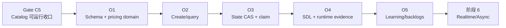

# 下一步重构实施蓝图：Catalog 收口与 Orders/Concurrency

> 状态：实施说明，不代表代码已经落地。本文生成于 2026-08-09；实际版本以 `api/package.json`、`api/pnpm-lock.yaml` 和实施当天重新打开的官方文档为准。
>
> 本文中的手写文件均给出完整目标内容；`api/src/schema.gql`、`api/src/generated/prisma/**` 和 migration 初稿属于工具生成产物，必须通过命令生成并审查，不能手工照抄 generated SDL/Client。

## 1. 执行结论

当前**不能直接把阶段 5 Orders 代码加入主干**。`api/src/catalog/` 已经存在完整的查询和 Owner 管理代码，TypeScript 与 Nest build 也能通过，但 Catalog 尚未满足自己的完成定义。下一步按以下顺序执行：

1. **Gate C5：收口 Catalog**。补齐未应用 migration 中的数据库 CHECK，单独完成全量格式化，确认 migration 目标数据库，应用 migration，生成并审查 Catalog SDL，完成 runtime/query-plan 证据与 `docs/learning/03-catalog-query.md`。
2. **O1：订单数据与纯领域代码**。建立 Order/OrderItem、整数计价快照、选择校验、状态枚举和幂等指纹。
3. **O2：原子创建和 actor-scoped 查询**。在短 Serializable transaction 中从可信菜单计价并嵌套写入订单；实现按 CUSTOMER/OWNER/COURIER 收敛的查询。
4. **O3：状态机与抢单**。使用带旧状态、角色归属和 courier 条件的 `updateMany` compare-and-set；不使用先查后写。
5. **O4：GraphQL 装配与 runtime 并发证据**。生成 SDL，人工验证成功/拒绝/幂等/并发路径。
6. **O5：文档收口**。记录延后 Jest 与前端适配清单；实际完成后创建 `docs/learning/04-orders-concurrency.md`。



本文不把“代码文件已存在”当作切片完成；完成状态必须同时有 migration、运行时契约、并发行为、静态门禁和学习记录证据。

## 2. 2026-08-09 项目状态审计

### 2.1 工作区和提交边界

审计开始时两个 Git 视角均 clean：

```text
root:  main...origin/main
api:   main...origin/main
HEAD:  65ae73b feat: catalog module
```

根仓库和 `api/` 当前显示同一个提交历史，但 `api/` 仍保留独立 `.git` 边界约束；每个实施切片前后仍必须执行两次 status。不得 reset、删除或重写任何一层历史。

### 2.2 已完成到什么程度

| 范围                | 事实                                                                                       | 判断                                         |
| ------------------- | ------------------------------------------------------------------------------------------ | -------------------------------------------- |
| Foundation          | Zod env、Apollo code-first、global `ValidationPipe`、CORS、Prisma lifecycle、health 已存在 | 主要实现已在，但整体 lint 尚未绿             |
| Identity            | register/login/me、Bearer-only guard、角色 guard、邮箱验证代码与安全 User model 已存在     | 主路径已编码；本阶段只做回归，不扩展身份功能 |
| Catalog schema      | Category/Restaurant/Dish Prisma model 与独立 migration 已存在                              | migration 未应用且缺少蓝图要求的两个 CHECK   |
| Catalog application | public queries、Owner restaurant/dish 管理、strict option parser、safe selects 已存在      | `tsc` 和 build 通过，说明基本装配可编译      |
| Generated SDL       | `api/src/schema.gql` 仍只有 Identity operations                                            | Catalog runtime/schema review 尚未完成       |
| Learning evidence   | 只有 learning 01/02，没有 `03-catalog-query.md`                                            | Catalog C5 尚未完成                          |
| Orders              | `api/src/orders/` 不存在；Prisma 无 Order/OrderItem                                        | 阶段 5 尚未开始                              |

### 2.3 实际执行的门禁结果

| 命令                                         | 结果                                   | 含义                                      |
| -------------------------------------------- | -------------------------------------- | ----------------------------------------- |
| `pnpm exec prisma validate`                  | 通过                                   | 当前 Prisma schema 语法有效               |
| `pnpm exec tsc --noEmit --incremental false` | 通过                                   | 当前源码类型可编译                        |
| `pnpm run build`                             | 通过                                   | Nest 可产出构建                           |
| non-fixing ESLint                            | 失败：679 个 `prettier/prettier` error | 格式门禁未完成；没有证据允许忽略          |
| `pnpm exec prisma migrate status`            | 失败状态：Catalog migration pending    | 配置数据库只应用了 init，不能运行 Catalog |

审计没有执行 Jest：仓库当前指导明确把 Jest 实现和执行延后到 functional refactor 全部完成之后。审计也没有应用 migration，因为当前配置指向远端 PostgreSQL，尚未确认它是一次性/个人 development 数据库。

### 2.4 Catalog migration 的确定缺陷

`api/prisma/migrations/20260808161512_catalog_foundation/migration.sql` 当前缺少蓝图已经要求人工加入的：

```sql
CONSTRAINT "dishes_price_minor_check"
  CHECK ("price_minor" >= 0 AND "price_minor" <= 100000000),
CONSTRAINT "dishes_options_array_check"
  CHECK (jsonb_typeof("options") = 'array')
```

因为该 migration 尚未应用，所以应在 Gate C5 中直接修正这个未发布 migration，而不是再造一个“补丁 migration”。若实施时发现它已被任何共享/保留数据库应用，则必须停止，改用新的 forward migration；不能改写已发布历史。

## 3. 范围与非目标

### 3.1 本实施蓝图包含

- Catalog C5 完成门禁和准确退出条件。
- `Order`、`OrderItem`、`OrderStatus` Prisma schema 与独立 migration。
- 客户下单、服务端可信计价、不可变 Dish/option 价格快照。
- 每客户唯一 idempotency key；同 key/同逻辑请求返回原 order，同 key/不同请求拒绝。
- CUSTOMER/OWNER/COURIER actor-scoped `getOrder/getOrders`。
- OWNER 的 `PENDING → COOKING → COOKED`。
- COURIER 的原子抢单与 `COOKED → PICKED_UP → DELIVERED`。
- code-first GraphQL DTO/model/resolver、应用服务、Prisma repository 和 mapper。
- runtime smoke、真实重叠抢单检查、query count/plan 记录方式。
- deferred Jest 和 deferred frontend backlog。

### 3.2 明确不包含

- 不修改 `frontend/`、不运行 frontend codegen/build/test。
- 不修改 `backend/`；它只提供行为和缺陷证据。
- 不在本阶段实现 `pendingOrders`、`cookedOrders`、`orderUpdates` 或 `graphql-ws`；阶段 6 在已提交状态之上接事件端口和订阅。
- 不提前加入 Redis、BullMQ、outbox、CQRS 或分布式锁。
- 不实现取消、退款、配送定位、quantity、税费、优惠、库存或多商家订单。
- 不执行 `prisma migrate reset`，不对未确认用途的数据库 apply migration。
- 不新增或扩写 Jest spec；只维护可测试结构和后续覆盖矩阵。

## 4. Legacy 证据与目标修正

### 4.1 保留的产品行为

- CUSTOMER 从单个 Restaurant 菜单选择 Dish 后创建订单。
- OWNER 只能看自己 Restaurant 的订单，并按 `PENDING → COOKING → COOKED` 推进。
- COURIER 抢一个 Cooked 且未分配的订单，再按 `PICKED_UP → DELIVERED` 推进。
- CUSTOMER、相关 OWNER、已分配 COURIER 可以查看订单。
- 历史 UI 依赖 order id、status、total、customer email、courier/driver email、restaurant name。

### 4.2 不复制的 legacy 缺陷

| Legacy 行为                       | 缺陷                                       | 目标修正                                                                 |
| --------------------------------- | ------------------------------------------ | ------------------------------------------------------------------------ |
| 每个 item 单独查 Dish 并逐个 save | N+1；部分 OrderItem 可在失败后残留         | 一次加载全部可信菜单，单事务 nested create                               |
| Dish 只按 id 查询                 | 可把其他 Restaurant 的 Dish 塞入订单       | `restaurantId + dishIds` 同时收敛，数量必须完全匹配                      |
| 使用 Float 和客户端 option 名     | 浮点计价；旧 choice 匹配写错为 option name | 全部使用 Int minor unit，严格区分 option/choice                          |
| OrderItem 只关联可变 Dish         | 改价/删除会改变或破坏历史事实              | 保存 dish 名、base、选择、extra、line total 快照；dish id 只是 UUID 快照 |
| 多写不在事务内                    | 孤立 item/半订单                           | 一个短 transaction 原子提交                                              |
| 抢单先读 `driver` 再 save         | 两个 courier 可同时成功                    | `UPDATE ... WHERE status=COOKED AND courier_id IS NULL` CAS              |
| edit 只检查目标 status            | 可跳级、回退或基于陈旧状态覆盖             | target 映射唯一 expected status，DB where 同时包含 expected/actor        |
| `canSeeOrder` 先加载完整对象      | 容易形成 IDOR 和过量数据读取               | 查询 where 直接带 customer/owner/courier scope                           |
| 所有错误 catch 后返回字符串       | 吞掉编程和基础设施错误                     | 只映射预期领域结果，未知错误继续抛出并由统一边界清洗                     |
| 发布事件紧贴 save、无 commit 边界 | 可能发布未提交/不完整状态                  | 本阶段不发布；阶段 6 只基于 repository 已返回的 committed fact           |

### 4.3 有意的目标契约变化

- role 使用 `CUSTOMER/OWNER/COURIER`，不接受 `Client/Owner/Delivery` alias。
- enum 使用 `PENDING/COOKING/COOKED/PICKED_UP/DELIVERED`。
- 所有 ID 使用 UUID GraphQL `ID`；order 主键由 Prisma `uuid(7)` 生成。
- `total` 改为 `totalMinor: Int!`；快照金额也都是 `*Minor`。
- `driver` 改为领域术语 `courier`。
- `Order.items[].dish` 改为明确快照字段，不返回当前可变 Dish。
- `createOrder` 新增必填 UUID v4 `idempotencyKey`。
- `getOrders` 新增固定 15 条的 `page`，结果包含 `totalResults/totalPages`。
- mutation payload 增加 `replayed`，表示同一命令的安全重放。

这些变化只写入目标 generated schema 和阶段 9 backlog；当前不加 compatibility shim。

## 5. 目标 GraphQL 契约

### 5.1 Operations

| Operation                        | 角色          | 结果                                    |
| -------------------------------- | ------------- | --------------------------------------- |
| `createOrder(input)`             | CUSTOMER      | `{ ok, error, orderId, replayed }`      |
| `getOrder(input)`                | 任一认证角色  | actor-scoped `Order` 或统一 unavailable |
| `getOrders(input = { page: 1 })` | 任一认证角色  | 当前 actor 可见订单的 15 条分页         |
| `editOrder(input)`               | OWNER/COURIER | 合法状态边 CAS；可识别立即重放          |
| `takeOrder(input)`               | COURIER       | 原子 claim；同 courier 重试可重放       |

### 5.2 业务状态机

| 当前                       | actor      | 命令/目标     | 结果                                   |
| -------------------------- | ---------- | ------------- | -------------------------------------- |
| 创建                       | CUSTOMER   | `createOrder` | `PENDING`、courier null、version 0     |
| `PENDING`                  | 所属 OWNER | `COOKING`     | version + 1                            |
| `COOKING`                  | 所属 OWNER | `COOKED`      | version + 1                            |
| `COOKED` + courier null    | COURIER    | `takeOrder`   | status 不变，设置 courier，version + 1 |
| `COOKED` + 当前 courier    | 同 COURIER | `PICKED_UP`   | version + 1                            |
| `PICKED_UP` + 当前 courier | 同 COURIER | `DELIVERED`   | version + 1                            |

任何其他边、错误 Restaurant owner、错误 courier、CUSTOMER edit、未 claim 就 pickup、第二 courier claim 均不修改数据库。

### 5.3 错误语义

- DTO 形状、UUID、数组上限、空字符串等 transport 错误由 global `ValidationPipe` 变成 GraphQL `BAD_REQUEST`。
- 重复 Dish/option、无效 option 输入等纯输入错误也使用 `BadRequestException`。
- “不存在”和“存在但无权访问”统一返回 `Resource is unavailable.`，降低 IDOR 枚举能力。
- 菜单已变化导致选项不再存在，返回 `One or more order selections are invalid.`。
- 同 idempotency key 不同逻辑请求返回 `The idempotency key was already used for another request.`。
- 已耗尽有限 transaction retry 返回可重试错误；不无限重试。
- 损坏的 persisted JSON、未知 Prisma/编程错误不转成 `{ ok: false }`；记录最小内部标识后抛清洗过的 internal error。

## 6. 数据模型与不变量

### 6.1 Order

- `customerId`、`restaurantId` 为非空 FK，删除策略 `RESTRICT`，历史订单不能因删除主体而失效。
- `courierId` 可空；进入 `PICKED_UP/DELIVERED` 时数据库约束要求非空。
- `PENDING/COOKING` 时 courier 必须为空；`COOKED` 允许 claim 前为空、claim 后非空。
- `totalMinor` 为 `0..2_147_483_647` 的 PostgreSQL `INTEGER` 和 GraphQL `Int`。
- `version >= 0`；每次 claim/transition 用 atomic increment。
- `(customerId, idempotencyKey)` 唯一；`requestHash` 只存 SHA-256 hex，不暴露到 GraphQL。

### 6.2 OrderItem 快照

- 不建立 Dish FK；保存 `dishId` UUID 快照，允许 Catalog 后续删除 Dish 而历史事实仍完整。
- 保存 `dishName`、`basePriceMinor`、`selectedOptions`、`optionsExtraMinor`、`lineTotalMinor`。
- 保存从 0 开始的 `position`，以数据库字段定义 GraphQL items 的稳定顺序，不依赖 UUID/时间戳碰巧有序。
- DB CHECK 保证 `lineTotalMinor = basePriceMinor + optionsExtraMinor`。
- OrderItem 没有 update workflow；应用中视为不可变。
- 每个 `CreateOrderItemInput` 代表 1 份；同一订单不允许重复 dishId。本阶段不静默发明 quantity。

### 6.3 计价边界

1. 客户只提交 restaurantId、dishId、option name 和可选 choice name；不提交任何价格。
2. transaction 内按 restaurantId 和全部唯一 dishId 一次加载可信菜单。
3. persisted `Dish.options` 再过 strict Catalog parser，不能 cast JSON。
4. direct-extra option 必须没有 choice；choice option 必须提供且命中一个 choice。
5. option 名和 choice 名按 trim/collapse/case-insensitive key 匹配，快照保存服务端 canonical name。
6. 每次整数加法后检查 GraphQL/PostgreSQL Int 上限。
7. 先生成全部 priced snapshots，再 nested create Order + OrderItems。

## 7. 并发、事务与幂等策略

### 7.1 createOrder

- 使用 Prisma interactive transaction，显式 `Serializable`、短 `maxWait/timeout`。
- transaction 中没有邮件、HTTP、WebSocket 或 sleep。
- P2034 只做最多 3 次、transaction 外带小抖动重试。
- unique constraint 是 idempotency 的最终仲裁者；“先查 key”只优化常见重放路径。
- 发生 P2002 后在已回滚 transaction 外读取 winner：hash 相同返回原 order，不同返回 conflict。
- request hash 对规范化后的 dish/options 排序，因此同一逻辑选择不因数组顺序不同被误判为不同命令。

### 7.2 editOrder / takeOrder

使用单条条件更新，不使用 read-check-write：

```sql
UPDATE orders
SET courier_id = :courier_id,
    version = version + 1,
    updated_at = CURRENT_TIMESTAMP
WHERE id = :order_id
  AND status = 'COOKED'
  AND courier_id IS NULL;
```

PostgreSQL `READ COMMITTED` 下并发 UPDATE 会等待冲突行，并在已更新版本上重新检查 WHERE；因此两个 courier 对同一订单最多一个 `UPDATE ... RETURNING` 返回一行。状态 transition 同时带 `id + expected status + owner/courier scope`，避免 lost update。

第一次 update 没有返回行时，只做 scoped replay 查询：同一 courier 已 claim，或记录已经处于同一 target status，返回 `replayed: true`；其他情况统一失败。后续阶段已继续推进的旧命令不被当作精确重放，防止客户端用陈旧 UI 掩盖状态漂移。

### 7.3 事件边界

本阶段 repository 返回后才代表 commit 成功。create、transition 和 claim 都返回 `{ orderId, status, version }` committed fact，但 O1–O5 不发布实时事件。阶段 6 将在 application service 收到 `replayed: false` 的 committed result 后构造 `OrderCreated/OrderStatusChanged/OrderClaimed` 事件，并选择 in-memory bus 或 outbox；不得在 transaction callback 内 publish，也不得对 idempotent replay 重复发布。

## 8. 目标文件树

```text
api/
├── prisma/
│   ├── schema.prisma                                  # 完整替换
│   └── migrations/<actual_timestamp>_orders_foundation/
│       └── migration.sql                              # 工具生成后人工审查
└── src/
    ├── app.module.ts                                  # 完整替换
    ├── catalog/application/restaurant-management.service.ts
    └── orders/
        ├── application/
        │   ├── order-command.service.ts
        │   ├── order-query.service.ts
        │   └── parse-order-input.ts
        ├── domain/
        │   ├── assert-order-role.ts
        │   ├── idempotency.ts
        │   ├── order-input.error.ts
        │   ├── order-result.ts
        │   ├── order-selection.ts
        │   ├── order-state.ts
        │   ├── order-status.ts
        │   └── price-order.ts
        ├── dto/
        │   ├── order-command.dto.ts
        │   └── order-query.dto.ts
        ├── models/
        │   └── order.model.ts
        ├── persistence/
        │   ├── order.mapper.ts
        │   ├── order.repository.ts
        │   ├── order.selects.ts
        │   └── selected-options-json.ts
        ├── orders.module.ts
        └── orders.resolver.ts
```

不创建空 `events/` 或 provider adapter；阶段 6 在确有消费者时建立。

## 9. Gate C5：Catalog 必须先收口

### 9.1 开始前保护

```powershell
Set-Location C:\Users\yze\gomi\tiny-food-delivery
git status --short --branch
git -C api status --short --branch
git diff --check
```

若不是 clean，先区分用户已有改动，不覆盖、不 reset。

### 9.2 修正尚未应用的 Catalog migration

只有再次执行 `pnpm exec prisma migrate status` 仍确认 `20260808161512_catalog_foundation` 对所有需保留数据库都未应用时，才把该 migration 完整内容修正为：

```sql
-- CreateTable
CREATE TABLE "categories" (
    "id" UUID NOT NULL,
    "name" VARCHAR(80) NOT NULL,
    "normalized_name" VARCHAR(80) NOT NULL,
    "slug" VARCHAR(100) NOT NULL,
    "cover_image_url" VARCHAR(2048),
    "created_at" TIMESTAMPTZ(3) NOT NULL DEFAULT CURRENT_TIMESTAMP,
    "updated_at" TIMESTAMPTZ(3) NOT NULL,

    CONSTRAINT "categories_pkey" PRIMARY KEY ("id")
);

-- CreateTable
CREATE TABLE "restaurants" (
    "id" UUID NOT NULL,
    "owner_id" UUID NOT NULL,
    "category_id" UUID NOT NULL,
    "name" VARCHAR(120) NOT NULL,
    "address" VARCHAR(255) NOT NULL,
    "cover_image_url" VARCHAR(2048) NOT NULL,
    "created_at" TIMESTAMPTZ(3) NOT NULL DEFAULT CURRENT_TIMESTAMP,
    "updated_at" TIMESTAMPTZ(3) NOT NULL,

    CONSTRAINT "restaurants_pkey" PRIMARY KEY ("id")
);

-- CreateTable
CREATE TABLE "dishes" (
    "id" UUID NOT NULL,
    "restaurant_id" UUID NOT NULL,
    "name" VARCHAR(120) NOT NULL,
    "description" VARCHAR(500) NOT NULL,
    "price_minor" INTEGER NOT NULL,
    "photo_url" VARCHAR(2048),
    "options" JSONB NOT NULL DEFAULT '[]',
    "created_at" TIMESTAMPTZ(3) NOT NULL DEFAULT CURRENT_TIMESTAMP,
    "updated_at" TIMESTAMPTZ(3) NOT NULL,

    CONSTRAINT "dishes_pkey" PRIMARY KEY ("id"),
    CONSTRAINT "dishes_price_minor_check"
      CHECK ("price_minor" >= 0 AND "price_minor" <= 100000000),
    CONSTRAINT "dishes_options_array_check"
      CHECK (jsonb_typeof("options") = 'array')
);

-- CreateIndex
CREATE UNIQUE INDEX "categories_normalized_name_key" ON "categories"("normalized_name");

-- CreateIndex
CREATE UNIQUE INDEX "categories_slug_key" ON "categories"("slug");

-- CreateIndex
CREATE INDEX "restaurants_created_at_id_idx" ON "restaurants"("created_at" DESC, "id" DESC);

-- CreateIndex
CREATE INDEX "restaurants_owner_page_idx" ON "restaurants"("owner_id", "created_at" DESC, "id" DESC);

-- CreateIndex
CREATE INDEX "restaurants_category_page_idx" ON "restaurants"("category_id", "created_at" DESC, "id" DESC);

-- CreateIndex
CREATE INDEX "dishes_restaurant_menu_idx" ON "dishes"("restaurant_id", "created_at", "id");

-- AddForeignKey
ALTER TABLE "restaurants" ADD CONSTRAINT "restaurants_owner_id_fkey"
FOREIGN KEY ("owner_id") REFERENCES "users"("id") ON DELETE RESTRICT ON UPDATE CASCADE;

-- AddForeignKey
ALTER TABLE "restaurants" ADD CONSTRAINT "restaurants_category_id_fkey"
FOREIGN KEY ("category_id") REFERENCES "categories"("id") ON DELETE RESTRICT ON UPDATE CASCADE;

-- AddForeignKey
ALTER TABLE "dishes" ADD CONSTRAINT "dishes_restaurant_id_fkey"
FOREIGN KEY ("restaurant_id") REFERENCES "restaurants"("id") ON DELETE CASCADE ON UPDATE CASCADE;
```

若 migration 已在任何保留数据库应用，不使用上面替换；生成一个新的 `catalog_constraints` forward migration，只添加两个 constraint。

### 9.3 单独格式化提交

当前 679 个 lint error 全属于 Prettier。用单独、可 review 的 mechanical commit 收口，不与 Orders semantic diff 混在一起：

```powershell
Set-Location C:\Users\yze\gomi\tiny-food-delivery\api
pnpm exec prettier --write "src/**/*.ts" "test/**/*.ts"
pnpm exec eslint "src/**/*.ts" "test/**/*.ts"
pnpm exec tsc --noEmit --incremental false
pnpm run build
```

确认没有 ESLint 非格式错误；若出现，单独分析，不能用 `--fix` 掩盖语义变化。

### 9.4 只在已确认数据库上 apply

```powershell
pnpm exec prisma format
pnpm exec prisma validate
pnpm exec prisma generate
pnpm exec prisma migrate status
```

只有明确确认 `DATABASE_URL` 指向个人/一次性 development PostgreSQL 后：

```powershell
pnpm exec prisma migrate dev
pnpm exec prisma migrate status
```

必须验证两个 CHECK、FK delete policy 和三个组合索引。不要把 URL、密码或 token 写入记录。

### 9.5 Catalog runtime 与证据出口

1. 启动应用，让 code-first 生成包含 Catalog 的 `src/schema.gql`。
2. 完成 Identity/health 回归，以及 Catalog 公共、OWNER、options/IDOR smoke。
3. 使用代表性数据记录列表、category、search、menu 的 query count。
4. 记录分页、category 和 `%term%` search 的 `EXPLAIN (ANALYZE, BUFFERS)`；没有证据不加 DataLoader/cache/`pg_trgm`。
5. 创建具有真实结果的 `docs/learning/03-catalog-query.md`。
6. 只有 `docs/refactor/04-catalog-query-implementation.md` 第 18 节全部完成，才创建 Orders migration。

## 10. O1：完整 Prisma schema

Gate C5 通过后，`api/prisma/schema.prisma` 的完整目标内容为：

```prisma
generator client {
  provider     = "prisma-client"
  output       = "../src/generated/prisma"
  moduleFormat = "cjs"
}

datasource db {
  provider = "postgresql"
}

enum UserRole {
  CUSTOMER
  OWNER
  COURIER
}

enum OrderStatus {
  PENDING
  COOKING
  COOKED
  PICKED_UP
  DELIVERED
}

model User {
  id           String    @id @default(uuid(7)) @db.Uuid
  email        String    @unique(map: "users_email_key") @db.VarChar(254)
  passwordHash String    @map("password_hash") @db.VarChar(255)
  role         UserRole  @default(CUSTOMER)
  verifiedAt   DateTime? @map("verified_at") @db.Timestamptz(3)
  createdAt    DateTime  @default(now()) @map("created_at") @db.Timestamptz(3)
  updatedAt    DateTime  @updatedAt @map("updated_at") @db.Timestamptz(3)

  emailVerification EmailVerification?
  restaurants       Restaurant[]
  customerOrders    Order[]            @relation("OrderCustomer")
  courierOrders     Order[]            @relation("OrderCourier")

  @@map("users")
}

model EmailVerification {
  id        String   @id @default(uuid(7)) @db.Uuid
  userId    String   @unique(map: "email_verifications_user_id_key") @map("user_id") @db.Uuid
  tokenHash String   @unique(map: "email_verifications_token_hash_key") @map("token_hash") @db.Char(64)
  expiresAt DateTime @map("expires_at") @db.Timestamptz(3)
  createdAt DateTime @default(now()) @map("created_at") @db.Timestamptz(3)
  user      User     @relation(fields: [userId], references: [id], onDelete: Cascade)

  @@index([expiresAt], map: "email_verifications_expires_at_idx")
  @@map("email_verifications")
}

model Category {
  id             String       @id @default(uuid(7)) @db.Uuid
  name           String       @db.VarChar(80)
  normalizedName String       @unique(map: "categories_normalized_name_key") @map("normalized_name") @db.VarChar(80)
  slug           String       @unique(map: "categories_slug_key") @db.VarChar(100)
  coverImageUrl  String?      @map("cover_image_url") @db.VarChar(2048)
  createdAt      DateTime     @default(now()) @map("created_at") @db.Timestamptz(3)
  updatedAt      DateTime     @updatedAt @map("updated_at") @db.Timestamptz(3)
  restaurants    Restaurant[]

  @@map("categories")
}

model Restaurant {
  id            String   @id @default(uuid(7)) @db.Uuid
  ownerId       String   @map("owner_id") @db.Uuid
  categoryId    String   @map("category_id") @db.Uuid
  name          String   @db.VarChar(120)
  address       String   @db.VarChar(255)
  coverImageUrl String   @map("cover_image_url") @db.VarChar(2048)
  createdAt     DateTime @default(now()) @map("created_at") @db.Timestamptz(3)
  updatedAt     DateTime @updatedAt @map("updated_at") @db.Timestamptz(3)

  owner    User     @relation(fields: [ownerId], references: [id], onDelete: Restrict)
  category Category @relation(fields: [categoryId], references: [id], onDelete: Restrict)
  dishes   Dish[]
  orders   Order[]

  @@index([createdAt(sort: Desc), id(sort: Desc)], map: "restaurants_created_at_id_idx")
  @@index([ownerId, createdAt(sort: Desc), id(sort: Desc)], map: "restaurants_owner_page_idx")
  @@index([categoryId, createdAt(sort: Desc), id(sort: Desc)], map: "restaurants_category_page_idx")
  @@map("restaurants")
}

model Dish {
  id           String     @id @default(uuid(7)) @db.Uuid
  restaurantId String     @map("restaurant_id") @db.Uuid
  name         String     @db.VarChar(120)
  description  String     @db.VarChar(500)
  priceMinor   Int        @map("price_minor")
  photoUrl     String?    @map("photo_url") @db.VarChar(2048)
  options      Json       @default("[]") @db.JsonB
  createdAt    DateTime   @default(now()) @map("created_at") @db.Timestamptz(3)
  updatedAt    DateTime   @updatedAt @map("updated_at") @db.Timestamptz(3)
  restaurant   Restaurant @relation(fields: [restaurantId], references: [id], onDelete: Cascade)

  @@index([restaurantId, createdAt, id], map: "dishes_restaurant_menu_idx")
  @@map("dishes")
}

model Order {
  id             String      @id @default(uuid(7)) @db.Uuid
  customerId     String      @map("customer_id") @db.Uuid
  restaurantId   String      @map("restaurant_id") @db.Uuid
  courierId      String?     @map("courier_id") @db.Uuid
  status         OrderStatus @default(PENDING)
  totalMinor     Int         @map("total_minor")
  version        Int         @default(0)
  idempotencyKey String      @map("idempotency_key") @db.Uuid
  requestHash    String      @map("request_hash") @db.Char(64)
  createdAt      DateTime    @default(now()) @map("created_at") @db.Timestamptz(3)
  updatedAt      DateTime    @updatedAt @map("updated_at") @db.Timestamptz(3)

  customer   User        @relation("OrderCustomer", fields: [customerId], references: [id], onDelete: Restrict)
  courier    User?       @relation("OrderCourier", fields: [courierId], references: [id], onDelete: Restrict)
  restaurant Restaurant  @relation(fields: [restaurantId], references: [id], onDelete: Restrict)
  items      OrderItem[]

  @@unique([customerId, idempotencyKey], map: "orders_customer_idempotency_key")
  @@index([customerId, createdAt(sort: Desc), id(sort: Desc)], map: "orders_customer_page_idx")
  @@index([restaurantId, status, createdAt(sort: Desc), id(sort: Desc)], map: "orders_restaurant_status_page_idx")
  @@index([courierId, status, createdAt(sort: Desc), id(sort: Desc)], map: "orders_courier_status_page_idx")
  @@map("orders")
}

model OrderItem {
  id                String   @id @default(uuid(7)) @db.Uuid
  orderId           String   @map("order_id") @db.Uuid
  position          Int
  dishId            String   @map("dish_id") @db.Uuid
  dishName          String   @map("dish_name") @db.VarChar(120)
  basePriceMinor    Int      @map("base_price_minor")
  selectedOptions   Json     @default("[]") @map("selected_options") @db.JsonB
  optionsExtraMinor Int      @map("options_extra_minor")
  lineTotalMinor    Int      @map("line_total_minor")
  createdAt         DateTime @default(now()) @map("created_at") @db.Timestamptz(3)
  order             Order    @relation(fields: [orderId], references: [id], onDelete: Cascade)

  @@unique([orderId, position], map: "order_items_order_position_key")
  @@map("order_items")
}
```

`OrderItem.dishId` 故意没有 relation；它是购买时事实。`Order.restaurantId` 保留 FK 并 RESTRICT 删除，因为 owner scope 和订单详情仍依赖 Restaurant 身份。

## 11. O1 migration 生成与完整目标 SQL

先生成，不手写 migration 目录时间戳：

```powershell
Set-Location C:\Users\yze\gomi\tiny-food-delivery\api
pnpm exec prisma format
pnpm exec prisma validate
pnpm exec prisma generate
pnpm exec prisma migrate dev --create-only --name orders_foundation
```

工具生成的 migration 必须人工补齐 CHECK，完整 SQL 语义应等价于：

```sql
-- CreateEnum
CREATE TYPE "OrderStatus" AS ENUM ('PENDING', 'COOKING', 'COOKED', 'PICKED_UP', 'DELIVERED');

-- CreateTable
CREATE TABLE "orders" (
    "id" UUID NOT NULL,
    "customer_id" UUID NOT NULL,
    "restaurant_id" UUID NOT NULL,
    "courier_id" UUID,
    "status" "OrderStatus" NOT NULL DEFAULT 'PENDING',
    "total_minor" INTEGER NOT NULL,
    "version" INTEGER NOT NULL DEFAULT 0,
    "idempotency_key" UUID NOT NULL,
    "request_hash" CHAR(64) NOT NULL,
    "created_at" TIMESTAMPTZ(3) NOT NULL DEFAULT CURRENT_TIMESTAMP,
    "updated_at" TIMESTAMPTZ(3) NOT NULL,

    CONSTRAINT "orders_pkey" PRIMARY KEY ("id"),
    CONSTRAINT "orders_total_minor_check"
      CHECK ("total_minor" >= 0 AND "total_minor" <= 2147483647),
    CONSTRAINT "orders_version_check" CHECK ("version" >= 0),
    CONSTRAINT "orders_request_hash_check"
      CHECK ("request_hash" ~ '^[0-9a-f]{64}$'),
    CONSTRAINT "orders_courier_state_check" CHECK (
      ("status" IN ('PENDING', 'COOKING') AND "courier_id" IS NULL)
      OR "status" = 'COOKED'
      OR ("status" IN ('PICKED_UP', 'DELIVERED') AND "courier_id" IS NOT NULL)
    )
);

-- CreateTable
CREATE TABLE "order_items" (
    "id" UUID NOT NULL,
    "order_id" UUID NOT NULL,
    "position" INTEGER NOT NULL,
    "dish_id" UUID NOT NULL,
    "dish_name" VARCHAR(120) NOT NULL,
    "base_price_minor" INTEGER NOT NULL,
    "selected_options" JSONB NOT NULL DEFAULT '[]',
    "options_extra_minor" INTEGER NOT NULL,
    "line_total_minor" INTEGER NOT NULL,
    "created_at" TIMESTAMPTZ(3) NOT NULL DEFAULT CURRENT_TIMESTAMP,

    CONSTRAINT "order_items_pkey" PRIMARY KEY ("id"),
    CONSTRAINT "order_items_position_check"
      CHECK ("position" >= 0 AND "position" < 25),
    CONSTRAINT "order_items_base_price_check"
      CHECK ("base_price_minor" >= 0 AND "base_price_minor" <= 100000000),
    CONSTRAINT "order_items_options_extra_check"
      CHECK ("options_extra_minor" >= 0 AND "options_extra_minor" <= 2147483647),
    CONSTRAINT "order_items_line_total_check"
      CHECK (
        "line_total_minor" >= 0
        AND "line_total_minor" <= 2147483647
        AND "line_total_minor" = "base_price_minor" + "options_extra_minor"
      ),
    CONSTRAINT "order_items_selected_options_array_check"
      CHECK (jsonb_typeof("selected_options") = 'array')
);

-- CreateIndex
CREATE UNIQUE INDEX "orders_customer_idempotency_key"
ON "orders"("customer_id", "idempotency_key");

-- CreateIndex
CREATE INDEX "orders_customer_page_idx"
ON "orders"("customer_id", "created_at" DESC, "id" DESC);

-- CreateIndex
CREATE INDEX "orders_restaurant_status_page_idx"
ON "orders"("restaurant_id", "status", "created_at" DESC, "id" DESC);

-- CreateIndex
CREATE INDEX "orders_courier_status_page_idx"
ON "orders"("courier_id", "status", "created_at" DESC, "id" DESC);

-- CreateIndex
CREATE UNIQUE INDEX "order_items_order_position_key"
ON "order_items"("order_id", "position");

-- AddForeignKey
ALTER TABLE "orders" ADD CONSTRAINT "orders_customer_id_fkey"
FOREIGN KEY ("customer_id") REFERENCES "users"("id") ON DELETE RESTRICT ON UPDATE CASCADE;

-- AddForeignKey
ALTER TABLE "orders" ADD CONSTRAINT "orders_restaurant_id_fkey"
FOREIGN KEY ("restaurant_id") REFERENCES "restaurants"("id") ON DELETE RESTRICT ON UPDATE CASCADE;

-- AddForeignKey
ALTER TABLE "orders" ADD CONSTRAINT "orders_courier_id_fkey"
FOREIGN KEY ("courier_id") REFERENCES "users"("id") ON DELETE RESTRICT ON UPDATE CASCADE;

-- AddForeignKey
ALTER TABLE "order_items" ADD CONSTRAINT "order_items_order_id_fkey"
FOREIGN KEY ("order_id") REFERENCES "orders"("id") ON DELETE CASCADE ON UPDATE CASCADE;
```

出现 drop/recreate User、Category、Restaurant、Dish 或修改旧 migration 时立即停止。review 后只在确认过的 development PostgreSQL apply，再重新 generate。

## 12. O1 纯领域代码（完整文件）

### 12.1 `api/src/orders/domain/order-status.ts`

```ts
import { OrderStatus as PrismaOrderStatus } from '@/generated/prisma/enums';
import { registerEnumType } from '@nestjs/graphql';

export enum OrderStatus {
  PENDING = 'PENDING',
  COOKING = 'COOKING',
  COOKED = 'COOKED',
  PICKED_UP = 'PICKED_UP',
  DELIVERED = 'DELIVERED',
}

registerEnumType(OrderStatus, {
  name: 'OrderStatus',
  description: 'The lifecycle state of an order',
});

export function toPrismaOrderStatus(status: OrderStatus): PrismaOrderStatus {
  switch (status) {
    case OrderStatus.PENDING:
      return PrismaOrderStatus.PENDING;
    case OrderStatus.COOKING:
      return PrismaOrderStatus.COOKING;
    case OrderStatus.COOKED:
      return PrismaOrderStatus.COOKED;
    case OrderStatus.PICKED_UP:
      return PrismaOrderStatus.PICKED_UP;
    case OrderStatus.DELIVERED:
      return PrismaOrderStatus.DELIVERED;
  }
}

export function toPublicOrderStatus(status: PrismaOrderStatus): OrderStatus {
  switch (status) {
    case PrismaOrderStatus.PENDING:
      return OrderStatus.PENDING;
    case PrismaOrderStatus.COOKING:
      return OrderStatus.COOKING;
    case PrismaOrderStatus.COOKED:
      return OrderStatus.COOKED;
    case PrismaOrderStatus.PICKED_UP:
      return OrderStatus.PICKED_UP;
    case PrismaOrderStatus.DELIVERED:
      return OrderStatus.DELIVERED;
  }
}
```

### 12.2 `api/src/orders/domain/order-input.error.ts`

```ts
export class OrderInputError extends Error {
  constructor(message: string) {
    super(message);
    this.name = OrderInputError.name;
  }
}
```

### 12.3 `api/src/orders/application/parse-order-input.ts`

```ts
import { OrderInputError } from '../domain/order-input.error';
import { BadRequestException } from '@nestjs/common';

export function parseOrderInput<T>(factory: () => T): T {
  try {
    return factory();
  } catch (error) {
    if (error instanceof OrderInputError) {
      throw new BadRequestException(error.message);
    }
    throw error;
  }
}
```

### 12.4 `api/src/orders/domain/order-result.ts`

```ts
export enum OrderMutationError {
  ResourceUnavailable = 'RESOURCE_UNAVAILABLE',
  InvalidSelection = 'INVALID_SELECTION',
  InvalidTransition = 'INVALID_TRANSITION',
  IdempotencyConflict = 'IDEMPOTENCY_CONFLICT',
  RetryableConflict = 'RETRYABLE_CONFLICT',
}

export type OrderResult<T> =
  | {
      ok: true;
      value: T;
      replayed: boolean;
    }
  | {
      ok: false;
      error: OrderMutationError;
    };

export class ExpectedOrderError extends Error {
  constructor(readonly code: OrderMutationError) {
    super(code);
    this.name = ExpectedOrderError.name;
  }
}

export function orderErrorMessage(error: OrderMutationError): string {
  switch (error) {
    case OrderMutationError.ResourceUnavailable:
      return 'Resource is unavailable.';
    case OrderMutationError.InvalidSelection:
      return 'One or more order selections are invalid.';
    case OrderMutationError.InvalidTransition:
      return 'The order cannot be moved to that status.';
    case OrderMutationError.IdempotencyConflict:
      return 'The idempotency key was already used for another request.';
    case OrderMutationError.RetryableConflict:
      return 'The order could not be committed. Retry with the same idempotency key.';
  }
}
```

### 12.5 `api/src/orders/domain/assert-order-role.ts`

```ts
import type { AuthenticatedPrincipal } from '@/auth/auth-principal';
import { UserRole } from '@/users/user-role.enum';
import { ForbiddenException } from '@nestjs/common';

export function assertCustomer(principal: AuthenticatedPrincipal): void {
  if (principal.role !== UserRole.CUSTOMER) {
    throw new ForbiddenException('Insufficient role.');
  }
}

export function assertOrderEditor(principal: AuthenticatedPrincipal): void {
  if (
    principal.role !== UserRole.OWNER &&
    principal.role !== UserRole.COURIER
  ) {
    throw new ForbiddenException('Insufficient role.');
  }
}

export function assertCourier(principal: AuthenticatedPrincipal): void {
  if (principal.role !== UserRole.COURIER) {
    throw new ForbiddenException('Insufficient role.');
  }
}
```

### 12.6 `api/src/orders/domain/order-selection.ts`

```ts
import { OrderInputError } from './order-input.error';

export const MAX_ORDER_ITEMS = 25;
export const MAX_SELECTED_OPTIONS = 20;

export interface RequestedOrderOption {
  name: string;
  nameKey: string;
  choice: string | null;
  choiceKey: string | null;
}

export interface RequestedOrderItem {
  dishId: string;
  options: RequestedOrderOption[];
}

export interface SelectedOrderOptionSnapshot {
  name: string;
  choice: string | null;
  extraMinor: number;
}

export function parseRequestedOrderItems(value: unknown): RequestedOrderItem[] {
  if (!Array.isArray(value)) {
    throw new OrderInputError('items must be an array.');
  }
  if (value.length === 0 || value.length > MAX_ORDER_ITEMS) {
    throw new OrderInputError(
      `items must contain between 1 and ${MAX_ORDER_ITEMS} entries.`,
    );
  }

  const dishIds = new Set<string>();
  return value.map((candidate, itemIndex) => {
    const path = `items[${itemIndex}]`;
    assertRecord(candidate, path);
    assertKnownKeys(candidate, ['dishId', 'options'], path);

    if (typeof candidate.dishId !== 'string' || candidate.dishId.length === 0) {
      throw new OrderInputError(`${path}.dishId must be a UUID string.`);
    }
    if (dishIds.has(candidate.dishId)) {
      throw new OrderInputError('Each dish can appear only once in an order.');
    }
    dishIds.add(candidate.dishId);

    const options = candidate.options ?? [];
    if (!Array.isArray(options)) {
      throw new OrderInputError(`${path}.options must be an array.`);
    }
    if (options.length > MAX_SELECTED_OPTIONS) {
      throw new OrderInputError(
        `${path}.options must contain at most ${MAX_SELECTED_OPTIONS} entries.`,
      );
    }

    const optionNames = new Set<string>();
    const parsedOptions = options.map((option, optionIndex) => {
      const optionPath = `${path}.options[${optionIndex}]`;
      assertRecord(option, optionPath);
      assertKnownKeys(option, ['name', 'choice'], optionPath);

      const name = normalizeSelectionName(option.name, `${optionPath}.name`);
      const nameKey = selectionKey(name);
      if (optionNames.has(nameKey)) {
        throw new OrderInputError(
          `${path}.options contains a duplicate option name.`,
        );
      }
      optionNames.add(nameKey);

      const choice = normalizeOptionalSelectionName(
        option.choice,
        `${optionPath}.choice`,
      );
      return {
        name,
        nameKey,
        choice,
        choiceKey: choice === null ? null : selectionKey(choice),
      };
    });

    return {
      dishId: candidate.dishId,
      options: parsedOptions,
    };
  });
}

export function selectionKey(value: string): string {
  return value.toLowerCase();
}

function normalizeSelectionName(value: unknown, path: string): string {
  if (typeof value !== 'string') {
    throw new OrderInputError(`${path} must be a string.`);
  }

  const normalized = value.trim().replace(/\s+/gu, ' ');
  if (normalized.length === 0 || normalized.length > 60) {
    throw new OrderInputError(
      `${path} must contain between 1 and 60 characters.`,
    );
  }
  return normalized;
}

function normalizeOptionalSelectionName(
  value: unknown,
  path: string,
): string | null {
  if (value === undefined || value === null) {
    return null;
  }
  return normalizeSelectionName(value, path);
}

function assertRecord(
  value: unknown,
  path: string,
): asserts value is Record<string, unknown> {
  if (typeof value !== 'object' || value === null || Array.isArray(value)) {
    throw new OrderInputError(`${path} must be an object.`);
  }
}

function assertKnownKeys(
  value: Record<string, unknown>,
  allowedKeys: readonly string[],
  path: string,
): void {
  const allowed = new Set(allowedKeys);
  const unknownKey = Object.keys(value).find((key) => !allowed.has(key));
  if (unknownKey) {
    throw new OrderInputError(`${path}.${unknownKey} is not allowed.`);
  }
}
```

### 12.7 `api/src/orders/domain/idempotency.ts`

```ts
import type { RequestedOrderItem } from './order-selection';
import { createHash } from 'node:crypto';

export function createOrderRequestHash(
  restaurantId: string,
  items: readonly RequestedOrderItem[],
): string {
  const canonicalItems = items
    .map((item) => ({
      dishId: item.dishId,
      options: item.options
        .map((option) => ({
          name: option.nameKey,
          choice: option.choiceKey,
        }))
        .sort((left, right) => compareText(left.name, right.name)),
    }))
    .sort((left, right) => compareText(left.dishId, right.dishId));

  const canonicalRequest = JSON.stringify({
    restaurantId,
    items: canonicalItems,
  });

  return createHash('sha256').update(canonicalRequest, 'utf8').digest('hex');
}

function compareText(left: string, right: string): number {
  if (left < right) {
    return -1;
  }
  if (left > right) {
    return 1;
  }
  return 0;
}
```

### 12.8 `api/src/orders/domain/price-order.ts`

```ts
import { CatalogInputError } from '@/catalog/domain/catalog-input.error';
import {
  type MenuOptionDefinition,
  parseMenuOptionDefinitions,
} from '@/catalog/domain/menu-option-definition';
import {
  type RequestedOrderItem,
  type SelectedOrderOptionSnapshot,
  selectionKey,
} from './order-selection';
import { ExpectedOrderError, OrderMutationError } from './order-result';

const MAX_GRAPHQL_INT = 2_147_483_647;

export interface OrderableDish {
  id: string;
  name: string;
  priceMinor: number;
  options: unknown;
}

export interface PricedOrderItem {
  dishId: string;
  dishName: string;
  basePriceMinor: number;
  selectedOptions: SelectedOrderOptionSnapshot[];
  optionsExtraMinor: number;
  lineTotalMinor: number;
}

export interface PricedOrder {
  items: PricedOrderItem[];
  totalMinor: number;
}

export class PersistedCatalogPricingError extends Error {
  constructor(readonly dishId: string) {
    super(`Invalid persisted menu options for dish ${dishId}.`);
    this.name = PersistedCatalogPricingError.name;
  }
}

export function priceOrder(
  requestedItems: readonly RequestedOrderItem[],
  dishes: readonly OrderableDish[],
): PricedOrder {
  const dishesById = new Map(dishes.map((dish) => [dish.id, dish]));
  let totalMinor = 0;

  const items = requestedItems.map((requestedItem): PricedOrderItem => {
    const dish = dishesById.get(requestedItem.dishId);
    if (!dish) {
      throw new ExpectedOrderError(OrderMutationError.ResourceUnavailable);
    }

    let definitions: MenuOptionDefinition[];
    try {
      definitions = parseMenuOptionDefinitions(dish.options);
    } catch (error) {
      if (error instanceof CatalogInputError) {
        throw new PersistedCatalogPricingError(dish.id);
      }
      throw error;
    }

    const definitionsByName = new Map(
      definitions.map((definition) => [
        selectionKey(definition.name),
        definition,
      ]),
    );
    let optionsExtraMinor = 0;

    const selectedOptions = requestedItem.options.map(
      (requested): SelectedOrderOptionSnapshot => {
        const definition = definitionsByName.get(requested.nameKey);
        if (!definition) {
          throw new ExpectedOrderError(OrderMutationError.InvalidSelection);
        }

        if (definition.choices !== undefined) {
          if (requested.choiceKey === null) {
            throw new ExpectedOrderError(OrderMutationError.InvalidSelection);
          }

          const choice = definition.choices.find(
            (candidate) => selectionKey(candidate.name) === requested.choiceKey,
          );
          if (!choice) {
            throw new ExpectedOrderError(OrderMutationError.InvalidSelection);
          }

          optionsExtraMinor = safeMoneyAdd(
            optionsExtraMinor,
            choice.extraMinor,
          );
          return {
            name: definition.name,
            choice: choice.name,
            extraMinor: choice.extraMinor,
          };
        }

        if (requested.choice !== null) {
          throw new ExpectedOrderError(OrderMutationError.InvalidSelection);
        }

        optionsExtraMinor = safeMoneyAdd(
          optionsExtraMinor,
          definition.extraMinor,
        );
        return {
          name: definition.name,
          choice: null,
          extraMinor: definition.extraMinor,
        };
      },
    );

    const lineTotalMinor = safeMoneyAdd(dish.priceMinor, optionsExtraMinor);
    totalMinor = safeMoneyAdd(totalMinor, lineTotalMinor);

    return {
      dishId: dish.id,
      dishName: dish.name,
      basePriceMinor: dish.priceMinor,
      selectedOptions,
      optionsExtraMinor,
      lineTotalMinor,
    };
  });

  return { items, totalMinor };
}

function safeMoneyAdd(left: number, right: number): number {
  const total = left + right;
  if (!Number.isSafeInteger(total) || total < 0 || total > MAX_GRAPHQL_INT) {
    throw new ExpectedOrderError(OrderMutationError.InvalidSelection);
  }
  return total;
}
```

### 12.9 `api/src/orders/domain/order-state.ts`

```ts
import type { AuthenticatedPrincipal } from '@/auth/auth-principal';
import { UserRole } from '@/users/user-role.enum';
import { OrderStatus } from './order-status';

export interface OrderTransition {
  from: OrderStatus;
  to: OrderStatus;
}

export function requestedTransition(
  principal: AuthenticatedPrincipal,
  target: OrderStatus,
): OrderTransition | null {
  if (principal.role === UserRole.OWNER) {
    switch (target) {
      case OrderStatus.COOKING:
        return { from: OrderStatus.PENDING, to: OrderStatus.COOKING };
      case OrderStatus.COOKED:
        return { from: OrderStatus.COOKING, to: OrderStatus.COOKED };
      default:
        return null;
    }
  }

  if (principal.role === UserRole.COURIER) {
    switch (target) {
      case OrderStatus.PICKED_UP:
        return { from: OrderStatus.COOKED, to: OrderStatus.PICKED_UP };
      case OrderStatus.DELIVERED:
        return { from: OrderStatus.PICKED_UP, to: OrderStatus.DELIVERED };
      default:
        return null;
    }
  }

  return null;
}
```

## 13. O1 GraphQL model 与 DTO（完整文件）

### 13.1 `api/src/orders/models/order.model.ts`

```ts
import { OrderStatus } from '../domain/order-status';
import { Field, ID, Int, ObjectType } from '@nestjs/graphql';

@ObjectType('OrderParty')
export class OrderPartyModel {
  @Field(() => ID)
  id!: string;

  @Field()
  email!: string;
}

@ObjectType('OrderRestaurant')
export class OrderRestaurantModel {
  @Field(() => ID)
  id!: string;

  @Field()
  name!: string;

  @Field()
  address!: string;
}

@ObjectType('SelectedOrderOption')
export class SelectedOrderOptionModel {
  @Field()
  name!: string;

  @Field(() => String, { nullable: true })
  choice!: string | null;

  @Field(() => Int)
  extraMinor!: number;
}

@ObjectType('OrderItem')
export class OrderItemModel {
  @Field(() => ID)
  id!: string;

  @Field(() => ID)
  dishId!: string;

  @Field()
  dishName!: string;

  @Field(() => Int)
  basePriceMinor!: number;

  @Field(() => [SelectedOrderOptionModel])
  selectedOptions!: SelectedOrderOptionModel[];

  @Field(() => Int)
  optionsExtraMinor!: number;

  @Field(() => Int)
  lineTotalMinor!: number;
}

@ObjectType('Order')
export class OrderModel {
  @Field(() => ID)
  id!: string;

  @Field(() => OrderStatus)
  status!: OrderStatus;

  @Field(() => Int)
  totalMinor!: number;

  @Field(() => Int)
  version!: number;

  @Field(() => OrderPartyModel)
  customer!: OrderPartyModel;

  @Field(() => OrderPartyModel, { nullable: true })
  courier!: OrderPartyModel | null;

  @Field(() => OrderRestaurantModel)
  restaurant!: OrderRestaurantModel;

  @Field(() => [OrderItemModel])
  items!: OrderItemModel[];

  @Field(() => Date)
  createdAt!: Date;

  @Field(() => Date)
  updatedAt!: Date;
}
```

`OrderParty` 只暴露订单 UI 真正需要的 id/email，不把 `emailVerified`、role、账户时间等 User 元数据扩大到订单图中；更不会选择 `passwordHash`。

### 13.2 `api/src/orders/dto/order-command.dto.ts`

```ts
import {
  MAX_ORDER_ITEMS,
  MAX_SELECTED_OPTIONS,
} from '../domain/order-selection';
import { OrderStatus } from '../domain/order-status';
import { OperationPayload } from '@/common/dto/operation.payload';
import { Field, ID, InputType, ObjectType } from '@nestjs/graphql';
import { Transform, Type } from 'class-transformer';
import {
  ArrayMaxSize,
  ArrayMinSize,
  IsArray,
  IsEnum,
  IsOptional,
  IsString,
  IsUUID,
  MaxLength,
  MinLength,
  ValidateNested,
} from 'class-validator';

const trimString = ({ value }: { value: unknown }): unknown =>
  typeof value === 'string' ? value.trim() : value;

@InputType()
export class OrderOptionSelectionInput {
  @Field()
  @Transform(trimString)
  @IsString()
  @MinLength(1)
  @MaxLength(60)
  name!: string;

  @Field(() => String, { nullable: true })
  @IsOptional()
  @Transform(trimString)
  @IsString()
  @MinLength(1)
  @MaxLength(60)
  choice?: string | null;
}

@InputType()
export class CreateOrderItemInput {
  @Field(() => ID)
  @IsUUID('7')
  dishId!: string;

  @Field(() => [OrderOptionSelectionInput], { defaultValue: [] })
  @IsArray()
  @ArrayMaxSize(MAX_SELECTED_OPTIONS)
  @ValidateNested({ each: true })
  @Type(() => OrderOptionSelectionInput)
  options: OrderOptionSelectionInput[] = [];
}

@InputType()
export class CreateOrderInput {
  @Field(() => ID)
  @IsUUID('7')
  restaurantId!: string;

  @Field(() => ID, {
    description:
      'A client-generated UUID v4 scoped to the authenticated customer',
  })
  @IsUUID('4')
  idempotencyKey!: string;

  @Field(() => [CreateOrderItemInput])
  @IsArray()
  @ArrayMinSize(1)
  @ArrayMaxSize(MAX_ORDER_ITEMS)
  @ValidateNested({ each: true })
  @Type(() => CreateOrderItemInput)
  items!: CreateOrderItemInput[];
}

@InputType()
export class EditOrderInput {
  @Field(() => ID)
  @IsUUID('7')
  orderId!: string;

  @Field(() => OrderStatus)
  @IsEnum(OrderStatus)
  status!: OrderStatus;
}

@InputType()
export class TakeOrderInput {
  @Field(() => ID)
  @IsUUID('7')
  orderId!: string;
}

@ObjectType()
export class CreateOrderPayload extends OperationPayload {
  @Field(() => ID, { nullable: true })
  orderId?: string;

  @Field(() => Boolean)
  replayed: boolean = false;
}

@ObjectType()
export class OrderOperationPayload extends OperationPayload {
  @Field(() => Boolean)
  replayed: boolean = false;
}
```

### 13.3 `api/src/orders/dto/order-query.dto.ts`

```ts
import { OrderStatus } from '../domain/order-status';
import { OrderModel } from '../models/order.model';
import { OperationPayload } from '@/common/dto/operation.payload';
import { PageInput } from '@/common/pagination/page.input';
import { Field, ID, InputType, Int, ObjectType } from '@nestjs/graphql';
import { IsEnum, IsOptional, IsUUID } from 'class-validator';

@InputType()
export class GetOrderInput {
  @Field(() => ID)
  @IsUUID('7')
  orderId!: string;
}

@InputType()
export class GetOrdersInput extends PageInput {
  @Field(() => OrderStatus, { nullable: true })
  @IsOptional()
  @IsEnum(OrderStatus)
  status?: OrderStatus | null;
}

@ObjectType()
export class GetOrderPayload extends OperationPayload {
  @Field(() => OrderModel, { nullable: true })
  order?: OrderModel;
}

@ObjectType()
export class GetOrdersPayload extends OperationPayload {
  @Field(() => [OrderModel])
  orders: OrderModel[] = [];

  @Field(() => Int)
  totalResults = 0;

  @Field(() => Int)
  totalPages = 0;
}
```

## 14. O2 Persistence（完整文件）

### 14.1 `api/src/orders/persistence/order.selects.ts`

```ts
import { Prisma } from '@/generated/prisma/client';

export const ORDER_PARTY_SELECT = {
  id: true,
  email: true,
} as const satisfies Prisma.UserSelect;

export const ORDER_RESTAURANT_SELECT = {
  id: true,
  name: true,
  address: true,
} as const satisfies Prisma.RestaurantSelect;

export const ORDERABLE_DISH_SELECT = {
  id: true,
  name: true,
  priceMinor: true,
  options: true,
} as const satisfies Prisma.DishSelect;

export const ORDER_ITEM_SELECT = {
  id: true,
  dishId: true,
  dishName: true,
  basePriceMinor: true,
  selectedOptions: true,
  optionsExtraMinor: true,
  lineTotalMinor: true,
} as const satisfies Prisma.OrderItemSelect;

export const ORDER_SELECT = {
  id: true,
  status: true,
  totalMinor: true,
  version: true,
  createdAt: true,
  updatedAt: true,
  customer: {
    select: ORDER_PARTY_SELECT,
  },
  courier: {
    select: ORDER_PARTY_SELECT,
  },
  restaurant: {
    select: ORDER_RESTAURANT_SELECT,
  },
  items: {
    select: ORDER_ITEM_SELECT,
    orderBy: { position: 'asc' },
  },
} as const satisfies Prisma.OrderSelect;

export type OrderableDishRecord = Prisma.DishGetPayload<{
  select: typeof ORDERABLE_DISH_SELECT;
}>;

export type OrderRecord = Prisma.OrderGetPayload<{
  select: typeof ORDER_SELECT;
}>;
```

所有 select 都是 allow-list。`requestHash`、`idempotencyKey`、relation FK 和 User 内部字段不会进入 mapper 输入。

### 14.2 `api/src/orders/persistence/selected-options-json.ts`

```ts
import type { SelectedOrderOptionSnapshot } from '../domain/order-selection';
import { OrderInputError } from '../domain/order-input.error';
import { Prisma } from '@/generated/prisma/client';

const MAX_SELECTED_OPTIONS = 20;
const MAX_GRAPHQL_INT = 2_147_483_647;

export function toPrismaSelectedOptions(
  options: readonly SelectedOrderOptionSnapshot[],
): Prisma.InputJsonValue {
  return options.map((option): Prisma.InputJsonObject => ({
    name: option.name,
    choice: option.choice,
    extraMinor: option.extraMinor,
  }));
}

export function parseSelectedOptionsSnapshot(
  value: unknown,
): SelectedOrderOptionSnapshot[] {
  if (!Array.isArray(value) || value.length > MAX_SELECTED_OPTIONS) {
    throw new OrderInputError(
      'Persisted selectedOptions must be a bounded array.',
    );
  }

  return value.map((candidate, index) => {
    const path = `selectedOptions[${index}]`;
    if (
      typeof candidate !== 'object' ||
      candidate === null ||
      Array.isArray(candidate)
    ) {
      throw new OrderInputError(`${path} must be an object.`);
    }

    const record = candidate as Record<string, unknown>;
    const allowed = new Set(['name', 'choice', 'extraMinor']);
    if (Object.keys(record).some((key) => !allowed.has(key))) {
      throw new OrderInputError(`${path} contains an unknown field.`);
    }

    if (
      typeof record.name !== 'string' ||
      record.name.length === 0 ||
      record.name.length > 60
    ) {
      throw new OrderInputError(`${path}.name is invalid.`);
    }
    if (
      record.choice !== null &&
      (typeof record.choice !== 'string' ||
        record.choice.length === 0 ||
        record.choice.length > 60)
    ) {
      throw new OrderInputError(`${path}.choice is invalid.`);
    }
    if (
      typeof record.extraMinor !== 'number' ||
      !Number.isInteger(record.extraMinor) ||
      record.extraMinor < 0 ||
      record.extraMinor > MAX_GRAPHQL_INT
    ) {
      throw new OrderInputError(`${path}.extraMinor is invalid.`);
    }

    return {
      name: record.name,
      choice: record.choice,
      extraMinor: record.extraMinor,
    };
  });
}
```

### 14.3 `api/src/orders/persistence/order.mapper.ts`

```ts
import { OrderInputError } from '../domain/order-input.error';
import { toPublicOrderStatus } from '../domain/order-status';
import type { OrderModel } from '../models/order.model';
import type { OrderRecord } from './order.selects';
import { parseSelectedOptionsSnapshot } from './selected-options-json';
import {
  Injectable,
  InternalServerErrorException,
  Logger,
} from '@nestjs/common';

@Injectable()
export class OrderMapper {
  private readonly logger = new Logger(OrderMapper.name);

  toModel(order: OrderRecord): OrderModel {
    return {
      id: order.id,
      status: toPublicOrderStatus(order.status),
      totalMinor: order.totalMinor,
      version: order.version,
      customer: { ...order.customer },
      courier: order.courier ? { ...order.courier } : null,
      restaurant: { ...order.restaurant },
      items: order.items.map((item) => {
        try {
          return {
            id: item.id,
            dishId: item.dishId,
            dishName: item.dishName,
            basePriceMinor: item.basePriceMinor,
            selectedOptions: parseSelectedOptionsSnapshot(item.selectedOptions),
            optionsExtraMinor: item.optionsExtraMinor,
            lineTotalMinor: item.lineTotalMinor,
          };
        } catch (error) {
          if (!(error instanceof OrderInputError)) {
            throw error;
          }
          this.logger.error(
            `Invalid persisted selected options for order item ${item.id}.`,
          );
          throw new InternalServerErrorException('Order data is unavailable.');
        }
      }),
      createdAt: order.createdAt,
      updatedAt: order.updatedAt,
    };
  }
}
```

### 14.4 `api/src/orders/persistence/order.repository.ts`

```ts
import type { AuthenticatedPrincipal } from '@/auth/auth-principal';
import { PAGE_SIZE } from '@/common/pagination/page.constants';
import {
  type PageResult,
  pageOffset,
  toPageResult,
} from '@/common/pagination/page.types';
import { Prisma } from '@/generated/prisma/client';
import { OrderStatus as PrismaOrderStatus } from '@/generated/prisma/enums';
import { PrismaService } from '@/prisma/prisma.service';
import { UserRole } from '@/users/user-role.enum';
import {
  ExpectedOrderError,
  OrderMutationError,
  type OrderResult,
} from '../domain/order-result';
import type { RequestedOrderItem } from '../domain/order-selection';
import {
  OrderStatus,
  toPrismaOrderStatus,
  toPublicOrderStatus,
} from '../domain/order-status';
import { priceOrder } from '../domain/price-order';
import type { OrderTransition } from '../domain/order-state';
import {
  ORDER_SELECT,
  ORDERABLE_DISH_SELECT,
  type OrderRecord,
} from './order.selects';
import { toPrismaSelectedOptions } from './selected-options-json';
import { Injectable } from '@nestjs/common';
import { setTimeout as delay } from 'node:timers/promises';

const MAX_TRANSACTION_ATTEMPTS = 3;

export interface CreateOrderRecord {
  customerId: string;
  restaurantId: string;
  idempotencyKey: string;
  requestHash: string;
  items: RequestedOrderItem[];
}

export interface CommittedOrderFact {
  orderId: string;
  status: OrderStatus;
  version: number;
}

export type CreatedOrder = CommittedOrderFact;

@Injectable()
export class OrderRepository {
  constructor(private readonly prisma: PrismaService) {}

  async create(input: CreateOrderRecord): Promise<OrderResult<CreatedOrder>> {
    for (let attempt = 1; attempt <= MAX_TRANSACTION_ATTEMPTS; attempt += 1) {
      try {
        return await this.prisma.$transaction(
          async (transaction): Promise<OrderResult<CreatedOrder>> => {
            const existing = await transaction.order.findUnique({
              where: {
                customerId_idempotencyKey: {
                  customerId: input.customerId,
                  idempotencyKey: input.idempotencyKey,
                },
              },
              select: {
                id: true,
                requestHash: true,
                status: true,
                version: true,
              },
            });

            if (existing) {
              return existing.requestHash === input.requestHash
                ? {
                    ok: true,
                    value: toCommittedOrderFact(existing),
                    replayed: true,
                  }
                : {
                    ok: false,
                    error: OrderMutationError.IdempotencyConflict,
                  };
            }

            const restaurant = await transaction.restaurant.findUnique({
              where: { id: input.restaurantId },
              select: {
                id: true,
                dishes: {
                  where: {
                    id: {
                      in: input.items.map((item) => item.dishId),
                    },
                  },
                  select: ORDERABLE_DISH_SELECT,
                },
              },
            });

            if (
              !restaurant ||
              restaurant.dishes.length !== input.items.length
            ) {
              throw new ExpectedOrderError(
                OrderMutationError.ResourceUnavailable,
              );
            }

            const priced = priceOrder(input.items, restaurant.dishes);
            const created = await transaction.order.create({
              data: {
                customerId: input.customerId,
                restaurantId: restaurant.id,
                idempotencyKey: input.idempotencyKey,
                requestHash: input.requestHash,
                totalMinor: priced.totalMinor,
                items: {
                  create: priced.items.map((item, position) => ({
                    position,
                    dishId: item.dishId,
                    dishName: item.dishName,
                    basePriceMinor: item.basePriceMinor,
                    selectedOptions: toPrismaSelectedOptions(
                      item.selectedOptions,
                    ),
                    optionsExtraMinor: item.optionsExtraMinor,
                    lineTotalMinor: item.lineTotalMinor,
                  })),
                },
              },
              select: {
                id: true,
                status: true,
                version: true,
              },
            });

            return {
              ok: true,
              value: toCommittedOrderFact(created),
              replayed: false,
            };
          },
          {
            isolationLevel: Prisma.TransactionIsolationLevel.Serializable,
            maxWait: 2_000,
            timeout: 5_000,
          },
        );
      } catch (error) {
        if (error instanceof ExpectedOrderError) {
          return { ok: false, error: error.code };
        }

        if (hasPrismaCode(error, 'P2003')) {
          return {
            ok: false,
            error: OrderMutationError.ResourceUnavailable,
          };
        }

        if (hasPrismaCode(error, 'P2002')) {
          return this.resolveIdempotencyRace(input);
        }

        if (hasPrismaCode(error, 'P2034')) {
          if (attempt === MAX_TRANSACTION_ATTEMPTS) {
            return {
              ok: false,
              error: OrderMutationError.RetryableConflict,
            };
          }
          await delay(attempt * 10 + Math.floor(Math.random() * 10));
          continue;
        }

        throw error;
      }
    }

    return {
      ok: false,
      error: OrderMutationError.RetryableConflict,
    };
  }

  async findScoped(
    principal: AuthenticatedPrincipal,
    orderId: string,
  ): Promise<OrderRecord | null> {
    return this.prisma.order.findFirst({
      where: {
        id: orderId,
        ...scopeWhere(principal),
      },
      select: ORDER_SELECT,
    });
  }

  async listScoped(
    principal: AuthenticatedPrincipal,
    status: OrderStatus | undefined,
    page: number,
  ): Promise<PageResult<OrderRecord>> {
    const where: Prisma.OrderWhereInput = {
      ...scopeWhere(principal),
      ...(status === undefined ? {} : { status: toPrismaOrderStatus(status) }),
    };

    const [orders, totalResults] = await this.prisma.$transaction([
      this.prisma.order.findMany({
        where,
        select: ORDER_SELECT,
        orderBy: [{ createdAt: 'desc' }, { id: 'desc' }],
        skip: pageOffset(page),
        take: PAGE_SIZE,
      }),
      this.prisma.order.count({ where }),
    ]);

    return toPageResult(orders, totalResults);
  }

  async transition(
    principal: AuthenticatedPrincipal,
    orderId: string,
    transition: OrderTransition,
  ): Promise<OrderResult<CommittedOrderFact>> {
    const actorWhere = editorScopeWhere(principal);
    const updated = await this.prisma.order.updateManyAndReturn({
      where: {
        id: orderId,
        status: toPrismaOrderStatus(transition.from),
        ...actorWhere,
      },
      data: {
        status: toPrismaOrderStatus(transition.to),
        version: { increment: 1 },
      },
      select: {
        id: true,
        status: true,
        version: true,
      },
    });

    if (updated.length === 1) {
      return {
        ok: true,
        value: toCommittedOrderFact(updated[0]),
        replayed: false,
      };
    }

    const replay = await this.prisma.order.findFirst({
      where: {
        id: orderId,
        status: toPrismaOrderStatus(transition.to),
        ...actorWhere,
      },
      select: {
        id: true,
        status: true,
        version: true,
      },
    });

    return replay
      ? {
          ok: true,
          value: toCommittedOrderFact(replay),
          replayed: true,
        }
      : { ok: false, error: OrderMutationError.InvalidTransition };
  }

  async take(
    courierId: string,
    orderId: string,
  ): Promise<OrderResult<CommittedOrderFact>> {
    const updated = await this.prisma.order.updateManyAndReturn({
      where: {
        id: orderId,
        status: toPrismaOrderStatus(OrderStatus.COOKED),
        courierId: null,
      },
      data: {
        courierId,
        version: { increment: 1 },
      },
      select: {
        id: true,
        status: true,
        version: true,
      },
    });

    if (updated.length === 1) {
      return {
        ok: true,
        value: toCommittedOrderFact(updated[0]),
        replayed: false,
      };
    }

    const replay = await this.prisma.order.findFirst({
      where: {
        id: orderId,
        courierId,
        status: {
          in: [
            toPrismaOrderStatus(OrderStatus.COOKED),
            toPrismaOrderStatus(OrderStatus.PICKED_UP),
            toPrismaOrderStatus(OrderStatus.DELIVERED),
          ],
        },
      },
      select: {
        id: true,
        status: true,
        version: true,
      },
    });

    return replay
      ? {
          ok: true,
          value: toCommittedOrderFact(replay),
          replayed: true,
        }
      : { ok: false, error: OrderMutationError.ResourceUnavailable };
  }

  private async resolveIdempotencyRace(
    input: CreateOrderRecord,
  ): Promise<OrderResult<CreatedOrder>> {
    const winner = await this.prisma.order.findUnique({
      where: {
        customerId_idempotencyKey: {
          customerId: input.customerId,
          idempotencyKey: input.idempotencyKey,
        },
      },
      select: {
        id: true,
        requestHash: true,
        status: true,
        version: true,
      },
    });

    if (!winner) {
      return { ok: false, error: OrderMutationError.RetryableConflict };
    }

    return winner.requestHash === input.requestHash
      ? {
          ok: true,
          value: toCommittedOrderFact(winner),
          replayed: true,
        }
      : {
          ok: false,
          error: OrderMutationError.IdempotencyConflict,
        };
  }
}

function scopeWhere(principal: AuthenticatedPrincipal): Prisma.OrderWhereInput {
  switch (principal.role) {
    case UserRole.CUSTOMER:
      return { customerId: principal.userId };
    case UserRole.OWNER:
      return {
        restaurant: {
          is: { ownerId: principal.userId },
        },
      };
    case UserRole.COURIER:
      return { courierId: principal.userId };
  }
}

function editorScopeWhere(
  principal: AuthenticatedPrincipal,
): Prisma.OrderWhereInput {
  switch (principal.role) {
    case UserRole.OWNER:
      return {
        restaurant: {
          is: { ownerId: principal.userId },
        },
      };
    case UserRole.COURIER:
      return { courierId: principal.userId };
    case UserRole.CUSTOMER:
      throw new Error('Customer cannot edit orders.');
  }
}

function hasPrismaCode(
  error: unknown,
  code: string,
): error is { code: string } {
  return (
    typeof error === 'object' &&
    error !== null &&
    'code' in error &&
    (error as { code?: unknown }).code === code
  );
}

function toCommittedOrderFact(order: {
  id: string;
  status: PrismaOrderStatus;
  version: number;
}): CommittedOrderFact {
  return {
    orderId: order.id,
    status: toPublicOrderStatus(order.status),
    version: order.version,
  };
}
```

`editorScopeWhere` 的 CUSTOMER 分支是内部编程错误：application service 和 Resolver guard 都会先拒绝 CUSTOMER；repository 仍选择立即失败，而不是构造一个放宽或伪造的 where。

## 15. O2/O3 Application service（完整文件）

### 15.1 `api/src/orders/application/order-command.service.ts`

```ts
import type { AuthenticatedPrincipal } from '@/auth/auth-principal';
import {
  assertCourier,
  assertCustomer,
  assertOrderEditor,
} from '../domain/assert-order-role';
import { createOrderRequestHash } from '../domain/idempotency';
import { OrderMutationError, type OrderResult } from '../domain/order-result';
import { parseRequestedOrderItems } from '../domain/order-selection';
import { requestedTransition } from '../domain/order-state';
import { PersistedCatalogPricingError } from '../domain/price-order';
import type { OrderStatus } from '../domain/order-status';
import {
  type CommittedOrderFact,
  type CreatedOrder,
  OrderRepository,
} from '../persistence/order.repository';
import { parseOrderInput } from './parse-order-input';
import {
  Injectable,
  InternalServerErrorException,
  Logger,
} from '@nestjs/common';

export interface CreateOrderCommand {
  restaurantId: string;
  idempotencyKey: string;
  items: unknown;
}

@Injectable()
export class OrderCommandService {
  private readonly logger = new Logger(OrderCommandService.name);

  constructor(private readonly orders: OrderRepository) {}

  async create(
    principal: AuthenticatedPrincipal,
    command: CreateOrderCommand,
  ): Promise<OrderResult<CreatedOrder>> {
    assertCustomer(principal);
    const items = parseOrderInput(() =>
      parseRequestedOrderItems(command.items),
    );
    const requestHash = createOrderRequestHash(command.restaurantId, items);

    try {
      return await this.orders.create({
        customerId: principal.userId,
        restaurantId: command.restaurantId,
        idempotencyKey: command.idempotencyKey,
        requestHash,
        items,
      });
    } catch (error) {
      if (!(error instanceof PersistedCatalogPricingError)) {
        throw error;
      }
      this.logger.error(
        `Order pricing rejected persisted dish ${error.dishId}.`,
      );
      throw new InternalServerErrorException('Order pricing is unavailable.');
    }
  }

  async edit(
    principal: AuthenticatedPrincipal,
    orderId: string,
    target: OrderStatus,
  ): Promise<OrderResult<CommittedOrderFact>> {
    assertOrderEditor(principal);
    const transition = requestedTransition(principal, target);
    if (!transition) {
      return {
        ok: false,
        error: OrderMutationError.InvalidTransition,
      };
    }
    return this.orders.transition(principal, orderId, transition);
  }

  take(
    principal: AuthenticatedPrincipal,
    orderId: string,
  ): Promise<OrderResult<CommittedOrderFact>> {
    assertCourier(principal);
    return this.orders.take(principal.userId, orderId);
  }
}
```

### 15.2 `api/src/orders/application/order-query.service.ts`

```ts
import type { AuthenticatedPrincipal } from '@/auth/auth-principal';
import type { PageResult } from '@/common/pagination/page.types';
import type { OrderStatus } from '../domain/order-status';
import type { OrderModel } from '../models/order.model';
import { OrderMapper } from '../persistence/order.mapper';
import { OrderRepository } from '../persistence/order.repository';
import { Injectable } from '@nestjs/common';

@Injectable()
export class OrderQueryService {
  constructor(
    private readonly orders: OrderRepository,
    private readonly mapper: OrderMapper,
  ) {}

  async getOrder(
    principal: AuthenticatedPrincipal,
    orderId: string,
  ): Promise<OrderModel | null> {
    const order = await this.orders.findScoped(principal, orderId);
    return order ? this.mapper.toModel(order) : null;
  }

  async getOrders(
    principal: AuthenticatedPrincipal,
    status: OrderStatus | undefined,
    page: number,
  ): Promise<PageResult<OrderModel>> {
    const result = await this.orders.listScoped(principal, status, page);
    return {
      ...result,
      results: result.results.map((order) => this.mapper.toModel(order)),
    };
  }
}
```

## 16. O4 Resolver 和 module（完整文件）

### 16.1 `api/src/orders/orders.resolver.ts`

```ts
import type { AuthenticatedPrincipal } from '@/auth/auth-principal';
import { CurrentPrincipal } from '@/auth/current-principal.decorator';
import { GqlAuthGuard } from '@/auth/gql-auth.guard';
import { Roles } from '@/auth/roles.decorator';
import { RolesGuard } from '@/auth/roles.guard';
import { UserRole } from '@/users/user-role.enum';
import { OrderCommandService } from './application/order-command.service';
import { OrderQueryService } from './application/order-query.service';
import { orderErrorMessage } from './domain/order-result';
import {
  CreateOrderInput,
  CreateOrderPayload,
  EditOrderInput,
  OrderOperationPayload,
  TakeOrderInput,
} from './dto/order-command.dto';
import {
  GetOrderInput,
  GetOrderPayload,
  GetOrdersInput,
  GetOrdersPayload,
} from './dto/order-query.dto';
import { OrderModel } from './models/order.model';
import { UseGuards } from '@nestjs/common';
import { Args, Mutation, Query, Resolver } from '@nestjs/graphql';

@UseGuards(GqlAuthGuard, RolesGuard)
@Resolver(() => OrderModel)
export class OrdersResolver {
  constructor(
    private readonly commands: OrderCommandService,
    private readonly queries: OrderQueryService,
  ) {}

  @Roles(UserRole.CUSTOMER)
  @Mutation(() => CreateOrderPayload)
  async createOrder(
    @CurrentPrincipal() principal: AuthenticatedPrincipal,
    @Args('input') input: CreateOrderInput,
  ): Promise<CreateOrderPayload> {
    const result = await this.commands.create(principal, input);
    return result.ok
      ? {
          ok: true,
          orderId: result.value.orderId,
          replayed: result.replayed,
        }
      : {
          ok: false,
          error: orderErrorMessage(result.error),
          replayed: false,
        };
  }

  @Roles(UserRole.CUSTOMER, UserRole.OWNER, UserRole.COURIER)
  @Query(() => GetOrderPayload)
  async getOrder(
    @CurrentPrincipal() principal: AuthenticatedPrincipal,
    @Args('input') input: GetOrderInput,
  ): Promise<GetOrderPayload> {
    const order = await this.queries.getOrder(principal, input.orderId);
    return order
      ? { ok: true, order }
      : {
          ok: false,
          error: 'Resource is unavailable.',
        };
  }

  @Roles(UserRole.CUSTOMER, UserRole.OWNER, UserRole.COURIER)
  @Query(() => GetOrdersPayload)
  async getOrders(
    @CurrentPrincipal() principal: AuthenticatedPrincipal,
    @Args('input', {
      type: () => GetOrdersInput,
      defaultValue: { page: 1 },
    })
    input: GetOrdersInput,
  ): Promise<GetOrdersPayload> {
    const page = await this.queries.getOrders(
      principal,
      input.status ?? undefined,
      input.page,
    );
    return {
      ok: true,
      orders: page.results,
      totalResults: page.totalResults,
      totalPages: page.totalPages,
    };
  }

  @Roles(UserRole.OWNER, UserRole.COURIER)
  @Mutation(() => OrderOperationPayload)
  async editOrder(
    @CurrentPrincipal() principal: AuthenticatedPrincipal,
    @Args('input') input: EditOrderInput,
  ): Promise<OrderOperationPayload> {
    const result = await this.commands.edit(
      principal,
      input.orderId,
      input.status,
    );
    return result.ok
      ? { ok: true, replayed: result.replayed }
      : {
          ok: false,
          error: orderErrorMessage(result.error),
          replayed: false,
        };
  }

  @Roles(UserRole.COURIER)
  @Mutation(() => OrderOperationPayload)
  async takeOrder(
    @CurrentPrincipal() principal: AuthenticatedPrincipal,
    @Args('input') input: TakeOrderInput,
  ): Promise<OrderOperationPayload> {
    const result = await this.commands.take(principal, input.orderId);
    return result.ok
      ? { ok: true, replayed: result.replayed }
      : {
          ok: false,
          error: orderErrorMessage(result.error),
          replayed: false,
        };
  }
}
```

### 16.2 `api/src/orders/orders.module.ts`

```ts
import { AuthModule } from '@/auth/auth.module';
import { PrismaModule } from '@/prisma/prisma.module';
import { OrderCommandService } from './application/order-command.service';
import { OrderQueryService } from './application/order-query.service';
import { OrdersResolver } from './orders.resolver';
import { OrderMapper } from './persistence/order.mapper';
import { OrderRepository } from './persistence/order.repository';
import { Module } from '@nestjs/common';

@Module({
  imports: [PrismaModule, AuthModule],
  providers: [
    OrdersResolver,
    OrderCommandService,
    OrderQueryService,
    OrderRepository,
    OrderMapper,
  ],
})
export class OrdersModule {}
```

### 16.3 `api/src/app.module.ts`

```ts
import { AuthModule } from '@/auth/auth.module';
import { GraphqlContext } from '@/auth/graphql-context';
import { CatalogModule } from '@/catalog/catalog.module';
import { EnvironmentVariables } from '@/config/environment.variables';
import { validateEnvironment } from '@/config/validate-environment';
import { HealthModule } from '@/health/health.module';
import { OrdersModule } from '@/orders/orders.module';
import { UsersModule } from '@/users/users.module';
import { ApolloDriver, ApolloDriverConfig } from '@nestjs/apollo';
import { Module } from '@nestjs/common';
import { ConfigModule, ConfigService } from '@nestjs/config';
import { GraphQLModule } from '@nestjs/graphql';
import { Request, Response } from 'express';
import { join } from 'node:path';
import { AppController } from './app.controller';
import { AppService } from './app.service';

@Module({
  imports: [
    ConfigModule.forRoot({
      isGlobal: true,
      cache: true,
      validate: validateEnvironment,
      ignoreEnvFile: process.env.NODE_ENV === 'production',
    }),
    GraphQLModule.forRootAsync<ApolloDriverConfig>({
      driver: ApolloDriver,
      imports: [ConfigModule],
      inject: [ConfigService],
      useFactory: (
        config: ConfigService<EnvironmentVariables, true>,
      ): ApolloDriverConfig => ({
        driver: ApolloDriver,
        graphiql: config.get('NODE_ENV', { infer: true }) !== 'production',
        autoSchemaFile: join(process.cwd(), 'src/schema.gql'),
        sortSchema: true,
        context: ({
          req,
          res,
        }: {
          req: Request;
          res: Response;
        }): GraphqlContext => ({
          request: req,
          response: res,
        }),
      }),
    }),
    HealthModule,
    AuthModule,
    UsersModule,
    CatalogModule,
    OrdersModule,
  ],
  controllers: [AppController],
  providers: [AppService],
})
export class AppModule {}
```

模块依赖是 `Orders → Auth + Prisma`；它通过 Prisma 读取 Catalog 持久化事实，不让 Resolver 调用 Catalog resolver，也不让 Catalog 反向依赖 Orders。

## 17. Orders FK 对 Catalog 删除路径的完整修正

Order → Restaurant 使用 `RESTRICT` 后，已有订单的 Restaurant 不能 hard delete。`api/src/catalog/application/restaurant-management.service.ts` 必须捕获 P2003，避免把底层 FK 细节作为 internal error 泄漏。完整目标内容：

```ts
import { assertOwner } from './assert-owner';
import { parseCatalogInput } from './parse-catalog-input';
import {
  type NormalizedCategoryName,
  normalizeCategoryName,
} from '../domain/category-name';
import { normalizeCatalogText, normalizeHttpUrl } from '../domain/catalog-text';
import {
  CatalogMutationError,
  type CatalogResult,
} from '../domain/catalog-result';
import type { RestaurantModel } from '../models/restaurant.model';
import { CatalogMapper } from '../persistence/catalog.mapper';
import { hasPrismaCode } from '../persistence/prisma-error';
import { RestaurantRepository } from '../persistence/restaurant.repository';
import type { AuthenticatedPrincipal } from '@/auth/auth-principal';
import { BadRequestException, Injectable } from '@nestjs/common';

export interface CreateRestaurantCommand {
  name: string;
  address: string;
  coverImageUrl: string;
  categoryName: string;
}

export interface EditRestaurantCommand {
  restaurantId: string;
  name?: string | null;
  address?: string | null;
  coverImageUrl?: string | null;
  categoryName?: string | null;
}

interface RestaurantChanges {
  name?: string;
  address?: string;
  coverImageUrl?: string;
  category?: NormalizedCategoryName;
}

@Injectable()
export class RestaurantManagementService {
  constructor(
    private readonly restaurants: RestaurantRepository,
    private readonly mapper: CatalogMapper,
  ) {}

  async create(
    principal: AuthenticatedPrincipal,
    command: CreateRestaurantCommand,
  ): Promise<CatalogResult<RestaurantModel>> {
    assertOwner(principal);
    const input = parseCatalogInput(() => ({
      ownerId: principal.userId,
      name: normalizeCatalogText(command.name, 'name', 1, 120),
      address: normalizeCatalogText(command.address, 'address', 3, 255),
      coverImageUrl: normalizeHttpUrl(command.coverImageUrl, 'coverImageUrl'),
      category: normalizeCategoryName(command.categoryName),
    }));

    try {
      const created = await this.restaurants.create(input);
      return {
        ok: true,
        value: this.mapper.toRestaurant(created),
      };
    } catch (error) {
      if (hasPrismaCode(error, 'P2002')) {
        return {
          ok: false,
          error: CatalogMutationError.CategoryConflict,
        };
      }
      if (hasPrismaCode(error, 'P2003') || hasPrismaCode(error, 'P2025')) {
        return {
          ok: false,
          error: CatalogMutationError.ResourceUnavailable,
        };
      }
      throw error;
    }
  }

  async edit(
    principal: AuthenticatedPrincipal,
    command: EditRestaurantCommand,
  ): Promise<CatalogResult<undefined>> {
    assertOwner(principal);
    const changes = parseCatalogInput(() => normalizeChanges(command));

    if (Object.keys(changes).length === 0) {
      throw new BadRequestException(
        'At least one restaurant field must be changed.',
      );
    }

    try {
      const updated = await this.restaurants.update({
        restaurantId: command.restaurantId,
        ownerId: principal.userId,
        ...changes,
      });
      return updated
        ? { ok: true, value: undefined }
        : {
            ok: false,
            error: CatalogMutationError.ResourceUnavailable,
          };
    } catch (error) {
      if (hasPrismaCode(error, 'P2002')) {
        return {
          ok: false,
          error: CatalogMutationError.CategoryConflict,
        };
      }
      if (hasPrismaCode(error, 'P2003') || hasPrismaCode(error, 'P2025')) {
        return {
          ok: false,
          error: CatalogMutationError.ResourceUnavailable,
        };
      }
      throw error;
    }
  }

  async delete(
    principal: AuthenticatedPrincipal,
    restaurantId: string,
  ): Promise<CatalogResult<undefined>> {
    assertOwner(principal);

    try {
      const deleted = await this.restaurants.delete(
        restaurantId,
        principal.userId,
      );
      return deleted
        ? { ok: true, value: undefined }
        : {
            ok: false,
            error: CatalogMutationError.ResourceUnavailable,
          };
    } catch (error) {
      if (hasPrismaCode(error, 'P2003') || hasPrismaCode(error, 'P2025')) {
        return {
          ok: false,
          error: CatalogMutationError.ResourceUnavailable,
        };
      }
      throw error;
    }
  }
}

function normalizeChanges(command: EditRestaurantCommand): RestaurantChanges {
  const changes: RestaurantChanges = {};

  if (command.name !== undefined && command.name !== null) {
    changes.name = normalizeCatalogText(command.name, 'name', 1, 120);
  }
  if (command.address !== undefined && command.address !== null) {
    changes.address = normalizeCatalogText(command.address, 'address', 3, 255);
  }
  if (command.coverImageUrl !== undefined && command.coverImageUrl !== null) {
    changes.coverImageUrl = normalizeHttpUrl(
      command.coverImageUrl,
      'coverImageUrl',
    );
  }
  if (command.categoryName !== undefined && command.categoryName !== null) {
    changes.category = normalizeCategoryName(command.categoryName);
  }

  return changes;
}
```

本阶段不引入 soft-delete；如果未来产品需要隐藏 Restaurant 但保留订单，应作为独立 schema/查询语义变更设计，而不是把 FK 改成 `CASCADE`。

## 18. Generated SDL 审查目标

启动应用后由 code-first 生成 `api/src/schema.gql`。Orders 部分应在语义上等价于下列 SDL；不得手工编辑 generated 文件：

```graphql
enum OrderStatus {
  PENDING
  COOKING
  COOKED
  PICKED_UP
  DELIVERED
}

input OrderOptionSelectionInput {
  name: String!
  choice: String
}

input CreateOrderItemInput {
  dishId: ID!
  options: [OrderOptionSelectionInput!]! = []
}

input CreateOrderInput {
  restaurantId: ID!
  idempotencyKey: ID!
  items: [CreateOrderItemInput!]!
}

input GetOrderInput {
  orderId: ID!
}

input GetOrdersInput {
  page: Int! = 1
  status: OrderStatus
}

input EditOrderInput {
  orderId: ID!
  status: OrderStatus!
}

input TakeOrderInput {
  orderId: ID!
}

type OrderParty {
  id: ID!
  email: String!
}

type OrderRestaurant {
  id: ID!
  name: String!
  address: String!
}

type SelectedOrderOption {
  name: String!
  choice: String
  extraMinor: Int!
}

type OrderItem {
  id: ID!
  dishId: ID!
  dishName: String!
  basePriceMinor: Int!
  selectedOptions: [SelectedOrderOption!]!
  optionsExtraMinor: Int!
  lineTotalMinor: Int!
}

type Order {
  id: ID!
  status: OrderStatus!
  totalMinor: Int!
  version: Int!
  customer: OrderParty!
  courier: OrderParty
  restaurant: OrderRestaurant!
  items: [OrderItem!]!
  createdAt: DateTime!
  updatedAt: DateTime!
}

type CreateOrderPayload {
  ok: Boolean!
  error: String
  orderId: ID
  replayed: Boolean!
}

type OrderOperationPayload {
  ok: Boolean!
  error: String
  replayed: Boolean!
}

type GetOrderPayload {
  ok: Boolean!
  error: String
  order: Order
}

type GetOrdersPayload {
  ok: Boolean!
  error: String
  orders: [Order!]!
  totalResults: Int!
  totalPages: Int!
}

extend type Query {
  getOrder(input: GetOrderInput!): GetOrderPayload!
  getOrders(input: GetOrdersInput! = { page: 1 }): GetOrdersPayload!
}

extend type Mutation {
  createOrder(input: CreateOrderInput!): CreateOrderPayload!
  editOrder(input: EditOrderInput!): OrderOperationPayload!
  takeOrder(input: TakeOrderInput!): OrderOperationPayload!
}
```

实际 generator 会把字段合并进单一 `type Query`/`type Mutation`，不会输出 `extend`；上面仅用于聚焦 Orders diff。

审查命令：

```powershell
rg -n "createOrder|getOrder|getOrders|editOrder|takeOrder|OrderStatus" src/schema.gql
rg -n "totalMinor|basePriceMinor|selectedOptions|courier|replayed|version" src/schema.gql
rg -n "requestHash|idempotencyKey:.*Order|customerId|restaurantId:.*Order|courierId|password|x-jwt|Float" src/schema.gql
```

第三条除 `CreateOrderInput.idempotencyKey` 之外不得命中 Orders internal 字段；更稳妥的 review 是直接打开相关 SDL 段落，而不是仅依赖正则。

## 19. 分切片实施与验证

### 19.1 O1：schema/domain

交付：

- 完整 Prisma schema + create-only migration + CHECK review。
- order status/result/input/selection/idempotency/pricing/state 纯领域代码。
- GraphQL model/DTO。
- Prisma generate 后 typecheck。

门禁：

```powershell
pnpm exec prisma format
pnpm exec prisma validate
pnpm exec prisma generate
pnpm exec tsc --noEmit --incremental false
pnpm exec eslint "src/**/*.ts" "test/**/*.ts"
pnpm run build
```

只有确认 migration SQL 不破坏已有表，才 apply 到确认过的 development DB。

### 19.2 O2：create/query

使用本地开发 fixture 准备：

- 1 CUSTOMER、2 OWNER、2 COURIER；
- OWNER A/B 各一个 Restaurant；
- OWNER A Restaurant 至少两个 Dish：一个 direct extra，一个 choices option；
- 明确记录 ID，但不记录 password/JWT/DB URL。

代表性创建请求：

```graphql
mutation CreateOrder($input: CreateOrderInput!) {
  createOrder(input: $input) {
    ok
    error
    orderId
    replayed
  }
}
```

```json
{
  "input": {
    "restaurantId": "<RESTAURANT_UUID_V7>",
    "idempotencyKey": "9ee9ed0d-b98f-4c82-9a62-ce9f56a46afb",
    "items": [
      {
        "dishId": "<DIRECT_EXTRA_DISH_UUID_V7>",
        "options": [{ "name": "Extra egg" }]
      },
      {
        "dishId": "<CHOICE_DISH_UUID_V7>",
        "options": [{ "name": "Spice", "choice": "Hot" }]
      }
    ]
  }
}
```

人工核对：

1. response total 不由客户端提交。
2. DB 中 Order 和全部 OrderItem 同时存在，line/total 与菜单一致。
3. 改 Dish name/price/options 后，原 OrderItem 快照不变。
4. 删除 Dish 后订单仍可读；删除 Restaurant 因 FK 被安全拒绝。
5. 同 key、同逻辑请求（即使 item/options 数组顺序变化）返回相同 orderId 和 `replayed: true`。
6. 同 key、不同 dish/option 返回 idempotency conflict，订单行数不增加。
7. 其他 Restaurant Dish、未知 option、direct option 携带 choice、choice option 缺 choice 均失败且不产生任何行。

代表性查询：

```graphql
query GetOrder($input: GetOrderInput!) {
  getOrder(input: $input) {
    ok
    error
    order {
      id
      status
      totalMinor
      version
      customer {
        id
        email
      }
      courier {
        id
        email
      }
      restaurant {
        id
        name
        address
      }
      items {
        id
        dishId
        dishName
        basePriceMinor
        optionsExtraMinor
        lineTotalMinor
        selectedOptions {
          name
          choice
          extraMinor
        }
      }
    }
  }
}
```

用 CUSTOMER 自己、另一个 CUSTOMER、所属 OWNER、另一个 OWNER、未分配 COURIER 分别请求；只有 CUSTOMER 自己和所属 OWNER 成功。claim 后只有已分配 COURIER 成功。

### 19.3 O3：状态与抢单

OWNER：

```graphql
mutation EditOrder($input: EditOrderInput!) {
  editOrder(input: $input) {
    ok
    error
    replayed
  }
}
```

依次提交 `COOKING`、`COOKED`；验证错误 owner、直接 `PENDING → COOKED`、回退和重复陈旧命令不写入。

COURIER claim：

```graphql
mutation TakeOrder($input: TakeOrderInput!) {
  takeOrder(input: $input) {
    ok
    error
    replayed
  }
}
```

同一 courier 重试应成功且 `replayed: true`；第二 courier 应统一 unavailable。claim 后仅当前 courier 能提交 `PICKED_UP`、`DELIVERED`。

### 19.4 真正重叠的人工 claim 证据

两个顺序请求不能证明竞态安全。准备一个 `COOKED/courier_id NULL` 订单，在本地 PowerShell 进程中把两个临时 Bearer token 只放变量，然后同时启动：

```powershell
$claimDocument = @'
mutation TakeOrder($input: TakeOrderInput!) {
  takeOrder(input: $input) { ok error replayed }
}
'@

$claimBody = @{
  query = $claimDocument
  variables = @{ input = @{ orderId = $orderId } }
} | ConvertTo-Json -Depth 6

$claimJobs = @(
  Start-Job -ScriptBlock {
    param($body, $token)
    Invoke-RestMethod `
      -Method Post `
      -Uri 'http://localhost:3000/graphql' `
      -ContentType 'application/json' `
      -Headers @{ Authorization = "Bearer $token" } `
      -Body $body
  } -ArgumentList $claimBody, $courierAToken
  Start-Job -ScriptBlock {
    param($body, $token)
    Invoke-RestMethod `
      -Method Post `
      -Uri 'http://localhost:3000/graphql' `
      -ContentType 'application/json' `
      -Headers @{ Authorization = "Bearer $token" } `
      -Body $body
  } -ArgumentList $claimBody, $courierBToken
)

$claimResults = $claimJobs | Wait-Job | Receive-Job
$claimJobs | Remove-Job
$claimResults | ConvertTo-Json -Depth 8
```

出口证据：两个不同 courier 中恰好一个 `ok: true`；DB 只有一个 courierId，version 只增加 1。重复多轮时每轮使用新订单，不把同一个已 claim 订单误当竞态。

同理用同一 idempotency key 并发发送两个完全相同的 createOrder，请求都应得到同一 orderId，数据库只有一个 Order 和一组 OrderItem。

### 19.5 O4 最终静态和运行时门禁

```powershell
Set-Location C:\Users\yze\gomi\tiny-food-delivery\api
pnpm exec prettier --check "src/**/*.ts" "test/**/*.ts"
pnpm exec prisma format
pnpm exec prisma validate
pnpm exec prisma generate
pnpm exec prisma migrate status
pnpm exec tsc --noEmit --incremental false
pnpm exec eslint "src/**/*.ts" "test/**/*.ts"
pnpm run build
```

本 functional-refactor 阶段不执行 `pnpm test`、`test:e2e`、`test:cov`。如果仓库指导之后显式开始 Jest 阶段，再以第 22 节 backlog 为输入。

启动应用后还要回归：health、Identity Bearer/x-jwt 拒绝、Catalog public/Owner、Orders 全部 operations。最后检查两个 Git 视角并确认 `backend/`、`frontend/` 未变。

## 20. Query count 与 PostgreSQL plan 证据

必须记录“随 item/order 数量是否线性增长”，而不只记录单次毫秒数：

| 路径               | 期望 shape                                                                                                    |
| ------------------ | ------------------------------------------------------------------------------------------------------------- |
| createOrder 新请求 | idempotency read + bounded restaurant/menu load + nested Order/OrderItems write；不能每 item 一次 Dish select |
| createOrder replay | unique key read；不重新读取当前菜单、不重复写 item                                                            |
| getOrder           | actor-scoped Order 和 bounded relations；不能先读取无 scope order                                             |
| getOrders          | list + count，加 bounded relation loading；query 数不随 15 个 Order 线性增长                                  |
| editOrder 成功     | 一条 conditional update；失败/replay 最多再一条 scoped select                                                 |
| takeOrder 成功     | 一条 conditional update；失败/replay 最多再一条 scoped select                                                 |

对以下等价 SQL 执行 `EXPLAIN (ANALYZE, BUFFERS)`，参数使用本地 fixture：

```sql
EXPLAIN (ANALYZE, BUFFERS)
SELECT id, status, total_minor, version, created_at, updated_at
FROM orders
WHERE customer_id = '<CUSTOMER_UUID>'::uuid
ORDER BY created_at DESC, id DESC
LIMIT 15 OFFSET 0;
```

```sql
EXPLAIN (ANALYZE, BUFFERS)
SELECT o.id, o.status, o.total_minor, o.created_at, o.updated_at
FROM orders AS o
JOIN restaurants AS r ON r.id = o.restaurant_id
WHERE r.owner_id = '<OWNER_UUID>'::uuid
  AND o.status = 'PENDING'
ORDER BY o.created_at DESC, o.id DESC
LIMIT 15 OFFSET 0;
```

```sql
EXPLAIN (ANALYZE, BUFFERS)
UPDATE orders
SET courier_id = '<COURIER_UUID>'::uuid,
    version = version + 1,
    updated_at = CURRENT_TIMESTAMP
WHERE id = '<ORDER_UUID>'::uuid
  AND status = 'COOKED'
  AND courier_id IS NULL;
```

最后一个只在 disposable transaction 中执行并 `ROLLBACK`，或者仅用 `EXPLAIN` 不带 `ANALYZE`；绝不在需保留数据上用 `EXPLAIN ANALYZE UPDATE`。

若 owner query 实测无法合理利用现有 Restaurant/Order 索引，先记录真实 plan，再评审索引；不要预设添加冗余 `owner_id` snapshot 到 orders。

## 21. 安全与失败检查

- `Authorization: Bearer` 是唯一 HTTP credential；Orders 不读取 header。
- Resolver role guard 负责快速拒绝；application/repository 再检查角色、ownership 和 current state。
- 查询和 update where 都包含 actor scope，不先返回对象再用布尔函数过滤。
- 统一 unavailable 阻止随机 UUID 与他人 UUID 的可区分 IDOR 响应。
- `OrderParty` select 不包含 password hash、verification 或不需要的账户字段。
- idempotency hash 不含 secret；仍不暴露到 schema/log。
- persisted JSON 写和读都严格解析，未知字段不透传。
- 所有金额都在 JS safe integer、GraphQL Int、PostgreSQL INTEGER 三层限制内。
- transaction 内没有 provider I/O；有限 retry 只针对 P2034。
- 日志只记录内部 dish/orderItem UUID 和错误类别，不记录 JWT、email、订单选择明细或 provider body。

## 22. 延后 Jest 覆盖 backlog

functional refactor 完成后，至少实现：

| 层级                 | 场景                                                                                                                      |
| -------------------- | ------------------------------------------------------------------------------------------------------------------------- |
| Pure unit            | selection trim/casefold、duplicate dish/option、direct/choice union、request hash 排序稳定、金额边界、全部合法/非法状态边 |
| Service unit         | role 二次校验、expected error mapping、persisted JSON error 清洗、未知错误不被吞                                          |
| Prisma integration   | nested create rollback、price snapshot、Dish 删除后历史、Restaurant RESTRICT、全部 CHECK/FK/unique/index                  |
| Idempotency          | 同 key 同请求、同 key 重排、同 key 不同请求、并发相同请求恰好一行、P2034 有限 retry                                       |
| Query integration    | CUSTOMER/OWNER/COURIER scope、status/page、随机 UUID 与他人 UUID 等价、safe selects                                       |
| GraphQL e2e          | 所有 operations、DTO unknown field/UUID/nullability/role denial、generated schema contract                                |
| State concurrency    | competing owner transition、outdated target、claim 与 pickup 竞争、version 不丢失                                         |
| Claim concurrency    | 两个独立连接用 barrier 真正重叠，恰好一个 courier 成功                                                                    |
| Regression           | Foundation/Identity/Catalog 在 OrdersModule 装配后继续通过                                                                |
| Performance contract | 固定 fixture 的 create/get/list query count 上界和关键 plan                                                               |

Jest 并发测试必须使用真实 PostgreSQL 和两个独立连接/请求；mock repository 或连续调用两次不能证明数据库仲裁。

## 23. 延后前端适配清单

阶段 9 必须同时更新 operations、类型、路由变量、金额展示和 Apollo cache：

| Legacy frontend                             | Target                                                 |
| ------------------------------------------- | ------------------------------------------------------ |
| `Number(params.id)` / Float ID              | UUID string GraphQL `ID`                               |
| `UserRole.Client/Owner/Delivery`            | `CUSTOMER/OWNER/COURIER`                               |
| `Pending/Cooking/Cooked/PickedUp/Delivered` | uppercase OrderStatus                                  |
| `total` Float                               | `totalMinor` Int + 确定货币 formatter                  |
| `driver`                                    | `courier`                                              |
| `OrderItem.dish` 当前实体                   | dish/price/options snapshots                           |
| `CreateOrderInput` 无 idempotency           | 每次用户确认生成 UUID v4；网络重试复用同 key           |
| option 只有 name，legacy choice UI 不完整   | direct extra 无 choice；choices option 必须发送 choice |
| `getOrders` 无 page                         | page state/default 1、15 条分页                        |
| 无 `replayed`                               | mutation UI 把 replay 当同一成功结果，不重复导航/提示  |
| `x-jwt`                                     | HTTP/WS `Authorization: Bearer ...`（WS 在阶段 6/9）   |

前端阶段还需移除当前 order 页面中的 number cast、旧金额美元直接插值和过时 subscription types；当前不修改。

## 24. 建议 PR/提交顺序

1. `chore(api): close catalog formatting and migration gates`
2. `docs: record catalog runtime and query evidence`
3. `feat(api): add order schema and pricing domain`
4. `feat(api): add atomic order creation and scoped queries`
5. `feat(api): add order state transitions and atomic courier claim`
6. `docs: record orders concurrency evidence`

每一步失败就停在当前切片；不把 formatting、Catalog migration、Orders schema 和状态并发压进同一个不可 review commit。

## 25. 完成定义

只有全部满足，阶段 5 才完成：

- [ ] Catalog C5 完成；pending migration、679 lint errors、stale SDL 和缺失 learning note 都已收口。
- [ ] Orders 使用独立 migration，没有改写任何已应用 migration。
- [ ] Order/OrderItem FK、unique、CHECK 和索引已人工 review 并在确认 DB 验证。
- [ ] 所有价格来自 transaction 中加载的可信 Dish/options，client 无价格字段。
- [ ] OrderItem 保存完整不可变价格/名称/选择快照。
- [ ] 同 key/同请求返回同 order；同 key/不同请求冲突；并发同请求只写一行。
- [ ] actor-scoped query 不泄露其他客户、owner 或 courier 的订单。
- [ ] role、ownership、current state 同时参与所有 transition。
- [ ] 两个 courier 真正重叠 claim 时恰好一个成功。
- [ ] 所有状态 update 使用 conditional update 和 version increment，无 lost update。
- [ ] Restaurant 有订单后 hard delete 被安全拒绝；Dish 删除不破坏历史。
- [ ] generated SDL 已 review，无 internal FK/hash/password/Float/legacy role/header。
- [ ] query count 与关键 EXPLAIN 有真实记录，无证据时未添加高级组件。
- [ ] Prisma validate/generate/status、typecheck、non-fixing lint、Prettier check、build 全绿。
- [ ] 没有修改 `backend/`、`frontend/` 或 frontend generated types。
- [ ] 没有提前启动 Jest phase；第 22 节 backlog 完整。
- [ ] 创建基于真实结果的 `docs/learning/04-orders-concurrency.md`。

## 26. Learning note 要求

实际 O1–O5 完成后创建 `docs/learning/04-orders-concurrency.md`，至少包含：

1. 一个 createOrder 和一个 takeOrder 的 Nest request/data flow。
2. migration 名称和实际 constraint/index review。
3. direct/choice 计价示例与快照事实。
4. transaction isolation、P2034 retry、unique idempotency 的职责划分。
5. conditional update 在 PostgreSQL `READ COMMITTED` 下如何仲裁并发。
6. 两 courier 重叠请求的真实结果和最终 DB 行/version。
7. query count、EXPLAIN 摘要和当前瓶颈。
8. generated SDL intentional diff、延后 frontend/Jest 工作。
9. 失败/攻击面：IDOR、client price、JSON corruption、retry storm、stale command。

## 27. 主要取舍与拒绝方案

| 决策               | 选择                                                    | 暂不选择的原因                                                          |
| ------------------ | ------------------------------------------------------- | ----------------------------------------------------------------------- |
| 金额               | Int minor unit                                          | Float 不适合可靠计价；Decimal 在当前单币种/上限下增加转换复杂度         |
| OrderItem          | immutable snapshot + plain dish UUID                    | 只保留 Dish FK 会让历史受改价/删除影响                                  |
| create concurrency | short Serializable + unique idempotency + limited retry | 全局锁/分布式锁成本高；仅应用内 mutex 无法多实例                        |
| claim              | atomic conditional update                               | read-then-save 有竞态；显式 row lock 对单字段 CAS 过重                  |
| state command      | target → unique expected state                          | 接受任意 current/target 会允许跳级/回退                                 |
| events             | 阶段 6 再接 committed fact                              | 当前没有订阅消费者；先造 event infrastructure 会变成未使用抽象          |
| Restaurant delete  | FK RESTRICT                                             | CASCADE 会删除历史；SetNull 需要额外完整 Restaurant/owner snapshot 设计 |
| quantity           | 本阶段每 item = 1                                       | legacy/UI 无明确 quantity 产品契约，不静默扩大范围                      |

## 28. 面试复盘问题

1. **为什么 transaction 不能替代 idempotency unique constraint？**
   - transaction 保证单次调用原子；网络重试和并发重复调用仍是不同 transaction，必须由稳定 key 和唯一约束仲裁。
2. **为什么 claim 不先 `findUnique` 再 `update`？**
   - 两个请求可同时读到 null；单条 conditional update 让 PostgreSQL 在行冲突后重新判断 WHERE，只有一个 count=1。
3. **Serializable 是否意味着永不失败？**
   - 不。数据库可主动中止造成 serialization failure；应用只对已识别 P2034 做有限重试。
4. **为什么 role guard 不够？**
   - role 只说明 actor 类别；还必须证明 Restaurant ownership、courier assignment 和 current state。
5. **为什么 OrderItem 不关联 Dish？**
   - dishId 仍作为追踪快照，但历史名称/价格/选择不能依赖可变或可删除的 Catalog 行。
6. **exactly-once 下单实现了吗？**
   - 没有端到端 exactly-once；实现的是同 customer/key 的幂等效果，客户端仍需正确复用 key。
7. **version 在已有 status CAS 时有什么用？**
   - status CAS 防非法边；version 提供单调变化事实，方便后续事件排序、乐观缓存和诊断。

## 29. 官方依据（2026-08-09 复核）

- [NestJS GraphQL resolvers](https://docs.nestjs.com/graphql/resolvers)：code-first decorators、resolver/context/args 边界。
- [NestJS validation](https://docs.nestjs.com/techniques/validation)：全局 `ValidationPipe`、concrete DTO、whitelist/transform。
- [NestJS authorization](https://docs.nestjs.com/security/authorization)：RBAC guard 只是授权入口，复杂资源策略仍需业务层检查。
- [Prisma transactions](https://www.prisma.io/docs/orm/prisma-client/queries/transactions)：interactive transaction、isolation、短事务、P2034 retry。
- [Prisma CRUD](https://www.prisma.io/docs/orm/prisma-client/queries/crud)：`updateMany` count 与 atomic number increment。
- [Prisma JSON fields](https://www.prisma.io/docs/orm/prisma-client/special-fields-and-types/working-with-json-fields)：Json 输入输出类型；本项目仍在应用边界严格 parse。
- [PostgreSQL transaction isolation](https://www.postgresql.org/docs/current/transaction-iso.html)：默认 Read Committed、并发 UPDATE 等待并重新检查条件、Serializable anomaly/retry。
- [Prisma Migrate](https://www.prisma.io/docs/orm/prisma-migrate)：schema migration 必须生成、review、deploy，不依赖 runtime sync/reset。

## 30. 最终执行顺序

1. 双 Git status；确认用户改动。
2. 确认 Catalog migration 对所有保留数据库的 applied 状态。
3. 未应用时补两个 Catalog CHECK；已应用时创建 forward migration。
4. 单独格式化提交，non-fixing lint/typecheck/build 全绿。
5. 在确认 development DB apply Catalog migration。
6. 生成/review Catalog SDL，完成 runtime/query count/plan 和 learning 03。
7. 修改完整 Prisma schema，create-only 生成 Orders migration并加 CHECK。
8. review/apply Orders migration，generate Client。
9. 加入 O1 domain/model/DTO，跑静态门禁。
10. 加入 persistence、create/query、mapper，跑计价/快照/idempotency smoke。
11. 加入 state transition/takeOrder，跑 actor/state 拒绝矩阵。
12. 装配 resolver/module/AppModule，生成/review SDL。
13. 做两个 courier 与两个相同 create 请求的真正重叠验证。
14. 记录 query count/plan、安全与失败证据。
15. 跑最终非 Jest 后端门禁、双 Git diff。
16. 创建 learning 04，更新 deferred Jest/frontend backlog。
17. 只有上述完成，才准备阶段 6 Realtime/Async。

## 31. 本文档生成时的自检证据

- Markdown：3,000+ 行，代码 fence 成对，`git diff --check` 通过。
- TypeScript：22 个 `ts` 代码块使用仓库当前 TypeScript 5.7 `transpileModule` 检查，语法诊断为 0；再用当前 Prettier 3 配置检查，格式差异为 0。
- Prisma：把第 10 节 schema 作为临时 schema 交给当前 Prisma 7.9 `prisma validate`，验证通过；临时文件随后删除，没有 generated plan 文件残留。
- Installed API：当前 Prisma Client 生成类型确认 PostgreSQL 的 `updateManyAndReturn` 支持 `select`；它用于原子 CAS 后取得 committed fact。
- Current API：本轮实际执行的 `prisma validate`、`tsc --noEmit`、Nest build 通过；non-fixing lint 的 679 个 Prettier error 和 pending Catalog migration 已作为 Gate C5，而不是被误报为完成。
- 本轮没有把 Orders 代码写进 `api/src/`，所以完整的 project-level typecheck/runtime/migration 证据必须在 O1–O5 实施时按第 19 节产生；文档自检不能替代实施验收。
