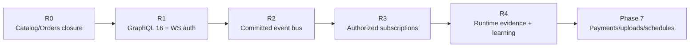
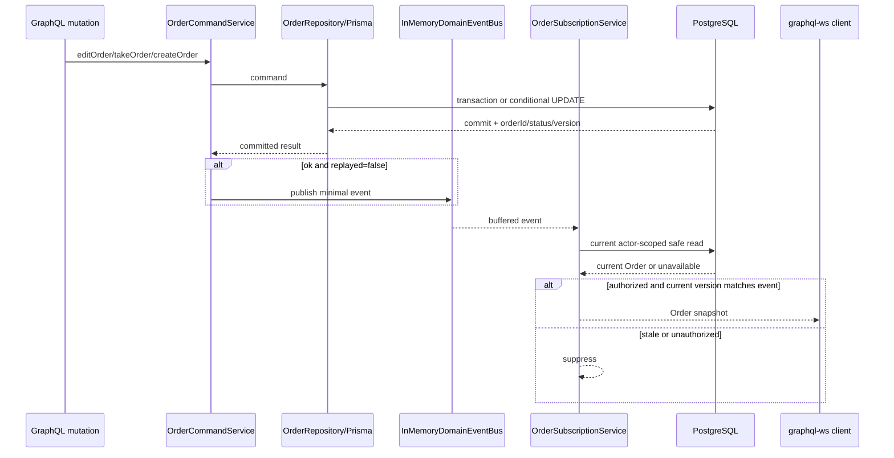

# 下一步重构实施蓝图：Orders 收口与 Realtime/Async

> 状态：实施说明，不代表代码已经落地。本文生成于 2026-08-09；实际依赖版本以 `api/package.json`、`api/pnpm-lock.yaml` 和实施当天的官方文档为准。
>
> 本文给出本阶段所有新增或修改的手写文件完整内容。`api/src/schema.gql`、`api/src/generated/prisma/**` 和 `api/pnpm-lock.yaml` 必须由工具生成并审查，不能手工复制。

## 1. 执行结论

当前不能直接进入 WebSocket 代码。最新 `475a5dd feat: order module` 已经实现 Orders 主路径，但没有达到阶段 5 自己定义的完成门槛。下一步按以下顺序执行：

1. **R0：收口 Catalog/Orders**。用新的 forward migration 补数据库约束；完成一次纯格式化提交；应用 pending migration 前确认数据库；补 runtime/query/concurrency 证据与 learning 03/04。
2. **R1：修正 GraphQL 依赖并建立双传输认证**。把不在 Nest/Apollo peer range 内的 GraphQL 17 改为兼容的 GraphQL 16；显式安装 `graphql-ws`/`ws`；严格接受 WS `Authorization: Bearer <JWT>` connection parameter。
3. **R2：加入提交后事件端口**。实现有界、可取消、shutdown-safe 的进程内事件总线；只对 `replayed: false` 的已提交订单事实发布事件。
4. **R3：交付三个授权订阅**。实现 `pendingOrders`、`cookedOrders`、`orderUpdates(input)`，每次事件按数据库当前状态重新授权并抑制陈旧版本。
5. **R4：运行时与文档收口**。生成/review SDL，手工验证真实 `graphql-ws` 握手、拒绝路径、事件过滤、断线清理和抢单竞态；实际完成后创建 learning 05。



本阶段选择 **Level 1 进程内投递**。它适合当前单实例学习与开发环境，但进程崩溃会丢事件，多实例之间也不会广播。本文不会把它称为可靠消息，也不会在没有实际部署需求时同时引入 Redis、BullMQ、CQRS 或 transactional outbox。

## 2. 2026-08-09 项目状态审计

### 2.1 Git 与实现状态

审计时两层 Git 均 clean：

```text
root: main...origin/main
api:  main...origin/main
HEAD: 475a5dd feat: order module
```

当前实现事实：

| 范围                | 已存在                                                                                                  | 尚未完成                                                                  |
| ------------------- | ------------------------------------------------------------------------------------------------------- | ------------------------------------------------------------------------- |
| Foundation/Identity | Zod 配置、Apollo code-first、Prisma lifecycle、Bearer-only HTTP、用户与邮箱验证                         | 全量格式门禁；runtime 证据仍未形成 learning note                          |
| Catalog             | 查询、Owner 写路径、严格 JSON parser、Catalog SDL                                                       | 已应用 migration 缺两个 CHECK；learning 03、query count/plan 缺失         |
| Orders              | 服务端整数计价、快照、Serializable create、幂等键、actor-scoped query、CAS transition/claim、Orders SDL | pending migration 缺 9 个 CHECK；真实并发/runtime 证据和 learning 04 缺失 |
| Realtime            | 无                                                                                                      | 无 `Subscription` SDL、WS context、事件端口、事件发布或订阅 resolver      |

### 2.2 实际质量门禁结果

| 命令                                                      | 结果                                   | 判断                                           |
| --------------------------------------------------------- | -------------------------------------- | ---------------------------------------------- |
| `pnpm exec prisma validate`                               | 通过                                   | Prisma schema 语法有效                         |
| `pnpm exec tsc --noEmit --incremental false`              | 通过                                   | 当前 TypeScript 可编译                         |
| `pnpm run build`                                          | 通过                                   | Nest build 可产物化                            |
| `pnpm exec prettier --check "src/**/*.ts" "test/**/*.ts"` | 失败，113 个文件                       | 仓库 `.prettierrc` 的单引号规则未落实          |
| non-fixing ESLint                                         | 失败，914 个 `prettier/prettier` error | 当前 lint 不是绿色门禁                         |
| `pnpm exec prisma migrate status`                         | 失败状态，Orders migration pending     | 配置数据库已应用 init + Catalog，未应用 Orders |

依照仓库指导，本次审计没有运行 Jest，也没有新增或扩写 spec。当前 functional refactor 尚未完成，Jest phase 仍然延后。

### 2.3 数据库迁移缺口

`20260808161512_catalog_foundation` 已经应用到当前配置数据库，但 migration SQL 没有：

- `dishes_price_minor_check`
- `dishes_options_array_check`

因此绝不能回改这个已应用 migration。

`20260809071530_orders_foundation` 在当前配置数据库 pending，但它已经提交并推送，不能证明其他需保留数据库从未应用。最安全的仓库级决策也是不改写它，而是在其后创建新的 forward migration，同时补齐 Catalog 与 Orders 约束。

### 2.4 依赖兼容缺口

当前直接依赖 `graphql@17.0.2`，但本地安装包声明：

- `@nestjs/graphql@13.4.2` peer：`graphql ^16.11.0`
- `@nestjs/apollo@13.4.2` peer：`graphql ^16.10.0`
- Nest 内置的 `graphql-ws@6.0.8` peer：`graphql ^15.10.1 || ^16`

build 通过不等于这个组合受支持。阶段 6 会首次真正执行 subscription engine，因此 R1 必须先把 GraphQL 固定到当前 peer range 内的 `16.14.2`，并把 `graphql-ws@6.0.8`、`ws@8.20.1` 变成显式 runtime dependencies。不要在同一切片顺手升级 Nest/Apollo/Prisma。

审计机为 Node `v26.7.0`、pnpm `11.20.0`；`graphql-ws@6.0.8` 要求 Node `>=20`。实施时还必须确认 CI/部署 runtime 满足该 engine；阶段 8 再把统一 Node engine/container 版本固化为发布门禁。

## 3. 范围与非目标

### 3.1 本蓝图包含

- Catalog/Orders 缺失 CHECK 的 forward migration。
- 全仓 `api/src`/`api/test` 的机械 Prettier 收口。
- GraphQL 16 peer compatibility correction 与 lockfile 更新。
- `graphql-ws` 单一订阅协议；路径仍为 `/graphql`。
- WS Origin allowlist 与严格 `Authorization` connection parameter。
- 握手验证、每次 subscribe 再检查、JWT 到期时以 4403 关闭连接。
- 有界进程内事件总线、iterator cancel、buffer overflow、application shutdown。
- `OrderCreated`、`OrderStatusChanged`、`OrderClaimed` 提交后事件。
- `pendingOrders`、`cookedOrders`、`orderUpdates` 的角色、所有权、参与者和当前状态授权。
- 快速连续状态变化时用 `version` 抑制陈旧 snapshot。
- generated SDL、runtime smoke、deferred Jest/frontend backlog 与 learning note 要求。

### 3.2 明确不包含

- 不修改 `backend/`、`frontend/` 或 frontend generated types。
- 不实现 `x-jwt`、小写 `authorization` connection parameter 或 legacy protocol fallback。
- 不引入 `subscriptions-transport-ws`、`installSubscriptionHandlers` 或双协议模式。
- 不在当前 functional-refactor 阶段新增/扩写 Jest 或 e2e 文件。
- 不把事件写进订单 transaction；不把 WebSocket、邮件或任何网络 I/O 放进 transaction。
- 不在本阶段引入 Redis/BullMQ/outbox。多实例/可靠投递需求出现后单独 ADR。
- 不把 verification raw token 放入通用领域事件。现有 Resend adapter 已在端口后、有 timeout/idempotency key，并在 DB commit 后调用；队列化邮件需要先解决 secret persistence 和可靠重试语义，不能用易丢的内存事件冒充可靠邮件任务。
- 不提前实现支付、推广、上传、scheduler 或阶段 8 可观测性系统。

## 4. Legacy 证据与目标契约

### 4.1 保留的产品行为

- `pendingOrders`：新订单只通知拥有对应 Restaurant 的 OWNER。
- `cookedOrders`：订单到达 `COOKED` 且尚未分配 courier 时通知 COURIER；通知不代表抢单成功。
- `orderUpdates(input)`：只通知该订单的 CUSTOMER、Restaurant OWNER、已分配 COURIER。
- `pendingOrders` 与 `orderUpdates` 返回与 HTTP `getOrder` 相同的安全 `Order` model；未抢单的 `cookedOrders` 只返回最小 `CookedOrderOffer`。

### 4.2 目标修正

| Legacy                                       | 目标                                                                        |
| -------------------------------------------- | --------------------------------------------------------------------------- |
| `Delivery`、`driver`、Float id               | `COURIER`、`courier`、UUID GraphQL `ID`                                     |
| 任意 context user 假设                       | WS handshake + subscribe + event-time authorization                         |
| in-memory `PubSub` 直接注入 resolver/service | 领域 publisher/source port 与 GraphQL adapter 分离                          |
| save 附近直接 publish                        | repository 返回 committed fact 后 publish                                   |
| 重放也可能重复通知                           | 只发布 `replayed: false`                                                    |
| payload 携带完整 persistence entity          | 事件只携带 event/order/status/version；交付前重新读取安全 model             |
| 向所有 courier 广播 customer email/items     | `CookedOrderOffer` 只含 order ID、状态、版本、Restaurant 取餐信息和创建时间 |
| 只按内存 payload 做 ownership filter         | actor-scoped DB query 重新授权                                              |
| 无取消、buffer、shutdown 语义                | iterator return、64 条有界 buffer、overflow 终止、shutdown complete         |
| token 长连接无限有效                         | token 到期关闭 WS；新 token 通过客户端重连生效                              |

### 4.3 目标 SDL

```graphql
input OrderUpdatesInput {
  orderId: ID!
}

type Subscription {
  cookedOrders: CookedOrderOffer!
  orderUpdates(input: OrderUpdatesInput!): Order!
  pendingOrders: Order!
}

type CookedOrderOffer {
  createdAt: DateTime!
  id: ID!
  restaurant: OrderRestaurant!
  status: OrderStatus!
  version: Int!
}
```

订阅返回 GraphQL transport error，而不是 `{ ok, error }` payload：建立 `orderUpdates` 时订单不存在或不可见统一使用 `Resource is unavailable.`，避免区分 ID 不存在与越权。

## 5. 运行路径与正确性边界



关键语义：

1. repository 返回成功时 transaction/update 已提交；publisher 永远不在 transaction callback 内。
2. 事件总线失败不能把已提交 mutation 伪装成数据库失败；publisher 异常被记录，mutation 仍返回 committed result。
3. replay 不再次发布，因此同一幂等命令或 CAS retry 不制造重复通知。
4. resolver 不信任事件作为授权事实。每次候选事件重新调用查询服务。
5. 若 version 2 的 `COOKED` 事件排队期间订单已经 claim 到 version 3，则 version 2 被抑制；version 3 的最新事件负责交付，避免倒序 snapshot。
6. Level 1 总线没有历史回放。客户端应先建立 subscription，再查询/refetch 当前状态；阶段 9 在 Apollo 集成中固化此顺序。
7. commit 后、publish 前进程崩溃仍会丢事件。这是明确接受的 Level 1 窗口，不是 exactly-once。

## 6. R0：先收口 Catalog/Orders

### 6.1 保护与确认

从仓库根目录：

```powershell
git status --short --branch
git -C api status --short --branch
git diff --check
```

从 `api/`：

```powershell
pnpm exec prisma migrate status
```

禁止运行 `prisma migrate reset`。当前 `.env` 指向远端 Neon；只有用户确认它是本次允许修改的个人 development 数据库后才能 apply migration。

### 6.2 Forward migration 完整 SQL

创建新的、真实时间戳命名目录，例如：

```text
api/prisma/migrations/<timestamp>_catalog_orders_integrity/migration.sql
```

完整文件：

```sql
-- Catalog constraints were omitted from an already-applied migration.
ALTER TABLE "dishes"
ADD CONSTRAINT "dishes_price_minor_check"
CHECK ("price_minor" >= 0 AND "price_minor" <= 100000000) NOT VALID;

ALTER TABLE "dishes"
ADD CONSTRAINT "dishes_options_array_check"
CHECK (jsonb_typeof("options") = 'array') NOT VALID;

ALTER TABLE "dishes" VALIDATE CONSTRAINT "dishes_price_minor_check";
ALTER TABLE "dishes" VALIDATE CONSTRAINT "dishes_options_array_check";

-- Order aggregate constraints.
ALTER TABLE "orders"
ADD CONSTRAINT "orders_total_minor_check"
CHECK ("total_minor" >= 0 AND "total_minor" <= 2147483647) NOT VALID;

ALTER TABLE "orders"
ADD CONSTRAINT "orders_version_check"
CHECK ("version" >= 0) NOT VALID;

ALTER TABLE "orders"
ADD CONSTRAINT "orders_request_hash_check"
CHECK ("request_hash" ~ '^[0-9a-f]{64}$') NOT VALID;

ALTER TABLE "orders"
ADD CONSTRAINT "orders_courier_state_check"
CHECK (
  ("status" IN ('PENDING', 'COOKING') AND "courier_id" IS NULL)
  OR "status" = 'COOKED'
  OR ("status" IN ('PICKED_UP', 'DELIVERED') AND "courier_id" IS NOT NULL)
) NOT VALID;

-- Immutable order-item snapshot constraints.
ALTER TABLE "order_items"
ADD CONSTRAINT "order_items_position_check"
CHECK ("position" >= 0 AND "position" < 25) NOT VALID;

ALTER TABLE "order_items"
ADD CONSTRAINT "order_items_base_price_check"
CHECK ("base_price_minor" >= 0 AND "base_price_minor" <= 100000000) NOT VALID;

ALTER TABLE "order_items"
ADD CONSTRAINT "order_items_options_extra_check"
CHECK ("options_extra_minor" >= 0 AND "options_extra_minor" <= 2147483647) NOT VALID;

ALTER TABLE "order_items"
ADD CONSTRAINT "order_items_line_total_check"
CHECK (
  "line_total_minor" >= 0
  AND "line_total_minor" <= 2147483647
  AND "line_total_minor" = "base_price_minor" + "options_extra_minor"
) NOT VALID;

ALTER TABLE "order_items"
ADD CONSTRAINT "order_items_selected_options_array_check"
CHECK (jsonb_typeof("selected_options") = 'array') NOT VALID;

ALTER TABLE "orders" VALIDATE CONSTRAINT "orders_total_minor_check";
ALTER TABLE "orders" VALIDATE CONSTRAINT "orders_version_check";
ALTER TABLE "orders" VALIDATE CONSTRAINT "orders_request_hash_check";
ALTER TABLE "orders" VALIDATE CONSTRAINT "orders_courier_state_check";
ALTER TABLE "order_items" VALIDATE CONSTRAINT "order_items_position_check";
ALTER TABLE "order_items" VALIDATE CONSTRAINT "order_items_base_price_check";
ALTER TABLE "order_items" VALIDATE CONSTRAINT "order_items_options_extra_check";
ALTER TABLE "order_items" VALIDATE CONSTRAINT "order_items_line_total_check";
ALTER TABLE "order_items" VALIDATE CONSTRAINT "order_items_selected_options_array_check";
```

`NOT VALID` 让添加约束与验证成为可审查的两个动作；同一 migration 中的 `VALIDATE` 仍会扫描已有行，发现脏数据时 migration 必须失败，不能静默绕过。

### 6.3 格式门禁

格式化必须单独提交，避免 113 个文件的机械 diff 淹没实时功能 review：

```powershell
pnpm exec prettier --write "src/**/*.ts" "test/**/*.ts"
pnpm exec prettier --check "src/**/*.ts" "test/**/*.ts"
pnpm exec eslint "src/**/*.ts" "test/**/*.ts"
pnpm exec tsc --noEmit --incremental false
pnpm run build
```

不要使用 `pnpm run lint` 做审计，因为当前 script 自带 `--fix`。完成后重新检查两层 Git 状态，并确认没有修改 `backend/`/`frontend/`。

### 6.4 R0 退出门槛

- Catalog/Orders migrations 在经确认的数据库按顺序应用。
- 11 个新增 CHECK 在 PostgreSQL catalog 中存在且已 validated。
- Catalog 与 Orders runtime smoke、query count/plan、真正重叠 claim 有实际记录。
- `docs/learning/03-catalog-query.md` 与 `04-orders-concurrency.md` 只在取得真实结果后创建。
- Prisma validate/generate/status、Prettier check、non-fixing lint、typecheck、build 全绿。
- 完成以上门槛才开始 R1。

## 7. R1 依赖变更

### 7.1 安装命令

从 `api/` 执行：

```powershell
pnpm add --save-exact graphql@16.14.2 graphql-ws@6.0.8 ws@8.20.1
```

这会更新 `package.json` 和 `pnpm-lock.yaml`。不要手改 lockfile。

### 7.2 `api/package.json` 完整目标内容

```json
{
  "name": "foodeli",
  "version": "0.0.1",
  "description": "",
  "author": "",
  "private": true,
  "license": "UNLICENSED",
  "scripts": {
    "build": "nest build",
    "format": "prettier --write \"src/**/*.ts\" \"test/**/*.ts\"",
    "start": "nest start",
    "start:dev": "nest start --watch",
    "start:debug": "nest start --debug --watch",
    "start:prod": "node dist/main",
    "lint": "eslint \"{src,apps,libs,test}/**/*.ts\" --fix",
    "test": "jest",
    "test:watch": "jest --watch",
    "test:cov": "jest --coverage",
    "test:debug": "node --inspect-brk -r tsconfig-paths/register -r ts-node/register node_modules/.bin/jest --runInBand",
    "test:e2e": "jest --config ./test/jest-e2e.json"
  },
  "dependencies": {
    "@apollo/server": "^5.5.1",
    "@as-integrations/express5": "^1.1.2",
    "@nestjs/apollo": "^13.4.2",
    "@nestjs/common": "^11.0.1",
    "@nestjs/config": "^4.0.4",
    "@nestjs/core": "^11.0.1",
    "@nestjs/graphql": "^13.4.2",
    "@nestjs/jwt": "^11.0.2",
    "@nestjs/mapped-types": "^2.1.1",
    "@nestjs/platform-express": "^11.0.1",
    "@nestjs/terminus": "^11.1.1",
    "@nestjs/throttler": "^6.5.0",
    "@prisma/adapter-pg": "^7.9.1",
    "@prisma/client": "^7.9.1",
    "argon2": "^0.45.1",
    "class-transformer": "^0.5.1",
    "class-validator": "^0.15.1",
    "graphql": "16.14.2",
    "graphql-ws": "6.0.8",
    "pg": "^8.22.0",
    "prisma": "^7.9.1",
    "reflect-metadata": "^0.2.2",
    "rxjs": "^7.8.1",
    "ws": "8.20.1",
    "zod": "^4.4.3"
  },
  "devDependencies": {
    "@eslint/eslintrc": "^3.2.0",
    "@eslint/js": "^9.18.0",
    "@nestjs/cli": "^11.0.0",
    "@nestjs/schematics": "^11.0.0",
    "@nestjs/testing": "^11.0.1",
    "@types/express": "^5.0.0",
    "@types/jest": "^30.0.0",
    "@types/node": "^24.0.0",
    "@types/supertest": "^7.0.0",
    "dotenv": "^17.4.2",
    "eslint": "^9.18.0",
    "eslint-config-prettier": "^10.0.1",
    "eslint-plugin-prettier": "^5.2.2",
    "globals": "^17.0.0",
    "jest": "^30.0.0",
    "oxfmt": "^0.62.0",
    "prettier": "^3.4.2",
    "source-map-support": "^0.5.21",
    "supertest": "^7.0.0",
    "ts-jest": "^29.2.5",
    "ts-loader": "^9.5.2",
    "ts-node": "^10.9.2",
    "tsconfig-paths": "^4.2.0",
    "typescript": "^5.7.3",
    "typescript-eslint": "^8.20.0"
  },
  "jest": {
    "moduleFileExtensions": ["js", "json", "ts"],
    "rootDir": "src",
    "testRegex": ".*\\.spec\\.ts$",
    "moduleNameMapper": {
      "^@/(.*)$": "<rootDir>/$1",
      "^(\\.{1,2}/.*)\\.js$": "$1"
    },
    "transform": {
      "^.+\\.(t|j)s$": "ts-jest"
    },
    "collectCoverageFrom": ["**/*.(t|j)s"],
    "coverageDirectory": "../coverage",
    "testEnvironment": "node"
  }
}
```

实施当天再次运行 `pnpm view` 与 `pnpm list`；若 Nest 版本或其 peer range 已变化，以 lockfile 中的实际 Nest 版本为准，而不是盲目升级到 GraphQL 17。

## 8. 目标文件树

```text
api/src/
├── app.module.ts                                      # 完整替换
├── auth/
│   ├── access-token.service.ts                        # 完整替换
│   ├── auth-principal.ts                              # 完整替换
│   ├── auth.module.ts                                 # 完整替换
│   ├── bearer-token.ts                                # 完整替换
│   ├── gql-auth.guard.ts                              # 完整替换
│   ├── gql-throttler.guard.ts                         # 完整替换
│   ├── graphql-context.ts                             # 完整替换
│   └── graphql-context.factory.ts                     # 新增
├── events/
│   ├── domain-event.ts                               # 新增
│   ├── domain-event-bus.port.ts                      # 新增
│   ├── events.module.ts                              # 新增
│   ├── filter-map-async-iterator.ts                  # 新增
│   └── in-memory-domain-event-bus.ts                 # 新增
└── orders/
    ├── application/
    │   ├── order-command.service.ts                  # 完整替换
    │   ├── order-query.service.ts                    # 完整替换
    │   └── order-subscription.service.ts             # 新增
    ├── domain/
    │   ├── assert-order-role.ts                      # 完整替换
    │   └── order-event.ts                            # 新增
    ├── dto/order-subscription.dto.ts                 # 新增
    ├── models/cooked-order-offer.model.ts            # 新增
    ├── orders-subscription.resolver.ts               # 新增
    ├── orders.module.ts                              # 完整替换
    └── persistence/
        ├── order.mapper.ts                           # 完整替换
        ├── order.repository.ts                       # 完整替换
        └── order.selects.ts                          # 完整替换
```

## 9. R2：通用事件基础设施完整代码

### 9.1 `api/src/events/domain-event.ts`

```ts
export interface DomainEvent {
  readonly eventId: string;
  readonly occurredAt: string;
  readonly type: string;
}
```

### 9.2 `api/src/events/domain-event-bus.port.ts`

```ts
import type { DomainEvent } from "./domain-event";

export const DOMAIN_EVENT_PUBLISHER = Symbol("DOMAIN_EVENT_PUBLISHER");
export const DOMAIN_EVENT_SOURCE = Symbol("DOMAIN_EVENT_SOURCE");

export interface DomainEventPublisher {
  publish(event: DomainEvent): void;
}

export interface ClosableAsyncIterator<T> extends AsyncIterableIterator<T> {
  return(): Promise<IteratorResult<T>>;
}

export interface DomainEventSource {
  open(): ClosableAsyncIterator<DomainEvent>;
}
```

### 9.3 `api/src/events/filter-map-async-iterator.ts`

```ts
export type AsyncProject<TSource, TTarget> = (
  value: TSource,
) => Promise<TTarget | null> | TTarget | null;

export function filterMapAsyncIterator<TSource, TTarget>(
  source: AsyncIterableIterator<TSource>,
  project: AsyncProject<TSource, TTarget>,
): AsyncIterableIterator<TTarget> {
  let closed = false;

  const closeSource = async (): Promise<void> => {
    if (closed) {
      return;
    }
    closed = true;
    if (source.return) {
      await source.return();
    }
  };

  return {
    [Symbol.asyncIterator](): AsyncIterableIterator<TTarget> {
      return this;
    },

    async next(): Promise<IteratorResult<TTarget>> {
      try {
        while (true) {
          const result = await source.next();
          if (result.done) {
            closed = true;
            return { done: true, value: undefined };
          }

          const mapped = await project(result.value);
          if (mapped !== null) {
            return { done: false, value: mapped };
          }
        }
      } catch (error) {
        await closeSource();
        throw error;
      }
    },

    async return(): Promise<IteratorResult<TTarget>> {
      await closeSource();
      return { done: true, value: undefined };
    },

    async throw(error?: unknown): Promise<IteratorResult<TTarget>> {
      await closeSource();
      throw error;
    },
  };
}
```

### 9.4 `api/src/events/in-memory-domain-event-bus.ts`

```ts
import type { DomainEvent } from "./domain-event";
import type {
  ClosableAsyncIterator,
  DomainEventPublisher,
  DomainEventSource,
} from "./domain-event-bus.port";
import { Injectable, Logger, type OnApplicationShutdown } from "@nestjs/common";

const MAX_BUFFERED_EVENTS_PER_SUBSCRIBER = 64;

interface PendingNext {
  resolve(result: IteratorResult<DomainEvent>): void;
  reject(error: unknown): void;
}

@Injectable()
export class InMemoryDomainEventBus
  implements DomainEventPublisher, DomainEventSource, OnApplicationShutdown
{
  private readonly logger = new Logger(InMemoryDomainEventBus.name);
  private readonly subscribers = new Set<BufferedEventSubscription>();
  private stopped = false;

  publish(event: DomainEvent): void {
    if (this.stopped) {
      this.logger.warn(`Dropped domain event ${event.eventId} during shutdown.`);
      return;
    }

    for (const subscriber of [...this.subscribers]) {
      subscriber.push(event);
    }
  }

  open(): ClosableAsyncIterator<DomainEvent> {
    if (this.stopped) {
      return completedIterator();
    }

    let subscription: BufferedEventSubscription;
    subscription = new BufferedEventSubscription(
      () => this.subscribers.delete(subscription),
      () => this.logger.warn("Closed a slow domain-event subscriber after its buffer overflowed."),
    );
    this.subscribers.add(subscription);
    return subscription;
  }

  onApplicationShutdown(): void {
    this.stopped = true;
    for (const subscriber of [...this.subscribers]) {
      subscriber.complete();
    }
    this.subscribers.clear();
  }
}

class BufferedEventSubscription implements ClosableAsyncIterator<DomainEvent> {
  private readonly queue: DomainEvent[] = [];
  private readonly waiting: PendingNext[] = [];
  private failure: Error | null = null;
  private finished = false;

  constructor(
    private readonly onClose: () => void,
    private readonly onOverflow: () => void,
  ) {}

  [Symbol.asyncIterator](): AsyncIterableIterator<DomainEvent> {
    return this;
  }

  push(event: DomainEvent): void {
    if (this.finished) {
      return;
    }

    const pending = this.waiting.shift();
    if (pending) {
      pending.resolve({ done: false, value: event });
      return;
    }

    if (this.queue.length >= MAX_BUFFERED_EVENTS_PER_SUBSCRIBER) {
      this.onOverflow();
      this.fail(new Error("Subscription event buffer overflowed."));
      return;
    }

    this.queue.push(event);
  }

  next(): Promise<IteratorResult<DomainEvent>> {
    const queued = this.queue.shift();
    if (queued) {
      return Promise.resolve({ done: false, value: queued });
    }

    if (this.failure) {
      return Promise.reject(this.failure);
    }

    if (this.finished) {
      return Promise.resolve({ done: true, value: undefined });
    }

    return new Promise<IteratorResult<DomainEvent>>((resolve, reject) => {
      this.waiting.push({ resolve, reject });
    });
  }

  return(): Promise<IteratorResult<DomainEvent>> {
    this.complete();
    return Promise.resolve({ done: true, value: undefined });
  }

  throw(error?: unknown): Promise<IteratorResult<DomainEvent>> {
    const failure = error instanceof Error ? error : new Error("Subscription terminated.");
    this.fail(failure);
    return Promise.reject(failure);
  }

  complete(): void {
    if (this.finished) {
      return;
    }
    this.finished = true;
    this.queue.length = 0;
    for (const pending of this.waiting.splice(0)) {
      pending.resolve({ done: true, value: undefined });
    }
    this.onClose();
  }

  private fail(error: Error): void {
    if (this.finished) {
      return;
    }
    this.finished = true;
    this.failure = error;
    this.queue.length = 0;
    for (const pending of this.waiting.splice(0)) {
      pending.reject(error);
    }
    this.onClose();
  }
}

function completedIterator(): ClosableAsyncIterator<DomainEvent> {
  return {
    [Symbol.asyncIterator](): AsyncIterableIterator<DomainEvent> {
      return this;
    },
    next: () => Promise.resolve({ done: true, value: undefined }),
    return: () => Promise.resolve({ done: true, value: undefined }),
  };
}
```

### 9.5 `api/src/events/events.module.ts`

```ts
import { DOMAIN_EVENT_PUBLISHER, DOMAIN_EVENT_SOURCE } from "./domain-event-bus.port";
import { InMemoryDomainEventBus } from "./in-memory-domain-event-bus";
import { Module } from "@nestjs/common";

@Module({
  providers: [
    InMemoryDomainEventBus,
    {
      provide: DOMAIN_EVENT_PUBLISHER,
      useExisting: InMemoryDomainEventBus,
    },
    {
      provide: DOMAIN_EVENT_SOURCE,
      useExisting: InMemoryDomainEventBus,
    },
  ],
  exports: [DOMAIN_EVENT_PUBLISHER, DOMAIN_EVENT_SOURCE],
})
export class EventsModule {}
```

这个 bus 的 `publish` 不等待消费者，也不让慢消费者阻塞 mutation。每个 subscriber 最多缓存 64 个事件；溢出时只终止该 subscriber。`return()`、socket disconnect 和 application shutdown 都会解除引用。

## 10. R1：HTTP/WS 统一认证完整代码

### 10.1 `api/src/auth/auth-principal.ts`

```ts
import { UserRole } from "@/users/user-role.enum";

export interface AuthenticatedPrincipal {
  userId: string;
  role: UserRole;
}

export interface AuthenticatedSession {
  principal: AuthenticatedPrincipal;
  expiresAtEpochSeconds: number;
}
```

领域/application 代码继续只接收最小 `AuthenticatedPrincipal`；token expiry 是 transport session 属性，不进入订单领域参数。

### 10.2 `api/src/auth/bearer-token.ts`

```ts
import { UnauthorizedException } from "@nestjs/common";
import type { Request } from "express";

const JWT_PATTERN = /^Bearer ([A-Za-z0-9_-]+\.[A-Za-z0-9_-]+\.[A-Za-z0-9_-]+)$/i;
const MAX_AUTHORIZATION_LENGTH = 8_192;

type RawHeaderRequest = Pick<Request, "rawHeaders">;

export function extractBearerToken(request: RawHeaderRequest): string {
  if (collectRawHeaders(request, "x-jwt").length > 0) {
    throw new UnauthorizedException("Unsupported authentication header.");
  }

  const authorizationValues = collectRawHeaders(request, "authorization");
  if (authorizationValues.length !== 1) {
    throw new UnauthorizedException("A single Authorization header is required.");
  }

  return parseAuthorizationValue(authorizationValues[0]);
}

export function extractBearerTokenFromConnectionParams(connectionParams: unknown): string {
  if (!isRecord(connectionParams)) {
    throw new UnauthorizedException("A single Authorization connection parameter is required.");
  }

  const entries = Object.entries(connectionParams);
  if (entries.some(([key]) => key.toLowerCase() === "x-jwt")) {
    throw new UnauthorizedException("Unsupported authentication connection parameter.");
  }

  const authorizationEntries = entries.filter(([key]) => key.toLowerCase() === "authorization");
  if (authorizationEntries.length !== 1 || authorizationEntries[0][0] !== "Authorization") {
    throw new UnauthorizedException("A single Authorization connection parameter is required.");
  }

  return parseAuthorizationValue(authorizationEntries[0][1]);
}

function parseAuthorizationValue(value: unknown): string {
  if (typeof value !== "string" || value.length > MAX_AUTHORIZATION_LENGTH) {
    throw new UnauthorizedException("Invalid Authorization value.");
  }

  const match = JWT_PATTERN.exec(value);
  if (!match) {
    throw new UnauthorizedException("Expected Authorization: Bearer <JWT>.");
  }

  return match[1];
}

function collectRawHeaders(request: RawHeaderRequest, headerName: string): string[] {
  const values: string[] = [];
  const target = headerName.toLowerCase();

  for (let index = 0; index < request.rawHeaders.length; index += 2) {
    if (request.rawHeaders[index]?.toLowerCase() === target) {
      values.push(request.rawHeaders[index + 1] ?? "");
    }
  }

  return values;
}

function isRecord(value: unknown): value is Record<string, unknown> {
  return typeof value === "object" && value !== null && !Array.isArray(value);
}
```

JSON object 本身不能保留完全相同的重复 key，但可以同时带 `Authorization` 与 `authorization`。上面的 case-insensitive 收集会拒绝这种冲突；唯一接受的规范 key 是大小写准确的 `Authorization`。

### 10.3 `api/src/auth/access-token.service.ts`

```ts
import type { AuthenticatedPrincipal, AuthenticatedSession } from "@/auth/auth-principal";
import { EnvironmentVariables } from "@/config/environment.variables";
import { UserRole } from "@/users/user-role.enum";
import { Injectable, UnauthorizedException } from "@nestjs/common";
import { ConfigService } from "@nestjs/config";
import { JwtService } from "@nestjs/jwt";
import { isUUID } from "class-validator";

interface AccessTokenPayload extends Record<string, unknown> {
  sub: string;
  role: UserRole;
  exp: number;
  iat: number;
}

export interface IssuedAccessToken {
  accessToken: string;
  expiresIn: number;
}

@Injectable()
export class AccessTokenService {
  constructor(
    private readonly jwt: JwtService,
    private readonly config: ConfigService<EnvironmentVariables, true>,
  ) {}

  async issue(principal: AuthenticatedPrincipal): Promise<IssuedAccessToken> {
    const expiresIn = this.config.get("JWT_ACCESS_TTL_SECONDS", {
      infer: true,
    });
    const accessToken = await this.jwt.signAsync(
      { role: principal.role },
      {
        algorithm: "HS256",
        subject: principal.userId,
        expiresIn,
        issuer: this.config.get("JWT_ISSUER", { infer: true }),
        audience: this.config.get("JWT_AUDIENCE", { infer: true }),
      },
    );

    return { accessToken, expiresIn };
  }

  async verify(accessToken: string): Promise<AuthenticatedPrincipal> {
    return (await this.verifySession(accessToken)).principal;
  }

  async verifySession(accessToken: string): Promise<AuthenticatedSession> {
    try {
      const payload = await this.jwt.verifyAsync<AccessTokenPayload>(accessToken, {
        algorithms: ["HS256"],
        issuer: this.config.get("JWT_ISSUER", { infer: true }),
        audience: this.config.get("JWT_AUDIENCE", { infer: true }),
      });

      if (
        !isUUID(payload.sub, "7") ||
        !isUserRole(payload.role) ||
        !Number.isSafeInteger(payload.iat) ||
        !Number.isSafeInteger(payload.exp) ||
        payload.exp <= Math.floor(Date.now() / 1_000)
      ) {
        throw new UnauthorizedException("Invalid or expired access token.");
      }

      return {
        principal: {
          userId: payload.sub,
          role: payload.role,
        },
        expiresAtEpochSeconds: payload.exp,
      };
    } catch {
      throw new UnauthorizedException("Invalid or expired access token.");
    }
  }
}

function isUserRole(value: unknown): value is UserRole {
  return Object.values(UserRole).some((role) => role === value);
}
```

### 10.4 `api/src/auth/graphql-context.ts`

```ts
import type { AuthenticatedPrincipal } from "@/auth/auth-principal";
import type { Request, Response } from "express";

interface BaseGraphqlContext {
  principal?: AuthenticatedPrincipal;
  accessTokenExpiresAtEpochSeconds?: number;
}

export interface HttpGraphqlContext extends BaseGraphqlContext {
  transport: "http";
  request: Request;
  response: Response;
}

export interface WebSocketGraphqlContext extends BaseGraphqlContext {
  transport: "websocket";
  principal: AuthenticatedPrincipal;
  accessTokenExpiresAtEpochSeconds: number;
}

export type GraphqlContext = HttpGraphqlContext | WebSocketGraphqlContext;

export function isGraphqlSessionExpired(context: GraphqlContext): boolean {
  return (
    context.accessTokenExpiresAtEpochSeconds === undefined ||
    context.accessTokenExpiresAtEpochSeconds <= Math.floor(Date.now() / 1_000)
  );
}
```

### 10.5 `api/src/auth/graphql-context.factory.ts`

```ts
import { AccessTokenService } from "@/auth/access-token.service";
import type { AuthenticatedSession } from "@/auth/auth-principal";
import { extractBearerTokenFromConnectionParams } from "@/auth/bearer-token";
import type {
  GraphqlContext,
  HttpGraphqlContext,
  WebSocketGraphqlContext,
} from "@/auth/graphql-context";
import { EnvironmentVariables } from "@/config/environment.variables";
import { Injectable, type OnApplicationShutdown, UnauthorizedException } from "@nestjs/common";
import { ConfigService } from "@nestjs/config";
import type { Request, Response } from "express";
import { CloseCode } from "graphql-ws";

const ACCESS_TOKEN_EXPIRED_REASON = "Access token expired.";

interface WebSocketAuthState {
  extra: object;
  session: AuthenticatedSession;
  expiryTimer: NodeJS.Timeout;
}

interface ClosableSocket {
  close(code: number, reason: string): void;
}

@Injectable()
export class GraphqlContextFactory implements OnApplicationShutdown {
  private readonly sessions = new WeakMap<object, WebSocketAuthState>();
  private readonly activeStates = new Set<WebSocketAuthState>();

  constructor(
    private readonly accessTokens: AccessTokenService,
    private readonly config: ConfigService<EnvironmentVariables, true>,
  ) {}

  async onConnect(context: unknown): Promise<boolean> {
    const envelope = readWebSocketEnvelope(context);
    if (!envelope || !this.hasAllowedOrigin(envelope.extra)) {
      return false;
    }

    try {
      const token = extractBearerTokenFromConnectionParams(envelope.connectionParams);
      const session = await this.accessTokens.verifySession(token);
      this.setSession(envelope.extra, session);
      return true;
    } catch {
      return false;
    }
  }

  onSubscribe(context: unknown): void {
    const envelope = readWebSocketEnvelope(context);
    const state = envelope ? this.sessions.get(envelope.extra) : undefined;

    if (!state || isExpired(state.session)) {
      if (envelope) {
        closeSocket(envelope.extra, CloseCode.Forbidden, "Forbidden");
      }
      return;
    }
  }

  onClose(context: unknown): void {
    const envelope = readWebSocketEnvelope(context);
    if (envelope) {
      this.clearSession(envelope.extra);
    }
  }

  create(context: unknown): GraphqlContext {
    if (isHttpContextInput(context)) {
      const result: HttpGraphqlContext = {
        transport: "http",
        request: context.req,
        response: context.res,
      };
      return result;
    }

    const envelope = readWebSocketEnvelope(context);
    const state = envelope ? this.sessions.get(envelope.extra) : undefined;
    if (!state || isExpired(state.session)) {
      if (envelope) {
        closeSocket(envelope.extra, CloseCode.Forbidden, "Forbidden");
      }
      throw new UnauthorizedException("Authentication is required.");
    }

    const result: WebSocketGraphqlContext = {
      transport: "websocket",
      principal: state.session.principal,
      accessTokenExpiresAtEpochSeconds: state.session.expiresAtEpochSeconds,
    };
    return result;
  }

  onApplicationShutdown(): void {
    for (const state of this.activeStates) {
      clearTimeout(state.expiryTimer);
    }
    this.activeStates.clear();
  }

  private hasAllowedOrigin(extra: object): boolean {
    const origin = readOrigin(extra);
    return origin !== null && this.config.get("CORS_ORIGINS", { infer: true }).includes(origin);
  }

  private setSession(extra: object, session: AuthenticatedSession): void {
    this.clearSession(extra);

    const delayMilliseconds = Math.max(0, session.expiresAtEpochSeconds * 1_000 - Date.now());
    const state: WebSocketAuthState = {
      extra,
      session,
      expiryTimer: setTimeout(() => {
        closeSocket(extra, CloseCode.Forbidden, ACCESS_TOKEN_EXPIRED_REASON);
        this.clearSession(extra);
      }, delayMilliseconds),
    };
    state.expiryTimer.unref();
    this.sessions.set(extra, state);
    this.activeStates.add(state);
  }

  private clearSession(extra: object): void {
    const existing = this.sessions.get(extra);
    if (!existing) {
      return;
    }
    clearTimeout(existing.expiryTimer);
    this.activeStates.delete(existing);
    this.sessions.delete(extra);
  }
}

interface HttpContextInput {
  req: Request;
  res: Response;
}

interface WebSocketEnvelope {
  connectionParams: unknown;
  extra: object;
}

function isHttpContextInput(value: unknown): value is HttpContextInput {
  return (
    isRecord(value) &&
    "req" in value &&
    isRecord(value.req) &&
    "res" in value &&
    isRecord(value.res)
  );
}

function readWebSocketEnvelope(value: unknown): WebSocketEnvelope | null {
  if (!isRecord(value) || !("extra" in value) || !isRecord(value.extra)) {
    return null;
  }
  return {
    connectionParams: "connectionParams" in value ? value.connectionParams : undefined,
    extra: value.extra,
  };
}

function readOrigin(extra: object): string | null {
  if (!("request" in extra) || !isRecord(extra.request)) {
    return null;
  }
  const request = extra.request;
  if (!("headers" in request) || !isRecord(request.headers)) {
    return null;
  }
  const origin = request.headers.origin;
  return typeof origin === "string" ? origin : null;
}

function closeSocket(extra: object, code: number, reason: string): void {
  if ("socket" in extra && isClosableSocket(extra.socket)) {
    extra.socket.close(code, reason);
  }
}

function isClosableSocket(value: unknown): value is ClosableSocket {
  return (
    typeof value === "object" &&
    value !== null &&
    "close" in value &&
    typeof value.close === "function"
  );
}

function isExpired(session: AuthenticatedSession): boolean {
  return session.expiresAtEpochSeconds <= Math.floor(Date.now() / 1_000);
}

function isRecord(value: unknown): value is Record<PropertyKey, unknown> {
  return typeof value === "object" && value !== null;
}
```

`CORS` 不保护 WebSocket upgrade，因此这里显式复用已经验证过的 `CORS_ORIGINS`。浏览器会发送 `Origin`；缺失或不在 allowlist 的 Origin 也拒绝。若未来需要支持非浏览器 trusted client，应通过独立、明确配置放行，不能删除浏览器 Origin 校验。

### 10.6 `api/src/auth/gql-auth.guard.ts`

```ts
import { AccessTokenService } from "@/auth/access-token.service";
import { extractBearerToken } from "@/auth/bearer-token";
import { type GraphqlContext, isGraphqlSessionExpired } from "@/auth/graphql-context";
import {
  type CanActivate,
  type ExecutionContext,
  Injectable,
  UnauthorizedException,
} from "@nestjs/common";
import { GqlExecutionContext } from "@nestjs/graphql";

@Injectable()
export class GqlAuthGuard implements CanActivate {
  constructor(private readonly accessTokens: AccessTokenService) {}

  async canActivate(executionContext: ExecutionContext): Promise<boolean> {
    const graphql = GqlExecutionContext.create(executionContext);
    const context = graphql.getContext<GraphqlContext>();

    if (context.transport === "websocket") {
      if (!context.principal || isGraphqlSessionExpired(context)) {
        throw new UnauthorizedException("Authentication is required.");
      }
      return true;
    }

    const accessToken = extractBearerToken(context.request);
    const session = await this.accessTokens.verifySession(accessToken);
    context.principal = session.principal;
    context.accessTokenExpiresAtEpochSeconds = session.expiresAtEpochSeconds;
    return true;
  }
}
```

### 10.7 `api/src/auth/gql-throttler.guard.ts`

```ts
import type { GraphqlContext } from "@/auth/graphql-context";
import { type ExecutionContext, Injectable } from "@nestjs/common";
import { GqlExecutionContext } from "@nestjs/graphql";
import { ThrottlerGuard } from "@nestjs/throttler";
import type { Request, Response } from "express";

@Injectable()
export class GqlThrottlerGuard extends ThrottlerGuard {
  protected getRequestResponse(executionContext: ExecutionContext): {
    req: Request;
    res: Response;
  } {
    const graphql = GqlExecutionContext.create(executionContext);
    const context = graphql.getContext<GraphqlContext>();
    if (context.transport !== "http") {
      throw new Error("HTTP throttling cannot run on a WebSocket operation.");
    }
    return {
      req: context.request,
      res: context.response,
    };
  }
}
```

当前 throttler 只装在 HTTP identity operations 上。WS connection/subscription rate limit 属于阶段 8 的代理与应用防滥用切片；本阶段至少限制单连接 init timeout、每个 subscriber buffer，并在验收记录当前缺口。

### 10.8 `api/src/auth/auth.module.ts`

```ts
import { AccessTokenService } from "@/auth/access-token.service";
import { AuthResolver } from "@/auth/auth.resolver";
import { AuthService } from "@/auth/auth.service";
import { CredentialsRepository } from "@/auth/credentials.repository";
import { GqlAuthGuard } from "@/auth/gql-auth.guard";
import { GqlThrottlerGuard } from "@/auth/gql-throttler.guard";
import { GraphqlContextFactory } from "@/auth/graphql-context.factory";
import { PasswordHasherService } from "@/auth/password-hasher.service";
import { RolesGuard } from "@/auth/roles.guard";
import { EnvironmentVariables } from "@/config/environment.variables";
import { PrismaModule } from "@/prisma/prisma.module";
import { Module } from "@nestjs/common";
import { ConfigModule, ConfigService } from "@nestjs/config";
import { JwtModule } from "@nestjs/jwt";
import { ThrottlerModule } from "@nestjs/throttler";

@Module({
  imports: [
    ConfigModule,
    PrismaModule,
    ThrottlerModule.forRoot([
      {
        name: "identity",
        ttl: 60_000,
        limit: 10,
      },
    ]),
    JwtModule.registerAsync({
      imports: [ConfigModule],
      inject: [ConfigService],
      useFactory: (config: ConfigService<EnvironmentVariables, true>) => ({
        secret: config.get("JWT_SECRET", { infer: true }),
      }),
    }),
  ],
  providers: [
    AuthService,
    AuthResolver,
    CredentialsRepository,
    PasswordHasherService,
    AccessTokenService,
    GraphqlContextFactory,
    GqlAuthGuard,
    GqlThrottlerGuard,
    RolesGuard,
  ],
  exports: [
    PasswordHasherService,
    AccessTokenService,
    GraphqlContextFactory,
    GqlAuthGuard,
    GqlThrottlerGuard,
    RolesGuard,
  ],
})
export class AuthModule {}
```

### 10.9 `api/src/app.module.ts`

```ts
import { AuthModule } from "@/auth/auth.module";
import { GraphqlContextFactory } from "@/auth/graphql-context.factory";
import { CatalogModule } from "@/catalog/catalog.module";
import { EnvironmentVariables } from "@/config/environment.variables";
import { validateEnvironment } from "@/config/validate-environment";
import { HealthModule } from "@/health/health.module";
import { OrdersModule } from "@/orders/orders.module";
import { UsersModule } from "@/users/users.module";
import { ApolloDriver, ApolloDriverConfig } from "@nestjs/apollo";
import { Module } from "@nestjs/common";
import { ConfigModule, ConfigService } from "@nestjs/config";
import { GraphQLModule } from "@nestjs/graphql";
import { join } from "node:path";
import { AppController } from "./app.controller";
import { AppService } from "./app.service";

@Module({
  imports: [
    ConfigModule.forRoot({
      isGlobal: true,
      cache: true,
      validate: validateEnvironment,
      ignoreEnvFile: process.env.NODE_ENV === "production",
    }),
    GraphQLModule.forRootAsync<ApolloDriverConfig>({
      driver: ApolloDriver,
      imports: [ConfigModule, AuthModule],
      inject: [ConfigService, GraphqlContextFactory],
      useFactory: (
        config: ConfigService<EnvironmentVariables, true>,
        contexts: GraphqlContextFactory,
      ): ApolloDriverConfig => ({
        driver: ApolloDriver,
        graphiql: config.get("NODE_ENV", { infer: true }) !== "production",
        autoSchemaFile: join(process.cwd(), "src/schema.gql"),
        sortSchema: true,
        stopOnApplicationShutdown: true,
        subscriptions: {
          "graphql-ws": {
            path: "/graphql",
            connectionInitWaitTimeout: 5_000,
            onConnect: (context: unknown) => contexts.onConnect(context),
            onSubscribe: (context: unknown) => contexts.onSubscribe(context),
            onClose: (context: unknown) => contexts.onClose(context),
          },
        },
        context: (context: unknown) => contexts.create(context),
      }),
    }),
    HealthModule,
    AuthModule,
    UsersModule,
    CatalogModule,
    OrdersModule,
  ],
  controllers: [AppController],
  providers: [AppService],
})
export class AppModule {}
```

Nest 13.4.2 的本地实现会把同一个 `context` factory 同时交给 Apollo HTTP 与 `graphql-ws` server，并在应用 shutdown 时 dispose subscription server。这里只启用 `'graphql-ws'` key；不得加入 legacy key。

## 11. R2：订单提交后事件完整代码

### 11.1 `api/src/orders/domain/order-event.ts`

```ts
import type { DomainEvent } from "@/events/domain-event";
import type { OrderStatus } from "./order-status";
import { randomUUID } from "node:crypto";

export const ORDER_CREATED_EVENT = "order.created.v1";
export const ORDER_STATUS_CHANGED_EVENT = "order.status-changed.v1";
export const ORDER_CLAIMED_EVENT = "order.claimed.v1";

export interface OrderEventFact {
  orderId: string;
  status: OrderStatus;
  version: number;
}

interface OrderEventBase extends DomainEvent, OrderEventFact {}

export interface OrderCreatedEvent extends OrderEventBase {
  readonly type: typeof ORDER_CREATED_EVENT;
}

export interface OrderStatusChangedEvent extends OrderEventBase {
  readonly type: typeof ORDER_STATUS_CHANGED_EVENT;
  readonly previousStatus: OrderStatus;
}

export interface OrderClaimedEvent extends OrderEventBase {
  readonly type: typeof ORDER_CLAIMED_EVENT;
}

export type OrderDomainEvent = OrderCreatedEvent | OrderStatusChangedEvent | OrderClaimedEvent;

export function createOrderCreatedEvent(fact: OrderEventFact): OrderCreatedEvent {
  return {
    ...newEventMetadata(),
    type: ORDER_CREATED_EVENT,
    ...fact,
  };
}

export function createOrderStatusChangedEvent(
  fact: OrderEventFact,
  previousStatus: OrderStatus,
): OrderStatusChangedEvent {
  return {
    ...newEventMetadata(),
    type: ORDER_STATUS_CHANGED_EVENT,
    ...fact,
    previousStatus,
  };
}

export function createOrderClaimedEvent(fact: OrderEventFact): OrderClaimedEvent {
  return {
    ...newEventMetadata(),
    type: ORDER_CLAIMED_EVENT,
    ...fact,
  };
}

export function isOrderDomainEvent(event: DomainEvent): event is OrderDomainEvent {
  return (
    event.type === ORDER_CREATED_EVENT ||
    event.type === ORDER_STATUS_CHANGED_EVENT ||
    event.type === ORDER_CLAIMED_EVENT
  );
}

function newEventMetadata(): Pick<DomainEvent, "eventId" | "occurredAt"> {
  return {
    eventId: randomUUID(),
    occurredAt: new Date().toISOString(),
  };
}
```

事件不携带 Order record、email、token、request hash 或 persistence JSON。当前 `eventId`/`occurredAt` 可由 Jest fake timers 和 recording publisher 验证；阶段 8 引入 request context 后再增加可选 correlation ID。

### 11.2 `api/src/orders/domain/assert-order-role.ts`

```ts
import type { AuthenticatedPrincipal } from "@/auth/auth-principal";
import { UserRole } from "@/users/user-role.enum";
import { ForbiddenException } from "@nestjs/common";

export function assertCustomer(principal: AuthenticatedPrincipal): void {
  if (principal.role !== UserRole.CUSTOMER) {
    throw new ForbiddenException("Insufficient role.");
  }
}

export function assertOwner(principal: AuthenticatedPrincipal): void {
  if (principal.role !== UserRole.OWNER) {
    throw new ForbiddenException("Insufficient role.");
  }
}

export function assertOrderEditor(principal: AuthenticatedPrincipal): void {
  if (principal.role !== UserRole.OWNER && principal.role !== UserRole.COURIER) {
    throw new ForbiddenException("Insufficient role.");
  }
}

export function assertCourier(principal: AuthenticatedPrincipal): void {
  if (principal.role !== UserRole.COURIER) {
    throw new ForbiddenException("Insufficient role.");
  }
}

export function assertOrderViewer(principal: AuthenticatedPrincipal): void {
  if (
    principal.role !== UserRole.CUSTOMER &&
    principal.role !== UserRole.OWNER &&
    principal.role !== UserRole.COURIER
  ) {
    throw new ForbiddenException("Insufficient role.");
  }
}
```

### 11.3 `api/src/orders/application/order-command.service.ts`

```ts
import type { AuthenticatedPrincipal } from "@/auth/auth-principal";
import { DOMAIN_EVENT_PUBLISHER, type DomainEventPublisher } from "@/events/domain-event-bus.port";
import { assertCourier, assertCustomer, assertOrderEditor } from "../domain/assert-order-role";
import {
  createOrderClaimedEvent,
  createOrderCreatedEvent,
  createOrderStatusChangedEvent,
} from "../domain/order-event";
import { createOrderRequestHash } from "../domain/idempotency";
import { OrderMutationError, type OrderResult } from "../domain/order-result";
import { parseRequestedOrderItems } from "../domain/order-selection";
import { requestedTransition } from "../domain/order-state";
import { PersistedCatalogPricingError } from "../domain/price-order";
import type { OrderStatus } from "../domain/order-status";
import {
  type CommittedOrderFact,
  type CreatedOrder,
  OrderRepository,
} from "../persistence/order.repository";
import { parseOrderInput } from "./parse-order-input";
import { Inject, Injectable, InternalServerErrorException, Logger } from "@nestjs/common";

export interface CreateOrderCommand {
  restaurantId: string;
  idempotencyKey: string;
  items: unknown;
}

@Injectable()
export class OrderCommandService {
  private readonly logger = new Logger(OrderCommandService.name);

  constructor(
    private readonly orders: OrderRepository,
    @Inject(DOMAIN_EVENT_PUBLISHER)
    private readonly events: DomainEventPublisher,
  ) {}

  async create(
    principal: AuthenticatedPrincipal,
    command: CreateOrderCommand,
  ): Promise<OrderResult<CreatedOrder>> {
    assertCustomer(principal);
    const items = parseOrderInput(() => parseRequestedOrderItems(command.items));
    const requestHash = createOrderRequestHash(command.restaurantId, items);

    try {
      const result = await this.orders.create({
        customerId: principal.userId,
        restaurantId: command.restaurantId,
        idempotencyKey: command.idempotencyKey,
        requestHash,
        items,
      });
      if (result.ok && !result.replayed) {
        this.publishAfterCommit(createOrderCreatedEvent(result.value));
      }
      return result;
    } catch (error) {
      if (!(error instanceof PersistedCatalogPricingError)) {
        throw error;
      }
      this.logger.error(`Order pricing rejected persisted dish ${error.dishId}.`);
      throw new InternalServerErrorException("Order pricing is unavailable.");
    }
  }

  async edit(
    principal: AuthenticatedPrincipal,
    orderId: string,
    target: OrderStatus,
  ): Promise<OrderResult<CommittedOrderFact>> {
    assertOrderEditor(principal);
    const transition = requestedTransition(principal, target);
    if (!transition) {
      return {
        ok: false,
        error: OrderMutationError.InvalidTransition,
      };
    }

    const result = await this.orders.transition(principal, orderId, transition);
    if (result.ok && !result.replayed) {
      this.publishAfterCommit(createOrderStatusChangedEvent(result.value, transition.from));
    }
    return result;
  }

  async take(
    principal: AuthenticatedPrincipal,
    orderId: string,
  ): Promise<OrderResult<CommittedOrderFact>> {
    assertCourier(principal);
    const result = await this.orders.take(principal.userId, orderId);
    if (result.ok && !result.replayed) {
      this.publishAfterCommit(createOrderClaimedEvent(result.value));
    }
    return result;
  }

  private publishAfterCommit(event: Parameters<DomainEventPublisher["publish"]>[0]): void {
    try {
      this.events.publish(event);
    } catch (error) {
      this.logger.error(
        `Domain event ${event.eventId} failed after the order commit.`,
        error instanceof Error ? error.stack : undefined,
      );
    }
  }
}
```

`publishAfterCommit` 的 catch 很重要：如果数据库已提交，不能因为进程内通知失败向客户端返回“订单失败”，否则客户端重试可能产生错误理解。事件丢失会被日志暴露；需要消除该窗口时再引入 outbox。

## 12. R3：授权订单订阅完整代码

### 12.1 `api/src/orders/dto/order-subscription.dto.ts`

```ts
import { Field, ID, InputType } from "@nestjs/graphql";
import { IsUUID } from "class-validator";

@InputType()
export class OrderUpdatesInput {
  @Field(() => ID)
  @IsUUID("7")
  orderId!: string;
}
```

### 12.2 `api/src/orders/models/cooked-order-offer.model.ts`

```ts
import { OrderStatus } from "../domain/order-status";
import { OrderRestaurantModel } from "./order.model";
import { Field, ID, Int, ObjectType } from "@nestjs/graphql";

@ObjectType("CookedOrderOffer")
export class CookedOrderOfferModel {
  @Field(() => ID)
  id!: string;

  @Field(() => OrderStatus)
  status!: OrderStatus;

  @Field(() => Int)
  version!: number;

  @Field(() => OrderRestaurantModel)
  restaurant!: OrderRestaurantModel;

  @Field(() => Date)
  createdAt!: Date;
}
```

### 12.3 `api/src/orders/persistence/order.selects.ts`

```ts
import { Prisma } from "@/generated/prisma/client";

export const ORDER_PARTY_SELECT = {
  id: true,
  email: true,
} as const satisfies Prisma.UserSelect;

export const ORDER_RESTAURANT_SELECT = {
  id: true,
  name: true,
  address: true,
} as const satisfies Prisma.RestaurantSelect;

export const ORDERABLE_DISH_SELECT = {
  id: true,
  name: true,
  priceMinor: true,
  options: true,
} as const satisfies Prisma.DishSelect;

export const ORDER_ITEM_SELECT = {
  id: true,
  dishId: true,
  dishName: true,
  basePriceMinor: true,
  selectedOptions: true,
  optionsExtraMinor: true,
  lineTotalMinor: true,
} as const satisfies Prisma.OrderItemSelect;

export const ORDER_SELECT = {
  id: true,
  status: true,
  totalMinor: true,
  version: true,
  createdAt: true,
  updatedAt: true,
  customer: {
    select: ORDER_PARTY_SELECT,
  },
  courier: {
    select: ORDER_PARTY_SELECT,
  },
  restaurant: {
    select: ORDER_RESTAURANT_SELECT,
  },
  items: {
    select: ORDER_ITEM_SELECT,
    orderBy: { position: "asc" },
  },
} as const satisfies Prisma.OrderSelect;

export const AVAILABLE_COOKED_ORDER_SELECT = {
  id: true,
  status: true,
  version: true,
  createdAt: true,
  restaurant: {
    select: ORDER_RESTAURANT_SELECT,
  },
} as const satisfies Prisma.OrderSelect;

export type OrderableDishRecord = Prisma.DishGetPayload<{
  select: typeof ORDERABLE_DISH_SELECT;
}>;

export type OrderRecord = Prisma.OrderGetPayload<{
  select: typeof ORDER_SELECT;
}>;

export type AvailableCookedOrderRecord = Prisma.OrderGetPayload<{
  select: typeof AVAILABLE_COOKED_ORDER_SELECT;
}>;
```

### 12.4 `api/src/orders/persistence/order.mapper.ts`

```ts
import { OrderInputError } from "../domain/order-input.error";
import { toPublicOrderStatus } from "../domain/order-status";
import type { CookedOrderOfferModel } from "../models/cooked-order-offer.model";
import type { OrderModel } from "../models/order.model";
import type { AvailableCookedOrderRecord, OrderRecord } from "./order.selects";
import { parseSelectedOptionsSnapshot } from "./selected-options-json";
import { Injectable, InternalServerErrorException, Logger } from "@nestjs/common";

@Injectable()
export class OrderMapper {
  private readonly logger = new Logger(OrderMapper.name);

  toModel(order: OrderRecord): OrderModel {
    return {
      id: order.id,
      status: toPublicOrderStatus(order.status),
      totalMinor: order.totalMinor,
      version: order.version,
      customer: { ...order.customer },
      courier: order.courier ? { ...order.courier } : null,
      restaurant: { ...order.restaurant },
      items: order.items.map((item) => {
        try {
          return {
            id: item.id,
            dishId: item.dishId,
            dishName: item.dishName,
            basePriceMinor: item.basePriceMinor,
            selectedOptions: parseSelectedOptionsSnapshot(item.selectedOptions),
            optionsExtraMinor: item.optionsExtraMinor,
            lineTotalMinor: item.lineTotalMinor,
          };
        } catch (error) {
          if (!(error instanceof OrderInputError)) {
            throw error;
          }
          this.logger.error(`Invalid persisted selected options for order item ${item.id}.`);
          throw new InternalServerErrorException("Order data is unavailable.");
        }
      }),
      createdAt: order.createdAt,
      updatedAt: order.updatedAt,
    };
  }

  toCookedOrderOffer(order: AvailableCookedOrderRecord): CookedOrderOfferModel {
    return {
      id: order.id,
      status: toPublicOrderStatus(order.status),
      version: order.version,
      restaurant: { ...order.restaurant },
      createdAt: order.createdAt,
    };
  }
}
```

### 12.5 `api/src/orders/application/order-query.service.ts`

```ts
import type { AuthenticatedPrincipal } from "@/auth/auth-principal";
import type { PageResult } from "@/common/pagination/page.types";
import type { OrderStatus } from "../domain/order-status";
import type { CookedOrderOfferModel } from "../models/cooked-order-offer.model";
import type { OrderModel } from "../models/order.model";
import { OrderMapper } from "../persistence/order.mapper";
import { OrderRepository } from "../persistence/order.repository";
import { Injectable } from "@nestjs/common";

@Injectable()
export class OrderQueryService {
  constructor(
    private readonly orders: OrderRepository,
    private readonly mapper: OrderMapper,
  ) {}

  async getOrder(principal: AuthenticatedPrincipal, orderId: string): Promise<OrderModel | null> {
    const order = await this.orders.findScoped(principal, orderId);
    return order ? this.mapper.toModel(order) : null;
  }

  async getAvailableCookedOrder(orderId: string): Promise<CookedOrderOfferModel | null> {
    const order = await this.orders.findAvailableCooked(orderId);
    return order ? this.mapper.toCookedOrderOffer(order) : null;
  }

  async getOrders(
    principal: AuthenticatedPrincipal,
    status: OrderStatus | undefined,
    page: number,
  ): Promise<PageResult<OrderModel>> {
    const result = await this.orders.listScoped(principal, status, page);
    return {
      ...result,
      results: result.results.map((order) => this.mapper.toModel(order)),
    };
  }
}
```

`getAvailableCookedOrder` 只由已经在 application 层断言 COURIER 的 subscription service 使用。最终 `takeOrder` 仍由数据库 `courierId IS NULL` CAS 仲裁；feed 可见性不是抢单授权。

### 12.6 `api/src/orders/application/order-subscription.service.ts`

```ts
import type { AuthenticatedPrincipal } from "@/auth/auth-principal";
import { DOMAIN_EVENT_SOURCE, type DomainEventSource } from "@/events/domain-event-bus.port";
import { filterMapAsyncIterator } from "@/events/filter-map-async-iterator";
import { assertCourier, assertOrderViewer, assertOwner } from "../domain/assert-order-role";
import {
  isOrderDomainEvent,
  ORDER_CREATED_EVENT,
  ORDER_STATUS_CHANGED_EVENT,
  type OrderDomainEvent,
} from "../domain/order-event";
import { OrderStatus } from "../domain/order-status";
import type { CookedOrderOfferModel } from "../models/cooked-order-offer.model";
import type { OrderModel } from "../models/order.model";
import { Inject, Injectable } from "@nestjs/common";
import { OrderQueryService } from "./order-query.service";

export interface PendingOrdersPayload {
  pendingOrders: OrderModel;
}

export interface CookedOrdersPayload {
  cookedOrders: CookedOrderOfferModel;
}

export interface OrderUpdatesPayload {
  orderUpdates: OrderModel;
}

@Injectable()
export class OrderSubscriptionService {
  constructor(
    @Inject(DOMAIN_EVENT_SOURCE)
    private readonly events: DomainEventSource,
    private readonly queries: OrderQueryService,
  ) {}

  pendingOrders(principal: AuthenticatedPrincipal): AsyncIterableIterator<PendingOrdersPayload> {
    assertOwner(principal);
    return filterMapAsyncIterator(this.events.open(), async (event) => {
      if (!isOrderDomainEvent(event) || event.type !== ORDER_CREATED_EVENT) {
        return null;
      }

      const order = await this.queries.getOrder(principal, event.orderId);
      return isCurrent(order, event, OrderStatus.PENDING) ? { pendingOrders: order } : null;
    });
  }

  cookedOrders(principal: AuthenticatedPrincipal): AsyncIterableIterator<CookedOrdersPayload> {
    assertCourier(principal);
    return filterMapAsyncIterator(this.events.open(), async (event) => {
      if (
        !isOrderDomainEvent(event) ||
        event.type !== ORDER_STATUS_CHANGED_EVENT ||
        event.status !== OrderStatus.COOKED
      ) {
        return null;
      }

      const order = await this.queries.getAvailableCookedOrder(event.orderId);
      return isCurrent(order, event, OrderStatus.COOKED) ? { cookedOrders: order } : null;
    });
  }

  async orderUpdates(
    principal: AuthenticatedPrincipal,
    orderId: string,
  ): Promise<AsyncIterableIterator<OrderUpdatesPayload> | null> {
    assertOrderViewer(principal);

    const source = this.events.open();
    try {
      const current = await this.queries.getOrder(principal, orderId);
      if (!current) {
        await source.return();
        return null;
      }
    } catch (error) {
      await source.return();
      throw error;
    }

    return filterMapAsyncIterator(source, async (event) => {
      if (!isOrderDomainEvent(event) || event.orderId !== orderId) {
        return null;
      }

      const order = await this.queries.getOrder(principal, orderId);
      return isCurrent(order, event) ? { orderUpdates: order } : null;
    });
  }
}

interface VersionedOrderSnapshot {
  status: OrderStatus;
  version: number;
}

function isCurrent<TOrder extends VersionedOrderSnapshot>(
  order: TOrder | null,
  event: OrderDomainEvent,
  requiredStatus?: OrderStatus,
): order is TOrder {
  return (
    order !== null &&
    order.version === event.version &&
    (requiredStatus === undefined || order.status === requiredStatus)
  );
}
```

`orderUpdates` 先打开 source，再做初始授权查询，这样授权查询进行期间发生的事件会进入有界 buffer，不会落在“先查、后订阅”的空窗里。查询失败或越权时显式 `return()`，不遗留 listener。

### 12.7 `api/src/orders/orders-subscription.resolver.ts`

```ts
import type { AuthenticatedPrincipal } from "@/auth/auth-principal";
import { CurrentPrincipal } from "@/auth/current-principal.decorator";
import { GqlAuthGuard } from "@/auth/gql-auth.guard";
import { Roles } from "@/auth/roles.decorator";
import { RolesGuard } from "@/auth/roles.guard";
import { UserRole } from "@/users/user-role.enum";
import {
  type CookedOrdersPayload,
  type OrderUpdatesPayload,
  type PendingOrdersPayload,
  OrderSubscriptionService,
} from "./application/order-subscription.service";
import { OrderUpdatesInput } from "./dto/order-subscription.dto";
import { CookedOrderOfferModel } from "./models/cooked-order-offer.model";
import { OrderModel } from "./models/order.model";
import { NotFoundException, UseGuards } from "@nestjs/common";
import { Args, Resolver, Subscription } from "@nestjs/graphql";

@UseGuards(GqlAuthGuard, RolesGuard)
@Resolver(() => OrderModel)
export class OrdersSubscriptionResolver {
  constructor(private readonly subscriptions: OrderSubscriptionService) {}

  @Roles(UserRole.OWNER)
  @Subscription(() => OrderModel, {
    resolve: (payload: PendingOrdersPayload) => payload.pendingOrders,
  })
  pendingOrders(
    @CurrentPrincipal() principal: AuthenticatedPrincipal,
  ): AsyncIterableIterator<PendingOrdersPayload> {
    return this.subscriptions.pendingOrders(principal);
  }

  @Roles(UserRole.COURIER)
  @Subscription(() => CookedOrderOfferModel, {
    resolve: (payload: CookedOrdersPayload) => payload.cookedOrders,
  })
  cookedOrders(
    @CurrentPrincipal() principal: AuthenticatedPrincipal,
  ): AsyncIterableIterator<CookedOrdersPayload> {
    return this.subscriptions.cookedOrders(principal);
  }

  @Roles(UserRole.CUSTOMER, UserRole.OWNER, UserRole.COURIER)
  @Subscription(() => OrderModel, {
    resolve: (payload: OrderUpdatesPayload) => payload.orderUpdates,
  })
  async orderUpdates(
    @CurrentPrincipal() principal: AuthenticatedPrincipal,
    @Args("input") input: OrderUpdatesInput,
  ): Promise<AsyncIterableIterator<OrderUpdatesPayload>> {
    const stream = await this.subscriptions.orderUpdates(principal, input.orderId);
    if (!stream) {
      throw new NotFoundException("Resource is unavailable.");
    }
    return stream;
  }
}
```

### 12.8 `api/src/orders/orders.module.ts`

```ts
import { AuthModule } from "@/auth/auth.module";
import { EventsModule } from "@/events/events.module";
import { PrismaModule } from "@/prisma/prisma.module";
import { OrderCommandService } from "./application/order-command.service";
import { OrderQueryService } from "./application/order-query.service";
import { OrderSubscriptionService } from "./application/order-subscription.service";
import { OrdersSubscriptionResolver } from "./orders-subscription.resolver";
import { OrdersResolver } from "./orders.resolver";
import { OrderMapper } from "./persistence/order.mapper";
import { OrderRepository } from "./persistence/order.repository";
import { Module } from "@nestjs/common";

@Module({
  imports: [PrismaModule, AuthModule, EventsModule],
  providers: [
    OrdersResolver,
    OrdersSubscriptionResolver,
    OrderCommandService,
    OrderQueryService,
    OrderSubscriptionService,
    OrderRepository,
    OrderMapper,
  ],
})
export class OrdersModule {}
```

### 12.9 `api/src/orders/persistence/order.repository.ts`

完整替换文件；相对当前实现只新增 `findAvailableCooked`，这里仍给出全文件，避免实施时靠上下文猜插入位置：

```ts
import type { AuthenticatedPrincipal } from "@/auth/auth-principal";
import { PAGE_SIZE } from "@/common/pagination/page.constants";
import { type PageResult, pageOffset, toPageResult } from "@/common/pagination/page.types";
import { Prisma } from "@/generated/prisma/client";
import { OrderStatus as PrismaOrderStatus } from "@/generated/prisma/enums";
import { PrismaService } from "@/prisma/prisma.service";
import { UserRole } from "@/users/user-role.enum";
import { ExpectedOrderError, OrderMutationError, type OrderResult } from "../domain/order-result";
import type { RequestedOrderItem } from "../domain/order-selection";
import { OrderStatus, toPrismaOrderStatus, toPublicOrderStatus } from "../domain/order-status";
import { priceOrder } from "../domain/price-order";
import type { OrderTransition } from "../domain/order-state";
import {
  AVAILABLE_COOKED_ORDER_SELECT,
  ORDER_SELECT,
  ORDERABLE_DISH_SELECT,
  type AvailableCookedOrderRecord,
  type OrderRecord,
} from "./order.selects";
import { toPrismaSelectedOptions } from "./selected-options-json";
import { Injectable } from "@nestjs/common";
import { setTimeout as delay } from "node:timers/promises";

const MAX_TRANSACTION_ATTEMPTS = 3;

export interface CreateOrderRecord {
  customerId: string;
  restaurantId: string;
  idempotencyKey: string;
  requestHash: string;
  items: RequestedOrderItem[];
}

export interface CommittedOrderFact {
  orderId: string;
  status: OrderStatus;
  version: number;
}

export type CreatedOrder = CommittedOrderFact;

@Injectable()
export class OrderRepository {
  constructor(private readonly prisma: PrismaService) {}

  async create(input: CreateOrderRecord): Promise<OrderResult<CreatedOrder>> {
    for (let attempt = 1; attempt <= MAX_TRANSACTION_ATTEMPTS; attempt += 1) {
      try {
        return await this.prisma.$transaction(
          async (transaction): Promise<OrderResult<CreatedOrder>> => {
            const existing = await transaction.order.findUnique({
              where: {
                customerId_idempotencyKey: {
                  customerId: input.customerId,
                  idempotencyKey: input.idempotencyKey,
                },
              },
              select: {
                id: true,
                requestHash: true,
                status: true,
                version: true,
              },
            });

            if (existing) {
              return existing.requestHash === input.requestHash
                ? {
                    ok: true,
                    value: toCommittedOrderFact(existing),
                    replayed: true,
                  }
                : {
                    ok: false,
                    error: OrderMutationError.IdempotencyConflict,
                  };
            }

            const restaurant = await transaction.restaurant.findUnique({
              where: { id: input.restaurantId },
              select: {
                id: true,
                dishes: {
                  where: {
                    id: {
                      in: input.items.map((item) => item.dishId),
                    },
                  },
                  select: ORDERABLE_DISH_SELECT,
                },
              },
            });

            if (!restaurant || restaurant.dishes.length !== input.items.length) {
              throw new ExpectedOrderError(OrderMutationError.ResourceUnavailable);
            }

            const priced = priceOrder(input.items, restaurant.dishes);
            const created = await transaction.order.create({
              data: {
                customerId: input.customerId,
                restaurantId: restaurant.id,
                idempotencyKey: input.idempotencyKey,
                requestHash: input.requestHash,
                totalMinor: priced.totalMinor,
                items: {
                  create: priced.items.map((item, position) => ({
                    position,
                    dishId: item.dishId,
                    dishName: item.dishName,
                    basePriceMinor: item.basePriceMinor,
                    selectedOptions: toPrismaSelectedOptions(item.selectedOptions),
                    optionsExtraMinor: item.optionsExtraMinor,
                    lineTotalMinor: item.lineTotalMinor,
                  })),
                },
              },
              select: {
                id: true,
                status: true,
                version: true,
              },
            });

            return {
              ok: true,
              value: toCommittedOrderFact(created),
              replayed: false,
            };
          },
          {
            isolationLevel: Prisma.TransactionIsolationLevel.Serializable,
            maxWait: 2_000,
            timeout: 5_000,
          },
        );
      } catch (error) {
        if (error instanceof ExpectedOrderError) {
          return { ok: false, error: error.code };
        }

        if (hasPrismaCode(error, "P2003")) {
          return {
            ok: false,
            error: OrderMutationError.ResourceUnavailable,
          };
        }

        if (hasPrismaCode(error, "P2002")) {
          return this.resolveIdempotencyRace(input);
        }

        if (hasPrismaCode(error, "P2034")) {
          if (attempt === MAX_TRANSACTION_ATTEMPTS) {
            return {
              ok: false,
              error: OrderMutationError.RetryableConflict,
            };
          }
          await delay(attempt * 10 + Math.floor(Math.random() * 10));
          continue;
        }

        throw error;
      }
    }

    return {
      ok: false,
      error: OrderMutationError.RetryableConflict,
    };
  }

  findScoped(principal: AuthenticatedPrincipal, orderId: string): Promise<OrderRecord | null> {
    return this.prisma.order.findFirst({
      where: {
        id: orderId,
        ...scopeWhere(principal),
      },
      select: ORDER_SELECT,
    });
  }

  findAvailableCooked(orderId: string): Promise<AvailableCookedOrderRecord | null> {
    return this.prisma.order.findFirst({
      where: {
        id: orderId,
        status: PrismaOrderStatus.COOKED,
        courierId: null,
      },
      select: AVAILABLE_COOKED_ORDER_SELECT,
    });
  }

  async listScoped(
    principal: AuthenticatedPrincipal,
    status: OrderStatus | undefined,
    page: number,
  ): Promise<PageResult<OrderRecord>> {
    const where: Prisma.OrderWhereInput = {
      ...scopeWhere(principal),
      ...(status === undefined ? {} : { status: toPrismaOrderStatus(status) }),
    };

    const [orders, totalResults] = await this.prisma.$transaction([
      this.prisma.order.findMany({
        where,
        select: ORDER_SELECT,
        orderBy: [{ createdAt: "desc" }, { id: "desc" }],
        skip: pageOffset(page),
        take: PAGE_SIZE,
      }),
      this.prisma.order.count({ where }),
    ]);

    return toPageResult(orders, totalResults);
  }

  async transition(
    principal: AuthenticatedPrincipal,
    orderId: string,
    transition: OrderTransition,
  ): Promise<OrderResult<CommittedOrderFact>> {
    const actorWhere = editorScopeWhere(principal);
    const updated = await this.prisma.order.updateManyAndReturn({
      where: {
        id: orderId,
        status: toPrismaOrderStatus(transition.from),
        ...actorWhere,
      },
      data: {
        status: toPrismaOrderStatus(transition.to),
        version: { increment: 1 },
      },
      select: {
        id: true,
        status: true,
        version: true,
      },
    });

    if (updated.length === 1) {
      return {
        ok: true,
        value: toCommittedOrderFact(updated[0]),
        replayed: false,
      };
    }

    const replay = await this.prisma.order.findFirst({
      where: {
        id: orderId,
        status: toPrismaOrderStatus(transition.to),
        ...actorWhere,
      },
      select: {
        id: true,
        status: true,
        version: true,
      },
    });

    return replay
      ? {
          ok: true,
          value: toCommittedOrderFact(replay),
          replayed: true,
        }
      : { ok: false, error: OrderMutationError.InvalidTransition };
  }

  async take(courierId: string, orderId: string): Promise<OrderResult<CommittedOrderFact>> {
    const updated = await this.prisma.order.updateManyAndReturn({
      where: {
        id: orderId,
        status: toPrismaOrderStatus(OrderStatus.COOKED),
        courierId: null,
      },
      data: {
        courierId,
        version: { increment: 1 },
      },
      select: {
        id: true,
        status: true,
        version: true,
      },
    });

    if (updated.length === 1) {
      return {
        ok: true,
        value: toCommittedOrderFact(updated[0]),
        replayed: false,
      };
    }

    const replay = await this.prisma.order.findFirst({
      where: {
        id: orderId,
        courierId,
        status: {
          in: [
            toPrismaOrderStatus(OrderStatus.COOKED),
            toPrismaOrderStatus(OrderStatus.PICKED_UP),
            toPrismaOrderStatus(OrderStatus.DELIVERED),
          ],
        },
      },
      select: {
        id: true,
        status: true,
        version: true,
      },
    });

    return replay
      ? {
          ok: true,
          value: toCommittedOrderFact(replay),
          replayed: true,
        }
      : { ok: false, error: OrderMutationError.ResourceUnavailable };
  }

  private async resolveIdempotencyRace(
    input: CreateOrderRecord,
  ): Promise<OrderResult<CreatedOrder>> {
    const winner = await this.prisma.order.findUnique({
      where: {
        customerId_idempotencyKey: {
          customerId: input.customerId,
          idempotencyKey: input.idempotencyKey,
        },
      },
      select: {
        id: true,
        requestHash: true,
        status: true,
        version: true,
      },
    });

    if (!winner) {
      return { ok: false, error: OrderMutationError.RetryableConflict };
    }

    return winner.requestHash === input.requestHash
      ? {
          ok: true,
          value: toCommittedOrderFact(winner),
          replayed: true,
        }
      : {
          ok: false,
          error: OrderMutationError.IdempotencyConflict,
        };
  }
}

function scopeWhere(principal: AuthenticatedPrincipal): Prisma.OrderWhereInput {
  switch (principal.role) {
    case UserRole.CUSTOMER:
      return { customerId: principal.userId };
    case UserRole.OWNER:
      return {
        restaurant: {
          is: { ownerId: principal.userId },
        },
      };
    case UserRole.COURIER:
      return { courierId: principal.userId };
  }
}

function editorScopeWhere(principal: AuthenticatedPrincipal): Prisma.OrderWhereInput {
  switch (principal.role) {
    case UserRole.OWNER:
      return {
        restaurant: {
          is: { ownerId: principal.userId },
        },
      };
    case UserRole.COURIER:
      return { courierId: principal.userId };
    case UserRole.CUSTOMER:
      throw new Error("Customer cannot edit orders.");
  }
}

function hasPrismaCode(error: unknown, code: string): error is { code: string } {
  return typeof error === "object" && error !== null && "code" in error && error.code === code;
}

function toCommittedOrderFact(order: {
  id: string;
  status: PrismaOrderStatus;
  version: number;
}): CommittedOrderFact {
  return {
    orderId: order.id,
    status: toPublicOrderStatus(order.status),
    version: order.version,
  };
}
```

## 13. 分切片实施与验证

### 13.1 R0：历史收口

1. 记录两层 Git status 和当前 migration status。
2. 创建 forward integrity migration，不改写已应用/已发布 migration。
3. 只在用户确认的 development database 上 apply。
4. 查询 `pg_constraint`，确认全部新增约束 `convalidated = true`。
5. 独立运行 Prettier write，并把机械格式化作为单独提交。
6. 完成 Catalog/Orders runtime、query-plan、claim overlap 证据与 learning 03/04。

约束验证查询：

```sql
SELECT
  conrelid::regclass AS table_name,
  conname,
  convalidated
FROM pg_constraint
WHERE conname IN (
  'dishes_price_minor_check',
  'dishes_options_array_check',
  'orders_total_minor_check',
  'orders_version_check',
  'orders_request_hash_check',
  'orders_courier_state_check',
  'order_items_position_check',
  'order_items_base_price_check',
  'order_items_options_extra_check',
  'order_items_line_total_check',
  'order_items_selected_options_array_check'
)
ORDER BY table_name::text, conname;
```

必须恰好返回 11 行，全部 `convalidated = true`。

### 13.2 R1：依赖与 WS transport

1. 使用第 7 节命令更新 direct dependencies 与 lockfile。
2. 先只实现 session、connection parameter parser、context factory 和 GraphQL transport。
3. 启动 API，确认 HTTP query/mutation 仍使用 HTTP header；WS 只使用 connection parameter。
4. 生成 SDL 时尚未加入 subscription resolver 也可以启动，以隔离 transport/auth 问题。

依赖核对：

```powershell
pnpm list graphql graphql-ws ws --depth 4
pnpm exec tsc --noEmit --incremental false
pnpm run build
```

预期 direct GraphQL 是 `16.14.2`，没有 GraphQL 17 peer mismatch；runtime 只启用 `graphql-transport-ws`。

### 13.3 R2：事件发布

1. 加 EventsModule 和有界 iterator。
2. 加订单事件 union。
3. 修改 command service；create/transition/take 都先 await repository，再判断 `ok && !replayed`。
4. 人工 recording publisher 验证一次真实命令只记录一个事件，重放不增加记录。
5. 模拟 publisher 抛错，确认 mutation 的 committed result 不被改写为失败，并产生安全日志。

### 13.4 R3：订阅

1. 先加最小 `CookedOrderOffer`、safe select 与 mapper。
2. 加 subscription application service；所有数据库读取复用 query/repository scope。
3. 加 resolver 与 module provider。
4. 启动应用生成 `schema.gql`，只 review diff，不手改 SDL。
5. 运行真实 WS 客户端和真实 mutation smoke。

建议 connection init payload：

```json
{
  "Authorization": "Bearer <JWT>"
}
```

三个目标 operation：

```graphql
subscription PendingOrders {
  pendingOrders {
    id
    status
    version
    customer {
      id
      email
    }
    restaurant {
      id
      name
      address
    }
  }
}
```

```graphql
subscription CookedOrders {
  cookedOrders {
    id
    status
    version
    createdAt
    restaurant {
      id
      name
      address
    }
  }
}
```

```graphql
subscription OrderUpdates($input: OrderUpdatesInput!) {
  orderUpdates(input: $input) {
    id
    status
    version
    totalMinor
    courier {
      id
      email
    }
    restaurant {
      id
      name
      address
    }
  }
}
```

### 13.5 最终静态门禁

从 `api/`：

```powershell
pnpm exec prettier --check "src/**/*.ts" "test/**/*.ts"
pnpm exec eslint "src/**/*.ts" "test/**/*.ts"
pnpm exec prisma format
pnpm exec prisma validate
pnpm exec prisma generate
pnpm exec prisma migrate status
pnpm exec tsc --noEmit --incremental false
pnpm run build
```

本阶段默认不运行 Jest。已有历史 spec 不作为阶段 6 的完成证据；阶段 6 的自动化覆盖进入第 15 节 backlog，在 functional refactor 全部结束后实现。

## 14. Runtime smoke 矩阵

### 14.1 WS 握手与生命周期

| 场景                                                       | 预期                                                      |
| ---------------------------------------------------------- | --------------------------------------------------------- |
| allowlisted Origin + 单个规范 `Authorization` + 有效 token | 收到 `connection_ack`，可建立允许的 subscription          |
| 缺 connection params                                       | 4403                                                      |
| `x-jwt`                                                    | 4403，无 compatibility path                               |
| 小写 `authorization`                                       | 4403；目标 key 明确为 `Authorization`                     |
| `Authorization` + `authorization` 冲突                     | 4403                                                      |
| malformed/伪造/过期 JWT                                    | 4403，不泄露验证细节                                      |
| Origin 缺失或不在 `CORS_ORIGINS`                           | 4403                                                      |
| client 连接后 token 到期                                   | server 以 4403 关闭，reason 为 `Access token expired.`    |
| 5 秒不发送 `connection_init`                               | 4408 initialization timeout                               |
| client complete/disconnect                                 | iterator `return()`，subscriber 从 Set 移除               |
| `app.close()`                                              | WS server dispose；event iterator complete；无悬挂 handle |

### 14.2 角色与数据最小化

| 订阅            | 允许                                             | 拒绝/抑制                                                          |
| --------------- | ------------------------------------------------ | ------------------------------------------------------------------ |
| `pendingOrders` | 对应 Restaurant OWNER                            | CUSTOMER/COURIER 建立失败；其他 OWNER 不收事件                     |
| `cookedOrders`  | COURIER                                          | CUSTOMER/OWNER 建立失败；已被 claim 或陈旧 version 的 offer 不交付 |
| `orderUpdates`  | order CUSTOMER、Restaurant OWNER、已分配 COURIER | 不存在和越权统一 unavailable；未 claim courier 不能建立            |

`cookedOrders` SDL/response 必须没有 customer、courier、items、total、request hash 或任何内部字段。成功 claim 后 courier 才能通过 `getOrder/orderUpdates` 的 actor scope 获得完整参与者视图。

### 14.3 事件与竞态

| 场景                                  | 预期                                               |
| ------------------------------------- | -------------------------------------------------- |
| create 成功                           | 一个 `order.created.v1`；正确 OWNER 收 pending     |
| 相同 idempotency key/相同请求重放     | 原 order 返回，零新增事件                          |
| create transaction 失败               | 零事件                                             |
| OWNER `PENDING → COOKING`             | 一个 status event；参与者收到 version + 1 snapshot |
| OWNER `COOKING → COOKED`              | 一个 status event；在线 courier 收最小 offer       |
| 两个 courier 看见 offer 后并发 claim  | 数据库仍恰好一个成功；只成功者产生 claim event     |
| 同 courier claim replay               | `replayed: true`，不重复 publish                   |
| `COOKED` event 还在队列时订单已 claim | version 不匹配，陈旧 offer 被抑制                  |
| event bus subscriber 超过 64 条未消费 | 只终止该慢 subscriber；mutation 不被阻塞/回滚      |
| publish 前进程崩溃                    | 事件可能丢失；记录为 Level 1 已知限制              |

## 15. 延后 Jest 覆盖 backlog

| 层级                | 后续必须自动化的行为                                                                                             |
| ------------------- | ---------------------------------------------------------------------------------------------------------------- |
| Unit / auth         | HTTP duplicate header、WS exact parameter、x-jwt、malformed JWT、Origin allowlist、expiry timer、onClose cleanup |
| Unit / event bus    | fan-out、FIFO、64 buffer overflow、pending `next`、`return`、`throw`、shutdown、publisher-after-stop             |
| Unit / iterator     | filter、async map、source error、project error、return 只执行一次                                                |
| Unit / command      | commit success 后 publish；failure/replay 不 publish；publisher throw 不改变 committed result                    |
| Unit / subscription | role assertions、event type、order ID、status/version、DB-scope unavailable、stale suppression                   |
| Prisma/PostgreSQL   | 11 个 CHECK、available cooked minimal select、owner/courier scope、claim/update version                          |
| GraphQL contract    | `Subscription` SDL、`CookedOrderOffer` 无 PII/items、UUID input、nullability                                     |
| graphql-ws e2e      | 真实 client 的 ack/4403/4408、三角色、ownership、token expiry、complete/disconnect                               |
| Concurrency e2e     | 两个 courier 都收到 offer 但只有一个 claim/event 成功                                                            |
| Lifecycle           | `app.close()` 后没有 listener、timer、socket 或 Jest open handle                                                 |

测试 phase 开始时使用 Nest testing module 覆盖 publisher/source token；unit 使用 recording publisher，不打开 socket；WS e2e 使用 `graphql-ws` client 和 `ws` implementation，连接参数只用标准 `Authorization`。

## 16. 延后前端适配清单

- Apollo HTTP link 继续改为 `Authorization: Bearer <JWT>`，删除 `x-jwt`。
- `graphql-ws` `connectionParams` 使用 `{ Authorization: `Bearer ${token}` }`；不发送 lowercase alias。
- 4403/token expiry 时刷新 token 后重连并重新订阅；不要无限重试无效凭据。
- `CookedOrdersSubscription` 改用 `CookedOrderOffer`，不再假设 customer/driver/items/total 存在。
- 所有 order ID 改 UUID string；enum 改 canonical uppercase；金额改 minor units。
- 建议先建立 subscription，再 refetch 当前 order，消除 query→subscribe 客户端空窗。
- Apollo cache 只接受 version 不小于当前缓存的 snapshot，防止乱序覆盖。
- 抢单 UI 必须以 `takeOrder` mutation 结果为准，收到 cooked offer 不代表归属。
- 阶段 9 才运行 codegen、更新 generated types/operations 和 frontend tests；当前不修改 `frontend/`。

## 17. 可靠性分层与 ADR 触发条件

### 17.1 当前保证

- 单进程、在线、best-effort、at-most-once 风格通知。
- DB 是订单状态真相；subscription 只是失效/刷新提示和最新 snapshot 通道。
- 无历史 replay、无离线补发、无跨实例广播。
- 事件顺序只在单个进程 publisher 调用顺序和单 subscriber FIFO 内成立。
- 事件丢失不破坏订单状态，客户端重连后通过 HTTP refetch 恢复。

### 17.2 何时升级共享 Pub/Sub

只有部署两个或更多 API 实例、且连接可能落到不同实例时，才评估 Redis Pub/Sub 等共享广播。共享 Pub/Sub 解决跨实例在线广播，但仍不提供离线可靠投递。

### 17.3 何时升级 outbox/queue

出现以下具体需求之一时单独写 ADR：

- commit 后业务事件不可丢；
- 邮件/支付/推广副作用需要可重试和 dead-letter；
- 必须观测 pending/attempt/failure 状态；
- worker 崩溃后必须恢复；
- 事件需要历史 replay/audit。

届时 Order transaction 同时写 outbox row，worker 使用 claim/publish/mark，消费者幂等；不要把 Redis Pub/Sub、queue 和 outbox当成同一个机制。

## 18. 安全与失败检查

- WS 与 HTTP 复用同一个 `AccessTokenService`，签名、issuer、audience、expiry 和 claims 不分叉。
- 只接受标准 bearer；token、connection params 和 verification secret 不写日志/事件。
- WS Origin 使用精确 allowlist；生产 TLS 在反向代理终止时使用 `wss://`，并正确配置可信 proxy boundary。
- connection init、subscriber buffer 和 JWT lifetime 都有界；connection-level rate limit 留到 production readiness。
- `orderUpdates` 不区分不存在与不可见，降低 IDOR 枚举。
- 每条候选事件重新读 actor-scoped DB；role guard 不是唯一授权层。
- 未分配 courier 只收到 `CookedOrderOffer`，不会广播 customer email/items。
- event payload 不含 Prisma record；未知 persistence JSON 仍由 mapper fail closed。
- publish failure 不回滚/伪装已提交订单；日志只含 event ID，不含 PII。
- 进程内事件丢失、buffer overflow、重连空窗都在 learning/operations backlog 中明确，不宣传 exactly-once。

## 19. 建议 PR/提交顺序

1. `fix: add catalog and order integrity constraints`
2. `style: apply api prettier baseline`
3. `docs: close catalog and order runtime evidence`
4. `fix: align graphql runtime peer versions`
5. `feat: authenticate graphql-ws connections`
6. `feat: add bounded in-memory domain event bus`
7. `feat: publish committed order events`
8. `feat: add authorized order subscriptions`
9. `docs: record realtime runtime evidence`

每个提交前后检查两层 status。格式化提交不夹带语义修改；dependency 提交只包含 manifest/lockfile；generated SDL 与对应 resolver 在同一语义提交 review。

## 20. 完成定义

- [ ] R0 完成：forward migration、11 个 validated CHECK、格式门禁、runtime/query/concurrency 和 learning 03/04 全部闭环。
- [ ] GraphQL runtime 位于 Nest/Apollo/graphql-ws 支持的 16.x peer range，lockfile 已 review。
- [ ] 只启用 `graphql-ws`，不存在 deprecated transport/handler。
- [ ] WS 只接受精确 `Authorization` bearer connection parameter；`x-jwt`、冲突、错误 Origin 和无效 JWT 被拒绝。
- [ ] token expiry 会关闭长连接，新订阅也再次检查 session。
- [ ] application service 只在 commit 后、`replayed: false` 时发布最小事件。
- [ ] transaction 内没有 publish、socket、mail 或其他网络 I/O。
- [ ] pending/cooked/update 分别通过 role、owner/availability/participant 和当前 DB 状态授权。
- [ ] unassigned courier 收到的 `CookedOrderOffer` 不含 PII/items。
- [ ] 陈旧 event version 不覆盖新状态；两个 courier 仍只有一个 claim 成功。
- [ ] disconnect、complete、overflow 和 shutdown 都释放 iterator/listener/timer。
- [ ] 当前 Level 1 保证和 crash/multi-instance 限制有真实记录。
- [ ] generated SDL 已 review；没有 legacy role/header/driver/Float ID。
- [ ] Prisma validate/generate/status、Prettier check、non-fixing lint、typecheck、build 全绿。
- [ ] 未修改 `backend/`、`frontend/` 或 frontend generated types；未提前进入 Jest phase。
- [ ] 实际完成后创建 `docs/learning/05-realtime-subscriptions.md`。

## 21. Learning note 要求

`docs/learning/05-realtime-subscriptions.md` 只能在实现与 runtime smoke 完成后创建，并记录实际事实：

1. 三类用户行为与最终 generated SDL。
2. HTTP request 与 WS connect/subscribe/event 的 Nest execution context 差异。
3. bearer parser、Origin、token expiry 和 4403/4408 实测。
4. commit → event bus → actor-scoped query → subscription response 数据流。
5. replay、快速状态变化、两个 courier claim、disconnect 和 overflow 的实际观察。
6. Level 1 delivery guarantee、commit/publish crash window 与多实例限制。
7. 本阶段未引入 Redis/BullMQ/outbox 的理由与 ADR 触发条件。
8. deferred Jest matrix 和阶段 9 前端适配。
9. query count/latency/buffer 基线；没有测量时不能声称已优化。
10. 三到五个基于本代码的面试问题和答案。

## 22. 面试复盘问题

### 为什么握手认证后还要 subscription/event 授权？

- 握手只证明 token 在连接建立时有效。
- 一个连接可发多个 operation；每个 operation 的角色/资源不同。
- ownership/participant 关系可能在连接期间变化。
- token expiry 和当前数据库状态必须在长期流中继续生效。

### 为什么不直接在 OrderService 里注入 GraphQL PubSub？

- application service 不应依赖 transport。
- recording publisher 可独立验证 commit timing/replay。
- 将来替换共享 transport/outbox 不必重写领域命令。
- GraphQL adapter 负责 DTO、授权与 snapshot shape。

### commit 后直接 publish 有什么失败窗口？

- DB commit 成功、publish 前进程崩溃时事件丢失。
- 先 publish 再 commit 会产生“通知成功但状态回滚”的更坏假事实。
- 当前接受前者并用 refetch 恢复；不可丢时使用 transactional outbox。

### 为什么 `cookedOrders` 不能返回完整 Order？

- 任何 courier 都可看到 available feed，但尚未成为订单参与者。
- 完整 Order 含 customer email/items，违反 least privilege。
- 最小 offer 足够显示取餐和执行 CAS claim；成功后 actor scope 才开放完整视图。

### Pub/Sub、queue、outbox 分别解决什么？

- Pub/Sub：在线广播；通常无离线持久化。
- Queue：后台任务竞争消费、重试与 dead-letter。
- Outbox：让业务 commit 与“待发布事实”同事务持久化。
- 三者都不能自动带来 exactly-once；消费者仍需幂等。

## 23. 官方依据（2026-08-09 复核）

- [NestJS GraphQL subscriptions](https://docs.nestjs.com/graphql/subscriptions)：code-first `@Subscription`、`subscriptions: { 'graphql-ws': ... }`、filter/context 与默认 PubSub 非生产限制。
- [NestJS lifecycle events](https://docs.nestjs.com/fundamentals/lifecycle-events)：shutdown hooks、provider cleanup 与 application lifecycle。
- [graphql-ws ServerOptions](https://the-guild.dev/graphql/ws/docs/server/interfaces/ServerOptions)：`context` 每个 operation 只初始化一次、connection init timeout 和 hooks。
- [graphql-ws authentication/expiry recipe](https://the-guild.dev/graphql/ws/recipes)：connect/subscribe auth、4403 与 token refresh/reconnect 模式。
- [graphql-ws CloseCode](https://the-guild.dev/graphql/ws/docs/common/enumerations/CloseCode)：4403 Forbidden、4408 connection initialization timeout 等协议 close code。
- [GraphQL September 2025 specification](https://spec.graphql.org/September2025/)：subscription source/response event stream 与 single root field。
- [Prisma customize migrations](https://docs.prisma.io/docs/orm/prisma-migrate/workflows/customizing-migrations)：create-only、人工修改 SQL 与 apply 流程。
- [Prisma migration histories](https://docs.prisma.io/docs/orm/prisma-migrate/understanding-prisma-migrate/migration-histories)：不要修改已应用 migration；migration history 必须纳入版本控制。
- [Prisma CHECK constraints](https://docs.prisma.io/docs/orm/more/troubleshooting/check-constraints)：数据库 CHECK 由 PostgreSQL enforce，Prisma schema 不表达时使用 SQL migration。
- [Prisma transactions](https://www.prisma.io/docs/orm/prisma-client/queries/transactions)：短 transaction、Serializable、P2034 retry 和避免 transaction 内网络请求。

## 24. 最终执行顺序

1. 重新阅读 AGENTS、本文和阶段 5 blueprint；记录两层 Git status。
2. 确认 configured database，再创建 forward integrity migration。
3. apply/validate 11 个 CHECK；完成 Catalog/Orders runtime 证据和 learning 03/04。
4. 独立格式化提交，使 Prettier/non-fixing lint 归零。
5. 修正 GraphQL peer compatibility，显式安装 graphql-ws/ws，review lockfile。
6. 完成 WS context/auth，先验证 ack/4403/4408/expiry/shutdown。
7. 加有界 event bus 和 order event union。
8. 修改 command service，只发布 committed non-replay facts。
9. 加 minimal cooked offer、subscription service/resolver/module。
10. 生成/review SDL；完成角色/ownership/PII/竞态/runtime matrix。
11. 运行最终静态门禁，检查两层 status 与 diff。
12. 基于真实结果创建 learning 05；进入阶段 7 前再次确认阶段 6 completion definition。

## 25. 本文档自检边界

- 文档给出了所有新增/修改手写 TypeScript 文件和 forward migration 的完整目标内容。
- 已从 Markdown 提取 26 个目标 TypeScript 文件，以当前 `tsconfig.build.json`、现有源码和本地类型做只读虚拟编译，结果 `TYPECHECK_OK`；该校验没有写入 `api/src`。
- `schema.gql`、Prisma Client 与 lockfile 是生成物，只给出生成/review目标，不给出手写副本。
- 本文没有修改 `api/src`、Prisma migration、`backend/` 或 `frontend/`，也没有执行 Jest。
- 文档中的代码仍必须在实施提交中经过当前 lockfile 下的 Prettier、ESLint、TypeScript、Nest build 和真实 runtime 验证；蓝图自检不能替代实现证据。
